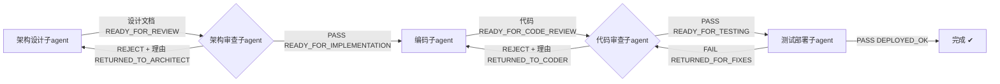

# CRISP Agent 流水线（Agent Pipeline）

> 本文件定义 CRISP 项目的 5 个自定义子 agent 及其协作流水线。
> 存放位置：`.github/agents/`（workspace 级，团队共享）。

## Agent 一览

| Agent | 文件 | 职责 | 产出 | 交接标记 |
|-------|------|------|------|----------|
| 架构设计子agent | `architect.agent.md` | 分析 Qt 架构，设计 CRISP 架构与事件系统（**必须落盘**设计文档到 `docs/`） | 设计文档（`docs/` 下的 markdown） | `READY_FOR_REVIEW` |
| 架构审查子agent | `architecture-reviewer.agent.md` | 审查设计方案合理性，通过/打回 | 审查裁决（PASS/REJECT + 理由） | `READY_FOR_IMPLEMENTATION` / `RETURNED_TO_ARCHITECT` |
| 编码子agent | `coder.agent.md` | 把通过的设计落地为 `.h`/`.cpp` 代码 | `src/`、`tests/` 下的代码文件 | `READY_FOR_CODE_REVIEW` |
| 代码审查子agent | `code-reviewer.agent.md` | 审查代码（规范/正确性/与设计一致性），通过/打回 | 审查裁决（PASS/REJECT + 具体行号理由） | `READY_FOR_TESTING` / `RETURNED_TO_CODER` |
| 测试部署子agent | `tester.agent.md` | 编译、跑单元测试、部署产物、出测试报告 | 测试报告 + 构建产物 | `DEPLOYED_OK` / `RETURNED_FOR_FIXES` |

## 流水线（Pipeline）



## 调用方式（主 agent 编排）

在 Copilot Chat 中给主 agent（默认 agent 或自定义编排 agent）下指令即可，它会按 `description` 自动委派对应的子 agent。例如：

```
请对 src/event/ 增加 [某个新特性]：
1. 先让架构设计子agent出方案；
2. 架构审查子agent审查，不通过就打回重做；
3. 通过后让编码子agent实现；
4. 代码审查子agent审查代码，不通过打回；
5. 最后测试部署子agent编译、跑测试并出报告。
```

## 关键设计决策

- **每个 agent 都是单一职责**：设计不写码、审查不修复、编码不改设计、测试不修代码。
- **审查是门卫**：两个审查 agent 拥有打回权，打回时必须给出**可执行的、可定位的理由**（违反哪条原则 / 文件:行号 / 建议修法），避免空洞的"不够好"。
- **工具最小化**：设计/审查 agent 只读（`read, search`）；**架构设计子agent 例外，需写文档所以是 `read, search, edit`**；编码 agent 可写（`read, search, edit`）；测试 agent 可执行终端（`read, search, execute, todo`）。所有 agent 均未开放 web 工具。
- **`user-invocable: false`**：这些 agent 仅作为子 agent 由主 agent 按需委派，保持聊天面板简洁。
- **agents 字段**：架构审查子agent 只能回调 `architect`；代码审查子agent 只能回调 `coder`——限制打回目标，防止乱跳。

## 维护提示

- 修改任一 agent 后，确认 frontmatter 的 `description` 包含触发关键词（如 "架构设计"、"代码审查"、"编译"），否则主 agent 无法自动发现它。
- 新增子 agent 时遵循模板：单一角色 + 最小工具集 + 明确边界 + 关键词丰富的 description。
