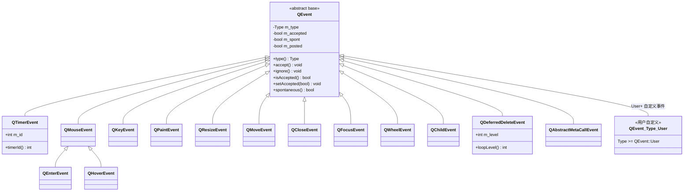
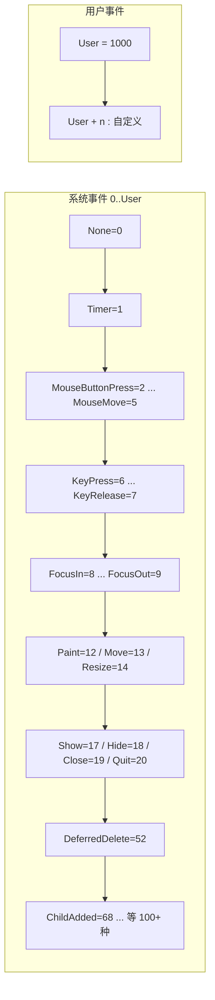
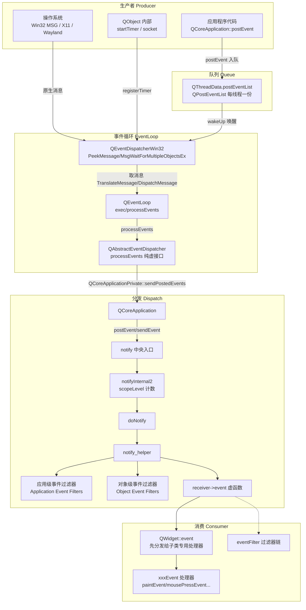
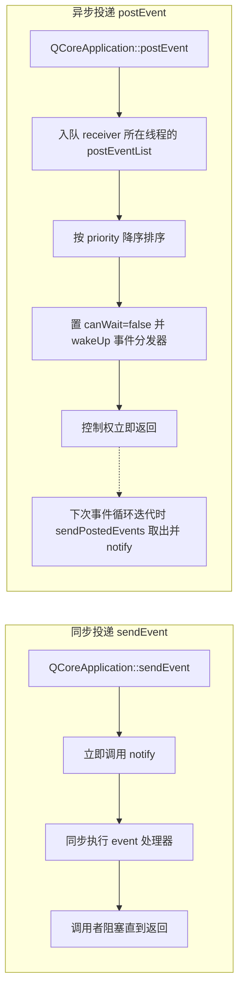
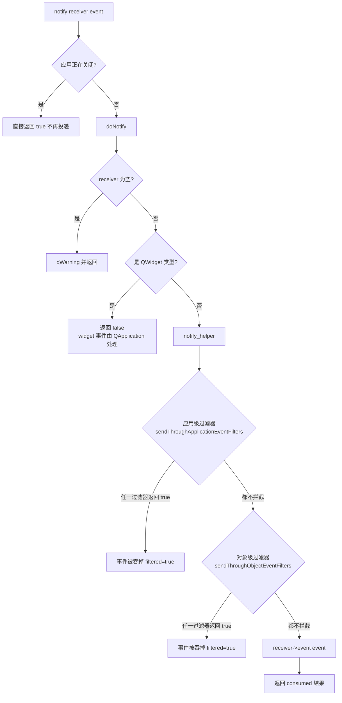
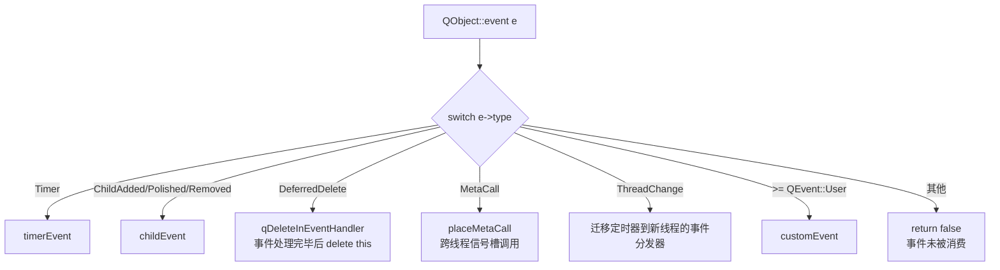
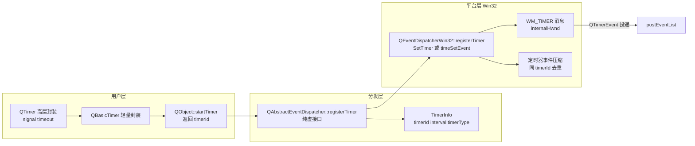
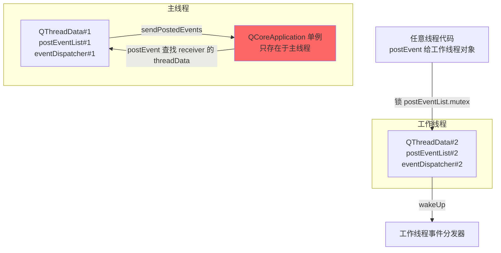
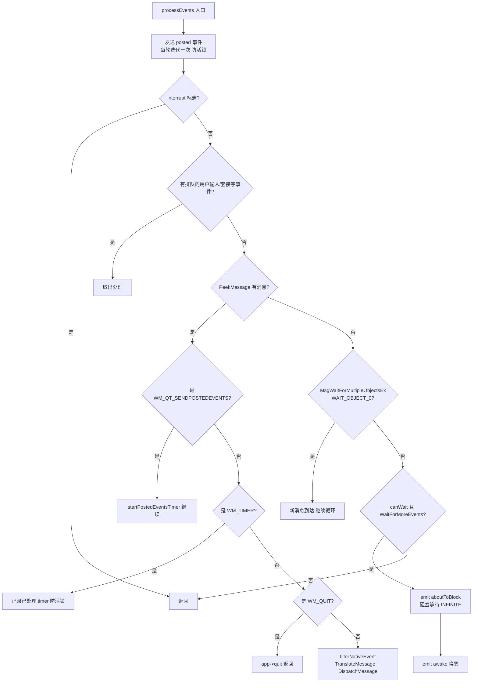

# Qt 事件系统架构解析：QEvent 调用结构、类图与流程图

> 基于本仓库下载的 Qt 6.2.4 源码（`qtbase-everywhere-src-6.2.4/src/corelib/kernel/`）分析。
> 核心文件：`qcoreevent.h/cpp`、`qcoreapplication.cpp`、`qeventloop.h/cpp`、`qabstracteventdispatcher.h/cpp`、`qeventdispatcher_win.cpp`、`qobject.cpp`、`qthread.cpp`。

---

## 1. 总览

Qt 的事件系统是一个**单线程、对象归属（thread-affinity）约束、中央分发（central dispatch）** 的机制。它的设计哲学是：

> 事件（QEvent）是"值型"消息载体，对象（QObject）是接收者，事件循环（QEventLoop + QAbstractEventDispatcher）是驱动源，QCoreApplication::notify() 是唯一的中央分发入口。

核心参与者：

| 角色 | 类 | 职责 |
|------|-----|------|
| 事件本体 | `QEvent` + 数百个子类 | 携带事件类型和负载数据 |
| 接收者 | `QObject` | 提供 `event()`、`eventFilter()`、各 `xxxEvent()` 虚函数 |
| 分发中枢 | `QCoreApplication` | `notify()` / `sendEvent()` / `postEvent()` / `sendPostedEvents()` |
| 事件循环 | `QEventLoop` | `exec()` / `processEvents()` / `exit()` |
| 平台驱动 | `QAbstractEventDispatcher` | `processEvents()` / 定时器 / socket notifier / native 事件过滤 |
| 线程容器 | `QThreadData` | 每线程一份 posted 事件队列（`QPostEventList`） |

---

## 2. 类图

### 2.1 QEvent 类层次（核心部分）

### 2.2 事件类型枚举（QEvent::Type）

**要点**：
- 事件类型是一个 **int 枚举**，而非类型系统的一部分。`QEvent::Type` 是区分事件子类的唯一手段，全部通过 `switch(e->type())` 分发。
- `QEvent::User`（=1000）以上留给应用程序自定义。Qt 自身预留了 `QEvent::MaxUser` 上限。
- 枚举值一旦发布**不可变更**（ABI/源码兼容承诺），新增事件只能往后追加。

### 2.3 事件分发链路（调用结构）

---

## 3. 事件流转的完整流程

### 3.1 事件的两条入口：send 与 post

Qt 提供两类投递方式，语义差异极大：

**关键差异**：
- `sendEvent`：同步、栈上事件、调用者驱动、**跨线程调用是未定义行为（实际会崩溃）**。
- `postEvent`：异步、**堆上事件（队列拥有所有权并负责 delete）**、线程安全（锁 `postEventList.mutex`）、投递后调用者**不得再触碰事件指针**。
- `sendSpontaneousEvent`：标记 `m_spont=true`（来自窗口系统的原生事件），走与 sendEvent 相同的 notify 路径。

### 3.2 notify() 中央分发详细流程

**事件过滤器（Event Filter）优先级规则**（来自源码注释与实现）：
1. 应用级过滤器（`QCoreApplication::installEventFilter`）— 只作用于主线程
2. 对象级过滤器（`QObject::installEventFilter`）— 按安装顺序逆序调用，后装先得
3. `receiver->event()` — 对象自身的总入口
4. QWidget::event 内部再先派发给专用事件处理器（如 `paintEvent`）

任何一级过滤器返回 `true` 即吞掉事件，不再向下传递。

### 3.3 QObject::event() 的分派逻辑

---

## 4. 定时器子系统

定时器是事件系统与平台耦合最深的子系统之一：

**要点**：
- 定时器 ID 由事件分发器分配，`QObject::startTimer` 返回的 int 只是句柄。
- `QTimerEvent` 通过 `postEvent` 异步投递，因此**定时器事件是排队事件**，精度受事件循环负载影响。
- `Qt::PreciseTimer`（Windows 上 `timeSetEvent`）与 `CoarseTimer` 的取舍是平台相关的。

---

## 5. 线程模型与事件队列

**核心规则**：
- 每个线程有独立的 `QThreadData`（posted 队列 + 事件分发器实例）。
- `postEvent` 是**唯一线程安全**的投递方式：它会跟随 receiver 找到其所在线程的队列并加锁。
- `sendEvent`/`notify` 只能投递给**当前线程**的对象（`checkReceiverThread` 断言）。
- `QCoreApplication` 单例只在主线程；应用级过滤器只处理主线程对象的事件。
- 跨线程调用（信号槽 QueuedConnection、`QMetaObject::invokeMethod`）最终都编码为 `QMetaCallEvent` 投递到目标线程队列。

---

## 6. Windows 平台事件循环（QEventDispatcherWin32::processEvents）

**要点**：
- 事件循环本质是 **Win32 消息泵的包装**：`PeekMessage` 非阻塞轮询 + `MsgWaitForMultipleObjectsEx` 阻塞等待。
- `wakeUp()` 通过 `PostMessage(WM_QT_SENDPOSTEDEVENTS)` 跨线程唤醒阻塞中的循环。
- `aboutToBlock` / `awake` 信号供外部（如网络库）挂接。
- 原生事件先过 `filterNativeEvent`（QAbstractNativeEventFilter 链），再翻译分发。
