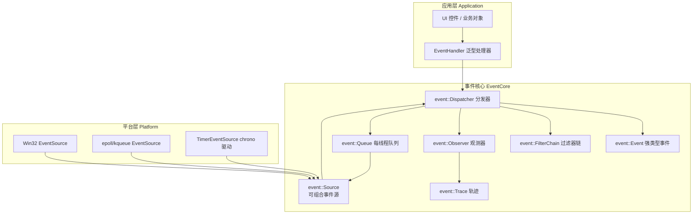
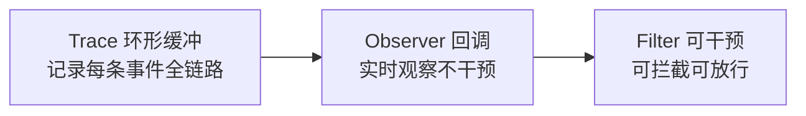
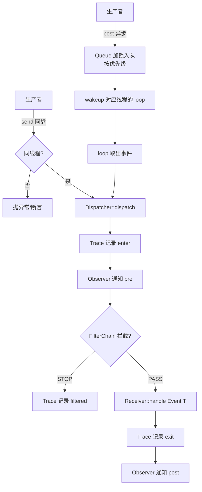

# 事件系统重写方案设计（调研版）

> 目标：设计一个**逐步替代 Qt 模块**的代码库中的**事件系统**——用现代 C++（C++17/20）重写，解决 Qt 事件系统的核心痛点。
> 本文为**调研与方案设计**，不含实现代码。后续再进入原型阶段。

---

## 1. 总体定位与战略

### 1.1 项目战略：逐步替代 Qt

```
┌─────────────────────────────────────────────────────────────┐
│ 你的代码库 (d:\crisp)                                          │
│                                                             │
│  阶段0  引入自有事件系统（本方案）           ← 现在这里        │
│  阶段1  用自有事件系统替换 QtCore 事件层                     │
│  阶段2  替换 QObject / 信号槽                                │
│  阶段3  替换 QtGui / QtWidgets（或自研 UI）                  │
│  ...    逐个模块蚕食，最终脱离 Qt                             │
└─────────────────────────────────────────────────────────────┘
```

**关键决策**：
- **CMake 而非 qmake**：已确定。CMake 是现代 C++ 事实标准，便于依赖管理与 IDE 集成。
- **抛弃 moc**：已确定。不引入 Qt 的元对象编译器，事件系统不依赖任何代码生成。
- **不用 Mock**：已确定。用真实 C++ 实现 + 可注入的测试替身（test double 用接口注入实现，而非 mock 框架）。
- **兼容层**：阶段 1-2 提供 `QObject` 兼容 API（可选），让存量代码平滑迁移。

### 1.2 设计原则

| 原则 | 说明 |
|------|------|
| 类型安全第一 | 事件类型在编译期可校验，杜绝 int 枚举 + static_cast |
| 可观测性内置 | 事件轨迹（trace）是**一等公民**，不是事后打补丁 |
| 所有权明确 | 用 RAII/智能指针表达所有权，杜绝手工 new/delete |
| 线程规则显式 | 跨线程投递是**类型不同**的操作，而非"碰运气" |
| 热路径零堆分配 | 高频事件（鼠标移动、定时器）用值语义/对象池 |
| 无代码生成 | 不用 moc/qmake，纯标准 C++ |

---

## 2. 核心架构设计

### 2.1 分层总览



### 2.2 命名空间与模块划分

```
crisp/event/                    事件系统（纯头文件 + 少量 .cpp）
├── event.hpp                   总入口：Event<T>、EventType、EventTraits
├── dispatcher.hpp              Dispatcher：同步分发核心
├── queue.hpp                   Queue：每线程异步队列 + 优先级
├── loop.hpp                    EventLoop：可组合事件循环
├── source.hpp                  EventSource：平台事件源抽象
├── source_win32.cpp            Win32 实现（GetMessage 等）
├── source_timer.hpp            定时器源（std::chrono 驱动）
├── filter.hpp                  FilterChain：可插拔过滤器
├── observer.hpp                Observer：纯观测（不改变分发结果）
├── trace.hpp                   Trace：事件轨迹记录
├── affinity.hpp                线程归属（thread affinity）标记
└── posting.hpp                 投递 API（send/post 分离）
```

### 2.3 核心概念对比（Qt vs 新方案）

| 概念 | Qt | 新方案 |
|------|----|--------|
| 事件类型 | `QEvent::Type` int 枚举 | `template<typename T> struct Event` + `EventType<T>` constexpr 标签 |
| 事件对象 | `QEvent` 基类 + 子类 + static_cast | `Event<T>` 值语义，负载即 T，`std::visit` 分发 |
| 接收者 | `QObject::event()` 虚函数 | `EventHandler<T>` 可调用对象 / 类型化虚接口 |
| 同步投递 | `QCoreApplication::sendEvent` | `dispatcher.send(obj, Event<MousePress>{...})` |
| 异步投递 | `postEvent(new QMouseEvent...)` | `dispatcher.post(obj, Event<...>{...})`（值语义） |
| 过滤器 | `installEventFilter(QObject*)` | `filter_chain.add(Filter<T>)`，类型化 |
| 观测 | 重写 notify()（互斥） | 多个 `Observer` 可同时挂载，纯只读 |
| 定时器 | `startTimer(int ms)` | `timer_source.schedule(500ms, handler)` |
| 线程模型 | threadData + 断言 | `Affinity` 类型标签 + 编译期/运行期检查 |
| 调试 | 无内置 | `Trace` 环形缓冲，可查询事件全链路 |

---

## 3. 关键设计决策详解

### 3.1 强类型事件（解决痛点 #2 伪类型系统）

**方案：`Event<T>` + constexpr 类型标签 + `std::variant` 分发**

```cpp
namespace crisp::event {

// 1. 事件类型标签：编译期唯一 ID（不再手工编号）
template <typename T>
struct EventType {
    static constexpr std::string_view name = /* 反射/宏生成 */;
    // 用 typeid 或 计数器模板 生成稳定 ID
};

// 2. 事件本体：值语义，负载就是 T
template <typename T>
struct Event {
    using payload_type = T;
    T payload;
    bool accepted = false;
    SourceInfo source;      // 来源：系统/应用/哪个对象
    TimePoint timestamp;    // 便于调试与去重
};

// 3. 接收端类型化分发：std::visit 而非 static_cast
using AnyEvent = std::variant<Event<MousePress>, Event<KeyPress>, Event<Timer>, ...>;

// 4. 用户自定义事件：零样板，天然类型安全
struct MyPayload { int id; std::string data; };
using MyEvent = Event<MyPayload>;   // 无需 registerEventType()
}
```

**收益**：
- 类型错误在**编译期**暴露（`std::visit` 穷尽性检查）。
- 自定义事件零样板、无全局 ID 注册。
- `payload` 是值语义，生命周期由调用栈/容器管理。

### 3.2 可观测性内置（解决痛点 #1 调试困难）

**方案：三层观测机制**



| 机制 | 行为 | 典型用途 |
|------|------|---------|
| `Trace` | 每条事件经过 dispatcher 时记录：来源、类型、过滤器链结果、耗时 | 事后排查"事件去哪了" |
| `Observer` | 纯只读回调，可挂多个，不影响分发结果 | 日志、统计、自动化测试断言 |
| `Filter` | 可拦截（返回 stop）或放行 | 业务拦截、全局快捷键 |

**Trace 记录内容**（解决"事件消失/重复/乱序"）：
```
[t=12.345ms] post   MyEvent{id=7} -> object#42 (thread#1)
[t=12.400ms] filter object#42: AppFilter -> pass
[t=12.401ms] filter object#42: DebugFilter -> STOP  ← 事件被谁吞了一目了然
[t=12.402ms] deliver MyEvent{id=7} -> (cancelled by filter)
```

**关键点**：Trace 用环形缓冲 + 原子计数，默认开启且开销极低；需要完整栈时再开"深模式"。

### 3.3 所有权与生命周期（解决痛点 #3）

**方案：值语义 + 智能指针，杜绝手工管理**

| 场景 | Qt（问题） | 新方案 |
|------|-----------|--------|
| 同步分发 | 栈对象 + 调用者负责 | `Event<T>` 值类型，直接传引用 |
| 异步投递 | `new` 堆对象 + 队列接管（易错） | `post(Event<T>)` 按值入队，内部 `std::deque` 管理 |
| 延迟删除 | `deleteLater()` + DeferredDelete 事件 | `defer_delete(obj)` 由 dispatcher 统一处理 |
| 事件压缩 | 硬编码 if 链 | `EventTraits<T>::compressible` 编译期开关 |

**删除语义**：
- 队列中事件是值，出队即析构，无泄漏无双删。
- 对象删除：`Dispatcher` 持有接收者的 `weak_ptr`/代币（token），对象销毁自动失效，**杜绝悬垂指针**。

### 3.4 线程模型显式化（解决痛点 #5）

**方案：投递 API 按线程语义分型**

```cpp
namespace crisp::event {
// 同步：仅限同一线程（编译期不强制，运行期断言 + 文档明确）
template <typename T> bool send(Receiver&, Event<T>);

// 异步：线程安全，投递到接收者所在线程的队列
template <typename T> void post(Receiver&, Event<T>, Priority = Normal);

// 显式跨线程投递：必须显式调用，语义清晰
template <typename T> void post_to_thread(std::thread::id, Receiver&, Event<T>);
}
```

**线程归属（Affinity）**：
- 每个 `Receiver` 记录所属线程 id（类似 Qt 的 threadData，但简化）。
- `send` 检查归属，不匹配时**抛异常/断言**（release 也可启用）。
- 跨线程只允许 `post`，且队列加锁是唯一的并发点。

### 3.5 事件循环可组合（解决痛点 #6 平台耦合）

**方案：`EventSource` 可组合 + 统一 `EventLoop`**

```cpp
// 任何产生事件的东西都是 EventSource
struct EventSource {
    virtual ~EventSource() = default;
    virtual bool poll(Queue&) = 0;       // 非阻塞取出就绪事件
    virtual void wait(Queue&) = 0;       // 阻塞等待
    virtual void wakeup() = 0;           // 跨线程唤醒
};

// 平台源可以组合
EventLoop loop;
loop.add_source(std::make_unique<Win32EventSource>());   // 窗口消息
loop.add_source(std::make_unique<TimerEventSource>());    // chrono 定时器
loop.add_source(std::make_unique<SocketEventSource>());   // IO
loop.run();  // 轮询所有源，无事件则 wait
```

**收益**：
- 新平台 = 新增一个 `EventSource`，不动核心。
- 定时器用 `std::chrono::steady_clock`，跨平台行为一致。
- 测试时可注入"假源"（如 `ManualEventSource`），无需 mock 框架。

### 3.6 性能设计（解决痛点 #8）

| 手段 | 说明 |
|------|------|
| 事件值语义 | 小事件（< 64B）栈上传递，零堆分配 |
| 大负载用 `unique_ptr` | 明确转移所有权 |
| 过滤器短路 | FilterChain 用 `std::function` + 提前返回，无虚调用链 |
| 队列批量出队 | 一次锁操作处理一批事件 |
| 类型擦除最小化 | 热路径避免 `std::function` 分配（SBO 小对象优化） |

---

## 4. 分发流程图（新方案）



---

## 5. 与 Qt 逐步替代的路线图

### 阶段 0：事件系统独立成型（当前任务）
- [ ] 纯 C++17/20 事件核心：`Event<T>`、`Dispatcher`、`Queue`、`FilterChain`、`Observer`、`Trace`
- [ ] 不依赖 Qt，可独立编译运行（CMake 工程）
- [ ] 单元测试全绿（无 mock 框架，用手写测试替身）

### 阶段 1：替换事件投递层
- [ ] 在你的应用代码里，用新事件系统替代 `QCoreApplication::postEvent/sendEvent`
- [ ] 存量 `QEvent` 通过适配器 `QtEventBridge` 转换（临时）

### 阶段 2：替换 QObject/信号槽
- [ ] 用 `Receiver` + 类型化信号替代 `QObject`
- [ ] 信号槽用 `std::function`/`std::jthread` 等标准库实现，弃用 moc
- [ ] 此时可彻底断掉对 QtCore 的依赖

### 阶段 3：替换 UI 层（可选）
- [ ] 自研/引入轻量 UI 栈，或继续用 QtWidgets 但事件已全部走新系统

### 兼容策略
- 每一阶段保持"双轨运行"：新旧系统通过**桥接层**共存，逐个模块切换。
- 关键验收标准：**同一份业务代码，切换前后行为一致**（事件顺序、过滤语义、线程语义）。

---

## 6. 技术选型汇总

| 关注点 | 选型 | 理由 |
|--------|------|------|
| 构建 | CMake ≥ 3.20 | 现代事实标准，跨平台 |
| 语言 | C++20（至少 C++17） | concepts/variant/chrono/协程 |
| 类型分发 | `std::variant` + `std::visit` | 编译期穷尽检查，替代 switch+cast |
| 时间 | `std::chrono` | 强类型时间，杜绝 int 毫秒 |
| 线程 | `std::thread`/`std::jthread` + 原子 | 标准库即可，无自研线程类 |
| 内存 | `std::unique_ptr`/值语义 | RAII 表达所有权 |
| 异步（可选演进） | C++20 协程 | 后续可让处理器返回 `co_await` |
| 测试 | 手写测试替身 + 断言 | 用户明确要求不用 mock 框架 |
| 反射（如需序列化） | 不引入，用代码生成可选 | 保持零 moc 原则 |

---

## 7. 风险与对策

| 风险 | 对策 |
|------|------|
| 存量 Qt 代码迁移量大 | 桥接层 + 双轨运行，逐模块切换 |
| 值语义事件内存放大 | 小事件 SBO / 大负载 unique_ptr |
| 事件顺序语义与 Qt 不同 | 明确文档化优先级规则，桥接层保持兼容 |
| 协程集成复杂 | 先不做协程，核心稳定后再加 |
| 调试器可视化 | Trace 输出为结构化文本，后续可接 IDE 插件 |

---

## 8. 结论与下一步

**结论**：用 `Event<T>` 值语义 + `std::variant` 分发 + 内置 Trace/Observer + 可组合 EventSource，可以系统性解决 Qt 事件系统的 9 类痛点，且完全符合"CMake、无 moc、无 mock、纯 C++"的约束。

**下一步（原型阶段，待你确认后开始）**：
1. 搭建 `crisp/event/` 骨架 + CMake 工程
2. 实现 `Event<T>` 与 `Dispatcher`（同步路径）
3. 实现 `Queue` + `post`（异步路径）
4. 实现 `FilterChain` / `Observer` / `Trace`
5. 配套单测（手写 test double）
