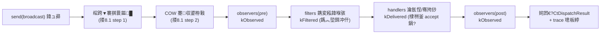

# CRISP 浜嬩欢绯荤粺閲嶈璁★紙涓枃鐗堬級

> **鐘舵€?*锛氭灦鏋勮璁℃枃妗ｏ紙涓嶅惈瀹炵幇浠ｇ爜锛?> **鑼冨洿**锛歚crisp::event` 鈥?CRISP 椤圭洰浜嬩欢瀛愮郴缁?> **宸ュ叿閾?*锛歁inGW-w64 8.1.0锛?2 浣嶏級銆丆++17銆丆Make 鈮?3.20銆佺鐢?`std::filesystem`
> **杈撳叆**锛歚AGENTS.md`銆乣docs/style-guide.md`銆乣docs/event-system/01..03`銆佺幇鏈夊師鍨嬩唬鐮?`src/event/`锛坄ct_event.h`銆乣ct_dispatcher.h`銆乣ct_trace.h`锛夈€佹祴璇?`tests/event/`
> **璁捐鍘熷垯**锛氱被鍨嬪畨鍏ㄧ涓€銆佸彲瑙傛祴鎬у唴缃€佹墍鏈夋潈鏄庣‘銆佺嚎绋嬭鍒欐樉寮忋€佺儹璺緞闆跺爢鍒嗛厤銆佹棤浠ｇ爜鐢熸垚

---

## 淇璁板綍锛圧evision Log锛?
| 鐗堟湰 | 鏃ユ湡 | 鍐呭 |
|------|------|------|
| Rev 1 | 锛堥鐗堬級 | 鍒濆閲嶈璁℃枃妗ｏ紙搂1鈥撀?4锛夈€?|
| Rev 2 | 2026-10-02 | **鏋舵瀯瀹℃煡鎵撳洖鍚庝慨璁?*锛氫慨澶?6 涓?P1 缂栬瘧绾х煕鐩句笌 6 涓?P2 瀹屾暣鎬ч棶棰橈紱搂14 寮€鏀鹃棶棰?#3/#7 缁欏嚭瑁佸畾銆傞€愭潯瑙佷笅銆?|
| **Rev 3** | 2026-10-02 | **鏋舵瀯瀹℃煡 Rev 2 鎵撳洖锛圢1鈥揘4锛夊悗淇**锛氫慨澶?2 涓?P1锛堢嚎绋嬭繚渚嬨€? 涓紪璇戠骇闂锛変笌 2 涓?P2锛圡2 瀹屾暣鎬х己鍙ｏ級锛屽苟钀藉疄缂栬緫灞傚洖鍐欍€傞€愭潯瑙佷笅銆?|
| Rev 4 | 2026-10-02 | **鏋舵瀯瀹℃煡 Rev 3 鎵撳洖锛圥1-1鈥1-7 / P2-8鈥2-12 / P3锛夊悗淇**锛氫慨澶?7 涓?P1锛圢1 娈嬬暀鏃ц涔夊叏鏂囨敼鍐欍€乸ush 绛惧悕銆乫riend 娓呭崟銆侀槦鍒楁垚鍛樼紪璇戠骇銆佸洓涓己澶卞畾涔夈€乸ost 璺敱銆侀敊璇枃浠跺懡鍚嶏級銆? 涓?P2锛坕nclude/褰掑睘/缂栬緫灞傚洖鍐?骞冲彴瑁佸畾/鏌ユ壘绛栫暐锛変笌 3 椤?P3 娓呯悊銆傞€愭潯瑙佷笅銆?|
| **Rev 5** | 2026-10-02 | **鏋舵瀯瀹℃煡 Rev 4 鎵撳洖锛圥1-1鈥1-6 / P2-1鈥2-6 / P3锛夊悗淇**锛氶噸瀹氱被鍨嬫摝闄よ竟鐣岋紙`front/popFront` 寮曠敤璇箟鏇夸唬涓嶅彲瑕嗗啓鐨?`optional<鎶借薄鍩虹被> pop`锛夈€佽ˉ `CtQueue::pushAny` 瑕嗗啓銆乣CtDispatcherBase` 琛?`friend class CtEventLoop`銆佽В闄?`ct_receiver.h`鈫擿ct_dispatcher.h` 寰幆 include锛堝墠缃０鏄庯級銆佽ˉ `ct_event_loop.h`/`ct_event_source.h` 缂哄け include銆乣CtEvent` 琛?`setSequence/setPriority`锛坒riend `CtDispatcherBase`/`CtQueue`锛夈€乣CtEventLoop` 闃熷垪鎯版€у垱寤?+ 璺敱娉ㄩ攢濂戠害銆乣CtHandlerToken` 搂6.4鈫斅?.7 鍚屾銆丳3 涓夐」钀芥鏂囥€傞€愭潯瑙佷笅銆?|
| **Rev 6** | 2026-10-02 | **鏋舵瀯瀹℃煡 Rev 5 鎵撳洖锛圢-1鈥-13锛夊悗淇**锛氫慨澶?2 涓?M1 闃诲 P1锛坄ct_receiver.h` 琛?`ct_handler_token.h` include锛沗ct_dispatcher.h` 琛?`CtPendingEventBase` 鍓嶇疆澹版槑锛夈€? 涓?M2 P1锛堟摝闄よ竟鐣屾媶涓?闈炴ā鏉?`CtAnyEventBase` 鎺ュ彛 + 妯℃澘 `CtAnyEventHolder` 鎸佹湁鑰?銆侀槦鍒椾紭鍏堢骇缁熶竴涓轰簨浠?`uint64_t` 鎻愮ず銆佹帓绌轰吉鐮佷慨骞挎挱绌?weak_ptr 涓㈠純 bug銆乸ost 缁忔摝闄よ竟鐣屽叆闃?+ 璺?EventSet 鏂█/drop锛夈€? 涓?M1 缂栬瘧 P2锛坄CtEvent` 鏋勯€犻噸杞?`enable_if` 娑堟锛変笌 5 椤?P3锛坄CtPendingEventBase` 鎺緸/`kDropped` 璁板綍鐐?`~CtHandlerToken noexcept`/`m_inDispatch` 鏉′欢缂栬瘧/`ct_dispatcher.h` 鏄惧紡 include affinity锛夈€傞€愭潯瑙佷笅銆?|
| **Rev 7** | 2026-10-02 | **鏋舵瀯瀹℃煡 Rev 6 鎵撳洖锛圥1-1鈥1-3 / P2-1鈥2-4锛夊悗淇**锛歚isBroadcast()` 鏀规瀯閫犳椂鍥哄寲骞挎挱鏍囧織锛坄CtPendingEvent` ctor 鐢?`owner_before` 鍒ょ┖锛岄潪娲荤殑 `expired()` 妫€鏌ワ級锛沗CtDispatchTables` 绉诲叆 `crisp::event::detail`锛堜笌 搂7.8 `detail::` 寮曠敤涓€鑷达級锛沗m_inDispatch` 鏉′欢缂栬瘧涓ゅ垎鏀湡姝ｄ笉鍚岋紙NDEBUG = 绌烘垚鍛橈級锛沗CtEvent::setPriority` 鏀?public锛沗CtAnyEventHolder` 琛ラ潪 const `value()`锛坢ove 璁块棶鍣級锛沗CtDispatcherBase` 琛?`m_tokenStates` 寮卞紩鐢ㄩ泦鍚堟垚鍛橈紙鏋愭瀯缈昏浆 alive 鐨勮惤鐐癸級锛沗CtEvent` 鏋勯€?`enable_if` 鏉′欢鎵╀负"棣栧弬涓?origin 鍗虫帓闄?銆傞€愭潯瑙佷笅銆?|
| **Rev 8** | 2026-10-02 | **鏋舵瀯瀹℃煡 Rev 7 鎵撳洖锛圥1-1鈥1-5 / P2-1鈥2-8锛夊悗淇**锛歚CtEvent` 琛?`template <typename> friend class CtDispatcher;`锛堝弸鍏冧笉缁ф壙锛宻end/broadcast 鎵嶈兘璋?setSequence锛夛紱`isBroadcast` 鍒ょ┖鏂瑰悜淇锛坄!绌?owner_before(target)`锛夛紱`CtTracePhase` 绉诲叆 `ct_event.h` 瑙ｅ惊鐜?include锛坈tx鈫攖race 鏃犵幆锛夛紱`ct_handler_token.h` 琛?`CtDispatcherBase` 鍓嶇疆澹版槑锛沗CtDispatcher` 琛?`dispatchAny` override 澹版槑锛堢被涓嶅啀鎶借薄锛夛紱琛?`ErasedHandler/Filter/Observer` 绮剧‘瀹氫箟锛沗ct_dispatcher.h` 琛?`<unordered_map>`锛沗kDropped` 璁板綍鐐圭粺涓€锛堟帓绌轰笉璺宠繃 dispatchAny锛屽唴閮ㄨ锛夛紱`CtAnyEventHolder` 琛?`eventSetId()`锛堥噸鍙犻泦鍚堣法 EventSet 妫€娴嬶級锛沗setDispatcher` 闃熷垪鍒涘缓鏃舵満缁熶竴 + 绾跨▼绾︽潫锛沗CtPendingEvent` ctor 琛?`sequence` 鍙傛暟锛沠riend 娉ㄩ噴鏀瑰啓銆傞€愭潯瑙佷笅銆?|
| **Rev 9** | 2026-10-02 | **鏋舵瀯瀹℃煡 Rev 8 鎵撳洖锛圥1-1鈥1-4 / P2-1鈥2-4 + P3锛夊悗淇**锛氭摝闄ゅ洖璋冪鍚嶅榻?搂5.2锛坄ErasedObserver` 鎼哄甫 `const CtDispatchContext&`銆乣ErasedHandler/Filter` 鐢ㄩ潪 const `void*`锛夛紱`CtHandlerToken` 琛?`template friend CtDispatcher`锛堝弸鍏冧笉缁ф壙锛夛紱搂8.2 骞挎挱鏉＄洰鍒ょ┖璋冪敤锛堢┖ = 璋冪敤锛岄潪绌哄凡浜?= 璺宠繃锛夛紱M1 `dispatchAny` 涓嶅彲杈?stub 瀹氫箟 + M2 鐪熷疄瀹氫箟钀界偣锛坉ispatcher include queue锛屾棤鐜級锛涘紓姝?sequence 鍗曚竴浜嬪疄鏉ユ簮锛坧ush 渚?stamp 鍏ラ槦搴忥級锛沗CtEventLoop` 琛?`attachSource/detachSource` + 婧愬鍣?+ 娉ㄥ叆璺緞锛堟ā鏉挎ˉ锛夛紱搂5.3 鍚屾 `CtTracePhase` 钀界偣锛沗setDispatcher` 纭绾︼紙鍚?EventSet 浠呬竴娆★級+ `CtPendingEventBase::eventSetId()` 鎺掔┖渚у弻閲嶆柇瑷€锛涜法 EventSet 涓㈠純褰掑洜锛堝苟鍏?`m_dropped`锛夛紱P3 娓呯悊锛埪?4 鎺緸銆乺ecord 绛惧悕銆乸ush 鎺緸銆乸ushAny 搴忓垪鏉ユ簮锛夈€傞€愭潯瑙佷笅銆?|
| **Rev 10** | 2026-10-02 | **鏋舵瀯瀹℃煡 Rev 9 鎵撳洖锛圥1-1 / P2-1鈥2-4 + P3锛夊悗淇**锛歚dispatchAny` 寮傛渚嬪锛堟帓绌轰笉閲嶈祴鍊?sequence銆佷繚鐣?accepted 澶嶄綅 + kDispatched 璁板叆闃熷簭锛夛紱`CtQueue` 琛?`m_seqCounter`锛堝叆闃熷簭鍗曚竴浜嬪疄鏉ユ簮锛宲ush/pushAny 鎸侀攣 stamp锛? `m_trace` 鎴愬憳锛坒ront/popDropped 璁板綍钀界偣锛夛紱`CtQueueBase` 琛?`eventSetId()` 绾櫄锛坕njectEvent 涓嬭浆鍨嬪墠鏍￠獙锛夛紱`injectEvent` 琛ヨ繘 搂7.11 绫诲畾涔変笖鍐欏叏 `template <typename EventSet, typename T>`锛沗CtDispatcher` 鏄惧紡 shared_ptr 鎵€鏈夋潈澹版槑锛坢ake_shared 鍞竴璺緞锛夛紱`setDispatcher` 琛?`dispatcher->assertSameThread()`锛坉ispatcher 涓?loop 鍚岀嚎绋嬶級锛浡?.6/搂7.9 record 鍙傛暟褰㈠紡缁熶竴锛堟寜鍊硷級锛浡?.3 琛?`CtHandlerPriority`/`CtPendingEventBase` 琛岋紱寮傛 trace typeName 鐢ㄦ暟鍊?payloadTypeKey锛圡4 鍙ˉ typeName()锛夈€傞€愭潯瑙佷笅銆?|
| **Rev 11** | 2026-10-02 | **鏋舵瀯瀹℃煡 Rev 10 鎵撳洖锛圥1-A / P2-A + P3锛夊悗淇**锛歚pushAny` 鐨?sequence 鏉ユ簮缁熶竴涓?`m_seqCounter`锛?*涓嶅彇 variant 鍐呮棫鍊?*鈥斺€斿彂閫佹柟 CtEvent 鐨?sequence 鍙兘涓?0 鎴栧悓姝ュ彿锛夛紝priority 浠?variant 璇伙紙**鍒犻櫎 pushAny 鐨?priority 鍙傛暟**閬垮厤鍙屾潈濞侊紝`CtQueueBase`/`CtQueue` 绛惧悕鍚屾锛夛紱婧愭敞鍏ュ畾**鏂规 A锛堟簮妯℃澘鍖栵級涓洪閫?*锛堥潪妯℃澘婧愬湪鍙寔 `CtQueueBase&` 褰㈡€佹棤娉ㄥ叆閫氶亾锛夛紝`injectEvent` 闄嶇骇涓哄簲鐢?妗ユ帴灞傛墜宸ユ敞鍏ラ€氶亾锛堟湁鍚堟硶璋冪敤鑰咃級锛浡?.11 濂戠害 #2 kDropped **涓夊彞鍒嗗伐**锛坘Queued鈫抐ront 璁伴槦鍒?trace銆佹孩鍑?kDropped鈫抪opDropped 璁伴槦鍒?trace銆佺洰鏍囧凡浜?kDropped鈫抎ispatchAny 璁?dispatcher trace锛夛紱寮傛 trace typeName 钀界偣瀹氭锛坄record()` 浼犲崰浣?`"<async>"`锛孧4 琛?typeName() 鏇挎崲锛夛紱搂8.2 Step 3 琛ュ紓姝ヤ緥澶栵紙缁ф壙 搂8.1 Step 3锛夛紱`ct_queue.h` include 娓呯悊锛堢Щ闄?ct_handler_token.h鈥斺€攑riority 鏄?uint64_t锛夈€傞€愭潯瑙佷笅銆?|
| **Rev 12** | 2026-10-02 | **鏋舵瀯瀹℃煡 Rev 11 鎵撳洖锛圥1-1 / P1-2 / P2-1鈥2-3 + P3锛夊悗淇**锛歚send` 鏀?*鍙屽綊灞炴柇瑷€**锛坮eceiver 褰掑睘 鈭?dispatcher 褰掑睘锛屄?.1 Step 1/搂10.2 瑙勫垯 #1/褰掑睘琛ㄥ悓姝モ€斺€攄ispatcher `m_trace` 涓ユ牸鍗曠嚎绋嬶紝闃茶法绾跨▼鍐?data race锛夛紱`CtDispatcherBase` 琛?**`m_nextSequence`** 鎴愬憳锛堝悓姝?sequence 璁℃暟鍣ㄨ惤鐐癸紝搂7.8/搂8.1/搂8.2/搂7.10 濂戠害 #9锛夛紱`unbindAll` 鏂规 a 瀹氱锛坮eceiver 琛?`m_dispatchers` 寮卞紩鐢ㄥ垪琛?+ 鍓嶇疆澹版槑 `CtDispatcherBase` + `<vector>`锛屄?.5/搂9.1 濂戠害 #4锛夛紱`payloadPtr()` 鏀?*闈?const `void*`**锛堜袱澶勫熀绫?+ holder + CtPendingEvent override锛屄?.5/搂7.10锛夛紱`injectEvent` 娉ㄩ噴鏀瑰啓锛堝簲鐢?妗ユ帴灞傛墜宸ユ敞鍏ラ€氶亾锛屄?.11锛夛紱妯℃澘鍖栨簮绛惧悕瀹氱锛坄CtTimerEventSource<EventSet>`锛屄?.12 濂戠害 #4锛夛紱EventSet 韬唤閿敞鏄庣‘璁わ紙`CtTypeKey<EventSet>::value()`锛屄?.4 濂戠害 #6锛夛紱`dispatchAny` 娉ㄩ噴淇锛圫tep 2 + 4-8 + Step 3 accepted 澶嶄綅锛夛紱鎺掔┖寮傚父璺緞瀹氫箟锛坉ispatchAny 鎶涘紓甯糕啋闃熷ご淇濈暀銆侀噸澶?kQueued 鍙帴鍙楋級锛沗record` objectId 鍐椾綑娉ㄦ槑锛坈tx.receiverId() 涓虹湡鐩革級銆傞€愭潯瑙佷笅銆?|
| **Rev 13锛堟湰杞級** | 2026-10-02 | **鏋舵瀯瀹℃煡 Rev 12 鎵撳洖锛圥1-1 / P2-A / P2-B + P3锛夊悗淇**锛歚payloadPtr()` **5 澶勫幓鎺夋垚鍛樺嚱鏁?`const` 闄愬畾绗?*锛坄virtual void* payloadPtr() noexcept`锛宱verride 鍚屾鈥斺€攃onst 鎴愬憳鍑芥暟鍐?`&m_value` 杞潪 const `void*` 涓㈠純 const 鏄紪璇戦敊璇級锛沗CtDispatcherBase` 琛?**`unregisterReceiver(uint64_t receiverObjectId)`**锛坧rotected + **`friend class CtReceiver;`**鈥斺€攗nbindAll 閬嶅巻 `m_dispatchers` 閫愪釜璋冪敤锛孋OW 鎵归噺娉ㄩ攢锛夛紱`CtEventSource` 琛?**protected `setAffinityThread(CtThreadId)` + `friend class CtEventLoop;`**锛坅ttachSource 鍐欏叆閫氶亾锛夛紱搂8.1/搂8.2 Step 3 鏄惧紡 **`++m_nextSequence`**锛沗CtHandlerToken` move 璧嬪€奸拤姝伙紙鐩爣鍏堟敞閿€鏃ф敞鍐屽啀鎺ョ锛夛紱婧㈠嚭涓㈠純绛栫暐瑁佸畾锛?*涓㈤槦灏?*鈥斺€斾紭鍏堢骇鏈夊簭 deque 涓?鏈€鏃?鏃犵簿纭惤鐐癸級锛沗dispatchAny` 瀹氬悜/骞挎挱鍒嗘敮鏄惧紡锛埪?.8锛夈€傞€愭潯瑙佷笅銆?|

**Rev 2 淇瑕佺偣锛堝搴斿鏌ユ姤鍛婏級**锛?
- **P1-1**锛歚CtQueue::pop` 鏀逛负杩斿洖 `std::optional<any_event>`锛堣瀹氭柟妗?(a)锛夛紱`CtEvent() = delete` 淇濇寔锛涘悓姝?搂7.10/搂7.11/搂13.3 鐨勭鍚嶄笌鐢ㄤ緥銆?- **P1-2**锛歚CtDispatchContext` 鏀逛负**绉佹湁榛樿鏋勯€?+ friend**锛坄CtTrace` / `CtDispatcherBase` / `CtDispatcher<EventSet>`锛夛紱"搴旂敤涓嶅彲浼€?涓嶅彉锛浡?.9 鐨?`CtTraceRecord` aggregate 鏁扮粍鐢辨鍙銆?- **P1-3**锛歚CtDispatcherBase::m_tables` 鏀逛负**鏅€?* `std::shared_ptr<const CtDispatchTables>` + `std::atomic_load/std::atomic_store`锛浡?.5/搂7.8/搂11.1 缁熶竴锛?M4 鎹?C++20 `std::atomic<shared_ptr>`"鐨勮娉曚繚鐣欍€?- **P1-4**锛歚CtTrace` 濂戠害鏀剁揣涓?**褰掑睘鍐欒€呯嚎绋嬬嫭鍗犺鍐?*"锛坮ecord/dump/clear 鍧囧綊灞炵嚎绋嬶級+ 鏄庣‘ release/acquire 鍐呭瓨搴忥紙P2-11 涓€骞惰惤鍦帮級锛涘垹闄ゆ棤閿佽浇浣撶殑 "dump: locks" 琛ㄨ堪銆?- **P1-5**锛歚CtReceiver::bindHandler` 澧炲姞 dispatcher 鍙傛暟骞?*濮旀墭** `CtDispatcher::addHandler`锛堝苟瀛樸€佺鍚嶅悓姝ャ€佽亴璐ｅ垝鍒嗘槑纭級銆?- **P1-6**锛歚CtReceiver` 涓?`CtDispatcherBase` 鏂板 `isOnThread()` / `assertSameThread()`锛堝唴宓?`CtThreadAffinity`锛夛紱搂8.1/搂8.2 瀵归綈銆?- **P2-7**锛氬瀹炲０鏄?C++17 `std::atomic_load(shared_ptr)` 鍦?libstdc++/MSVC 鍐呴儴鍚勬湁閿佲€斺€擟OW 璇诲叆鍙ｉ潪缁濆闆堕攣锛堜綆绔炰簤銆侀潪鍐欒矾寰勪簰鏂ワ級锛汳4 鎹?C++20 鎴栬嚜鐮斿師瀛愭寚閽堝疄鐜扮湡闆堕攣锛埪?.5/搂7.8/搂11.1/搂11.2锛夈€?- **P2-8**锛毬?.3 鏄惧紡澹版槑淇濈暀 `accepted`锛堝叕鏈夋垚鍛橈級涓?`accept()/ignore()`锛涙緞娓?涓嶅彲鍙?濂戠害杈圭晫 = **杞借嵎涓嶅彲鍙樸€佸垎鍙戞湡 accepted 鍙彉**銆?- **P2-9**锛毬?.2 琛ュ叏 `CtHandler<T>` / `CtFilter<T>` / `CtObserver<T>` 瀹屾暣瀹氫箟锛浡?.8 `addObserver` 绛惧悕鏀瑰洖 `CtObserver<T>`銆?- **P2-10**锛歚CtTokenState::owner` 鐢?`void*` 鏀逛负 `std::weak_ptr<CtDispatcherBase>`锛沝ispatcher 鏋愭瀯缈昏浆 `alive` 涓?token 娉ㄩ攢渚嬬▼**鎸佸悓涓€ `m_writeMutex`**锛堥攣鍐呭弻妫€锛夛紝鍏抽棴"token 璇诲埌 alive=true 鈫?dispatcher 鏋愭瀯涓?鈫?owner 鎮瀭"绔炴€佺獥鍙ｏ紱`CtDispatcherBase` 缁ф壙 `enable_shared_from_this`銆?- **P2-11**锛歚CtTrace::m_head`锛堝啓 release / 璇?acquire锛夈€乣m_count`锛坰eq_cst锛夊唴瀛樺簭鏄庣‘澹版槑銆?- **P2-12**锛毬?0.4 鍋忓樊娓呭崟琛?4 椤癸細`defer_delete`锛堟帹杩?M3/M4锛夈€乣EventTraits<T>::compressible`锛堝惁鍐筹級銆佸ぇ璐熻浇 `unique_ptr`锛堢粏鍖栵級銆乣post(..., Priority)`锛堥噰绾充絾鎹綅缃负浜嬩欢灞炴€э級銆?- **搂14**锛?1 鍏抽棴锛堝亸宸竻鍗曞凡琛ュ叏锛夛紱#3 瑁佸畾 **M1 钀藉疄 `m_inDispatch` debug 娣卞害鎶ゆ爮**锛?7 瑁佸畾 **骞冲彴 API**锛圵indows `GetCurrentThreadId`锛夛紱#2/#4/#5/#6/#8 鏍囨敞 M2/M4 鍓嶈瀹氥€佹湭瀹氬墠鎸夊師鍊惧悜鎵ц銆?
| **Rev 14（审计修复）** | 2026-10-11 | **cpp-review-rules 代码审计（REJECT）后修复**：MUST-1 CtQueueBase::popFront() 改**按身份删除** popFront(CtPendingEventBase* which)（front/dispatch/pop 之间跨线程 push 前插不再误删新事件、避免二次分发——§7.10 契约 #3 措辞同步）；MUST-2 CtEventLoop::exec() 补 !m_queue 空指针保护（未 setDispatcher 时断言 + 返回 0，不再 UB）；WARN 修复：
unObservers 的 m_handlerCount 改为该事件类型实际 handler 数、
unFilters 去 const_cast（非 const 参数）、ddHandler/Filter/Observer token state 先于 publish（防 bad_alloc 孤儿注册）、分发各步骤补 m_elapsed 打点、溢出丢弃注释与文档措辞统一（同级丢弃 seq 最大/最新）、CtTrace::sequence() 返回 m_writeSequence、8 个源码文件去 BOM 转 LF、(void) cast 改 [[maybe_unused]]、reentry release-only 测试 Debug 下跳过；SUGGEST 采纳：CtEvent move 条件 noexcept、qt_sink.cpp 裸 new 改 make_unique。逐条见正文。 |
**Rev 3 淇瑕佺偣锛堝搴斿鏌ユ姤鍛?N1鈥揘4锛?*锛?
- **N1锛圥1锛岀嚎绋嬭繚渚嬶級**锛歚CtTrace` 涓ユ牸鍗曠嚎绋嬶紙搂7.9 濂戠害 #1锛変笌寮傛鐩镐綅璁板綍鐐癸紙push/post 渚ц `kQueued`銆乸op 渚ц `kDropped`/`kDispatched`锛夌煕鐩锯€斺€攑ush/post 鍙繍琛屼簬浠绘剰绾跨▼锛岃Е纰板綊灞炵嚎绋嬬嫭鍗犵殑 trace 鍗?data race銆?*瑁佸畾鏂规 (a)**锛氬紓姝ョ浉浣嶅叏閮ㄦ敼鐢?*褰掑睘绾跨▼**鍦ㄦ帓绌?婧㈠嚭澶勭悊鏃惰褰曘€傚叿浣擄細`CtQueue::push` **涓嶈 trace**锛堣繑鍥?bool 琛ㄧず鍙楃悊锛夛紱`CtQueue::pop` 涓嶈 trace锛沗CtEventLoop` 鍦ㄦ帓绌哄惊鐜唴璁?`kQueued/kDropped`锛坄kDropped` 缁?`popDropped()` 鎶ュ憡銆乣kQueued` 缁?`CtQueue::trace()` 鑾峰彇鍚堟硶鏋勯€?ctx 鐨?friend 閫氶亾璁板綍锛夛紱`post/postTo` 渚у彧璁伴敊璇笉璁扮浉浣嶃€偮?.8 濂戠害 #8銆伮?.9 鐩镐綅娉ㄩ噴銆伮?.10 濂戠害 #6銆伮?.11 濂戠害 #2銆伮?0.1 濂戠害 #3/#4銆伮?3.3 鐢ㄤ緥 #3 鍏ㄩ儴鍚屾銆?- **N2锛圥1锛岀紪璇戠骇锛?*锛毬?.8 `addObserver` 绛惧悕涓殑 `CtObserver<T, CtDispatchContext>` 浼犱袱涓ā鏉垮疄鍙備笉鍙紪璇戯紝涓斾笌 搂5.2銆伮?.8 濂戠害 #7 鐭涚浘銆?*淇**锛氭敼鍥?`CtObserver<T>`锛? `std::function<void(const CtEvent<T>&, const CtDispatchContext&)>`锛夛紱grep 鏍稿疄鍏ㄦ枃鏃犱袱鍙傛畫鐣欍€?- **N3锛圥1锛岀紪璇戠骇锛?*锛歚CtHandlerToken::~CtHandlerToken` 璋?`owner->unregisterHandler(id)`锛屼絾 `unregisterHandler` 鍦?`CtDispatcherBase` 鏄?protected銆?*淇**锛歚CtDispatcherBase` 澹版槑 `friend class CtHandlerToken;`锛堝畬鏁?friend 娓呭崟瑙?搂7.8锛夈€?- **N4锛圥2锛孧2 瀹屾暣鎬х己鍙ｏ級**锛歚CtPendingEvent<EventSet>` 鍙０鏄庢湭瀹氫箟銆侀槦鍒楀瓨鍌ㄤ笉鎼哄甫鐩爣 receiver銆乣dispatchAny` 鏈０鏄庛€乣CtQueueBase` 鎺ュ彛鏈畾涔夈€?*瑁佸畾鏂规 (A)锛岄儴鍒嗛檷绾?*锛氱珛鍗冲畾姝?`CtPendingEvent<EventSet>`锛堟惡甯?`weak_ptr<CtReceiver>` 鐩爣 + `CtAnyEvent` 杞借嵎 + priority/sequence锛変笌 `CtDispatcherBase::dispatchAny`锛堝唴閮ㄦ寜鍙樹綋鍒嗘淳銆侀敭鍖归厤鏂█鍚庤皟鐢ㄦ摝闄?lambda锛夛紱`CtQueueBase` 绫诲瀷鎿﹂櫎鎺ュ彛**瀹氫箟瀹屾暣**锛坄push/pop/popDropped/size/trace/pendingEvent` 绛夛級锛宍CtEventLoop` 鏀规寔 `std::unique_ptr<CtQueueBase>`锛堥伩鍏嶆寜鍊煎熀绫诲垏鐗囦笌妯℃澘渚濊禆锛夛紝`CtEventSource::poll` 淇濈暀 `CtQueueBase&`銆偮?.3銆伮?.8銆伮?.10銆伮?.11銆伮?.12銆伮?0.1銆伮?2.2銆伮?3.3 鍚屾銆?- **缂栬緫灞傚洖鍐?*锛氣憼 搂8.1 Step 3 琛?灏?`event.accepted` 澶嶄綅涓?`false`"锛涒憽 搂7.8 `CtDispatcherBase` 鎴愬憳娓呭崟琛?`m_inDispatch`锛堜笌 搂9.2 濂戠害 #3 瀵归綈锛夛紱鈶?搂7.14 濂戠害 #1 鏄庣‘ `currentThreadId()` 鐢ㄥ钩鍙?API锛圵indows `GetCurrentThreadId`锛孧inGW 涓嬬ǔ瀹氾紱璺ㄥ钩鍙扮暀鎺ュ彛鎶借薄锛夛紝搂14 #1 鏍囪宸插叧闂€?3/#7 鍥炲啓姝ｆ枃銆?- **搂14**锛?1 **鍏抽棴**锛堢紪杈戝眰鍥炲啓 搂10.4/搂7.14锛夛紱#3 **宸茶瀹氬苟鍥炲啓**锛埪?.8 `m_inDispatch`銆伮?.2 濂戠害 #3锛夛紱#7 **宸茶瀹氬苟鍥炲啓**锛埪?.14 骞冲彴 API锛夛紱#2/#4/#5/#6/#8 鐘舵€佷笉鍙樸€?
**Rev 4 淇瑕佺偣锛堝搴斿鏌ヨ鍐?P1-1鈥1-7 / P2-8鈥2-12 / P3锛?*锛?
- **P1-1锛圢1 娈嬬暀鏃ц涔夛紝鍏ㄦ枃鏀瑰啓锛?*锛歱ush/post 渚ц `kQueued`/`kDropped`銆乸op 渚ц `kDispatched` 鐨勪竴鍒囨畫鐣欒〃杩板叏閮ㄦ敼鍐欎负瑁佸畾鏂规 (a)锛?*push/pop 涓€寰嬩笉璁?trace**锛沗kQueued`/`kDropped` 鍏ㄩ儴鐢?*褰掑睘绾跨▼**鍦ㄦ帓绌?婧㈠嚭澶勭悊鏃惰褰曪紙`CtEventLoop` 鎺掔┖寰幆缁?`popDropped()`/`trace()` friend 閫氶亾锛夛紱M1 鍗犱綅鏄庣‘"**涓嶈浠讳綍鐩镐綅**"銆傚悓姝ョ偣锛毬?.8 濂戠害 #8銆伮?.9 鐩镐綅娉ㄩ噴銆伮?.10 濂戠害 #6锛坄push` 鍙閿欒涓嶈鐩镐綅锛夈€伮?.11 濂戠害 #2銆伮?0.1 濂戠害 #3/#4锛?4 鐨?璁?kQueued 鍗犱綅鐩镐綅"鍒犻櫎鈥斺€斅?.8 濂戠害 #8 鑳滃嚭锛夈€伮?3.3 鐢ㄤ緥 #3銆俙CtEventLoop` 鎺掔┖浼爜鏇存柊涓?`while (auto pe = q.pop()) { dispatcher->dispatchAny(*pe); }`銆?- **P1-2锛坧ush 绛惧悕锛?*锛歚CtQueue::push` 绛惧悕鏀?`bool push(CtEvent<T>&& event);`鈥斺€斿彈鐞嗚繑鍥?`true`銆佹孩鍑鸿繑鍥?`false`锛沗post` 鎹杩斿洖 `kHandled`/`kUnhandled`銆備慨璁㈣褰曚腑"N1 瑁佸畾 push 杩斿洖 bool"鐨勫０鏄庝笌姝ｆ枃锛埪?.10 绛惧悕涓庡绾?#6銆伮?0.1 濂戠害 #3锛夌粺涓€涓?`bool`銆?- **P1-3锛坒riend 娓呭崟涓夋柟鐭涚浘锛?*锛氬紓姝ョ浉浣嶇敱 `CtQueue` 鐨?`popDropped()/trace()` 閫氶亾鍦?*褰掑睘绾跨▼**璁板綍鈥斺€擿CtQueue<EventSet>` 宸叉槸 friend锛?*涓嶅啀鏂板 `CtEventLoop` friend**銆俙CtDispatchContext` friend 娓呭崟缁熶竴涓?**4 涓?*锛歚CtTrace`銆乣CtDispatcherBase`銆乣CtDispatcher<EventSet>`銆乣CtQueue<EventSet>`锛浡?.6 濂戠害 #6 鏂囧瓧鍚屾锛堝垹闄?`CtEventLoop`锛夈€?- **P1-4锛堥槦鍒楁垚鍛樼紪璇戠骇锛?*锛歚CtEventLoop` 鐨?`CtQueueBase m_queue;`锛堟娊璞″熀绫绘寜鍊兼垚鍛樺繀鍒囩墖/涓嶅彲缂栬瘧锛夋敼 **`std::unique_ptr<CtQueueBase> m_queue;`**锛涙瀯閫犲嚱鏁板唴 `make_unique<CtQueue<EventSet>>(...)`锛岀粡 `setDispatcher<EventSet>` 妯℃澘瀹炰緥鍖栥€偮?.11 绛惧悕涓?搂7.12 濂戠害 #2锛坄poll(CtQueueBase&)` 瀹炲弬褰㈡€侊級鑱斿姩鏍稿銆?- **P1-5锛堝洓涓己澶卞畾涔夎ˉ鍏級**锛氣憼 `CtPendingEvent<EventSet>` **瀹屾暣瀹氫箟**锛坄weak_ptr<CtReceiver>` 鐩爣 + `CtAnyEvent` 杞借嵎 + priority/sequence锛夛紱鈶?`CtQueueBase` **绫诲瀷鎿﹂櫎鎺ュ彛瀹屾暣瀹氫箟**锛坄push/pop/popDropped/size/trace/pendingEvent` 绾櫄绛夛級锛涒憿 `CtDispatcherBase::dispatchAny` 澹版槑锛埪?.8锛夛紱鈶?闃熷垪瀛樺偍鏄庣‘涓?`deque<CtPendingEvent<EventSet>>`锛堜笌 P1-3 鑱斿姩锛氬畾鍚戞姇閫掗渶鎼哄甫鐩爣 receiver锛夈€偮?.3銆伮?.10銆伮?.11銆伮?.12銆伮?0.1銆伮?3.3 鍚屾銆?- **P1-6锛坧ost 璺敱鏈哄埗缂哄け锛?*锛氳ˉ榻?绾跨▼ 鈫?CtEventLoop 鈫?CtQueue"鐨勬敞鍐?鏌ユ壘鏈哄埗锛歚CtEventLoop::current()`锛?*姣忕嚎绋?TLS 闈欐€佸嚱鏁?*锛岃繑鍥炲綋鍓嶇嚎绋嬬殑 loop 鎸囬拡锛? `CtEventLoop::attachToCurrentThread()`锛沗post(receiver, ev)` 缁?`receiver->affinityThread()` 鈫?鏌?loop 鈫?鍏ラ槦銆偮?.11 濂戠害鏂板锛浡?0.1 濂戠害 #1/#2 寮曠敤銆?- **P1-7锛堥敊璇枃浠跺懡鍚嶄笉涓€鑷达級**锛氱粺涓€涓?**`ct_errors.h`**锛埪?.3 鐨勫啓娉曪級锛浡?.13 鏍囬浠?`ct_event_error.h` 鏀逛负 `ct_errors.h`锛屾枃浠跺竷灞€鍚屾锛沗CtAffinityError`/`CtNoQueueError` **琛ュ畾涔?*锛堢畝鐭紝褰掑叆 `CtEventErrorKind` 鏋氫妇锛歚kWrongThread` 宸叉湁銆佹柊澧?`kNoQueue` 鏇夸唬 `CtNoQueueError`锛沗CtAffinityError` 鍗?`kWrongThread` 鐨勯敊璇被鍨嬪埆鍚嶈涔夛紝琛?`CtEventError` 渚挎嵎鏋勯€狅級銆?- **P2-8锛坕nclude 鑷寘鍚級**锛毬?.10 `ct_queue.h` 鐨?include 琛?`ct_thread_affinity.h`锛堢鍚嶇敤 `CtThreadId` 蹇呴』鑷寘鍚級銆?- **P2-9锛圕tQueue 褰掑睘缁熶竴锛?*锛歚CtQueue` 鍐呭祵 **`CtThreadAffinity m_affinity`**锛堟瀯閫犺褰曞綋鍓嶇嚎绋嬶級锛屽垹闄ゆ瀯閫犵鍚嶉噷鐨勮８ `CtThreadId` 鍙傛暟锛沗affinityThread()` 濮旀墭 `m_affinity.thread()`銆偮?.14 濂戠害 #2/#6銆伮?0.2 琛ㄥ悓姝ャ€?- **P2-10锛坅ccepted 澶嶄綅鍥炲啓锛?*锛毬?.1 Step 3 鏄庣‘"灏?`event.accepted` 澶嶄綅涓?`false`"锛堜笌 搂7.3 濂戠害 #6 寮曠敤瀵归綈锛夛紱搂8.2 Step 3 鍚屾銆?- **P2-11锛堝钩鍙?API 瑁佸畾鍥炲啓锛?*锛毬?.14 濂戠害 #1 鏄庣‘ `currentThreadId()` 鐢?Windows `GetCurrentThreadId`锛圡inGW 涓嬬ǔ瀹氾級锛岃法骞冲彴鐣欐帴鍙ｆ娊璞★紱鍒犻櫎"std::hash<std::thread::id> 鎴栧钩鍙?API"鐨勬憞鎽嗚〃杩般€?- **P2-12锛坰end 瀹氬悜鏌ユ壘绛栫暐瀹氭锛?*锛毬?.1 Step 6 M1 瀹炵幇绛栫暐瀹氫负"**閬嶅巻蹇収鍚戦噺銆乣lock()` 鍚庢瘮瀵?`objectId`**"锛圡1 瑙勬ā鍙帴鍙楋級锛屽苟娉ㄦ槑 M4 鍙紩鍏ユ寜 receiver 鐨勫垎缁勭储寮曘€?- **P3 娓呯悊锛圧ev 4锛?*锛氣憼 `CtHandlerToken` 鎴愬憳娓呭崟缁熶竴锛埪?.4 鐨?`m_id` 涓?搂7.7 鐨勪粎 `m_state`鈥斺€旂粺涓€涓虹粡 `m_state->id` 鍙?`id()`锛宍CtHandlerToken` 涓嶅啀鎸佹湁 `m_id`锛夛紱鈶?`CtDispatcherBase::trace()` 涓?`CtDispatcher::trace() const` 鍚屽悕闅愯棌闂鈥斺€?*娉ㄦ槑鍗冲彲**锛堟淳鐢熺被 const 鐗堟湰闅愯棌鍩虹被闈?const 鐗堟湰锛屽睘棰勬湡锛涘疄鐜颁晶淇濈暀鍩虹被 `trace()` 渚涘唴閮ㄤ娇鐢級锛涒憿 搂14 #1 鏍囨敞"宸插叧闂?锛堜笌淇璁板綍涓€鑷达級銆?
**Rev 5 淇瑕佺偣锛堝搴斿鏌ヨ鍐?P1-1鈥1-6 / P2-1鈥2-6 / P3锛?*锛?
- **P1-1锛堟摝闄よ竟鐣?pop 涓嶅彲瑕嗗啓锛?*锛歚CtQueueBase::pop()` 杩斿洖 `std::optional<CtPendingEventBase>` **涓嶅彲瀹炵幇**锛堟娊璞″熀绫绘棤娉曟寜鍊煎叆 optional锛屼笖 `std::optional` 鏃犺繑鍥炵被鍨嬪崗鍙橈紝娲剧敓 `optional<CtPendingEvent<EventSet>>` 涓嶆瀯鎴愯鍐欙級鈫?**閲嶅畾涓?`front(CtPendingEventBase*&)` + `popFront()` 寮曠敤璇箟**锛堥浂鍫嗐€侀浂鎷疯礉銆佹棤鍒囩墖锛沗CtPendingEvent<EventSet>` 缁ф壙闈炴娊璞?`CtPendingEventBase`锛屄?.5 杈圭晫绫诲瀷鍏蜂綋鍖栵級銆偮?.10 濂戠害 #3/#7銆伮?.11 濂戠害 #2 鎺掔┖浼爜銆伮?3.3 鐢ㄤ緥 #2/#3 鍚屾銆?- **P1-2锛圕tQueue 鏈鍐?pushAny锛?*锛氳ˉ `CtQueue::pushAny(std::unique_ptr<CtAnyEventBase>, ...)` 鍏蜂綋瑕嗗啓锛沗detail::CtAnyEventBase` 閲嶅畾涓?*鍏蜂綋鍙寔鏈?variant 鐨勭被鍨?*锛坄pushAny` 鎵€鏈夋潈杞Щ锛屽紓姝ヨ矾寰勫厑璁镐竴娆″爢鍒嗛厤锛屄?.5/搂7.10 濂戠害 #7/搂11.2锛夈€?- **P1-3锛坉ispatchAny protected 璁块棶锛?*锛歚CtDispatcherBase` 琛?**`friend class CtEventLoop;`**锛坄exec` 鎺掔┖璋冪敤 `dispatchAny`锛屼笌 `CtHandlerToken` 鍚岀悊锛屄?.8 friend 娓呭崟锛夈€?- **P1-4锛堝惊鐜?include锛?*锛歚ct_receiver.h` **绉婚櫎** `#include "ct_dispatcher.h"`锛屾敼**鍓嶇疆澹版槑** `template <typename EventSet> class CtDispatcher;`锛坄bindHandler` 鍙湪瀹炰緥鍖栨湡瑙ｆ瀽渚濊禆鍚嶏紱`ct_dispatcher.h` 鏄?鏇村瘜"鐨勫ご锛屽畠 include `ct_receiver.h`锛屄?.5锛夈€?- **P1-5 / P1-6锛堝ご鑷寘鍚級**锛歚ct_event_loop.h` 琛?`#include "ct_dispatcher.h"`锛沗ct_event_source.h` 琛?`#include "ct_queue.h"`锛埪?.11/搂7.12锛夈€?- **P2-1锛坘Queued/kDropped 璁板綍閫氶亾锛?*锛氳瀹氭柟妗?(a)鈥斺€擿kQueued` 鐢?**`CtQueue::front()` 鎴愬姛鏃惰褰?*锛堥槦鍒楁槸 `CtDispatchContext` friend銆佸綊灞炵嚎绋嬭皟鐢紝鏃犳暟鎹珵浜夛級锛沗kDropped` 鐢?**`CtQueue::popDropped()` 鍐呴儴鎸夎鏁拌褰?*銆傝褰曚富浣撶粺涓€涓?`CtQueue`锛宭oop 涓嶇洿鎺ユ瀯閫?ctx锛埪?.6 濂戠害 #6銆伮?.10 濂戠害 #6銆伮?.11 濂戠害 #2锛夈€?- **P2-2锛圕tEvent sequence/priority 鏃犲啓鍏ユ満鍒讹級**锛歚CtEvent` 琛?**`friend class CtDispatcherBase; template <typename> friend class CtQueue;`** 涓庣鏈?`setSequence(uint64_t)/setPriority(uint64_t)`锛埪?.3锛浡?.1 Step 3 涓?搂10.3 鐨勫啓鍏ヨ惤鐐癸級銆?- **P2-3锛堥槦鍒楀垱寤烘椂鏈猴級**锛歚CtEventLoop` 鐨?`m_queue` 鏀?*鍦?`setDispatcher<EventSet>` 鍐呮儼鎬у垱寤?*锛堟瀯閫犲嚱鏁拌繍琛屾椂 EventSet 鏈煡锛屾棤娉曞疄渚嬪寲 `CtQueue<EventSet>`锛夛紱`queue()` 鍔犲墠缃潯浠?蹇呴』鍏?setDispatcher"锛埪?.11 濂戠害 #3锛夈€?- **P2-4锛堣矾鐢辨槧灏勭敓鍛藉懆鏈燂級**锛歚~CtEventLoop` 濂戠害**浠?TLS 涓庣嚎绋嬧啋loop 鏄犲皠绉婚櫎鑷韩**锛沺ost 渚ф牎楠岀洰鏍?loop 瀛樻椿锛埪?.11 濂戠害 #7锛夈€?- **P2-5锛堟摝闄ょ被鍨嬫枃浠惰惤鐐癸級**锛歚CtPendingEventBase` 瀹氫负鍏紑绫诲瀷锛堣惤鐐?`ct_queue.h`锛夛紱`detail::CtAnyEventBase` 瀹氫负瀹炵幇缁嗚妭锛堣惤鐐?`ct_queue.h`/`ct_dispatcher.h`锛夆€斺€旈兘涓嶈繘 搂5.3 鍏紑甯冨眬锛屾敞鏄庡涓诲ご锛埪?.5 娉ㄨ锛夈€?- **P2-6锛圕tHandlerToken 涓ゅ涓嶄竴鑷达級**锛毬?.4 鍚屾 搂7.7锛堝垹 `m_id` 鎴愬憳涓?`reset()`锛宍id()` 缁?`m_state->id` 鍙栧€硷級锛屾爣娉?搂6.4 涓烘憳褰曘€伮?.7 鏉冨▉銆?- **P3 钀芥鏂囷紙Rev 5锛?*锛氣憼 搂7.8 濂戠害 #9 琛?`trace()` 鍚屽悕闅愯棌娉ㄦ槑锛涒憽 搂14 #1 鏍?宸插叧闂?銆?3/#7 鏍?宸茶瀹?锛涒憿 搂11.2 闃熷垪閿佽銆伮?3.3 鐢ㄤ緥鍚屾 front/popFront銆?
**Rev 6 淇瑕佺偣锛堝搴斿鏌ヨ鍐?N-1鈥-13锛?*锛?
- **N-1锛圡1 闃诲锛?*锛歚ct_receiver.h` 琛?`#include "ct_handler_token.h"`锛坄bindHandler` 杩斿洖 `CtHandlerToken`锛屽ご蹇呴』鑷寘鍚紝搂7.5锛夈€?- **N-2锛圡1 闃诲锛?*锛歚ct_dispatcher.h` 琛?`namespace crisp::event { class CtPendingEventBase; }` 鍓嶇疆澹版槑锛坄dispatchAny(CtPendingEventBase&)` 寮曠敤鍙傛暟鍙渶澹版槑锛涘畬鏁村畾涔夊湪 `ct_queue.h`锛圡2锛夛紝`CtEventLoop` 璋冪敤鐐规彁渚涘畬鏁寸被鍨嬶紝搂7.8锛夈€?- **N-3锛圡2锛?*锛氭摝闄よ竟鐣屾媶涓ゅ眰鈥斺€擿detail::CtAnyEventBase`锛?*闈炴ā鏉挎帴鍙?*锛岀函铏?`payloadTypeKey/payloadPtr`锛? `detail::CtAnyEventHolder<EventSet>`锛?*妯℃澘鍏蜂綋鎸佹湁鑰?*锛屾寔鏈?variant锛夈€俙CtQueueBase::pushAny` 鏀?`std::unique_ptr<detail::CtAnyEventBase>`锛堟棤妯℃澘瀹炲弬闂锛夛紝`CtQueue<EventSet>::pushAny` 閿柇瑷€鍚?`static_cast` 鍒?Holder锛埪?.5/搂7.10锛夈€?- **N-4锛圡2锛?*锛氶槦鍒楀瓨鍌ㄤ笌 `pushAny` 鐨?priority 缁熶竴涓?*浜嬩欢鐨?`uint64_t` 鎺掑簭鎻愮ず**锛坄CtEvent::priority()`锛屄?.3锛夛紱`CtHandlerPriority` 浠呬繚鐣欎綔杩囨护鍣ㄦ帓搴忛敭锛埪?.15锛夈€俙CtPendingEventBase::priority()` 杩斿洖 `uint64_t`锛埪?.10/搂10.3锛夈€?- **N-5锛圡2 姝ｇ‘鎬э級**锛氭帓绌轰吉鐮?*涓嶅啀鐢?`target().expired()` 鍒ゅ畾涓㈠純**鈥斺€旂┖ `weak_ptr`锛堝箍鎾潯鐩級鐨?`expired()` 杩斿洖 true 浼氶潤榛樹涪寮冩墍鏈夊紓姝ュ箍鎾€傛敼涓?`isBroadcast()`锛堢┖ target = 蹇呴』鎶曢€掞級vs 闈炵┖涓?`lock()` 澶辫触锛堣烦杩?+ `kDropped`锛夛紙搂7.11 濂戠害 #2锛夈€?- **N-6锛圡2锛?*锛歚post` 鍏ラ槦璺緞瀹氭涓?*缁忔摝闄よ竟鐣?`CtQueueBase::pushAny`**锛堣矾鐢卞彧缁?`CtQueueBase&`锛屾姇閫掍晶鏃犳硶鑾风煡鍏蜂綋 EventSet锛涘己绫诲瀷 `CtQueue<EventSet>::push` 鍙湪 EventSet 宸茬煡澶勭敤锛夛紙搂10.1 濂戠害 #5锛夈€?- **N-7锛圡2锛?*锛?*璺?EventSet 鎶曢€掑绾?*鈥斺€擿post/postTo` 瑕佹眰鐩爣 loop EventSet 涓庡彂閫佹柟涓€鑷达紱涓嶄竴鑷存椂 `pushAny` 閿柇瑷€澶辫触 鈫?涓㈠純 + `kDropped` + `kTypeNotInSet`锛宲ost 杩斿洖 `kUnhandled`锛埪?0.1 濂戠害 #5锛夈€?- **N-8锛圡1 缂栬瘧锛?*锛歚CtEvent` 涓や釜鏋勯€犻噸杞藉姞 `enable_if` 娑堟锛堥鍙備负 `CtEventOrigin` 鏃朵粎 origin-first 閲嶈浇鍙備笌锛沗CtEvent<T>(CtEventOrigin::kApplication)` 涓嶅啀浜屼箟锛夛紙搂7.3锛夈€?- **N-9锛圥3锛?*锛歚CtPendingEventBase` 鎺緸缁熶竴涓?鎶借薄鍩虹被銆佷粎寮曠敤璇箟"锛堢函铏?`payloadTypeKey/payloadPtr` 涓?CONCRETE 闈炴娊璞?琛ㄨ堪鐭涚浘锛夛紙搂6.5/搂7.10 濂戠害 #7锛夈€?- **N-10锛圥3锛?*锛歚kDropped` 鐨?鐩爣宸蹭骸"璁板綍鐐硅ˉ涓娾€斺€旀帓绌烘椂闈炵┖ target 浣?`lock()` 澶辫触 鈫?`dispatchAny` 璁?`kDropped`锛埪?.10 濂戠害 #6銆伮?.11 濂戠害 #2锛夈€?- **N-11锛圥3锛?*锛歚~CtHandlerToken() noexcept` 涓ゅ缁熶竴锛埪?.4/搂7.7锛夈€?- **N-12锛圥3锛?*锛歚m_inDispatch` 鏉′欢缂栬瘧缁熶竴鈥斺€擿#if defined(NDEBUG)` 绌烘垚鍛?/ 鍚﹀垯 `size_t`锛埪?.8 鎴愬憳娓呭崟涓?搂9.2 濂戠害 #3 涓€鑷达級銆?- **N-13锛圥3锛?*锛歚ct_dispatcher.h` 鏄惧紡 `#include "ct_thread_affinity.h"`锛坄m_affinity` 鎴愬憳鐩存帴渚濊禆锛屼笉闈?`ct_receiver.h` 浼犻€掑寘鍚級锛埪?.8锛夈€?
**Rev 7 淇瑕佺偣锛堝搴斿鏌ヨ鍐?P1-1鈥1-3 / P2-1鈥2-4锛?*锛?
- **P1-1锛坕sBroadcast 瀹炵幇灞傛湭淇锛?*锛歚CtPendingEventBase::isBroadcast()` 鏀?*鏋勯€犳椂鍥哄寲鏍囧織**鈥斺€擿CtPendingEvent<EventSet>` 鐨勬瀯閫犲櫒鐢?`owner_before` 鍒ょ┖锛?push 鏃?target 鏄惁涓虹┖"锛夛紝瀛?`m_isBroadcast`锛?*涓嶅啀鐢ㄦ椿鐨?`expired()` 妫€鏌?*锛堢┖ weak_ptr 涓庡凡浜?weak_ptr 鐨?`expired()` 閮借繑鍥?true锛屾棤娉曞尯鍒?骞挎挱蹇呴』鎶曢€?涓?鐩爣宸蹭骸璺宠繃"锛夈€偮?.5銆伮?.10 濂戠害 #7銆伮?.11 濂戠害 #2 涓夊鍚屾锛埪?.5/搂7.10锛夈€?- **P1-2锛圕tDispatchTables 鍛藉悕绌洪棿涓嶄竴鑷达級**锛歚CtDispatchTables` **绉诲叆 `crisp::event::detail`**锛堢函瀹炵幇缁嗚妭锛屼笌 搂7.8 鐨?`detail::CtDispatchTables` 寮曠敤涓€鑷达級锛浡?.5 浠ｇ爜鍧楀懡鍚嶇┖闂存敼涓?`namespace crisp::event::detail`锛埪?.5锛夈€?- **P1-3锛坢_inDispatch 鏉′欢缂栬瘧鍒嗘敮鐩稿悓锛?*锛歚#if defined(NDEBUG)` 鍒嗘敮鏀?*绌烘垚鍛?*锛坄[[maybe_unused]] char m_inDispatchPadding`锛夛紝`#else` 鍒嗘敮淇濈暀 `size_t m_inDispatch`鈥斺€斾袱鍒嗘敮鐪熸涓嶅悓锛屼笌 搂9.2 濂戠害 #3"release 闆跺紑閿€"瀵归綈锛埪?.8锛夈€?- **P2-1锛坧riority 鏃犲叕寮€璁剧疆璺緞锛?*锛歚CtEvent::setPriority(uint64_t)` 鏀?**public**锛堟瀯閫犻噸杞藉彧杞彂缁?T 鐨勮浇鑽锋瀯閫狅紝搴旂敤渚ч渶鍏紑 setter 浜х敓闈為浂 priority 渚?搂10.3 闃熷垪鎺掑簭锛沗setSequence` 浠嶇鏈夛級锛埪?.3锛夈€?- **P2-2锛圕tAnyEventHolder 缂?move 璁块棶鍣級**锛氳ˉ**闈?const `any_event& value() noexcept`**锛坄CtQueue<EventSet>::pushAny` 闇€ move variant 杩?pending_event锛宑onst& 鏃犳硶 move锛夛紙搂6.5锛夈€?- **P2-3锛圕tDispatcherBase 缂?token-state 闆嗗悎锛?*锛氭垚鍛樻竻鍗曡ˉ **`std::vector<std::weak_ptr<detail::CtTokenState>> m_tokenStates;`**锛坄makeTokenState` 鐧昏銆乣unregisterHandler` 绉婚櫎銆佹瀽鏋勬寔閿佺炕杞墍鏈?token 鐨?alive鈥斺€斅?.2 濂戠害 #1 鐨勮惤鐐癸級锛沗ct_dispatcher.h` include 琛?`<vector>`锛埪?.8锛夈€?- **P2-4锛坋nable_if 鍙秷姝у崟鍙傦級**锛歚CtEvent` 鏋勯€犻噸杞界殑 `enable_if` 鏉′欢鎵╀负**"棣栧弬涓?`CtEventOrigin` 鍗虫帓闄?**锛坄sizeof...(Args) >= 1 && first is CtEventOrigin` 鏃?generic 閲嶈浇涓嶅弬涓庘€斺€擿(origin, args...)` 澶氬弬褰㈡€佷笉鍐嶈杞彂寮曠敤閲嶈浇鎹曡幏锛夛紱鍒犻櫎璇娉ㄩ噴锛埪?.3锛夈€?
**Rev 8 淇瑕佺偣锛堝搴斿鏌ヨ鍐?P1-1鈥1-5 / P2-1鈥2-8锛?*锛?
- **P1-1锛圕tEvent 缂?CtDispatcher friend锛?*锛歚CtEvent<T>` 绉佹湁鍖鸿ˉ **`template <typename> friend class CtDispatcher;`**鈥斺€擟++ 鍙嬪厓涓嶇户鎵匡紝`CtDispatcherBase` 鐨勫弸鍏冭祫鏍间笉寤朵几鍒版ā鏉挎淳鐢熺被 `CtDispatcher<EventSet>`锛岃€?搂8.1/搂8.2 Step 3 鐨?`event.setSequence(...)` 姝ｆ墽琛屼簬 `CtDispatcher<EventSet>::send/broadcast`锛埪?.3锛夈€?- **P1-2锛坕sBroadcast owner_before 鏂瑰悜锛?*锛氬垽绌鸿〃杈惧紡鏀?**`m_isBroadcast = !std::weak_ptr<CtReceiver>{}.owner_before(target)`**鈥斺€旈粯璁ょ┖ weak_ptr 鏄弗鏍煎急搴忔渶灏忓厓锛宍empty.owner_before(target)` 鎭板湪 target 闈炵┖鏃朵负 true锛?*鍙嶅悜 `target.owner_before(empty)` 鎭?false 浼氭妸鎵€鏈夊畾鍚戜簨浠舵爣璁颁负骞挎挱**銆偮?.5/搂7.10 浼爜缁熶竴锛埪?.5/搂7.10锛夈€?- **P1-3锛坈tx鈫攖race 寰幆 include锛?*锛?*`CtTracePhase` 绉诲叆 `ct_event.h`**锛埪?.3锛夛紱`ct_dispatch_context.h` **涓嶅緱** include `ct_trace.h`锛堝彧浠?`ct_event.h` 鍙?`CtTracePhase`锛夛紱`ct_trace.h` 淇濈暀 include `ct_dispatch_context.h`锛埪?.6/搂7.9锛夈€俰nclude 鍥撅細ctx鈫抏vent锛宼race鈫抍tx鈫抏vent锛屾棤鐜€?- **P1-4锛坈t_handler_token.h 缂哄墠缃０鏄庯級**锛氭枃浠跺紑澶磋ˉ **`namespace crisp::event { class CtDispatcherBase; }`**锛坄detail::CtTokenState::owner` 鏄?`weak_ptr<CtDispatcherBase>`锛屽厛浜庝换浣曞０鏄庡嚭鐜帮級锛埪?.7锛夈€?- **P1-5锛圕tDispatcher 婕?dispatchAny override锛?*锛歚CtDispatcher<EventSet>` 绉佹湁鍖鸿ˉ **`void dispatchAny(CtPendingEventBase& pending) override;`**鈥斺€斿惁鍒欏熀绫荤函铏氭湭瀹炵幇銆乣CtDispatcher` 鎶借薄銆乣make_shared` 涓嶅彲缂栬瘧锛埪?.8锛夈€?- **P2-1锛圗rasedHandler/Filter/Observer 鏈畾涔夛級**锛毬?.5 琛?*绮剧‘瀹氫箟**锛歚ErasedHandler = std::function<void(const void*)>`锛坋vent = CtEvent<T>*锛夈€乣ErasedFilter = std::function<bool(const void*)>`锛坋vent = const CtEvent<T>*锛夈€乣ErasedObserver = std::function<void(const void*, CtTracePhase)>`锛坋vent = const CtEvent<T>*锛夆€斺€旀敞鍐屾椂鏋勯€犮€侀敭鍖归厤鏂█鍚庤皟鐢紙搂6.5锛夈€?- **P2-2锛坈t_event.h 缂?`<tuple>`锛?*锛歚enable_if` 鐢?`std::tuple_element_t`锛宨nclude 琛?`<tuple>`锛埪?.3锛夈€?- **P2-3锛坈t_dispatcher.h 缂?`<unordered_map>`锛?*锛歚detail::CtDispatchTables` 鐢?`unordered_map`锛宨nclude 琛?`<unordered_map>`锛埪?.8锛夈€?- **P2-4锛坘Dropped 璁板綍鐐圭煕鐩撅級**锛氭帓绌哄惊鐜?*涓嶈烦杩?`dispatchAny`**鈥斺€斿箍鎾笌瀹氬悜閮借皟锛沗dispatchAny` 鍐呴儴鍒ゅ畾锛歚isBroadcast()`锛堟姇閫掑叏琛級/ 闈炲箍鎾笖 `lock()` 澶辫触锛?*璁?`kDropped` 骞惰烦杩?*锛夈€傜粺涓€"鐩爣宸蹭骸鐨?kDropped 鐢?dispatchAny 璁板綍"锛埪?.10 濂戠害 #6銆伮?.11 濂戠害 #2锛夈€?- **P2-5锛堥噸鍙犻泦鍚堣法 EventSet 妫€娴嬪け鏁堬級**锛歚CtAnyEventBase` 琛?*绾櫄 `eventSetId()`**锛宍CtAnyEventHolder<EventSet>` 浠?*鍦板潃娲剧敓閿?*锛埪?.1 鏂规锛夊疄鐜帮紱`CtQueue<EventSet>::pushAny` 鏂█ `holder.eventSetId() == EventSet 鑷韩閿甡 **鍚庡啀 cast**锛坧ayloadTypeKey 鏂█瀵瑰叡浜被鍨?T 鐨勯噸鍙犻泦鍚堜笉澶燂級锛埪?.5銆伮?0.1 濂戠害 #5锛夈€?- **P2-6锛堥槦鍒楀垱寤烘椂鏈虹煕鐩撅級**锛氱粺涓€涓?**`CtEventLoop` 鍦?`setDispatcher<EventSet>` 鍐呭垱寤洪槦鍒?*锛堟瀯閫犳椂 EventSet 鏈煡锛夛紱**褰掑睘 = 璋冪敤 setDispatcher 鐨勭嚎绋嬶紙蹇呴』涓?loop 绾跨▼锛孧2 鏂█锛?*锛沗queue()` 鍓嶇疆鏉′欢锛埪?0.2 濂戠害 #4銆伮?.11 濂戠害 #3锛夈€?- **P2-7锛堝紓姝?sequence 鎮┖锛?*锛歚CtPendingEvent<EventSet>` 鏋勯€犵鍚嶈ˉ **`uint64_t sequence` 鍙傛暟**锛坧ush 渚т粠 `CtEvent::sequence()` 鎷疯礉锛屄?.3 鐨?`CtQueue` friend 閫氶亾钀藉湴锛夛紙搂7.10锛夈€?- **P2-8锛坒riend 娉ㄩ噴璇锛?*锛毬?.3 娉ㄩ噴鏀瑰啓鈥斺€旀槑纭?`CtDispatcherBase` 涓?`CtDispatcher<EventSet>` **閮芥槸** friend锛堝弸鍏冧笉缁ф壙锛夛紙闅?P1-1锛夈€?
**Rev 9 淇瑕佺偣锛堝搴斿鏌ヨ鍐?P1-1鈥1-4 / P2-1鈥2-4 + P3锛?*锛?
- **P1-1锛堟摝闄ゅ洖璋冪鍚嶄笉瀵归綈 搂5.2锛?*锛歚ErasedObserver` 鏀?**`std::function<void(const void*, const CtDispatchContext&)>`**锛堢浉浣嶇粡 `ctx.phase()`锛岃瀵熻€呴渶瀹屾暣涓婁笅鏂?receiverId/filterIndex/elapsed/handlerCount锛宍CtTracePhase` 鍙傛暟鎵胯浇涓嶄簡锛寃rapper 鏃犳硶浼€?ctx鈥斺€斅?.6 绉佹湁鏋勯€狅級锛沗ErasedHandler`/`ErasedFilter` 鏀?*闈?const `void*`**锛堜笌 搂5.2 `CtHandler<T>`/`CtFilter<T>` 闈?const 浜嬩欢瀵归綈锛屽幓鎺?const_cast 闇€瑕侊級锛埪?.5锛夈€?- **P1-2锛圕tHandlerToken 鏋勯€犺闂己鍙ｏ級**锛歚CtHandlerToken` 绉佹湁鍖鸿ˉ **`template <typename> friend class CtDispatcher;`**鈥斺€旈潪绌?token 鍦?`CtDispatcher<EventSet>::addHandler` 鏋勯€狅紝鍙嬪厓涓嶇户鎵匡紙涓?搂7.3 CtEvent 鍚屽瀷闂锛夛紙搂7.7 濂戠害 #5锛夈€?- **P1-3锛堝悓姝ュ箍鎾潯鐩 lock() 璺宠繃锛?*锛毬?.2 Step 6 骞挎挱鏉＄洰**娉ㄥ唽鏃跺浐鍖栧垽绌?*鈥斺€攔eceiver 涓虹┖锛坄owner_before` 鍒ょ┖锛? 骞挎挱鏉＄洰**鏃犳潯浠惰皟鐢?*锛涢潪绌轰笖 `lock()` 澶辫触锛堝凡浜★級= 璺宠繃锛堜笌寮傛 `isBroadcast` 鍚屽瀷淇锛孯ev 8, P1-3锛夛紙搂8.2 Step 6锛夈€?- **P1-4锛圡1 dispatchAny 鏃犲畾涔?鈫?閾炬帴澶辫触锛?*锛毬?2.1 鏄庣‘ **M1 鎻愪緵涓嶅彲杈?stub 瀹氫箟**锛坄assert(false)` 绌轰綋锛屽紩鐢ㄥ弬鏁颁笉闇€瀹屾暣绫诲瀷锛夛紱**M2 鐪熷疄瀹氫箟**钀界偣锛歚ct_dispatcher.h` include `ct_queue.h` 鍚庡疄鐜帮紙include 鏂瑰悜鏃犵幆锛夛紙搂12.1 step 9銆伮?.8 dispatchAny 娉ㄩ噴锛夈€?- **P2-1锛堝紓姝?sequence 璇箟鍒嗚锛?*锛氬畾**鍗曚竴浜嬪疄鏉ユ簮**鈥斺€攑ush 渚э紙`CtQueue<EventSet>` 鏄?CtEvent friend锛夊厛 `setSequence()` 鍐嶆嫹璐濊繘 pending = **鍏ラ槦搴?*锛涘悓姝ヨ矾寰?搂8.1 Step 3 鐩存帴璧嬪€硷紱鎺掔┖渚т笉閲嶈祴鍊硷紙搂6.5/搂7.10 `sequence()` 娉ㄩ噴銆乣CtPendingEvent` ctor锛夈€?- **P2-2锛圕tEventLoop 缂烘簮鎸傛帴锛?*锛氳ˉ **`attachSource/detachSource`** API + **`m_sources` 瀹瑰櫒**锛坰hared_ptr锛屄?1.5锛夛紱**娉ㄥ叆璺緞瀹氭**锛歭oop 鎻愪緵妯℃澘妗?`injectEvent<EventSet>`锛堜笅杞瀷鍒板叿浣?`CtQueue<EventSet>&` 鍚庡己绫诲瀷 `push`锛夋垨婧愭ā鏉垮寲锛堜簩閫変竴锛夛紱`pushAny` 鐨?`eventSetId()` 鏂█鍏滃簳璺ㄩ泦鍚堣娉ㄥ叆锛埪?.11/搂7.12 濂戠害 #6锛夈€?- **P2-3锛埪?.3 甯冨眬鑴辫妭锛?*锛歚ct_event.h` 琛屾爣娉?`CtTracePhase`锛圧ev 7 P1-3 绉诲叆锛夛紱`ct_trace.h` 琛屾敞鏄?鐩镐綅浠?ct_event.h 鍙?锛沗ct_event_loop.h` 琛岃ˉ `attachSource`锛埪?.3锛夈€?- **P2-4锛堥槦鍒?EventSet == dispatcher EventSet 涓嶅彉閲忥級**锛歚setDispatcher` 瀹?*纭绾?*鈥斺€斿悓 `EventSet` 浠呬竴娆°€侀噸澶嶏紙鍚紓 `EventSet`锛夋嫆缁濆苟鏂█锛沗CtPendingEventBase` 琛?**`eventSetId()`**锛堝湴鍧€娲剧敓锛屄?.1锛変緵鎺掔┖渚?`dispatchAny` 鍙岄噸鏂█锛坧ayloadTypeKey + set 韬唤锛夛紙搂7.11 濂戠害 #3銆伮?.5/搂7.10銆伮?0.1 濂戠害 #5锛夈€?- **P3 娓呯悊锛圧ev 9锛?*锛氣憼 搂14 #3 鎺緸 `inDispatch_` 鈫?`m_inDispatch`锛涒憽 璺?EventSet 鎷掔粷涓庢孩鍑?*閮藉苟鍏?`m_dropped`**锛堣 `kDropped`锛夛紝`kTypeNotInSet` 浠呬綔閿欒绫诲埆涓嶅崟寮€璁℃暟锛涒憿 搂7.10 濂戠害 #2 鎺緸绮剧‘鍖栵紙寮虹被鍨?`push` 鐩存帴鏋勯€?pending锛宍std::visit` 浠呭睘 `pushAny`锛夛紱鈶?`pushAny` 鐨?priority/sequence 鏉ユ簮鏄庣‘锛坄std::visit` 璇?variant 鍐呬簨浠讹級锛涒懁 搂7.9 `record` 鎸夊€?`CtDispatchContext` 涓?搂7.6 濂戠害鏂囧瓧瀵归綈銆?
**Rev 10 淇瑕佺偣锛堝搴斿鏌ヨ鍐?P1-1 / P2-1鈥2-4 + P3锛?*锛?
- **P1-1锛坉ispatchAny 寮傛渚嬪锛?*锛毬?.8 `dispatchAny` 娉ㄩ噴 + 搂8.1 Step 3 琛?*寮傛渚嬪**鈥斺€旀帓绌鸿矾寰?*璺宠繃 sequence 閲嶈祴鍊?*锛坧ending 宸插湪 push 渚?stamp 鍏ラ槦搴忥級锛屼繚鐣?`accepted` 澶嶄綅涓?`kDispatched` 璁板綍锛堣鍏ラ槦搴忥級锛涘悓姝?`send` 鎵嶉噸璧嬪€硷紙搂7.8銆伮?.1 Step 3锛夈€?*寮傛璁℃暟鍣ㄦ潵婧?*锛歚CtQueue` 琛?**`m_seqCounter`**锛坧ush/pushAny 鎸?`m_mutex` 鑷骞?stamp锛夛紝涓?dispatcher 鍚屾璁℃暟鏄?*涓や釜鐙珛閿┖闂?*锛埪?.10 濂戠害 #9锛夈€?- **P2-1锛坕njectEvent 瀹夊叏缃?+ 澹版槑 + 绛惧悕锛?*锛歚CtQueueBase` 琛?**`virtual uint64_t eventSetId() const noexcept = 0;`**锛坕njectEvent 涓嬭浆鍨嬪墠鏍￠獙鈥斺€斿己绫诲瀷 `push` 涓嶇粡杩?`pushAny` 鐨勬柇瑷€锛夛紱`injectEvent` **琛ヨ繘 搂7.11 绫诲畾涔?*涓斿啓鍏?**`template <typename EventSet, typename T>`**锛圱 鐢卞疄鍙傛帹瀵硷級锛埪?.11銆伮?.12 濂戠害 #6锛夈€?- **P2-2锛圕tQueue 缂?m_trace锛?*锛歚CtQueue` 绉佹湁鎴愬憳琛?**`CtTrace m_trace;`**锛坄front` 璁?kQueued銆乣popDropped` 璁?kDropped 鐨勮惤鐐癸級锛埪?.10锛夈€?- **P2-3锛坉ispatcher shared_ptr 鎵€鏈夋潈鏈０鏄庯級**锛毬?.8 绫绘敞閲婅ˉ**寮哄埗澹版槑**鈥斺€擿CtDispatcher` 蹇呴』 `make_shared` 鎸佹湁锛坄enable_shared_from_this` + `makeTokenState` 渚濊禆 `shared_from_this()`锛屾爤涓婂垱寤洪璋?addHandler 鎶?`std::bad_weak_ptr`锛夛紙搂7.8锛夈€?- **P2-4锛坉ispatcher 涓?loop 鍚岀嚎绋嬶級**锛歚setDispatcher` 琛?**`dispatcher->assertSameThread()`** 鏂█鈥斺€攄ispatcher 鍒涘缓绾跨▼蹇呴』绛変簬 loop 褰掑睘绾跨▼锛堝惁鍒欏紓姝ュ箍鎾蛋 搂8.2 Step 1 鐨?dispatcher 褰掑睘鏂█璇Е鍙戯級锛埪?.11 濂戠害 #3锛夈€?- **P3锛圧ev 10锛?*锛氣憼 搂7.6 濂戠害 #6 涓?搂7.9 `record` 鍙傛暟褰㈠紡缁熶竴锛堟寜鍊?`CtDispatchContext ctx`锛岃皟鐢ㄤ晶浼?const&锛夛紱鈶?搂5.3 琛?`CtHandlerPriority`锛埪?.15 骞跺叆 ct_handler_token.h锛変笌 `CtPendingEventBase`锛堝叕寮€锛岃惤鐐?ct_queue.h锛夎锛涒憿 寮傛 trace typeName 鐢?*鏁板€?payloadTypeKey**锛圡4 鍙ˉ `virtual std::string_view typeName()`鈥斺€?*M4 宸茶惤鍦?*锛岃 搂7.10 濂戠害 #6锛夈€?
**Rev 11 淇瑕佺偣锛堝搴斿鏌ヨ鍐?P1-A / P2-A + P3锛?*锛?
- **P1-A锛坧ushAny sequence 鏉ユ簮浜掓枼锛?*锛歚CtQueue::pushAny` 娉ㄩ噴鏀瑰啓鈥斺€?*sequence 涓嶅彇鑷?variant**锛堝彂閫佹柟 `CtEvent<T>::sequence()` 鍙兘涓?0 鎴栧悓姝ヨ矾寰勫彿锛夛紝鐢辨湰闃熷垪 `m_seqCounter` 鎸?`m_mutex` 鑷 stamp锛堝绾?#9锛夛紱**priority 浠?variant 鍐呬簨浠惰鍙?*锛坄std::visit` 鍙?`CtEvent<T>::priority()`锛夈€?*`pushAny` 鐨?priority 鍙傛暟鍒犻櫎**锛坄CtQueueBase::pushAny(std::unique_ptr<detail::CtAnyEventBase>, std::weak_ptr<CtReceiver>)` + `CtQueue::pushAny` 鍚屾锛夆€斺€旈伩鍏嶅弬鏁颁笌 variant 鍊煎弻鏉冨▉锛埪?.10 绛惧悕涓庡绾?#7锛夈€?- **P2-A锛坕njectEvent 鏃犺皟鐢ㄨ矾寰勶級**锛氬畾**鏂规 A 涓洪閫?*鈥斺€斿唴寤烘簮锛坄CtTimerEventSource`/`ManualEventSource`锛変竴寰?*婧愪晶妯℃澘鍖?*锛堟惡甯?`EventSet` 绫诲瀷鍙傛暟锛宍poll` 鍐呯粡 `queue.eventSetId()` 鏂█鍚?`static_cast<CtQueue<EventSet>&>` 寮虹被鍨?`push`锛夛紱闈炴ā鏉挎簮鍦ㄥ彧鎸?`CtQueueBase&` 褰㈡€佷笅**娌℃湁娉ㄥ叆閫氶亾**锛堟棤娉曡皟 loop 妯℃澘鎴愬憳銆佷篃鏃犳硶鏋勯€?holder锛夈€俙CtEventLoop::injectEvent<EventSet, T>` **闄嶇骇鏍囨敞涓哄簲鐢?妗ユ帴灞傛墜宸ユ敞鍏ラ€氶亾**锛堟湁鍚堟硶璋冪敤鑰咃細搴旂敤浠ｇ爜鎴?Qt 妗ョ粡 loop 鎸囬拡璋冪敤锛屽悓鏍峰厛鏂█ eventSetId 鍐嶄笅杞瀷锛夛紙搂7.12 濂戠害 #6锛夈€?- **P3-1锛埪?.11 濂戠害 #2 kDropped 涓夊彞鍒嗗伐锛?*锛氣憼 `kQueued` 鐢?`CtQueue::front()` 璁?*闃熷垪 trace**锛涒憽 婧㈠嚭 `kDropped` 鐢?`CtQueue::popDropped()` 璁?*闃熷垪 trace**锛涒憿 **鐩爣宸蹭骸 `kDropped` 鐢?`dispatchAny` 璁?dispatcher trace**锛坄dispatchAny` 鍙敹 `CtPendingEventBase&`锛屾棤娉曡闂槦鍒?`m_trace`锛夆€斺€斿垹闄?涓€寰嬬粡闃熷垪 trace"鐨勭煕鐩捐〃杩帮紙搂7.11 濂戠害 #2锛夈€?- **P3-2锛堝紓姝?trace typeName 钀界偣锛?*锛歚CtTrace::record(std::string_view typeName, ...)` 淇濇寔瀛楃涓插舰鍙傦紱寮傛鐩镐綅锛坘Queued/kDropped锛夌殑闃熷垪 trace 浼?*鍗犱綅 `"<async>"`**锛孧4 琛?`CtPendingEventBase::typeName()` 鍚庢浛鎹紙搂7.9 record 娉ㄩ噴銆伮?.10 濂戠害 #6锛夈€?- **P3-3锛埪?.2 Step 3 寮傛渚嬪锛?*锛氬箍鎾?pending 缁?`dispatchAny` 鎺掔┖鏃?*缁ф壙 搂8.1 Step 3 寮傛渚嬪**锛堣烦杩?sequence 閲嶈祴鍊笺€佷繚鐣?accepted 澶嶄綅 + kDispatched 璁板叆闃熷簭锛夛紙搂8.2 Step 3锛夈€?- **P3-4锛坈t_queue.h include 娓呯悊锛?*锛氱Щ闄?`ct_handler_token.h`锛坄CtQueue` 鐨?priority 鏄?`uint64_t`锛屼笉鐢?`CtHandlerPriority`锛夆€斺€旈槻鎰忓渚濊禆锛埪?.10 include 娓呭崟锛夈€?
**Rev 12 淇瑕佺偣锛堝搴斿鏌ヨ鍐?P1-1 / P1-2 / P2-1鈥2-3 + P3锛?*锛?
- **P1-1锛坰end 绾跨▼濂戠害涓?dispatcher 鍗曠嚎绋嬬煕鐩撅級**锛歚send` Step 1 鏀?*鍙屽綊灞炴柇瑷€** `if (!receiver->assertSameThread() || !this->assertSameThread())`鈥斺€攔eceiver 褰掑睘 **鈭?* dispatcher 褰掑睘锛?*闅愬惈 "receiver 蹇呴』鍒涘缓浜?dispatcher 褰掑睘绾跨▼"**銆偮?0.2 瑙勫垯 #1 涓庡綊灞炶〃鍚屾鏀瑰啓锛坉ispatcher `m_trace` 涓ユ牸鍗曠嚎绋嬶紝搂7.9 濂戠害 #1锛涜法绾跨▼ send 鍐?trace = data race锛夛紙搂8.1 Step 1銆伮?0.2锛夈€?- **P1-2锛堝悓姝?sequence 璁℃暟鍣ㄦ棤钀界偣锛?*锛歚CtDispatcherBase` 鎴愬憳娓呭崟琛?**`uint64_t m_nextSequence = 0;`**锛堝悓姝ヨ矾寰勫崟绾跨▼璁块棶锛屾櫘閫?uint64_t 瀹夊叏锛浡?.1/搂8.2 Step 3 `++` 鍚?`setSequence`锛涘紓姝ヨ蛋闃熷垪 `m_seqCounter`锛屼袱閿┖闂寸嫭绔嬶級锛埪?.8锛夈€?- **P2-1锛坲nbindAll 鏃犲畾浣嶆満鍒讹級**锛氭柟妗?a 瀹氱鈥斺€攔eceiver 琛?**`std::vector<std::weak_ptr<CtDispatcherBase>> m_dispatchers;`**锛坄bindHandler` 鐧昏銆佹敞閿€/鏋愭瀯绉婚櫎锛沗unbindAll()` 閬嶅巻閫愪釜娉ㄩ攢锛夛紱`ct_receiver.h` 琛?`<vector>` + 鍓嶇疆澹版槑 `CtDispatcherBase`锛?*婢勬竻杩欎笉鏄浜屽 handler 琛?*锛埪?.5 濂戠害 #5 绂佺殑鏄?handler 琛紝涓嶆帓鏂?dispatcher 鎸囬拡鍒楄〃锛夛紙搂7.5銆伮?.1 濂戠害 #4锛夈€?- **P2-2锛坧ayloadPtr const 鐭涚浘锛?*锛歚CtPendingEventBase::payloadPtr()`銆乣detail::CtAnyEventBase::payloadPtr()`銆乣CtAnyEventHolder::payloadPtr()`銆乣CtPendingEvent::payloadPtr()` **鍏ㄩ儴鏀归潪 const `void*`**鈥斺€攄ispatchAny 璧?搂8.1 绠＄嚎澶嶄綅 accepted銆乭andler/filter 鏀堕潪 const `CtEvent<T>&`锛埪?.5/搂7.10锛夈€?- **P2-3锛坕njectEvent 娉ㄩ噴娈嬬暀锛?*锛氭敼鍐欎负"**搴旂敤/妗ユ帴灞傛墜宸ユ敞鍏ラ€氶亾**"锛堝簲鐢ㄤ唬鐮佹垨 Qt 妗ョ粡 loop 鎸囬拡璋冪敤锛夛紝鏂█/涓嬭浆鍨嬭涔変繚鐣欙紙搂7.11锛夈€?- **P3-1锛堟ā鏉垮寲婧愮鍚嶏級**锛毬?.12 濂戠害 #4 瀹?`CtTimerEventSource<EventSet>`/`ManualEventSource<EventSet>`锛堟惡甯?EventSet 绫诲瀷鍙傛暟鐨勬ā鏉跨被锛宍poll` 鍐?eventSetId 鏂█ + 涓嬭浆鍨嬪己绫诲瀷 push锛涙娊璞℃帴鍙?`CtEventSource` 淇濇寔闈炴ā鏉匡紝妯℃澘鍖栬惤娲剧敓婧愶級銆?- **P3-2锛圗ventSet 韬唤閿?API锛?*锛毬?.4 濂戠害 #6 娉ㄦ槑鈥斺€擿eventSetId()` 鐨勫疄鐜?= **`CtTypeKey<CtEventSet<Ts...>>::value()`**锛埪?.1 鏂规娉涚敤锛夈€?- **P3-3锛坉ispatchAny 娉ㄩ噴锛?*锛氫慨姝ｄ负 "**Step 2锛圕OW 蹇収锛? Steps 4-8 + Step 3 鐨?accepted 澶嶄綅**锛堜笉鍚?sequence 閲嶈祴鍊硷級"锛埪?.8锛夈€?- **P3-4锛堟帓绌哄紓甯歌矾寰勶級**锛歚dispatchAny` 鎶涘紓甯糕啋`popFront` 鏈墽琛屸啋闃熷ご淇濈暀銆佷笅涓€杞噸澶嶈 `kQueued`锛堝彲鎺ュ彈锛夛紱寮傚父浼犳挱鍒?`exec()` 璋冪敤鏂癸紱**涓嶅緱鍚炲紓甯歌烦杩?popFront**锛埪?.11 濂戠害 #2锛夈€?- **P3-5锛坮ecord objectId 鍐椾綑锛?*锛歚CtTrace::record` 鐨?`objectId` 鍙傛暟娉ㄦ槑鏄?`ctx.receiverId()` 鐨勪究鎹锋嫹璐濓紙鐪熺浉鍦?ctx锛涘疄鐜板彲鐪佺暐璇ュ弬鏁版敼璇?ctx锛夆€斺€旂鍚嶄繚鎸佷负璁ゅ彲褰㈠紡锛埪?.9锛夈€?
**Rev 13 淇瑕佺偣锛堝搴斿鏌ヨ鍐?P1-1 / P2-A / P2-B + P3锛?*锛?
- **P1-1锛坧ayloadPtr const 鎴愬憳鍑芥暟鐭涚浘锛?*锛歚payloadPtr()` **5 澶勭鍚嶅幓鎺夋垚鍛樺嚱鏁?`const` 闄愬畾绗?* 鈫?`virtual void* payloadPtr() noexcept = 0;`锛坄CtPendingEventBase` 搂6.5/搂7.10 脳2銆乣detail::CtAnyEventBase`銆乣CtAnyEventHolder` 鍐呰仈浣撱€乣CtPendingEvent` override 鍚屾锛夆€斺€攃onst 鎴愬憳鍑芥暟鍐?`&m_value`锛坄const any_event*`锛夐殣寮忚浆闈?const `void*` 涓㈠純 const 鏄紪璇戦敊璇紙搂6.5/搂7.10锛夈€?- **P2-A锛坲nbindAll 鏃犺惤鍦版満鍒讹級**锛歚CtDispatcherBase` 琛?**`void unregisterReceiver(uint64_t receiverObjectId);`**锛坧rotected锛屾寔 `m_writeMutex` + COW 鍙戝竷锛岀Щ闄ゅ揩鐓т腑鎵€鏈夊尮閰?receiver 鐨?Handler/Filter/Observer 鏉＄洰锛? **`friend class CtReceiver;`**锛浡?.5 `bindHandler` 鍚?`m_dispatchers` 鐧昏銆乣unbindAll` 閬嶅巻閫愪釜璋?`unregisterReceiver(objectId())`锛涢檲鏃у急鎸囬拡 `lock()` 澶辫触鍗宠烦杩囷紙搂7.8銆伮?.5 濂戠害 #5/#6銆伮?.1 濂戠害 #4锛夈€?- **P2-B锛圕tEventSource affinity 鍐欏叆閫氶亾锛?*锛歚CtEventSource` 琛?**protected `void setAffinityThread(CtThreadId)` + `friend class CtEventLoop;`**锛沗attachSource` attach 鎴愬姛鏃惰皟鐢紙搂7.12 绫诲畾涔?+ 濂戠害 #5銆伮?.11锛夈€?- **P3-1锛圫tep 3 鏄惧紡鍖栵級**锛毬?.1/搂8.2 Step 3 鐩存帴鍐?**`event.setSequence(++m_nextSequence)`**锛堜笉鍐嶉潬 搂7.8 娉ㄩ噴鎸囪锛夈€?- **P3-2锛坱oken move 璧嬪€硷級**锛毬?.7 濂戠害 #2 閽夋鈥斺€攎ove 璧嬪€兼椂鐩爣鑻ユ寔鏈?*瀛樻椿娉ㄥ唽**锛?*鍏堟敞閿€鏃ф敞鍐屽啀鎺ョ**锛堢瓑浠锋瀽鏋?+ move-construct锛夈€?- **P3-3锛堟孩鍑轰涪寮冪瓥鐣ワ級**锛氳瀹?*涓㈠純闃熷熬**锛堟渶浣庝紭鍏堢骇銆佸悓绾т腑鏈€鏃э紱浼樺厛绾ф湁搴?deque 涓?鏈€鏃?鏃犵簿纭惤鐐癸紝闃熷熬鏃犻渶鏃堕棿鎴筹級鈥斺€斅?.10 濂戠害 #5銆伮?0.3 瑙勫垯 #3 鍚屾銆?- **P3-4锛坉ispatchAny 鍒嗘敮鏄惧紡锛?*锛毬?.8 `dispatchAny` 娉ㄩ噴鏄庣‘鈥斺€擿pending.isBroadcast()` 鈫?搂8.2 骞挎挱璇箟锛堝叏琛ㄦ姇閫掞紝receiverId=0锛夛紱鍚﹀垯 鈫?搂8.1 瀹氬悜璇箟锛坄pending.target()` 瀹氬悜鏌ユ壘锛夛紱鍒嗘敮鍦?dispatchAny 鍐呴儴瑙ｆ瀽锛堜笉鍦ㄦ帓绌哄惊鐜級銆?
---

## 1. 鏂囨。瀹氫綅涓庨槄璇绘寚鍗?
### 1.1 瀹氫綅

鏈枃妗ｆ槸 CRISP 浜嬩欢绯荤粺閲嶈璁＄殑**鏉冨▉鏋舵瀯涓庢帴鍙ｈ鑼?*锛屽彇浠?`src/event/` 涓复鏃舵嫾鍑戠殑鍘熷瀷锛屼綔涓哄疄鐜扮殑鍞竴鍙傝€冦€傜紪鐮佸瓙agent 蹇呴』鑳?*鏃犳涔夊湴**瀹炵幇鏁翠釜瀛愮郴缁熲€斺€旀瘡涓叕寮€绫汇€佹柟娉曠鍚嶃€佽涔夊绾︺€佹墍鏈夋潈瑙勫垯銆佺嚎绋嬪畨鍏ㄥ绾﹂兘鍦ㄤ笅鏂囨槑纭粰鍑恒€?
### 1.2 涓庡叾浠栨枃妗ｇ殑鍏崇郴

| 鏂囨。 | 瑙掕壊 |
|------|------|
| `01-qt-event-system-architecture.md` | Qt 鎬庝箞鍋氾紙鍒嗘瀽杈撳叆锛?|
| `02-qt-event-system-pain-points.md` | Qt 璁捐涓轰粈涔堢棝锛堝垎鏋愯緭鍏ワ級 |
| `03-rewrite-proposal.md` | 鎴樼暐鏂瑰悜锛涙湰鏂囨。**瀹炵幇骞剁粏鍖?*瀹?|
| 鏈枃妗ｏ紙`04`锛?| 鍙惤鍦扮殑鍏蜂綋璁捐锛涗笌 `03` 鐨勫亸宸湪 搂10.4 鏄惧紡璇存槑 |

### 1.3 闃呰鏂瑰紡

- 搂2鈥撀?锛氬師鍒欌啋璁捐鏄犲皠 + 鐜版湁鍘熷瀷璇勪及锛堜负浠€涔堥噸璁捐锛夈€?- 搂4鈥撀?锛氭€昏锛堝垎灞傘€佸懡鍚嶇┖闂淬€佹枃浠跺竷灞€锛夈€?- 搂6鈥撀?1锛氳鑼冭璁★紙鏈哄埗銆佹帴鍙ｃ€佺绾裤€佹墍鏈夋潈銆佺嚎绋嬨€佹€ц兘锛夈€?- 搂12鈥撀?3锛氬疄鐜颁笌娴嬭瘯鐨勯€愭枃浠舵敼鍔ㄦ寚寮曘€?- 搂14锛氶樆濉炴斁琛岀殑寮€鏀鹃棶棰樻竻鍗曘€?
### 1.4 鍏ㄧ▼閬靛畧鐨勫伐鍏烽摼绾︽潫

- 浠?C++17锛坄__cplusplus == 201703L`锛夛細鏃?concepts銆佹棤 `<=>` 榛樿姣旇緝銆佹棤鍗忕▼銆?- 绂佺敤 `std::filesystem`锛圡inGW 8.1 libstdc++ bug锛夈€?- 鏃?moc / qmake / 浠ｇ爜鐢熸垚锛汣Make 鈮?3.20銆?- 鏃犺８ `new`/`delete`锛涙棤 C 椋庢牸 cast锛汻AII 閬嶅竷锛涘嚱鏁?鈮?60 琛岋紱鍏紑 API 鐢?Doxygen 鑻辨枃娉ㄩ噴銆?
---

## 2. 璁捐鍘熷垯鏄犲皠

鍏潯椤圭洰鍘熷垯閫愪竴鏄犲皠鍒板己鍒舵墽琛屽畠鐨勫叿浣撶被/鎺ュ彛銆傝嫢鏌愬師鍒欎粎"鏂囨。澹版槑"鑰屾湭鐢辩被鍨嬬郴缁熸垨濂戠害寮哄埗锛屽垯鏍囨敞銆?
| # | 鍘熷垯 | 寮哄埗杞戒綋 | 鏈哄埗 |
|---|------|----------|------|
| 1 | **绫诲瀷瀹夊叏绗竴** | `CtEvent<T>`銆乣CtTypeKey<T>`銆乣CtEventSet<Ts...>` + `CtAnyEvent`锛坄std::variant`锛?| 浜嬩欢绫诲瀷鍗?C++ 绫诲瀷 `T`锛涙棤 int 鏋氫妇銆佹棤鍒嗗彂鏃?`static_cast`銆傝浇鑽风被鍨嬪繀椤诲０鏄庯紙鐗瑰寲 traits锛夛紝鍚﹀垯缂栬瘧澶辫触銆傚紓鏋勫瓨鍌ㄦ槸缂栬瘧鏈熼棴鍚堢殑 `std::variant`锛沗std::visit` 绌峰敖銆傝法 TU 鍞竴绫诲瀷閿负鍦板潃娲剧敓锛堥浂纰版挒锛岃 搂6.4锛夈€?|
| 2 | **鍙娴嬫€у唴缃?* | `CtTrace`銆乣CtObserver`銆乣CtDispatchContext`銆乣CtTracePhase` | 姣忔鍒嗗彂姝ラ鐢辨瘡绾跨▼鏃犻攣銆侀浂鍒嗛厤鐨勭幆褰㈢紦鍐插尯锛坄CtTrace`锛夎褰曪紝榛樿寮€鍚€傝瀵熻€呮槸绾彧璇汇€佸彲澶氭寕杞界殑鍥炶皟锛岀粷涓嶆敼鍙樺垎鍙戠粨鏋溿€備笂涓嬫枃鎼哄甫鐩镐綅銆佹帴鏀惰€?id銆佽繃婊ゅ櫒搴忓彿銆佽€楁椂銆?|
| 3 | **鎵€鏈夋潈鏄庣‘锛圧AII/鏅鸿兘鎸囬拡锛?* | `CtReceiver`锛坄enable_shared_from_this`锛夈€乣weak_ptr` 娉ㄥ唽銆乣CtHandlerToken`銆乣CtQueue` | 鎺ユ敹鑰呯敱 `shared_ptr` 鎸佹湁锛涘垎鍙戝櫒涓庨槦鍒楀彧瀛?`weak_ptr<CtReceiver>`锛岄攢姣佺殑鎺ユ敹鑰呰璺宠繃/涓㈠純鈥斺€旀棤鎮瀭鎸囬拡銆佹瀽鏋勬棤闇€鎵嬪姩娉ㄩ攢閬嶅巻銆傛敞鍐屾槸 RAII 鐨?`CtHandlerToken` 鍙ユ焺锛堟瀽鏋勮嚜鍔ㄦ敞閿€锛夈€備簨浠朵负鍊艰涔夈€?|
| 4 | **绾跨▼瑙勫垯鏄惧紡** | `CtThreadAffinity`銆乣CtDispatcher::send/post/postTo`銆乣CtEventLoop`銆乣CtQueue` | 鎶曢€?API 鎸夌嚎绋嬭涔夋媶鍒嗭細`send`锛堝悓绾跨▼銆佹柇瑷€锛夈€乣post`锛堟姇鍒版帴鏀惰€呭綊灞炵嚎绋嬶級銆乣postTo`锛堟樉寮忕洰鏍囩嚎绋嬶級銆傝法绾跨▼鎶曢€掓槸**涓嶅悓鍛藉悕鐨勬搷浣?*锛岀粷闈炶繍琛屾椂纰拌繍姘斻€俙CtEventLoop` 姣忕嚎绋嬩竴涓紝鎸佹湁鑷繁鐨勯槦鍒楀苟鍚戝垎鍙戝櫒娉ㄥ唽銆?|
| 5 | **鐑矾寰勯浂鍫嗗垎閰?* | `CtEvent<T>` 鍊艰涔夈€乣CtAnyEvent` variant 瀛樺偍銆乣CtTypeKey::value()` 璁板繂鍖栥€丆OW 鍒嗗彂琛ㄣ€佹棤閿?`CtTrace` | 鍒嗗彂闆跺垎閰嶏細浜嬩欢鍦ㄦ爤涓娿€佺被鍨嬮敭涓洪璁＄畻闈欐€侀噺銆佸垎鍙戣〃缁忓師瀛?COW 蹇収鍙璁块棶銆乼race 鍐欏叆鍥哄畾鐜舰缂撳啿銆俙std::function` 鍙嚭鐜板湪娉ㄥ唽 API 杈圭晫锛堢粷涓嶅湪鍒嗗彂鐑矾寰勬瀯閫狅級銆?|
| 6 | **鏃犱唬鐮佺敓鎴?* | 鏁翠釜瀛愮郴缁?| 绾爣鍑?C++17 + CMake銆俙CRISP_EVENT_TYPE` 瀹忓彧鏄?traits 鐗瑰寲鐨勯澶勭悊鍣ㄥ睍寮€锛堥潪浠ｇ爜鐢熸垚锛夛紱鏃?moc銆佹棤 qmake銆佹棤鍙嶅皠銆?|

---

## 3. 鐜版湁鍘熷瀷锛坴0锛夎瘎浼?
璇勪及鏂囦欢锛歚src/event/ct_event.h`銆乣ct_dispatcher.h`銆乣ct_trace.h`锛涙祴璇?`tests/event/`銆?
| 鏂归潰 | v0 鐜扮姸 | 瑁佸喅 | 璁捐淇锛堢珷鑺傦級 |
|------|---------|------|------------------|
| 浜嬩欢绫诲瀷鏍囪瘑 | `CtEventTraits<T>::name` 榛樿 `"CtEvent"`锛沗typeKey<T>()` = 瀵硅瀛楃涓插仛 FNV-1a | **鍋忕** 鈥?鎵€鏈夋湭鐗瑰寲杞借嵎绫诲瀷鏄犲皠鍒板悓涓€涓敭 鈫?璺?TU 纰版挒銆佸垎鍙戝埌閿欒 handler銆侀潤榛樼被鍨嬫贩娣嗐€侳NV-1a 浠?64 浣嶆鐜囨€с€?| 鍦板潃娲剧敓缂栬瘧鏈熷敮涓€閿?+ 寮哄埗 traits 鐗瑰寲锛坄static_assert`锛夛紙搂6.4锛夈€?|
| 绫诲瀷瀹夊叏 | `CtEvent<T>` + 鎿﹂櫎 lambda 璋冪敤鏃?`const void*` 鍐?cast | **閮ㄥ垎** 鈥?绫诲瀷鍖?API 琛ㄩ潰瀹夊叏锛屼絾鎿﹂櫎瀛樺偍渚濊禆"鍙粠 `dispatch<T>` 璋冪敤"鐨勭邯寰嬶紱閿鎾烇紙瑙佷笂锛変細闈欓粯鐮村潖涓嶅彉閲忋€?| 鏃犵鎾為敭锛涘紓姝ヨ矾寰勭敤鍩轰簬 variant 鐨勯棴鍚堥泦鍙栦唬鍐?cast锛涘垎鍙戞椂 debug 鏂█閿尮閰嶏紙搂6銆伮?0锛夈€?|
| 鍙娴嬫€?| `CtTrace` 鐜?+ `CtTracePhase`锛? 鐩镐綅锛夈€乣CtObserver` | **閮ㄥ垎** 鈥?瀛樺湪涓旈粯璁ゅ紑鍚紝浣?`record()` 姣忔鍒嗗彂姝ラ鍙?`std::mutex`锛堜簤鐢ㄣ€侀浂鍒嗛厤浣嗗姞閿侊級锛岀浉浣嶇己澶卞紓姝ヨ矾寰勶紙鍏ラ槦/涓㈠純锛変笌瑙傚療鑰呮媶鍒嗐€?| 姣忕嚎绋嬫棤閿佸簭鍒楀彿鐜紱鎵╁睍鐩镐綅锛埪?.7鈥?.8銆伮?1.4锛夈€?|
| 鎺ユ敹鑰呯敓鍛藉懆鏈?| `addHandler(CtReceiver* receiver, ...)` 瀛樿８鎸囬拡锛?鎸夌害瀹?鎺ユ敹鑰呮瘮 handler 闀垮 | **鍋忕** 鈥?鎺ユ敹鑰呮瀽鏋勫悗鎮瀭鎸囬拡锛涙棤鑷姩娉ㄩ攢锛涘箍鎾笌瀹氬悜鏌ユ壘閮界敤瑁告寚閽堛€?| `shared_ptr` 鎸佹湁鎺ユ敹鑰呫€乣weak_ptr` 娉ㄥ唽銆乣CtHandlerToken`锛埪?.1鈥?.3銆伮?锛夈€?|
| 绾跨▼ | 鏃犲紓姝ヨ矾寰勶紱`dispatch()` 浠呮敞閲?闈炵嚎绋嬪畨鍏? | **鍋忕** 鈥?鏃?`post`/闃熷垪/寰幆锛涙棤褰掑睘锛涜法绾跨▼鍙欎簨缂哄け銆?| `send`/`post`/`postTo` 鎷嗗垎銆乣CtQueue`銆乣CtEventLoop`銆乣CtThreadAffinity`锛埪?0锛夈€?|
| 鐑矾寰勫垎閰?| 鍊艰涔変簨浠讹紙濂斤級锛涙瘡娉ㄥ唽瀛?`std::function`锛涙瘡娆″垎鍙?`unordered_map` 鏌ユ壘锛泃race 鍔犻攣 | **閮ㄥ垎** 鈥?浜嬩欢鏈韩闆跺垎閰嶏紝浣嗙被鍨嬮敭鍝堝笇姣忕被鍨嬩竴娆★紙鍙帴鍙楋級锛宼race 閿佷笌 map 鏌ユ壘鏄瘡娆″垎鍙戞垚鏈紱`std::function` 鍒嗛厤浠呭彂鐢熷湪娉ㄥ唽鏃躲€?| COW 琛ㄥ揩鐓э紙鏃犻攣璇伙級銆佽蹇嗗寲閿€佹棤閿?trace锛埪?1锛夈€?|
| 鍛藉悕锛坄Ct` 鍓嶇紑銆乣lowerCamelCase`锛?| v0 绗﹀悎 | **绗﹀悎** | 淇濈暀銆?|
| 鍛藉悕鍐茬獊 | `enum class CtEventSource { kSystem, kApplication }` 涓?`03` 鏂规鐨?`EventSource` 姒傚康鍐茬獊 | **鍋忕** 鈥?鍚屼竴鍛藉悕绌洪棿鍚屼竴鍚嶅瓧涓ょ鍚箟 | 鏋氫妇鏀瑰悕 `CtEventOrigin`锛沗CtEventSource` 鎴愪负鎶借薄骞冲彴婧愭帴鍙ｏ紙搂5.3銆伮?2锛夈€?|
| 鏃?moc / CMake / 绾?C++ | 绗﹀悎 | **绗﹀悎** | 淇濈暀銆?|
| 娴嬭瘯 | 鎵嬪啓 harness锛屾棤 mock 妗嗘灦 | **绗﹀悎** 鈥?浣嗘祴璇曟柇瑷€浜嗘槗纰版挒琛屼负锛坄CtEventTraits` 鐗瑰寲鍦ㄦ祴璇曚腑鍙€夛級 | 鎵╁睍锛氳法 TU 閿敮涓€鎬с€乼oken 鐢熷懡鍛ㄦ湡銆亀eak_ptr 鑷姩璺宠繃銆佸綊灞炶繚瑙勩€侀槦鍒楁帓搴忥紙搂13锛夈€?|

**缁撹**锛歷0 鐨勯鏋讹紙绫诲瀷鍖?`CtEvent<T>`銆佸甫瑙傚療鑰?杩囨护鍣?handler 鐨勫垎鍙戠绾裤€佸唴缃?trace锛夋柟鍚戞纭紝浣嗗洓涓己闄蜂娇鍏朵笉鑳戒綔涓哄湴鍩猴細(1) 绫诲瀷閿鎾炪€?2) 鎮瀭鎺ユ敹鑰呮寚閽堛€?3) 鏃犲紓姝?绾跨▼妯″瀷銆?4) 鍔犻攣 trace銆傞噸璁捐淇濈暀楠ㄦ灦骞朵慨澶嶇己闄枫€?
---

## 4. 鏋舵瀯鎬昏

### 4.1 鍒嗗眰鍥?
```mermaid
flowchart TB
    subgraph Application["搴旂敤灞?]
        UI["UI / 涓氬姟瀵硅薄锛圕tReceiver 瀛愮被锛?]
        SET["CtEventSet&lt;PayloadA, PayloadB, ...&gt;锛堥棴鍚堜簨浠堕泦锛?]
        HANDLER["CtHandler&lt;T&gt; lambdas / CtReceiver::bindHandler"]
    end

    subgraph Core["浜嬩欢鏍稿績锛歝risp::event"]
        EV["CtEvent&lt;T&gt; / CtEventTraits / CtTypeKey"]
        ANY["CtAnyEvent锛坰td::variant锛? std::visit"]
        DSP["CtDispatcher&lt;EventSet&gt;"]
        RCVR["CtReceiver / CtHandlerToken / CtDispatchContext"]
        FLT["CtFilter&lt;T&gt;"]
        OBS["CtObserver&lt;T&gt;"]
        TRC["CtTrace锛堟棤閿佺幆锛?]
        AFF["CtThreadAffinity"]
        Q["CtQueue&lt;EventSet&gt;锛堟瘡绾跨▼锛?]
        LOOP["CtEventLoop&lt;EventSet&gt;"]
        SRC["CtEventSource锛堟娊璞★級"]
    end

    subgraph Platform["骞冲彴灞?]
        TIMER["CtTimerEventSource锛坰td::chrono锛?]
        WIN["Win32EventSource锛堝欢鍚庯級"]
        MANUAL["ManualEventSource锛堟祴璇曠敤锛?]
    end

    UI --> HANDLER
    HANDLER --> DSP
    DSP --> RCVR
    DSP --> FLT
    DSP --> OBS
    OBS --> TRC
    DSP --> TRC
    DSP --> Q
    Q --> ANY
    LOOP --> Q
    LOOP --> SRC
    LOOP --> DSP
    TIMER --> SRC
    WIN --> SRC
    MANUAL --> SRC
    EV --> SET
    SET --> ANY
    AFF --> RCVR
```

鍒嗗眰瑙勫垯锛?
1. **搴旂敤灞?*鍙兘渚濊禆**鏍稿績灞?*锛涙牳蹇冨眰缁濅笉渚濊禆搴旂敤灞傛垨骞冲彴灞傘€?2. **鏍稿績灞?*鏄函 C++17銆佸ご浼樺厛銆佸彲鐙珛缂栬瘧娴嬭瘯锛?閫愭鏇夸唬 Qt"鐨勫墠缃潯浠讹級銆?3. **骞冲彴灞?*婧愬疄鐜?`CtEventSource`锛屾妸浜嬩欢娉ㄥ叆 `CtQueue`锛涚粷涓嶇洿鎺ユ帴瑙︽帴鏀惰€呮垨鍒嗗彂鍣ㄣ€?4. `CtEventLoop` 鏄繛鎺ラ槦鍒椻啋鍒嗗彂鍣ㄧ殑鍞竴鍦烘墍锛沗CtDispatcher` 鏄繛鎺ユ簮杈撳嚭锛堢粡闃熷垪鎺掔┖锛夊埌绫诲瀷鍖栨姇閫掔殑鍞竴鍦烘墍銆?
### 4.2 婕旇繘璺嚎

| 閲岀▼纰?| 鍐呭 | 閫€鍑烘爣鍑?|
|--------|------|----------|
| **M0锛堟湰鏂囨。锛?* | 瀹屾暣鏋舵瀯 + 鎺ュ彛瑙勮寖瀹氱 | 鏈枃妗ｅ埌杈?`READY_FOR_REVIEW` 骞惰幏鎵瑰噯 |
| **M1** | 鍚屾鏍稿績锛歚CtEvent`銆乣CtTypeKey`銆乣CtEventTraits`锛堝己鍒讹級銆乣CtReceiver`锛坰hared_ptr锛夈€乣CtHandlerToken`銆丆OW `CtDispatcher` 鍏ㄧ绾裤€佹棤閿?`CtTrace` | 鎵€鏈?M1 娴嬭瘯缁匡紱鍚屾璺緞鐩稿 v0 鏃犲洖褰?|
| **M2** | 寮傛鏍稿績锛歚CtEventSet`銆乣CtAnyEvent`銆乣CtQueue`銆乣CtEventLoop`銆乣CtThreadAffinity`銆乣send/post/postTo`銆乣CtTimerEventSource`銆乣ManualEventSource` | 闃熷垪鎺掑簭銆佸綊灞炴柇瑷€銆佸畾鏃跺櫒娴嬭瘯缁匡紱鍒嗛厤璁℃暟鍣ㄦ樉绀哄垎鍙戦浂鍒嗛厤 |
| **M3** | Qt 妗ワ紙鍙€夛級锛歚QtEventBridge` 閫傞厤鍣ㄣ€佸弻璺戦獙璇侊紙鍚屼竴涓氬姟浠ｇ爜鍚屼竴琛屼负锛?| 妗ユ祴璇曢€氳繃锛沗docs/event-system/05` 璁板綍妗?|
| **M4** | 鍔犲浐锛氭Ы瀵硅薄姹狅紙搂11.3锛夈€乫lat-map 琛ㄣ€乣CtOpaqueEvent` 閫冪敓鑸憋紙搂6.5锛夈€佽法 DLL 閿ǔ瀹氭€?| 鎬ц兘鍓栨瀽椹卞姩锛涗笉鎵胯鎺掓湡 |

M1 涓?M2 鏄湰鏂囨。闅愬惈鐨勫疄鐜拌寖鍥淬€侻3/M4 椤瑰湪 搂14 鏍囪涓哄彲鎺ㄨ繜銆?
---

## 5. 鍛藉悕绌洪棿涓庢枃浠跺竷灞€

### 5.1 鍛藉悕绌洪棿

- `crisp` 鈥?椤圭洰椤跺眰鍛藉悕绌洪棿銆?- `crisp::event` 鈥?鏁翠釜浜嬩欢瀛愮郴缁燂紙鍏紑锛夈€?- `crisp::event::detail` 鈥?鍐呴儴杈呭姪锛堢被鍨嬮敋鐐广€佹摝闄ゅ瓨鍌級锛?*闈?*鍏紑 API锛岄殢鏃跺彲鏀广€?
### 5.2 鍛藉悕瑙勫垯锛堟潵鑷?`AGENTS.md` / `style-guide.md`锛?
- 鎵€鏈夊叕寮€绫?缁撴瀯浣撳墠缂€ `Ct`锛涙灇涓惧墠缂€ `Ct`锛涙灇涓惧€?`k` 鍓嶇紑锛涙垚鍛樺彉閲?`m_`锛涢潤鎬佹垚鍛?`s_`锛涜嚜鐢卞嚱鏁颁笌鏂规硶 `lowerCamelCase()`銆?- 妯℃澘鍙傛暟銆佸眬閮ㄥ彉閲忋€佸嚱鏁板弬鏁版棤闇€鍓嶇紑銆?- `CtXxx<T>` 褰㈠紡鐨勭被鍨嬪埆鍚嶄繚鐣?`Ct` 鍓嶇紑渚夸簬妫€绱€傚叏閮ㄥ畬鏁村畾涔夊涓嬶紙**瀹℃煡琛ュ叏 P2-9**锛夛細

```cpp
// 涓変釜鍥炶皟绫诲瀷鐨勮鑼冨畾涔夛紙浣嶄簬 ct_receiver.h / ct_dispatcher.h锛屽叕鍏卞埆鍚嶏級

/// Handler: the delivery callback for CtEvent<T> to one receiver.
/// Non-const event reference so the handler may accept()/ignore() (搂7.3).
template <typename T>
using CtHandler = std::function<void(CtEvent<T>&)>;

/// Filter: returns true to intercept (event NOT delivered); false passes.
template <typename T>
using CtFilter = std::function<bool(CtEvent<T>&)>;

/// Observer: pure, read-only callback for one dispatch step.
/// Const event reference 鈥?observation MUST NOT affect the outcome (搂8.3).
template <typename T>
using CtObserver = std::function<void(const CtEvent<T>&, const CtDispatchContext&)>;
```

> **瀹炵幇娉ㄦ剰**锛歚CtObserver<T>` 鐨?*鍥炶皟绛惧悕**鎼哄甫涓や釜鍙傛暟 `(const CtEvent<T>&, const CtDispatchContext&)`锛屾槸 **v0 褰㈡€佺殑鐩存帴鍗囩骇**锛坴0 涓?`(const CtEvent<T>&, CtTracePhase)`锛屄?.6 濂戠害锛夛紱浣?`CtObserver<T>` 鏈韩鏄?*鍗曟ā鏉垮弬鏁板埆鍚?*锛埪?.2 瀹氫箟锛夛紝`addObserver` 鐨勭鍚嶄竴寰嬪啓浣?`addObserver(CtObserver<T>, ...)`锛?*涓嶆槸** `CtObserver<T, CtDispatchContext>`鈥斺€擱ev 3 N2 宸蹭慨澶嶏級銆備笁涓埆鍚嶅潎涓?`std::function`锛圫BO 鍙嬪ソ锛夛紝鍙厑璁稿湪**娉ㄥ唽 API 杈圭晫**鏋勯€狅紝缁濅笉鍦ㄥ垎鍙戠儹璺緞鏋勯€狅紙搂11.1锛夈€?
### 5.3 `src/event/` 涓嬬殑鍏紑鏂囦欢甯冨眬

```
src/event/
鈹溾攢鈹€ CMakeLists.txt                 锛堜笉鍙橈細INTERFACE 搴?crisp::event锛宑xx_std_17锛?鈹溾攢鈹€ ct_event.h                     淇濈暀+淇敼锛欳tEvent<T>, CtEventTraits, CtTracePhase锛圧ev 7 P1-3 绉诲叆锛? CtEventOrigin, CtDispatchResult
鈹溾攢鈹€ ct_type_key.h                  鏂板锛欳tTypeKey<T>, fnv1a (detail), CRISP_EVENT_TYPE 瀹?鈹溾攢鈹€ ct_event_set.h                 鏂板锛欳tEventSet<Ts...>, CtAnyEvent 鍒悕, visit() 杈呭姪
鈹溾攢鈹€ ct_receiver.h                  鏂板锛欳tReceiver (enable_shared_from_this, affinity, bindHandler)
鈹溾攢鈹€ ct_dispatch_context.h          鏂板锛欳tDispatchContext
鈹溾攢鈹€ ct_handler_token.h             鏂板锛欳tHandlerId, CtHandlerToken, CtHandlerPriority锛埪?.15 骞跺叆锛?鈹溾攢鈹€ ct_thread_affinity.h           鏂板锛欳tThreadAffinity
鈹溾攢鈹€ ct_dispatcher.h                淇濈暀+淇敼锛欳tDispatcher<EventSet>锛圕OW 琛ㄣ€佺绾裤€乻end/post/postTo锛?鈹溾攢鈹€ ct_trace.h                     淇濈暀+淇敼锛欳tTraceRecord, CtTrace锛堟棤閿佺幆锛涚浉浣嶄粠 ct_event.h 鍙栵紝Rev 7 P1-3锛?鈹溾攢鈹€ ct_queue.h                     鏂板锛欳tQueueBase锛堢被鍨嬫摝闄?+ eventSetId锛? CtPendingEventBase锛堝叕寮€锛? CtPendingEvent<EventSet>, CtQueue<EventSet>锛堜紭鍏堢骇鎻掑叆銆乸opDropped锛?鈹溾攢鈹€ ct_event_loop.h                鏂板锛欳tEventLoop锛堟瘡绾跨▼銆乪xec/quit銆乤ttachSource銆乧urrent()/attachToCurrentThread锛?鈹溾攢鈹€ ct_event_source.h              鏂板锛欳tEventSource锛堟娊璞★級
鈹溾攢鈹€ ct_timer_event_source.h        鏂板锛欳tTimerEventSource, CtTimerId, CtTimerPayload
鈹溾攢鈹€ ct_errors.h                    鏂板锛欳tEventError, CtAffinityError, CtNoQueueError
鈹斺攢鈹€ 锛堟湭鏉ワ級ct_opaque_event.h       鎺ㄨ繜锛圡4锛?```

澶存枃浠跺繀椤昏嚜鍖呭惈锛坄#pragma once`锛屽惈鍏ㄩ儴渚濊禆锛変笖鍙嫭绔嬬紪璇戙€傛ā鏉夸唬鐮佷綅浜庡ご鏂囦欢锛堣瑷€瑕佹眰鐨?.cpp/.h 鍒嗙渚嬪锛夛紱鎵€鏈夐潪妯℃澘鏈哄埗锛坄CtTrace`銆乣CtQueue` 瀛樺偍銆侀敊璇被鍨嬶級鍦?M1/M2 鍔犲叆鐨?`.cpp` 涓疄鐜帮紝涓斾笉鏀瑰彉娑堣垂鏂规帴鍙ｃ€傚簱淇濇寔 `INTERFACE` 鐩村埌寮曞叆 `.cpp`锛涘眾鏃舵敼 `add_library(crisp_event STATIC)`銆?
### 5.4 鍛藉悕鍐茬獊瑙ｅ喅

v0 鐨?`enum class CtEventSource { kSystem, kApplication }` **鏀瑰悕**涓?`enum class CtEventOrigin`銆俙CtEventSource` 杩欎釜鍚嶅瓧棰勭暀缁?`03-rewrite-proposal.md` 搂3.5 瑕佹眰鐨勬娊璞″钩鍙版簮鎺ュ彛銆俙CtEvent` 鎴愬憳 `source` 鐩稿簲鏀瑰悕 `origin`銆?
---

## 6. 鏈哄埗璁捐锛圡echanisms锛?
鏈妭鍥炵瓟"姣忎釜鏈哄埗**濡備綍**鍋氬埌璁捐鍘熷垯鎵胯鐨勪簨"銆傚彧缁欏嚭鏈哄埗涓庝笉鍙橀噺锛涚簿纭帴鍙ｇ鍚嶅湪 搂7銆?
### 6.1 绫诲瀷閿細鍦板潃娲剧敓鍞竴閿紙CtTypeKey锛?
**闂**锛歷0 鐢?`fnv1a(CtEventTraits<T>::name)` 鍋?64 浣嶅搱甯岄敭銆俙CtEventTraits` 鏈壒鍖栨椂鎵€鏈夌被鍨嬭惤鍒板悓涓€涓?name锛坄"CtEvent"`锛夛紝閿鎾炲鑷磋法 TU 鍒嗗彂鍒伴敊璇?handler锛涘嵆浣跨壒鍖栵紝FNV-1a 涔熷彧鏄?64 浣嶆鐜囨€у敮涓€銆?
**鏂规**锛歚CtTypeKey<T>::value()` 杩斿洖**缂栬瘧鏈熼敋鐐瑰璞＄殑鍦板潃**銆傛瘡涓?`T` 瀹炰緥鍖栦竴涓笉鍚岀殑 `inline` 闈欐€佹暟鎹垚鍛橈紱C++17 淇濊瘉 `inline` 鍙橀噺璺?TU 鏄悓涓€瀹炰綋锛圤DR锛夛紝鍥犳锛?
- 鍚屼竴 `T` 鍦ㄤ换浣?TU 涓敭鐩稿悓锛堝唴鑱旇涔夌粺涓€锛夛紱
- 涓嶅悓 `T` 閿笉鍚岋紙涓嶅悓绫诲瀷 鈫?涓嶅悓瀵硅薄 鈫?涓嶅悓鍦板潃锛夛紱
- 閿ǔ瀹氭€э細鍙绋嬪簭涓嶉噸鏂伴摼鎺ワ紝鍦板潃涓嶅彉锛圡4 涔嬪墠涓嶅仛璺ㄨ繘绋嬫寔涔呭寲闇€姹傦級銆?
```cpp
// ct_type_key.h锛堟柊澧烇紝鎺ュ彛鎽樺綍锛?namespace crisp::event::detail {
/// Empty tag type whose address serves as a unique, TU-stable identity.
struct CtTypeAnchor {};
} // namespace crisp::event::detail

namespace crisp::event {

/// Address-derived compile-time type key. Unique per type across TUs.
///
/// The key is the address of a function-template-scoped inline static data
/// member. C++17 guarantees exactly one entity per (template, argument)
/// specialization across the whole program, so `CtTypeKey<A>::value()` and
/// `CtTypeKey<B>::value()` can never collide 鈥?no hashing, no RTTI.
template <typename T>
struct CtTypeKey {
    using value_type = uint64_t;

    /// Returns the unique key. Thread-safe; cheap (reads a static address).
    static value_type value() noexcept {
        return reinterpret_cast<value_type>(&s_anchor);
    }

    /// The anchor object itself; address is the identity.
    static inline const detail::CtTypeAnchor s_anchor{};
};

} // namespace crisp::event
```

**鏈哄埗瑕佺偣**锛?
1. 閿被鍨嬪浐瀹氫负 `uint64_t`锛?2 浣嶆寚閽堟彁鍗囧埌 64 浣嶏紝澶熺敤涓斾笌鐜版湁 trace/琛ㄧ粨鏋勫吋瀹癸級銆?2. `reinterpret_cast` 鏄敮涓€鐨?C 椋庢牸 cast 璞佸厤鈥斺€旀枃妗ｆ槑纭厑璁革細`uintptr_t` 涓?`uint64_t` 涔嬮棿鐨勬寚閽堚啍鏁存暟杞崲鏄爣鍑?`reinterpret_cast` 鐢ㄦ硶锛岄渶娉ㄩ噴鐞嗙敱銆?3. **ICF锛坕dentical code folding锛夐闄?*锛氶摼鎺ュ櫒鍙兘鎶樺彔"鏈哄櫒鐮佺浉鍚岀殑鍑芥暟"锛屼絾鎴戜滑鐨勮韩浠芥槸**鏁版嵁瀵硅薄鍦板潃**涓旇鍦板潃琚彇鐢紙閫冮€革級锛屾姌鍙犵畻娉曞繀椤讳繚瀹堜繚鐣欏湴鍧€鍞竴鐨勫疄浣撱€傝嫢鏈潵閬囧埌 MSVC `/OPT:ICF` 鍦烘櫙锛孧4 鎻愪緵楠岃瘉娴嬭瘯锛埪?3.2 鐨勮法 TU 閿敮涓€鎬х敤渚嬪嵆涓烘璁捐锛夈€?4. 璋冭瘯鍙鎬т粛鐢?`CtEventTraits<T>::name`锛堜汉绫诲彲璇诲瓧绗︿覆锛夋彁渚涳紝閿彧鍋氭満鍣ㄨ韩浠姐€俆race 璁板綍**鍚屾椂**瀛橀敭涓庡悕绉帮紙搂7.5锛夈€?
**涓嶅彉閲?*锛歚CtTypeKey<T>::value() == CtTypeKey<T>::value()` 鎭掔湡锛沗T != U` 鏃?`value()` 涓嶇浉绛夛紙缂栬瘧鏈?`std::is_same_v` 淇濊瘉绫诲瀷涓嶅悓锛屽湴鍧€涓嶅悓锛夈€?
### 6.2 CtEventTraits锛氬己鍒剁壒鍖栵紙static_assert锛?
**闂**锛歷0 鐨?`CtEventTraits<T>` 涓绘ā鏉跨粰浜嗛粯璁?`name = "CtEvent"`锛屽鑷存湭鐗瑰寲绫诲瀷"鑳界敤浣嗛敭纰版挒"銆傜被鍨嬪畨鍏ㄧ涓€鍘熷垯瑕佹眰**鏈壒鍖?= 缂栬瘧澶辫触**銆?
**鏂规**锛氫富妯℃澘鎻愪緵涓€涓樉寮忔棤鏁堟爣璁帮紝鎵€鏈変娇鐢ㄤ簨浠剁被鍨嬬殑鍦版柟 `static_assert` 鏍￠獙銆?
```cpp
// ct_event.h锛堜繚鐣?淇敼锛屾帴鍙ｆ憳褰曪級
namespace crisp::event {

/// Compile-time metadata for payload type T.
///
/// The primary template is intentionally INVALID: every payload type used
/// with the event system MUST specialize this struct (use CRISP_EVENT_TYPE).
/// Forgetting the specialization is a compile error, not a runtime surprise.
template <typename T>
struct CtEventTraits {
    static constexpr bool kIsValid = false;             ///< must be true in a specialization
    static constexpr std::string_view name = "<unspecialized>";
};

} // namespace crisp::event

/// Macro that expands to a specialization of CtEventTraits.
/// This is plain preprocessor expansion of a template specialization 鈥?/// NOT code generation (no moc, no qmake, no reflection).
#define CRISP_EVENT_TYPE(TYPE, NAME)                                   \
    static_assert(!std::is_same_v<TYPE, void>,                          \
                  "CRISP_EVENT_TYPE: TYPE must be a concrete type");    \
    namespace crisp::event {                                            \
    template <>                                                         \
    struct CtEventTraits<TYPE> {                                        \
        static constexpr bool kIsValid = true;                          \
        static constexpr std::string_view name = NAME;                  \
    };                                                                  \
    }
```

**寮哄埗鐐癸紙涓夊 static_assert锛?*锛?
1. `CtEvent<T>` 绫讳綋鍐咃細`static_assert(CtEventTraits<T>::kIsValid, "CtEvent<T> requires CRISP_EVENT_TYPE(T, ...)")`鈥斺€旀瀯閫犱簨浠跺繀椤诲厛鐗瑰寲 traits銆?2. `CtDispatcher::addHandler<T>/send<T>/post<T>` 鍐呴儴锛氬悓涓€鏂█鈥斺€旀敞鍐?鎶曢€掑繀椤诲厛鐗瑰寲 traits銆?3. `CtEventSet<Ts...>` 鎶樺彔灞曞紑锛氬姣忎釜 `Ts` 鏂█鈥斺€旇繘鍏ラ棴鍚堜簨浠堕泦蹇呴』鍏堢壒鍖栥€?
**瀹忚涔?*锛歚CRISP_EVENT_TYPE(TYPE, NAME)` 灞曞紑涓哄 `crisp::event::CtEventTraits<TYPE>` 鐨勭壒鍖栥€傚繀椤诲湪**鍛藉悕绌洪棿澶?*鐨勬枃浠朵綔鐢ㄥ煙璋冪敤锛堝畯鍐呴儴鎵撳紑 `crisp::event`锛夈€俙NAME` 蹇呴』鏄瓧绗︿覆瀛楅潰閲忋€傝繖涓嶆槸浠ｇ爜鐢熸垚锛氫骇鐗╁氨鏄櫘閫?C++ 妯℃澘鐗瑰寲锛宮oc 涓嶅瓨鍦紝缂栬瘧鏈熷嵆鍙獙璇併€?
### 6.3 闂悎浜嬩欢闆嗭細CtEventSet 涓?CtAnyEvent

**闂**锛歷0 寮傛璺緞缂哄け锛涜鐢?`std::variant` 鍋氬紓鏋勫瓨鍌紝蹇呴』鍏堟湁**缂栬瘧鏈熼棴鍚堢殑绫诲瀷闆嗗悎**銆?
**鏂规**锛?
```cpp
// ct_event_set.h锛堟柊澧烇紝鎺ュ彛鎽樺綍锛?namespace crisp::event {

/// A closed set of event payload types known at compile time.
///
/// Every type in the set must be unique and must have a specialized
/// CtEventTraits. The set defines the `any_type` used for asynchronous
/// storage and exhaustive dispatch via std::visit.
template <typename... Ts>
struct CtEventSet {
    static_assert(sizeof...(Ts) >= 1, "CtEventSet needs at least one payload type");
    static_assert((... && CtEventTraits<Ts>::kIsValid),
                  "every payload type in CtEventSet must specialize CtEventTraits");
    static_assert(allDistinct<Ts...>(), "payload types in CtEventSet must be pairwise distinct");

    /// The variant that can hold any event of this set (value semantics).
    using any_type = std::variant<CtEvent<Ts>...>;

    /// Number of payload types in the set.
    static constexpr std::size_t size = sizeof...(Ts);

private:
    template <typename... Us>
    static constexpr bool allDistinct() {
        return true; // 鎶樺彔妫€鏌ヤ袱涓?std::is_same_v 涓?false锛堢粏鑺傚疄鐜帮級
    }
};

/// Convenience alias: the variant capable of holding any event in the set.
template <typename... Ts>
using CtAnyEvent = typename CtEventSet<Ts...>::any_type;

/// Type-safe accessor: returns pointer to CtEvent<T> inside the variant.
/// Returns nullptr if `any` currently holds a different event type.
template <typename T, typename... Ts>
CtEvent<T>* getIf(CtAnyEvent<Ts...>& any) noexcept;

/// Exhaustive visitor helper: calls `fn` for whichever event the variant
/// currently holds. Same semantics as std::visit 鈥?this exists only as a
/// convenience with a crisper name for dispatcher internals.
template <typename Visitor, typename... Ts>
decltype(auto) visitEvent(Visitor&& fn, CtAnyEvent<Ts...>& any);
template <typename Visitor, typename... Ts>
decltype(auto) visitEvent(Visitor&& fn, const CtAnyEvent<Ts...>& any);

} // namespace crisp::event
```

**鏈哄埗瑕佺偣**锛?
1. `std::variant<CtEvent<Ts>...>` 鏄€艰涔夊鍣細鏍堜笂鎴栭槦鍒?`deque` 涓瓨鍌紝鏃犲爢鍒嗛厤銆佹棤鎸囬拡 cast銆傚彇鍑烘椂 `std::get_if<CtEvent<T>>` 杩斿洖**瀹屾暣绫诲瀷**锛屽垎鍙戞槸 `std::visit` 绌峰敖閬嶅巻鈥斺€斾笉瀛樺湪 v0 鐨?鍐?cast"鎿﹂櫎璋冪敤銆?2. 涓変釜 `static_assert`锛堥潪绌恒€佸叏閮ㄧ壒鍖?traits銆佷袱涓や笉鍚岋級淇濊瘉 variant 鍚堟硶涓斿彲璇汇€?3. `CtDispatcher<CtEventSet<Ts...>>` 鐨勭被鍨嬪煙鍗虫闆嗗悎锛歚send<T>` 瑕佹眰 `T` 灞炰簬闆嗗悎锛坄static_assert`锛夛紝娉ㄥ唽鎺ュ彛鍚岀悊銆?*浠ｄ环**锛氫竴涓?dispatcher 缁戝畾涓€涓棴鍚堥泦锛涢渶瑕佸绉嶄簨浠剁殑搴旂敤鐢ㄦ洿澶ч泦鍚堟垨鍒嗗涓?dispatcher锛埪?.4 璇存槑鍙栬垗锛夈€?4. `CtAnyEvent` 涓烘柟渚垮埆鍚嶏紱`std::visit` 鏈韩鍗崇┓灏藉垎鍙戝伐鍏凤紝鏃犻渶鑷畾涔?`visitEvent`锛堥伩鍏嶄笌鏍囧噯搴撻噸澶?API锛夈€?
### 6.4 CtHandlerToken锛歊AII 娉ㄩ攢鍙ユ焺

**闂**锛歷0 `addHandler` 杩斿洖 `bool`锛屾敞閿€鍙兘"閿€姣?dispatcher 鎴栨墜鍔ㄧЩ闄?锛屼笖瑁告寚閽堟帴鏀惰€呮偓鍨傘€傝姹傦細**娉ㄥ唽鏄?RAII锛屾瀽鏋勮嚜鍔ㄦ敞閿€**銆?
**鏂规**锛氭敞鍐岃繑鍥?move-only 鐨?`CtHandlerToken`銆倀oken 涓?dispatcher 鍏变韩涓€涓?`CtTokenState`锛坄shared_ptr`锛夛紝鍏朵腑淇濆瓨 dispatcher 鎸囬拡涓庡瓨娲绘爣蹇楋細

```cpp
// ct_handler_token.h锛堟柊澧烇紝鎺ュ彛鎽樺綍锛?namespace crisp::event {

using CtHandlerId = uint64_t;  ///< globally unique handler id (atomic counter)

namespace detail {
/// Shared state linking a handler token to its owning dispatcher.
/// Created on registration; alive=false once the dispatcher is gone.
/// (Rev 2, P2-10) `owner` is a weak_ptr to the dispatcher base so a token
/// destroyed on an arbitrary thread (搂7.7 濂戠害 #6) can never dereference
/// a dispatcher that is mid-destruction (see 鏈哄埗瑕佺偣 #1 and 搂9.2).
struct CtTokenState {
    std::atomic<bool> alive{true};          ///< false once the dispatcher is gone
    std::weak_ptr<CtDispatcherBase> owner;  ///< owning dispatcher (weak, Rev 2)
    CtHandlerId id = 0;                     ///< registration id (global)
};
} // namespace detail

/// RAII handle for a registration in a CtDispatcher.
///
/// Destroying the token unregisters the handler. Tokens are move-only;
/// copying is impossible because two owners cannot share one registration.
/// A token outliving its dispatcher is safe: the dispatcher's destructor
/// flips `CtTokenState::alive`, and the token's destructor then skips the
/// (dangling) unregister call.
/// (Rev 5, P2-6) This is an EXCERPT 鈥?搂7.7 is authoritative. The final
/// CtHandlerToken has NO m_id member (id() delegates to m_state->id) and
/// NO reset() (destroying the token unregisters; valid() reports state).
class CtHandlerToken {
public:
    CtHandlerToken() noexcept = default;                    // null token
    ~CtHandlerToken() noexcept;                             // auto-unregister

    CtHandlerToken(const CtHandlerToken&) = delete;
    CtHandlerToken& operator=(const CtHandlerToken&) = delete;
    CtHandlerToken(CtHandlerToken&& other) noexcept;
    CtHandlerToken& operator=(CtHandlerToken&& other) noexcept;

    /// True if this token currently owns a live registration.
    bool valid() const noexcept;

    /// The unique registration id (0 for a null token).
    CtHandlerId id() const noexcept;

private:
    std::shared_ptr<detail::CtTokenState> m_state;  ///< shared with dispatcher
};

} // namespace crisp::event
```

**鏈哄埗瑕佺偣**锛?
1. **鐢熷懡鍛ㄦ湡濂戠害锛圧ev 2, P2-10 鏇存柊锛?*锛歚CtTokenState` 鐢?dispatcher 鏋勯€犳椂鍒涘缓锛沝ispatcher 鏋愭瀯鏃舵寔 `m_writeMutex` 缈昏浆 `alive=false` 骞舵竻绌?`owner`锛埪?.2 濂戠害 #1 鐨勯攣鍐呭弻妫€锛夈€倀oken 鏋愭瀯锛氳嫢 `alive` 宸蹭负 false 鍒欒烦杩?unregister锛堜笉瑙︾ dispatcher 鍐呭瓨锛夛紱鍚﹀垯 `lock()` 鍏?`weak_ptr<CtDispatcherBase>` 寰?`shared_ptr`锛堝紩鐢ㄨ鏁?+1锛?*淇濊瘉 dispatcher 鍦ㄦ敞閿€渚嬬▼鎵ц鏈熼棿涓嶄細鏋愭瀯**锛夛紝鍐嶈皟 `owner->unregisterHandler(id)`锛堣渚嬬▼鑷韩鎸?`m_writeMutex`锛夈€傞攣鍐呭弻妫€ + weak_ptr 寮曠敤璁℃暟涓ら亾闃茬嚎鍏卞悓鍏抽棴 "token 璇诲埌 alive=true 鈫?dispatcher 鏋愭瀯涓?鈫?owner 鎮瀭" 鐨勭珵鎬佺獥鍙ｃ€?*token 姣?dispatcher 闀垮涓嶄細 UB**锛堣繖鏄璁℃壙璇猴紝搂9 璇﹁堪锛夈€?2. **鎵€鏈夋潈**锛氭敞鍐屾椂 dispatcher 琛ㄥ瓨 `weak_ptr<CtReceiver>`锛堜笉寤堕暱鎺ユ敹鑰呯敓鍛藉懆鏈燂級+ 寮哄瓨 handler 鍙皟鐢ㄥ璞?+ token 寮烘寔 `CtTokenState`銆傛敞閿€ = 浠庡揩鐓ц〃涓Щ闄よ `CtHandlerId` 鐨勬潯鐩紙COW 琛紝搂6.5锛夈€?3. **move 璇箟**锛歮ove 杞Щ `m_state`锛屾簮 token 缃┖锛坄valid()==false`锛夈€傜姝㈡嫹璐濓紙涓€浠芥敞鍐屽彧鑳芥湁涓€涓敞閿€鑰咃級銆俙id()` 缁?`m_state->id` 鍙栧€硷紙搂7.7锛夈€?4. **鐑矾寰?*锛歵oken 鐨?`shared_ptr` 鍒嗛厤鍙彂鐢熷湪娉ㄥ唽鏃讹紙闈炵儹璺緞锛夛紱鍒嗗彂鏃惰〃鍐呭彧璇汇€?
### 6.5 COW 鍒嗗彂琛紙Copy-on-Write Dispatch Tables锛?
**闂**锛歷0 姣忔鍒嗗彂鍋?`unordered_map` 鏌ユ壘涓旀敞鍐?鍒嗗彂鍏辩敤鍙彉琛紝鏃犲苟鍙戞蹇点€傝姹?鐑矾寰勯浂鍫嗗垎閰?+ 鍙璁块棶"銆?
**鏂规**锛氫笁绉嶈〃锛坔andlers / filters / observers锛夎仛鍚堜负涓€涓?*涓嶅彲鍙樺揩鐓?* `CtDispatchTables`锛岀敱 `std::shared_ptr<const CtDispatchTables>` 鎸佹湁骞?*鍘熷瓙鍙戝竷**銆傚啓璺緞锛堟敞鍐?娉ㄩ攢锛夋寔浜掓枼閿佹嫹璐?淇敼-鍙戝竷锛涜璺緞锛堝垎鍙戯級鍘熷瓙鍙栧揩鐓у悗鍏ㄧ▼鍙鈥斺€斿垎鍙戜腑娉ㄥ唽/娉ㄩ攢浜х敓鏂板揩鐓э紝涓嶅奖鍝嶆湰娆″垎鍙戠殑涓€鑷存€ц鍥俱€?
```cpp
// ct_dispatcher.h锛堜繚鐣?淇敼锛屾満鍒舵憳褰曪級
// (Rev 6, P1-2) CtDispatchTables lives in crisp::event::detail 鈥?it is a pure
// implementation detail (erased storage), and 搂7.8 references it as
// detail::CtDispatchTables. Keeping it out of the public namespace avoids a
// namespace mismatch between 搂6.5 and 搂7.8.
namespace crisp::event::detail {

/// Type-erased registration callbacks (Rev 7, P2-1 + Rev 8, P1-1 鈥?precise
/// definitions so the coder need not guess; signatures ALIGN with 搂5.2's
/// public aliases). All are std::function wrappers built ONCE at
/// registration time (write path, allocation allowed); dispatch invokes them
/// with a pointer cast back to the concrete CtEvent<T> 鈥?the SAME disciplined
/// cast as 搂6.5's key-match assert (搂8.1/搂8.2 never call them otherwise).
///   - ErasedHandler:  void(void* event)            鈥?event = CtEvent<T>*   (non-const: handler may accept())
///   - ErasedFilter:   bool(void* event)            鈥?event = CtEvent<T>*   (non-const to match 搂5.2 CtFilter<T>)
///   - ErasedObserver: void(const void* event, const CtDispatchContext& ctx)
///                                                  鈥?event = const CtEvent<T>* (pure read-only, 搂5.2);
///                                                    phase = ctx.phase() (Rev 8, P1-1: the observer needs the
///                                                    FULL context 鈥?receiverId/filterIndex/elapsed/handlerCount 鈥?///                                                    a bare CtTracePhase cannot carry them, and the wrapper
///                                                    cannot fabricate a CtDispatchContext (搂7.6 private ctor).
using ErasedHandler  = std::function<void(void*)>;
using ErasedFilter   = std::function<bool(void*)>;
using ErasedObserver = std::function<void(const void*, const CtDispatchContext&)>;

/// One immutable snapshot of all registration tables.
/// Read-only during dispatch; replaced wholesale on mutation (COW).
struct CtDispatchTables {
    struct HandlerEntry {
        std::weak_ptr<CtReceiver> receiver;   ///< target receiver (or null = broadcast)
        detail::ErasedHandler fn;             ///< type-erased callable (safe, see below)
        CtHandlerId id = 0;                   ///< unique registration id (order key)
        CtHandlerPriority priority{CtHandlerPriority::kNormal};
        std::string_view name;                ///< registration name for traces
    };
    struct FilterEntry {
        detail::ErasedFilter fn;
        uint64_t filterSeq = 0;               ///< user-assigned deterministic order
        CtHandlerId id = 0;
        std::string_view name;
    };
    struct ObserverEntry {
        detail::ErasedObserver fn;
        CtHandlerId id = 0;
        std::string_view name;
    };

    std::unordered_map<uint64_t, std::vector<HandlerEntry>> handlers;   // key: CtTypeKey
    std::unordered_map<uint64_t, std::vector<FilterEntry>>  filters;    // key: CtTypeKey
    std::unordered_map<uint64_t, std::vector<ObserverEntry>> observers; // key: CtTypeKey
    uint64_t version = 0;               ///< bumped on every publish
};

} // namespace crisp::event::detail
```

**鍙戝竷鏈哄埗锛堝啓鍏ヨ矾寰勶級**锛氭垚鍛樺０鏄庝负**鏅€?* `std::shared_ptr<const CtDispatchTables>`锛岄厤鍚?C++17 鏍囧噯鑷敱鍑芥暟 `std::atomic_load(&m_tables)` / `std::atomic_store(&m_tables, ptr)`锛坄<memory>`锛屽 `shared_ptr` 鎻愪緵鍘熷瓙璁块棶锛汣++20 寮冪敤浣嗗彲鐢紝**M4 鍗囩骇宸ュ叿閾惧悗鎹?`std::atomic<std::shared_ptr<...>>`锛圥0718锛夋垚鍛?*鈥斺€旇繖鏄垚鍛樹负浠€涔堜繚鎸佹櫘閫?`shared_ptr` 鐨勫師鍥狅紝Rev 2, P1-3锛夈€傛敞鍐?娉ㄩ攢涓寸晫鍖虹敱 `std::mutex` 淇濇姢锛?*娉ㄥ唽涓嶆槸鐑矾寰?*锛屽厑璁搁攣锛夛細

1. 鎸侀攣 鈫?鎷疯礉 `*m_tables`锛堟祬鎷疯礉锛歚unordered_map` 涓?`vector` 鎷疯礉锛?*鍞竴鍏佽鍦ㄥ啓璺緞鍙戠敓鍫嗗垎閰?*锛夆啋 澧炲垹鏉＄洰 鈫?`version+1` 鈫?`std::atomic_store`銆?2. 鎵€鏈夎鏂?`std::atomic_load` 鎷垮埌蹇収锛涙棫蹇収鐢辨渶鍚庝竴涓寔鏈夎€呴噴鏀俱€?
**璇昏矾寰勶紙鍒嗗彂锛?*锛氳繘鍏?`send/broadcast` 鏃跺彇涓€娆″揩鐓?`auto tables = std::atomic_load(&m_tables);`锛屽悗缁墍鏈夋煡鎵鹃兘閽堝 `*tables`銆?
> **鎬ц兘濡傚疄澹版槑锛圧ev 2, P2-7锛?*锛欳++17 鐨?`std::atomic_load(shared_ptr)` 鍦?libstdc++ 涓?MSVC 涓?*鍐呴儴鍚勬湁閿?*锛堝疄鐜扮粏鑺傦紝闈炴爣鍑嗚姹傦級锛屽洜姝?COW 璇诲叆鍙ｅ苟闈炲瓧闈㈡剰涔夌殑"闆堕攣"鈥斺€斿畠鏄?*涓€娆℃爣鍑嗗簱鍐呴儴閿侊紙浣庣珵浜夛細浠呬笌鍐欒矾寰勭殑鐭殏 `atomic_store` 绔炰簤锛? 鏃犲啓璺緞浜掓枼**锛涚儹璺緞鍏朵綑閮ㄥ垎锛堣〃鏌ユ壘銆乼race銆佺绾匡級闆堕攣闆跺垎閰嶃€?*M4 鎹?C++20 `std::atomic<shared_ptr>`锛堟棤閿佸疄鐜帮級鎴栬嚜鐮斿師瀛愭寚閽堬紙鏃犻攣鏍?acquire-release CAS锛夊悗锛岃鍏ュ彛鎵嶈揪鍒扮湡闆堕攣**銆傚啓璺緞锛堟敞鍐?娉ㄩ攢锛変緷鐒舵槸**鍞竴**鎸?`m_writeMutex` 鐨勮矾寰勶紱`atomic_load/atomic_store` 鐨勯攣涓?`m_writeMutex` 姝ｄ氦銆傛祴璇曟柇瑷€"鍒嗗彂闆跺垎閰?涓嶅彈姝ゅ奖鍝嶏紙搂13.1 鐢ㄤ緥 #12锛夛紝浣?搂11.1/搂11.2 鐨?闆堕攣"琛ㄨ堪宸叉寜姝ゅ０鏄庝慨姝ｃ€?
**鎿﹂櫎璋冪敤瀹夊叏鎬?*锛歚ErasedHandler/Filter/Observer` 浠嶆槸 `std::function` 鍖呰锛堟敞鍐屾椂鏋勯€狅紝闈炵儹璺緞锛夈€傝皟鐢ㄦ椂浠?`CtAnyEvent`/`CtEvent<T>&` 鍙栧湴鍧€鈥斺€斾笌 v0 涓嶅悓锛?*绫诲瀷閿浂纰版挒**锛埪?.1锛夛紝涓旀敞鍐屾帴鍙?`static_assert` 浜?`T` 灞炰簬闆嗗悎锛宍getIf<T>` 鍙彲鑳藉懡涓紝鍥犳鍦ㄥ垎鍙戝叆鍙ｅ涓€娆?`std::get_if<CtEvent<T>>` 澶辫触鍗虫柇瑷€锛埪?.2锛夛紝鏉滅粷闈欓粯绫诲瀷娣锋穯銆傛枃妗ｆ槑纭細**鎿﹂櫎 lambda 浠呭湪閿尮閰嶆柇瑷€閫氳繃鍚庤皟鐢?*銆?
**涓嶅彉閲?*锛氬垎鍙戞湡闂磋瀵熷埌鐨勮〃闆嗗悎鏄崟璋冧竴鑷村揩鐓э紙鏃犲崐鏇存柊锛夛紱娉ㄥ唽/娉ㄩ攢涓嶉樆濉炲垎鍙戯紱`version` 鍗曡皟閫掑渚涙祴璇曟柇瑷€ COW 鍙戝竷娆℃暟銆?
**绫诲瀷鎿﹂櫎杈圭晫绫诲瀷锛圧ev 3, N4 / Rev 4, P1-5 瀹氫箟锛涗緵 搂7.10 `CtQueueBase` 涓?搂7.8 `dispatchAny` 浣跨敤锛?*锛氶槦鍒椻啍loop鈫攄ispatcher 杈圭晫闇€瑕?*涓€娆?*绫诲瀷鎿﹂櫎锛堥伩鍏?loop/queue 渚濊禆鍏蜂綋 `EventSet`锛夈€傛摝闄ゅ彂鐢熷湪杈圭晫锛屽垎鍙戠绾垮唴浠嶆槸寮虹被鍨嬶紙`std::visit` 杩樺師锛屄?0.1 濂戠害 #5锛夛細

```cpp
namespace crisp::event {
/// Base of a pending (asynchronously queued) event: common delivery fields.
/// ABSTRACT base used ONLY via reference semantics (never stored by value;
/// the boundary is reference/pointer, 搂7.10 濂戠害 #7). CtPendingEvent<EventSet>
/// derives from it and is stored BY VALUE in the deque; the loop and
/// dispatcher hold `CtPendingEventBase&`/`CtPendingEventBase*` (base
/// subobject of a live deque element 鈥?no slicing, no heap, no copy).
class CtPendingEventBase {
public:
    virtual ~CtPendingEventBase() = default;

    /// Delivery target; null = broadcast (搂8.2).
    const std::weak_ptr<CtReceiver>& target() const noexcept { return m_target; }

    /// True if this is a broadcast (target was EMPTY at push time; 搂8.2).
    /// (Rev 6, P1-1) This flag is FIXED AT CONSTRUCTION by
    /// CtPendingEvent<EventSet>'s ctor 鈥?NOT derived from a live expired()
    /// check. An empty weak_ptr and an expired weak_ptr both report
    /// expired()==true, so a live check cannot distinguish "broadcast (must
    /// deliver)" from "target died (skip + kDropped)". The fixed flag can.
    /// (Rev 7, P1-2) Emptiness is tested with
    /// `m_isBroadcast = !std::weak_ptr<CtReceiver>{}.owner_before(target)` 鈥?    /// the DEFAULT (empty) weak_ptr is the strict-weak-order minimum, so
    /// `empty.owner_before(target)` is true exactly when `target` is
    /// NON-empty. The REVERSE (`target.owner_before(empty)`) is false for
    /// both empty and non-empty targets and would mark every event as a
    /// broadcast 鈥?the direction matters.
    bool isBroadcast() const noexcept { return m_isBroadcast; }

    /// Ordering hint copied from CtEvent::priority() at push time 鈥?the
    /// event's uint64_t priority (搂7.3), NOT CtHandlerPriority (Rev 5, N-4:
    /// CtHandlerPriority is a filter-ordering key only, 搂7.15).
    uint64_t priority() const noexcept { return m_priority; }

    /// Dispatcher-assigned sequence number (搂8.2).
    uint64_t sequence() const noexcept { return m_sequence; }

    /// EventSet identity of the queue that CREATED this pending event
    /// (Rev 8, P2-4: address-derived, 搂6.1). The drain side (dispatchAny)
    /// asserts this == ITS OWN set id BEFORE static_casting the payload to
    /// its variant type 鈥?a payloadTypeKey() check alone cannot detect a
    /// cross-set pending record when two sets share type T (cast would be
    /// UB). Same discipline as CtAnyEventHolder::eventSetId() (搂6.5).
    virtual uint64_t eventSetId() const noexcept = 0;

    /// CtTypeKey of the payload T (for the dispatcher's set-membership assert).
    virtual uint64_t payloadTypeKey() const noexcept = 0;

    /// Pointer to the concrete CtAnyEvent (variant) inside the deque element.
    /// The templated CtDispatcher<EventSet> static_casts this to its known
    /// variant type AFTER asserting payloadTypeKey() 鈭?EventSet 鈥?the SAME
    /// disciplined cast as 搂6.5 erased handlers (never called otherwise).
    /// (Rev 11, P2-2 + Rev 12, P1-1) NON-const return AND non-const member
    /// function: dispatchAny runs the 搂8.1 pipeline which resets accepted
    /// (Step 3) and passes non-const CtEvent<T>& to handlers/filters (搂5.2).
    virtual void* payloadPtr() noexcept = 0;

protected:
    std::weak_ptr<CtReceiver> m_target;      ///< null = broadcast (搂8.2)
    bool m_isBroadcast = false;              ///< fixed at construction (Rev 6, P1-1)
    uint64_t m_priority = 0;                 ///< event priority hint (搂10.3)
    uint64_t m_sequence = 0;                 ///< enqueue-order sequence (Rev 8, P2-1: stamped at push, 搂7.10)
};
} // namespace crisp::event

namespace crisp::event::detail {
/// Type-erased payload interface (NON-template; Rev 5, N-3). The boundary
/// types (CtQueueBase, CtEventSource) cannot depend on a concrete EventSet,
/// so pushAny carries this abstract holder. The concrete templated
/// CtQueue<EventSet> static_casts to its own CtAnyEventHolder<EventSet>
/// AFTER a payloadTypeKey() assert (never otherwise 鈥?same discipline as
/// 搂6.5 erased handlers).
class CtAnyEventBase {
public:
    virtual ~CtAnyEventBase() = default;

    /// CtTypeKey<T> of the held payload (for key-match assert).
    virtual uint64_t payloadTypeKey() const noexcept = 0;

    /// Identity of the EventSet that CREATED this holder (Rev 7, P2-5:
    /// address-derived, 搂6.1 鈥?the SAME scheme as payload type keys). Two
    /// sets that share payload type T have different identities; a
    /// payloadTypeKey() check alone cannot detect a cross-set cast when T is
    /// shared (the static_cast would be UB). pushAny asserts
    /// eventSetId() == the receiver queue's set id BEFORE casting.
    virtual uint64_t eventSetId() const noexcept = 0;

    /// Pointer to the held variant; the receiving CtQueue<EventSet>
    /// static_casts to `CtAnyEventHolder<EventSet>::any_event` after assert.
    /// (Rev 11, P2-2 + Rev 12, P1-1) NON-const return AND non-const member
    /// function: the dispatch pipeline mutates the event (accepted reset,
    /// 搂8.1 Step 3) and handlers/filters take a non-const CtEvent<T>& (搂5.2).
    /// A const member function returning void* from a const this would
    /// discard const on &m_value 鈥?compile error.
    virtual void* payloadPtr() noexcept = 0;
};

/// Concrete holder: owns a CtAnyEvent (variant) through the ONE heap
/// allocation made at the async-path boundary (post / event source
/// injection). `pushAny(std::unique_ptr<CtAnyEventBase>, ...)` transfers
/// ownership to the queue. Async-path-only allocation 鈥?the sync dispatch
/// hot path never constructs one (搂10.1 濂戠害 #5, 搂11 棰勭畻).
template <typename EventSet>
class CtAnyEventHolder final : public CtAnyEventBase {
public:
    using any_event = typename EventSet::any_type;

    template <typename T>
    explicit CtAnyEventHolder(CtEvent<T>&& event)
        : m_value(std::move(event)) {}

    uint64_t payloadTypeKey() const noexcept override;   ///< CtTypeKey<T> of payload

    /// Address-derived identity of EventSet (Rev 7, P2-5; 搂6.1 scheme).
    uint64_t eventSetId() const noexcept override;

    void* payloadPtr() noexcept override { return &m_value; }  ///< (Rev 11, P2-2 + Rev 12, P1-1) non-const member fn

    /// Access the held variant (concrete EventSet known at this site).
    /// (Rev 6, P2-2) const and non-const accessors: CtQueue<EventSet>::pushAny
    /// must MOVE the variant into a CtPendingEvent 鈥?a const& cannot move.
    const any_event& value() const noexcept { return m_value; }
    any_event& value() noexcept { return m_value; }

private:
    any_event m_value;   ///< std::variant<CtEvent<Ts>...> (value semantics)
};
} // namespace crisp::event::detail
```

> **缂栫爜瀛恆gent 娉ㄦ剰**锛歚CtPendingEventBase` 鏄?*鍏紑绫诲瀷**锛埪?.10 濂戠害 #7锛屼緵 `CtQueueBase::front` 涓?`CtDispatcherBase::dispatchAny` 浣跨敤锛岃惤鐐?`ct_queue.h`锛夛紱`detail::CtAnyEventBase`锛堥潪妯℃澘鎺ュ彛锛?`detail::CtAnyEventHolder<EventSet>`锛堝叿浣撴寔鏈夎€咃級鏄?*瀹炵幇缁嗚妭**锛堣惤鐐?`ct_queue.h` 鎴?`ct_dispatcher.h`锛屽彲闅?M2 瀹炵幇鑷敱璋冩暣锛夛紝涓よ€呴兘**涓嶈繘鍏?搂5.3 鐨勫叕寮€鏂囦欢甯冨眬**鈥斺€斿竷灞€鍙垪鍏紑鎺ュ彛鏂囦欢锛宒etail 绫诲瀷闅忓涓诲ご銆俙CtQueueBase::pushAny` 涓?`CtDispatcherBase::dispatchAny` 鐨勭鍚嶄互鏈妭 + 搂7.8/搂7.10 涓哄噯銆?*鎶借薄绫诲瀷涓嶅緱鎸夊€艰繘鍑鸿竟鐣?*锛圧ev 5, P1-1 鏍瑰洜锛歚std::optional<鎶借薄鍩虹被>` 涓嶅彲缂栬瘧锛夆€斺€旇竟鐣屼竴寰嬪紩鐢?鎸囬拡璇箟銆?*杈圭晫涓婄殑妯℃澘瀹炲弬蹇呴』鏄惧紡**锛歚CtQueueBase::pushAny` 鏀?`std::unique_ptr<detail::CtAnyEventBase>`锛堥潪妯℃澘鎺ュ彛锛夛紝`CtQueue<EventSet>::pushAny` 閿柇瑷€鍚?`static_cast` 鍒?`CtAnyEventHolder<EventSet>`锛圧ev 5, N-3锛夈€?
---

## 7. 鎺ュ彛瑙勮寖锛圛nterfaces锛?
鏈妭缁欐瘡涓叕寮€绫诲瀷**绮剧‘鐨?C++ 鎺ュ彛绛惧悕**鈥斺€旂紪鐮佸瓙agent 鐓ф瀹炵幇鍗冲彲锛屾棤闇€鐚滄祴銆備笌 搂6 鐨勫垎宸ワ細搂6 璁叉満鍒朵笌涓嶅彉閲忥紙**涓轰粈涔?*锛夛紝鏈妭缁欏ご鏂囦欢绾у埆鐨勫畬鏁?API锛?*鏄粈涔?*锛夈€傛墍鏈夌鍚嶉伒瀹?`AGENTS.md` / `docs/style-guide.md`锛歚Ct` 鍓嶇紑銆乣k` 鍓嶇紑銆乣m_` 鍓嶇紑銆乣lowerCamelCase()`銆佸嚱鏁颁綋 鈮?60 琛屻€佸叕寮€ API 鐢ㄨ嫳鏂?Doxygen 娉ㄩ噴銆丆++17銆佹棤瑁?`new`/`delete`銆佹棤 C 椋庢牸 cast锛堝敮涓€鐨?`reinterpret_cast` 璞佸厤宸插湪 搂6.1 澹版槑锛夈€?
姣忓皬鑺傜粨鏋勫浐瀹氾細**鑱岃矗**锛堜竴鍙ワ級鈫?**澶存枃浠?* 鈫?**绮剧‘绛惧悕**锛堜唬鐮佸潡锛夆啋 **璇箟濂戠害**锛堣涓恒€佸墠缃潯浠躲€佸悗缃潯浠躲€侀敊璇鐞嗭級鈫?**涓?v0 鐨勫樊寮?*銆傛帴鍙ｆ寜 搂5.3 鏂囦欢甯冨眬褰掍綅锛沗crisp::event::detail` 鍐呭涓嶅湪姝ゆ壙璇鸿寖鍥村唴锛岄殢鏃跺彲鏀广€?*鏈妭涓?搂6 閲嶅澶勫彧寮曠敤涓嶉噸鎶?*锛涘啿绐佷互鏈妭涓哄噯銆?
### 7.1 CtTypeKey<T>锛坈t_type_key.h锛屾柊澧烇級

**鑱岃矗**锛氱紪璇戞湡绫诲瀷 鈫?`uint64_t` 鍞竴閿槧灏勶紝鐢ㄤ簬鍒嗗彂琛ㄧ储寮曚笌 trace 璁板綍銆?
**绮剧‘绛惧悕**锛堟満鍒惰 搂6.1锛夛細

```cpp
// ct_type_key.h
#pragma once
#include <cstdint>
#include <type_traits>

namespace crisp::event::detail {

/// FNV-1a 64-bit hash, kept ONLY for debug/diagnostic name hashing.
/// NOT used for type identity 鈥?see CtTypeKey. Moved here from v0's
/// ct_event.h so no public header depends on a hashing function.
constexpr uint64_t fnv1a(const char* s,
                         uint64_t seed = 14695981039346656037ull) noexcept;

/// Empty tag type whose address serves as a unique, TU-stable identity.
struct CtTypeAnchor {};

} // namespace crisp::event::detail

namespace crisp::event {

/// Address-derived compile-time type key. Unique per type across TUs.
template <typename T>
struct CtTypeKey {
    using value_type = uint64_t;

    /// The unique key: address of the anchor object.
    static value_type value() noexcept;

    /// Anchor object; its address is the identity.
    static inline const detail::CtTypeAnchor s_anchor{};

    CtTypeKey() = delete;   ///< stateless; never instantiate
};

} // namespace crisp::event
```

**璇箟濂戠害**锛?
1. **閿嵆鍦板潃**锛歚value()` 杩斿洖 `reinterpret_cast<value_type>(&s_anchor)`銆侰++17 `inline` 闈欐€佹暟鎹垚鍛樹繚璇佽法 TU 鍚屼竴瀹炰綋锛圤DR锛夛紝鍥犳鍚屼竴 `T` 鍦ㄤ换鎰?TU 涓敭鐩稿悓锛涗笉鍚?`T` 鐨勯敭涓嶅悓锛堜笉鍚岀被鍨?鈬?涓嶅悓瀵硅薄 鈬?涓嶅悓鍦板潃锛夈€傞敭闆剁鎾炴槸**璁捐鎵胯**锛岄潪姒傜巼鎬с€?2. **浣滀负 `uint64_t` 浣跨敤**锛氶敭鐩存帴鍙備笌 `std::unordered_map<uint64_t, ...>` 鏌ユ壘锛埪?.5锛変笌 trace 璁板綍锛?*涓嶅仛浜屾鍝堝笇**銆?2 浣?MinGW 涓婃寚閽堟彁鍗囧埌 64 浣嶅悗浠嶅敮涓€锛涢敭鍙敤浜庤繘绋嬪唴韬唤锛屼笉鍋氭寔涔呭寲/璺ㄨ繘绋嬪簭鍒楀寲锛圡4 鍓嶏級銆?3. **fnv1a 闄嶇骇鍒?`detail`**锛歷0 鐢?`fnv1a(CtEventTraits<T>::name)` 浣滆韩浠介敭锛堜細纰版挒锛夛紝鐜颁粎淇濈暀涓鸿皟璇曡緟鍔╋紱**浠讳綍琛ㄦ煡鎵俱€佷换浣曡韩浠芥瘮杈冮兘涓嶅緱浣跨敤 fnv1a**銆傜紪鐮佸瓙agent 鑻ュ湪鍏紑澶寸湅鍒?fnv1a 渚濊禆鍗宠涓鸿繚瑙勩€?4. **鎬ц兘**锛歚value()` 璇诲彇闈欐€佸湴鍧€锛岀紪璇戝櫒鍐呰仈涓哄父閲忓姞杞斤紱鐑矾寰勯浂寮€閿€銆傝皟璇曞彲璇绘€х敱 `CtEventTraits<T>::name` 鎻愪緵锛岄敭鍙仛鏈哄櫒韬唤銆?5. **绾跨▼瀹夊叏**锛歚value()` 鏃犵姸鎬併€佹棤閿侊紝浠绘剰绾跨▼鍙皟鐢ㄣ€?
**涓?v0 鐨勫樊寮?*锛歷0 鐨?`typeKey<T>()`锛坒nv1a 浜?name锛?*绉婚櫎**锛屾敹鏁涗负 `CtTypeKey<T>::value()`锛沗fnv1a` 杩佸叆 `detail`銆倂0 涓緷璧?`typeKey<T>()` 鐨勬祴璇曟敼鐢?`CtTypeKey<T>::value()`锛埪?3 娴嬭瘯璁″垝鍚屾鏇存柊锛夈€?
### 7.2 CtEventTraits 寮哄埗锛坈t_event.h锛屼繚鐣?淇敼锛?
**鑱岃矗**锛氳浇鑽风被鍨?`T` 鐨勭紪璇戞湡鍏冩暟鎹紙`kIsValid`銆乣name`锛夛紱**鏈壒鍖?= 缂栬瘧澶辫触**銆?
**绮剧‘绛惧悕**锛堟満鍒惰 搂6.2锛夛細

```cpp
// ct_event.h锛堣妭閫夛級
#pragma once
#include <string_view>
#include <type_traits>

namespace crisp::event {

/// Compile-time metadata for payload type T.
/// The primary template is intentionally INVALID 鈥?every payload type MUST
/// specialize it via CRISP_EVENT_TYPE. Forgetting is a compile error, not a runtime surprise.
template <typename T>
struct CtEventTraits {
    static constexpr bool kIsValid = false;              ///< must be true in a specialization
    static constexpr std::string_view name = "<unspecialized>";
};

} // namespace crisp::event

/// Macro that expands to a specialization of CtEventTraits.
/// Plain preprocessor expansion of a template specialization 鈥?NOT code
/// generation (no moc, no qmake, no reflection). Call at file scope,
/// outside any namespace.
#define CRISP_EVENT_TYPE(TYPE, NAME)                                   \
    static_assert(!std::is_same_v<TYPE, void>,                          \
                  "CRISP_EVENT_TYPE: TYPE must be a concrete type");    \
    namespace crisp::event {                                            \
    template <>                                                         \
    struct CtEventTraits<TYPE> {                                        \
        static constexpr bool kIsValid = true;                          \
        static constexpr std::string_view name = NAME;                  \
    };                                                                  \
    }
```

**璇箟濂戠害**锛?
1. **寮哄埗鐐硅惤浣?*锛埪?.2 涓夊 static_assert 鐨勬帴鍙ｅ眰钀界偣锛夛細
   - `CtEvent<T>` 绫讳綋鍐咃細`static_assert(CtEventTraits<T>::kIsValid, "CtEvent<T> requires CRISP_EVENT_TYPE(T, ...)")`锛?   - `CtDispatcher::addHandler<T>/send<T>/post<T>/postTo<T>` 鍐呴儴锛氬悓涓€鏂█锛?   - `CtEventSet<Ts...>` 鎶樺彔灞曞紑锛氬姣忎釜 `Ts` 鏂█锛埪?.4锛夈€?2. **name 瑕佹眰**锛歚NAME` 蹇呴』鏄瓧绗︿覆瀛楅潰閲忥紝浠呬綔 trace 鐨勪汉绫诲彲璇绘爣绛撅紱**涓嶅弬涓庣被鍨嬭韩浠?*锛堣韩浠芥槸 `CtTypeKey<T>::value()`锛夈€備袱涓被鍨嬪叡浜?name 鍚堟硶浣嗕笉鎺ㄨ崘锛堥伩鍏?trace 娣锋穯锛夈€?3. **鐗瑰寲浣嶇疆**锛歚CRISP_EVENT_TYPE` 鍙兘鍦ㄦ枃浠朵綔鐢ㄥ煙锛堝懡鍚嶇┖闂村锛夎皟鐢紱鍚屼竴 `TYPE` 鍏ㄩ」鐩彧鍏佽涓€涓壒鍖栤€斺€旈噸澶嶇壒鍖栬Е鍙?ODR 閾炬帴閿欒锛岃繖鏄?*鏈熸湜琛屼负**锛堥槻姝㈤噸澶嶅畾涔夛級銆?4. **瀹忎笉鏄唬鐮佺敓鎴?*锛氬睍寮€浜х墿鏄櫘閫氭ā鏉跨壒鍖栵紝缂栬瘧鏈熷彲楠岃瘉锛涙棤 moc銆佹棤鍙嶅皠銆佹棤 qmake銆?
**涓?v0 鐨勫樊寮?*锛歷0 涓绘ā鏉挎湁榛樿 `name = "CtEvent"` 涓旂壒鍖栧彲閫夛紙鏈壒鍖栧彲鐢ㄤ絾閿鎾烇級锛涚幇鍦ㄦ湭鐗瑰寲鐩存帴缂栬瘧澶辫触锛坄kIsValid == false`锛夈€?
### 7.3 CtEvent<T> 淇敼鐐癸紙ct_event.h锛屼繚鐣?淇敼锛?
**鑱岃矗**锛氱被鍨嬪寲浜嬩欢鍊煎璞♀€斺€旀惡甯﹁浇鑽?`T`銆佹椂闂存埑銆佷紭鍏堢骇涓庢潵婧愶紙origin锛夈€?
**绮剧‘绛惧悕**锛坴0 淇濈暀椤逛笉鍔紝浠呭垪淇敼鐐逛笌鏂拌涔夛紱瀹屾暣绛惧悕浠ユ渶缁堝ご鏂囦欢涓哄噯锛夛細

```cpp
// ct_event.h锛堣妭閫夛細淇敼鐐癸級
#pragma once
#include <cstdint>
#include <string_view>
#include <tuple>            // (Rev 7, P2-2) enable_if uses std::tuple_element_t
#include <type_traits>

namespace crisp::event {

/// Lifecycle phases of an event during its journey through the system.
/// (Rev 7, P1-3) Lives in ct_event.h 鈥?BOTH ct_dispatch_context.h and
/// ct_trace.h need it; moving it here keeps the include graph acyclic
/// (ct_dispatch_context.h must NOT include ct_trace.h, and vice versa).
/// v0 had 4 phases; we add the asynchronous phases kQueued/kDropped.
enum class CtTracePhase : uint8_t {
    kDispatched, ///< event entered the dispatcher (sync path)
    kFiltered,   ///< event was intercepted by a filter (kFiltered result)
    kDelivered,  ///< event reached a receiver handler
    kObserved,   ///< observer callback fired
    kQueued,     ///< event accepted into a CtQueue (async path, 搂10)
    kDropped,    ///< event dropped by queue overflow / expired receiver (搂10)
};

/// Where an event originated. Renamed from v0's `enum class CtEventSource`
/// so that the name CtEventSource is free for the abstract platform source
/// interface (see ct_event_source.h, 搂7.12).
enum class CtEventOrigin {
    kSystem,        ///< produced by the framework/platform layer (timers, io...)
    kApplication,   ///< produced by application code
};

/// Type-safe event value. Payload immutable after construction; the
/// dispatch state (accepted) is MUTABLE during delivery (搂8.1 Step 6);
/// value semantics.
/// The payload T must have a specialized CtEventTraits (compile-time).
template <typename T>
class CtEvent {
public:
    CtEvent() = delete;                 ///< events always carry a payload

    /// Construct in place with the given origin (default: application).
    template <typename... Args>
    explicit CtEvent(CtEventOrigin origin, Args&&... args);

    /// In-place payload construction from the event set/variant path.
    /// (Rev 5, N-8 + Rev 6, P2-4) enable_if disambiguates from the
    /// origin-first overload for BOTH single- and multi-arg forms: the
    /// generic overload is excluded whenever the FIRST argument is a
    /// CtEventOrigin, so CtEvent<T>(CtEventOrigin::kApplication[, args...])
    /// always resolves to the origin-first overload and never forwards the
    /// origin into T's constructor.
    template <typename... Args,
              typename = std::enable_if_t<!(
                  sizeof...(Args) >= 1 &&
                  std::is_same_v<std::decay_t<
                      std::tuple_element_t<0, std::tuple<Args...>>>, CtEventOrigin>)>>
    explicit CtEvent(Args&&... args);

    /// The strongly-typed payload (read-only view).
    const T& payload() const noexcept;

    /// The origin of the event (renamed from `source`).
    CtEventOrigin origin() const noexcept;

    /// Monotonic sequence number assigned at dispatch time (see 搂8.2).
    uint64_t sequence() const noexcept;

    /// Optional user-defined ordering hint; 0 means "no hint" (see 搂10.3).
    uint64_t priority() const noexcept;

    /// Set the ordering hint BEFORE posting/sending (Rev 6, P2-1: the
    /// constructors forward only to T's payload ctor, so a public setter is
    /// the application-facing way to produce a non-zero priority that 搂10.3
    /// queue ordering can act on. Must be called before dispatch/queue push;
    /// the dispatcher/queue stamp it into CtPendingEvent at push time).
    void setPriority(uint64_t prio) noexcept { m_priority = prio; }

    /// Mark the event as accepted (consumed) 鈥?called by a handler during
    /// delivery (搂8.1 Step 6). v0 API preserved (搂7.3 濂戠害 #6, Rev 2 P2-8).
    void accept();

    /// Mark the event as not accepted 鈥?v0 API preserved.
    void ignore();

    /// The accepted flag (v0 kept as a PUBLIC member 鈥?see 濂戠害 #6).
    bool accepted = false;

private:
    // (Rev 5, P2-2 / Rev 6, P2-1 / Rev 7, P1-1) 搂8.1/搂8.2 Step 3's
    // event.setSequence(...) executes inside CtDispatcher<EventSet>::send/
    // broadcast 鈥?a TEMPLATE DERIVED class. C++ friendship does NOT inherit:
    // CtDispatcherBase being a friend does NOT extend to CtDispatcher<EventSet>,
    // so the templated dispatcher MUST be a friend too. CtQueue's push path
    // also stamps sequence into the pending event. setPriority is PUBLIC
    // (Rev 6, P2-1) 鈥?priority is an application-facing event attribute;
    // only setSequence stays private (the producer must never forge a
    // sequence number).
    friend class CtDispatcherBase;
    template <typename> friend class CtDispatcher;
    template <typename> friend class CtQueue;

    /// Assign the dispatch sequence number (dispatcher/queue only; 搂8.2).
    void setSequence(uint64_t seq) noexcept { m_sequence = seq; }

    T m_payload;              ///< value semantics, no heap allocation
    CtEventOrigin m_origin{CtEventOrigin::kApplication};
    uint64_t m_sequence = 0;  ///< assigned by the dispatcher, not the producer
    uint64_t m_priority = 0;  ///< ordering hint for queues (public setPriority)
};

/// Result of a synchronous dispatch call.
enum class CtDispatchResult {
    kHandled,       ///< at least one handler invoked
    kUnhandled,     ///< no handler matched
    kFiltered,      ///< a filter intercepted the event (搂8.1 Step 5)
    kNoReceiver,    ///< broadcast found no live receiver (informational)
};

} // namespace crisp::event
```

**璇箟濂戠害**锛?
1. **source 鈫?origin 鏀瑰悕**锛埪?.4 鐨勮惤鍦帮級锛歚CtEventOrigin` 鏋氫妇鍙栦唬 v0 鐨?`CtEventSource`锛沗CtEvent::source()` 鏀瑰悕 `origin()`銆?*`CtEventSource` 鍚嶅瓧鏈増鏈唴涓嶅緱鍐嶄綔浠讳綍鍚箟浣跨敤**鈥斺€斿畠棰勭暀缁?搂7.12 鐨勬娊璞″钩鍙版簮鎺ュ彛銆傛墍鏈?v0 璋冪敤鐐逛笌娴嬭瘯鍚屾鏀瑰悕銆?2. **鍊艰涔?*锛歚CtEvent<T>` 鍦ㄦ爤涓?闃熷垪涓寜鍊煎瓨鍌紝鏋愭瀯鏃犲爢閲婃斁锛沗T` 鑷韩鍙惈 `std::string` 绛夛紙闈炵儹璺緞浜嬩欢鍏佽锛夛紝浣?*鐑矾寰勮浇鑽?*搴斾负 POD/灏忓璞★紙搂11 绾︽潫锛夈€?3. **涓嶅彲鍙樺绾︾殑杈圭晫锛圧ev 2, P2-8 婢勬竻锛?*锛?*杞借嵎** `payload()` 杩斿洖 `const T&`锛屾棤淇敼鍣紝鏋勯€犲悗涓嶅彲鍙橈紱`accepted` 鏄?*鍒嗗彂鐘舵€?*锛屽湪鍒嗗彂鏈燂紙搂8.1 Step 6 / 搂8.2 Step 6 鐨?handler 鍥炶皟鍐咃級**鍙彉**鈥斺€?浜嬩欢涓嶅彲鍙?鎸囪浇鑽蜂笌 origin/sequence/priority锛?*涓嶅惈 accepted**銆俙sequence`/`priority` 璇箟瑙?搂8.2/搂10.3銆?4. **鏋勯€犻噸杞?*锛歚explicit CtEvent(CtEventOrigin, Args&&...)` 涓?`explicit CtEvent(Args&&...)`锛堥粯璁?`kApplication`锛変簩閫変竴锛屽潎杞彂缁?`T` 鐨勬瀯閫犲嚱鏁帮紱绂佹榛樿鏋勯€狅紙浜嬩欢蹇呴』鎼哄甫杞借嵎锛夈€?5. **`CtDispatchResult`**锛歚send`/`broadcast` 杩斿洖鍊硷紱`kNoReceiver` 鏄俊鎭€х姸鎬侊紙骞挎挱鏈懡涓瓨娲绘帴鏀惰€咃級锛屼笉鏄敊璇€斺€旈敊璇敱 `CtEventError`锛埪?.13锛夎〃杈俱€偮?.1/搂8.2 鐢ㄥ埌鐨?`kFiltered` 鍦ㄦ涓€骞跺０鏄庛€?6. **`accepted` 涓?`accept()/ignore()` 淇濈暀锛圧ev 2, P2-8锛?*锛歷0 鐨勫叕鏈夋垚鍛?`bool accepted`锛堥粯璁?`false`锛変笌鎴愬憳鍑芥暟 `accept()/ignore()` **鍘熸牱淇濈暀**鈥斺€斿畠浠 搂8.1 Step 6 / 搂8.2 Step 6 鐨勫垎鍙戣涔変緷璧栵紙棣栦釜 accept 鍋滄 send 鐨勫悗缁姇閫掞紱broadcast 鍙?OR锛夈€?*缂栫爜瀛恆gent 娉ㄦ剰**锛歚accepted` 淇濇寔 public 浠ヤ笌 v0 鍏煎锛坔andler 鍙鍙啓锛夛紝`accept()/ignore()` 鏄帹鑽愬啓娉曪紱鍒嗗彂鍏ュ彛灏?`accepted` 澶嶄綅涓?`false`锛埪?.1 Step 3锛夈€?
**涓?v0 鐨勫樊寮?*锛氫粎 `source`鈫抈origin` 鏀瑰悕涓?`CtEventSource` 鏀瑰悕锛沗CtEvent<T>` 鍏朵綑鍏紑褰㈡€侊紙`payload()`銆佸€艰涔夈€乣accepted/accept/ignore`锛変繚鐣欎笉鍔紝閬垮厤鏃犺皳 churn銆?
### 7.4 CtEventSet<Ts...> 涓?CtAnyEvent锛坈t_event_set.h锛屾柊澧烇級

**鑱岃矗**锛氱紪璇戞湡闂悎鐨勪簨浠惰浇鑽风被鍨嬮泦鍚堬紝鎻愪緵寮傛瀯瀛樺偍锛坄any_type`锛変笌绫诲瀷瀹夊叏璁块棶銆?
**绮剧‘绛惧悕**锛堟満鍒惰 搂6.3锛夛細

```cpp
// ct_event_set.h
#pragma once
#include <type_traits>
#include <variant>
#include "ct_event.h"
#include "ct_type_key.h"

namespace crisp::event {

/// A closed set of event payload types known at compile time.
template <typename... Ts>
struct CtEventSet {
    static_assert(sizeof...(Ts) >= 1,
                  "CtEventSet needs at least one payload type");
    static_assert((... && CtEventTraits<Ts>::kIsValid),
                  "every payload type in CtEventSet must specialize CtEventTraits");
    static_assert(allDistinct<Ts...>(),
                  "payload types in CtEventSet must be pairwise distinct");

    /// The variant that can hold any event of this set (value semantics).
    using any_type = std::variant<CtEvent<Ts>...>;

    /// Number of payload types in the set.
    static constexpr std::size_t size = sizeof...(Ts);

    /// True if payload type T is a member of this set.
    template <typename T>
    static constexpr bool contains = (std::is_same_v<T, Ts> || ...);

private:
    template <typename... Us>
    static constexpr bool allDistinct() {
        // 鎶樺彔灞曞紑锛氬姣忎竴瀵?(Ui, Uj) 妫€鏌?!std::is_same_v锛堢粏鑺傚疄鐜帮紝瑙?搂6.3锛?        return true;
    }
};

/// Convenience alias: the variant capable of holding any event in the set.
template <typename... Ts>
using CtAnyEvent = typename CtEventSet<Ts...>::any_type;

/// Type-safe accessor: returns pointer to CtEvent<T> inside the variant.
/// Returns nullptr if `any` currently holds a different event type.
template <typename T, typename... Ts>
CtEvent<T>* getIf(CtAnyEvent<Ts...>& any) noexcept;

/// Exhaustive visitor helper: calls `fn` for whichever event the variant
/// currently holds. Same semantics as std::visit 鈥?this exists only as a
/// convenience with a crisper name for dispatcher internals.
template <typename Visitor, typename... Ts>
decltype(auto) visitEvent(Visitor&& fn, CtAnyEvent<Ts...>& any);
template <typename Visitor, typename... Ts>
decltype(auto) visitEvent(Visitor&& fn, const CtAnyEvent<Ts...>& any);

} // namespace crisp::event
```

**璇箟濂戠害**锛?
1. **闂悎闆嗗悎**锛歚CtDispatcher<CtEventSet<Ts...>>`锛埪?.8锛夌殑绫诲瀷鍩熷嵆 `Ts...`锛沗send<T>`/`addHandler<T>` 瑕佹眰 `T 鈭?{Ts...}`锛坄static_assert(CtEventSet::contains<T>)`锛夈€?*鍙栬垗**锛氶泦鍚堥棴鍚?鈬?涓€涓?dispatcher 鏃犳硶浜嬪悗鎺ョ撼鏂颁簨浠剁被鍨嬶紱闇€瑕佹墿灞曟椂锛坅锛夋墿澶ч泦鍚堥噸鏂板疄渚嬪寲 dispatcher锛屾垨锛坆锛夊簲鐢ㄥ眰鍒嗗涓?dispatcher 骞舵寜鑱岃矗鍒嗗彂锛埪?.1 鍒嗗眰鍥撅級銆侻4 鐨?`CtOpaqueEvent` 閫冪敓鑸憋紙搂14锛夌紦瑙ｈ闄愬埗銆?2. **`any_type` 鍗?`std::variant`**锛氬€艰涔夈€佹爤/`deque` 瀛樺偍銆佹棤鍫嗗垎閰嶏紱`std::get_if<CtEvent<T>>` 杩斿洖瀹屾暣绫诲瀷鎸囬拡锛屽け璐ヨ繑鍥?`nullptr`锛堝紓绫诲瀷鏃讹級銆?*鍒嗗彂鍙彲鑳藉湪鍖归厤绫诲瀷涓婃垚鍔?*鈥斺€旈泦鍚堥潤鎬佹柇瑷€ + 閿柇瑷€锛埪?.2锛夊弻閲嶄繚璇侊紝鏉滅粷 v0 鐨?鍐?cast"銆?3. **`visitEvent`**锛氬唴閮ㄧ瓑浠?`std::visit`锛涙彁渚?const/闈?const 涓や釜閲嶈浇銆?*缂栫爜瀛恆gent 娉ㄦ剰**锛氬疄鐜板繀椤荤洿鎺ヨ皟鐢?`std::visit`锛屼笉寰楄嚜琛岄亶鍘?variant 鐨?`index()`锛堣嚜閬嶅巻鏄撴紡鍒嗘敮涓斾笌鏍囧噯搴撻噸澶嶏級銆?4. **`contains<T>`**锛氱紪璇戞湡鎴愬憳锛屼緵 dispatcher 鐨?`static_assert` 浣跨敤锛坄CtEventSet<Ts...>::contains<T>`锛夈€?5. **璺?TU 绋冲畾鎬?*锛氶泦鍚堢殑 `any_type` 鏄櫘閫氱被鍨嬪埆鍚嶏紝鏃?ODR 椋庨櫓锛涘悓涓€闆嗗悎鍦ㄥ涓?TU 瀹炰緥鍖栨槸鍚屼竴绫诲瀷锛坄CtEvent<Ts>...` 鐩稿悓 鈬?variant 鐩稿悓锛夈€?6. **EventSet 韬唤閿紙Rev 11, P3 娉ㄦ槑纭锛?*锛歚CtEventSet<Ts...>` 鑷韩鐨勫湴鍧€娲剧敓韬唤閿?= **`CtTypeKey<CtEventSet<Ts...>>::value()`**锛埪?.1 鏂规娉涚敤浜庝换浣曠被鍨嬶級鈥斺€擿eventSetId()`锛坄CtQueueBase`/`CtAnyEventHolder`/`CtPendingEventBase`锛屄?.5/搂7.10锛変笌婧?`injectEvent` 鐨勪笅杞瀷鏂█閮界敤瀹冦€傚疄鐜颁晶鐩存帴璋冪敤 `CtTypeKey<EventSet>::value()` 鍗冲彲銆?
### 7.5 CtReceiver锛坈t_receiver.h锛屾柊澧烇級

**鑱岃矗**锛氫簨浠舵帴鏀惰€呯殑鍩虹被鈥斺€斿敮涓€浼氳 `CtDispatcher` 鐩存帴瀵诲潃鐨勫璞°€傛寔鏈夊叏灞€鍞竴 `objectId`銆佹墍灞炵嚎绋嬶紙`CtThreadAffinity`锛夛紝骞舵彁渚涚被鍨嬪畨鍏ㄧ殑 `bindHandler<T>` 娉ㄥ唽鍏ュ彛銆?
**绮剧‘绛惧悕**锛?
```cpp
// ct_receiver.h锛堟柊澧烇級
#pragma once
#include <cstdint>
#include <memory>
#include <functional>
#include "ct_event.h"
#include "ct_handler_token.h"       // CtHandlerToken (搂7.7; Rev 5, N-1: bindHandler returns it 鈥?self-contained)
#include "ct_thread_affinity.h"     // 搂7.14锛圕tThreadAffinity锛?#include <vector>                   // (Rev 11, P2-1) m_dispatchers collection

// (Rev 5, P1-4) NO #include "ct_dispatcher.h" here 鈥?that would create a
// circular dependency (ct_dispatcher.h includes ct_receiver.h). CtDispatcher
// is forward-declared; bindHandler<T> only names it as a dependent parameter
// type, resolved at template instantiation time (搂7.5 濂戠害 #5). ct_dispatcher.h
// (the "richer" header) is the one that includes ct_receiver.h.
// (Rev 11, P2-1) CtDispatcherBase is also forward-declared for the
// m_dispatchers weak_ptr member.
namespace crisp::event {
class CtDispatcherBase;                 ///< (Rev 11, P2-1) for m_dispatchers
template <typename EventSet>
class CtDispatcher;
}

namespace crisp::event {

/// Base class for objects that can receive events.
///
/// Ownership rule (MANDATORY): a CtReceiver MUST be owned by a
/// std::shared_ptr for its entire lifetime. CtDispatcher and CtQueue store
/// only std::weak_ptr<CtReceiver> (never extending lifetime); bindHandler()
/// relies on shared_from_this(). Creating a CtReceiver on the stack or via
/// new is a contract violation 鈥?the class provides CtReceiver::create<T>()
/// as the only sanctioned construction path (see below).
class CtReceiver : public std::enable_shared_from_this<CtReceiver> {
public:
    /// Default-construct the receiver; assigns a globally unique objectId.
    CtReceiver();

    CtReceiver(const CtReceiver&) = delete;            ///< identity is not copyable
    CtReceiver& operator=(const CtReceiver&) = delete;

    /// Virtual destructor: receivers may be subclassed.
    virtual ~CtReceiver() = default;

    /// Globally unique, stable object id (used in traces, tables, queues).
    uint64_t objectId() const noexcept;

    /// The thread this receiver is affined to (see 搂7.14 / 搂10.2).
    /// Set at construction to the creating thread's id.
    CtThreadId affinityThread() const noexcept;

    /// Thread-affinity checks (Rev 2, P1-6): forwarded to the embedded
    /// CtThreadAffinity (濂戠害 #4). Used by CtDispatcher::send (Step 1,
    /// 搂8.1) and by post routing (搂10.1). Debug: assertSameThread() aborts
    /// on mismatch; release: returns false (caller degrades, 搂7.14).
    bool isOnThread() const noexcept;
    bool assertSameThread() const noexcept;

    /// Register a handler for event payload type T on THIS receiver,
    /// delivered by `dispatcher`.
    ///
    /// This is the application-facing convenience entry point: it DELEGATES
    /// to `dispatcher->addHandler<T>(shared_from_this(), handler, name)`
    /// (see 搂7.8) 鈥?there is exactly ONE registration table (the
    /// dispatcher's COW tables). bindHandler and addHandler are two names
    /// for the same registration (Rev 2, P1-5: 鑱岃矗鍒掑垎瑙?濂戠害 #5).
    ///
    /// Requires: CtEventTraits<T>::kIsValid (see 搂7.2) and
    ///           T 鈭?EventSet of `dispatcher` (static_asserted there).
    ///
    /// Returns a move-only RAII token; destroying it unregisters (see 搂7.7).
    /// `name` is an optional human-readable tag stored for traces.
    template <typename EventSet, typename T>
    CtHandlerToken bindHandler(const std::shared_ptr<CtDispatcher<EventSet>>& dispatcher,
                               CtHandler<T> handler,
                               std::string_view name = {});

    /// Unregister all handlers bound to this receiver (used by ~CtReceiver
    /// and by CtDispatcher's receiver reaping; see 搂9). Typically not called
    /// directly by application code. Affects every dispatcher this receiver
    /// registered with.
    void unbindAll();

private:
    static uint64_t allocateObjectId();  ///< global atomic counter (see 搂6.1)

    uint64_t m_objectId = 0;             ///< assigned by allocateObjectId()
    CtThreadAffinity m_affinity;         ///< embedded affinity (Rev 2, P1-6)
    std::vector<std::weak_ptr<CtDispatcherBase>> m_dispatchers;  ///< (Rev 11, P2-1) dispatchers this receiver registered with 鈥?bindHandler registers, unbindAll traverses. NOT a second handler table (搂7.5 濂戠害 #5 allows this dispatcher list).
};

/// Sanctioned factory: create a receiver (or subclass R) owned by shared_ptr.
/// Only receivers held by shared_ptr may be dispatched to.
template <typename R = CtReceiver, typename... Args>
std::shared_ptr<R> createReceiver(Args&&... args);

} // namespace crisp::event
```

**璇箟濂戠害**锛?
1. **鎵€鏈夋潈锛堢户鎵跨害鏉?#2锛?*锛歚CtReceiver` 蹇呴』鐢?`std::shared_ptr` 鎸佹湁銆傚垎鍙戝櫒涓庨槦鍒楀彧瀛?`weak_ptr<CtReceiver>`锛涙帴鏀惰€呴攢姣佹椂 `weak_ptr` 澶辨晥锛屽垎鍙戣嚜鍔ㄨ烦杩団€斺€?*鏃犳偓鍨傛寚閽堛€佹瀽鏋勬棤闇€鎵嬪姩娉ㄩ攢閬嶅巻**銆俙bindHandler` 鍐呴儴缁?`shared_from_this()` 鑾峰彇 `shared_ptr` 涓庡垎鍙戝櫒浜や簰锛屽洜姝ゆ爤涓?瑁?`new` 鍒涘缓浼氭姏 `std::bad_weak_ptr`锛堣繖鏄?*璁捐涓婄殑寮哄埗**锛屼笉鏄剰澶栵級銆?2. **`createReceiver<R>` 宸ュ巶**锛氬敮涓€鍙楄鍙殑鏋勯€犺矾寰勩€俙R` 榛樿 `CtReceiver`锛涘瓙绫荤洿鎺?`createReceiver<MyWidget>(...)` 鍗冲彲銆?*缂栫爜瀛恆gent 娉ㄦ剰**锛氬伐鍘傚唴閮ㄥ繀椤?`std::shared_ptr<R>(new R(...))` 鎴?`std::make_shared`锛圧 鐨勬瀯閫犲嚱鏁板彲璁块棶鎬х敱 R 鑷繁鎺у埗锛沗CtReceiver` 鑷韩鏋勯€犲嚱鏁颁负 public锛屼絾鏂囨。寮哄埗"涓嶇粡宸ュ巶涓嶅緱鍒涘缓"锛夈€?3. **`objectId()`**锛氬叏灞€閫掑鍘熷瓙璁℃暟鍣紙澶嶇敤 搂6.1 鐨勫湴鍧€娲剧敓鎬濊矾锛涙帴鏀惰€?id 涓庣被鍨嬮敭鏄袱涓嫭绔嬮敭绌洪棿锛夈€俰d 绋冲畾銆佸崟璋冦€佹棤纰版挒锛?4 浣嶅洖缁曞湪瀹炶返涓婁笉鍙揪锛夈€?4. **`affinityThread()` / `isOnThread()` / `assertSameThread()`锛圧ev 2, P1-6锛?*锛氫笁涓柟娉曢兘杞彂鍒板唴宓岀殑 `CtThreadAffinity m_affinity`锛堟瀯閫犳椂璁板綍鍒涘缓绾跨▼锛夈€俙affinityThread()` = `m_affinity.thread()`锛沗isOnThread()` = `m_affinity.isOnThread()`锛沗assertSameThread()` = `m_affinity.assertSameThread()`銆傚畠瀹氫箟 `send/post` 鐨勫綊灞炲垽瀹氬熀鍑嗭紙搂8.1 Step 1銆伮?0.2锛夆€斺€?*搂8.1 鐨?`receiver->assertSameThread()` 璋冪敤鐐逛笌杩欓噷绛惧悕涓ユ牸瀵瑰簲**銆?5. **`bindHandler<T>` 涓?`CtDispatcher::addHandler<T>` 鐨勫叧绯伙紙Rev 2, P1-5 瑁佸畾锛氬苟瀛橈紝鑱岃矗鍒掑垎锛?*锛?   - **涓€涓敞鍐岃〃**锛氫袱鑰呰惤杩?*鍚屼竴** dispatcher COW 琛紝鏃犵浜屽娉ㄥ唽鏈哄埗銆俙bindHandler` 鏄?*搴旂敤渚т究鎹峰叆鍙?*锛堟帴鏀惰€呰瑙掋€侀殣鍚?`shared_from_this()`锛夛紱`addHandler` 鏄?*dispatcher 鍘熷鍏ュ彛**锛堝彲鐢?`nullptr`/骞挎挱鏉＄洰銆佸唴閮ㄤ笌妗ユ帴灞備娇鐢級銆?   - `bindHandler` 鐨勫疄鐜?= `return dispatcher->template addHandler<T>(shared_from_this(), std::move(handler), name);`銆?*缂栬瘧鏈熸牎楠屽畬鍏ㄥ鐢?addHandler 鐨?`static_assert`**锛坄T 鈭?EventSet`锛夛紝bindHandler 鑷韩涓嶅姞閲嶅鏂█銆?*锛圧ev 12, P2-A锛塨indHandler 鍚屾椂鍚?`m_dispatchers` 鐧昏璇?dispatcher锛坵eak_ptr锛夛紝渚?`unbindAll()` 瀹氫綅**鈥斺€旇繖鏄?dispatcher 鎸囬拡鍒楄〃锛?*涓嶆槸**绗簩濂?handler 琛紙搂9.1 濂戠害 #4锛夈€?   - 鑻ヤ袱鑰呯鍚嶆湭鏉ユ紨鍖栧繀椤讳繚鎸?bindHandler 濮旀墭 addHandler"杩欎竴鍏崇郴锛?*涓嶅緱**鍦?receiver 渚х淮鎶ょ嫭绔嬫敞鍐岄泦鍚堬紙鍚﹀垯 搂9 鐨勬墍鏈夋潈涓嶅彉閲忚鐮村潖锛夈€?6. **`unbindAll()`锛圧ev 12, P2-A锛?*锛氭瀽鏋勪笌鍥炴敹璺緞浣跨敤锛涘簲鐢ㄤ唬鐮佷竴鑸笉鐩存帴璋冪敤锛堟瀽鏋勪細璋冪敤瀹冿級銆傚疄鐜?= 閬嶅巻 `m_dispatchers`锛屽姣忎釜 `lock()` 鎴愬姛鐨?dispatcher 璋?**`unregisterReceiver(objectId())`**锛埪?.8锛宲rotected锛孋tReceiver 鏄?friend锛夆€斺€旂粡 COW 娉ㄩ攢渚嬬▼绉婚櫎璇ユ帴鏀惰€呯殑鍏ㄩ儴鏉＄洰銆?*闄堟棫寮辨寚閽堟棤瀹?*锛歵oken 宸叉敞閿€/dispatcher 宸叉瀽鏋勭殑鏉＄洰 `lock()` 澶辫触鍗宠烦杩囷紙搂9.1 濂戠害 #4锛夈€俤ispatcher 涓嶇淮鎶ゅ弽鍚戠储寮曪紝鍥炴敹鏄儼鎬х殑銆?
**涓?v0 鐨勫樊寮?*锛?- v0 鐨?`CtReceiver` 鏃?`enable_shared_from_this`銆佹棤宸ュ巶銆乣addHandler(CtReceiver*, ...)` 鐩存帴鏀惰８鎸囬拡涓旇繑鍥?`bool`鈥斺€旀敞鍐岀敓鍛藉懆鏈熼潬"绾緥"銆傜幇鍦細**shared_ptr 鎸佹湁 + 宸ュ巶 + RAII token**銆?- v0 鏃犵嚎绋嬪綊灞炴蹇碉紱鏂板 `affinityThread()` 涓?`isOnThread()/assertSameThread()`銆?- v0 鏃?`bindHandler`锛堟敞鍐屽湪 dispatcher 涓婏級锛涚幇鍦?`bindHandler` 鏀跺湪鎺ユ敹鑰呬竴渚с€?*濮旀墭** dispatcher 鐨?`addHandler`锛圧ev 2 瑁佸畾锛氬苟瀛樿€岄潪搴熷純鍏朵竴锛夈€?
### 7.6 CtDispatchContext锛坈t_dispatch_context.h锛屾柊澧烇級

**鑱岃矗**锛氫竴娆″垎鍙戞楠ょ殑涓嶅彲鍙樹笂涓嬫枃鈥斺€?*鍙**锛屽湪鍒嗗彂绠＄嚎涓～鍏咃紝浼犵粰瑙傚療鑰咃紙`CtObserver`锛変笌 trace銆傚畠璁╄瀵熻€?鐪嬭"浜嬩欢褰撳墠澶勪簬鍝釜鐩镐綅銆佸彂缁欒皝銆佺粡杩囩鍑犱釜杩囨护鍣ㄣ€佽€楁椂澶氬皯锛岃€?*涓嶆毚闇蹭换浣曞彲鏀瑰彉鍒嗗彂缁撴灉鐨勫彞鏌?*銆?
**绮剧‘绛惧悕**锛?
```cpp
// ct_dispatch_context.h锛堟柊澧烇級
#pragma once
#include <chrono>
#include <cstdint>
#include "ct_event.h"      // CtEventOrigin, CtTracePhase (Rev 7, P1-3: CtTracePhase lives here now)

// (Rev 7, P1-3) NO #include "ct_trace.h" here 鈥?ct_trace.h includes THIS
// header (CtTraceRecord holds a CtDispatchContext by value). CtTracePhase
// has moved into ct_event.h so both headers get it from a single common
// source; the include graph is now acyclic (ctx -> event, trace -> ctx).

namespace crisp::event {

/// Immutable, read-only context describing one dispatch step.
/// Filled by CtDispatcher during dispatch; handed to observers and trace.
/// Observers MUST NOT mutate it (const) 鈥?observation cannot affect outcome.
///
/// (Rev 2, P1-2) The default constructor is PRIVATE so application code can
/// never fabricate a context ("搴旂敤涓嶅彲浼€? holds); the dispatcher and the
/// trace ring are friends. Because the default constructor still EXISTS
/// (private), CtTraceRecord (搂7.9) remains a default-constructible
/// aggregate and `m_buffer[kCapacity]{}` value-initialization compiles.
class CtDispatchContext {
public:
    CtDispatchContext(const CtDispatchContext&) = default;   ///< cheap value snapshot
    CtDispatchContext& operator=(const CtDispatchContext&) = default;

    /// The pipeline phase this step corresponds to (see 搂7.9).
    CtTracePhase phase() const noexcept;

    /// objectId of the target receiver (0 for broadcast / not yet known).
    uint64_t receiverId() const noexcept;

    /// 1-based ordinal of the filter being evaluated (0 when not a filter step).
    uint64_t filterIndex() const noexcept;

    /// Elapsed time of this dispatch step (steady clock, measured internally).
    std::chrono::steady_clock::duration elapsed() const noexcept;

    /// Number of live handlers for this event type in the current snapshot.
    std::size_t handlerCount() const noexcept;

private:
    // Filled only by CtDispatcher (friend) 鈥?application code never builds one.
    // (Rev 2, P1-2) Private default ctor: exists so CtTraceRecord can hold
    // and value-initialize it, but is inaccessible to application code.
    CtDispatchContext() noexcept = default;

    friend class CtTrace;
    friend class CtDispatcherBase;
    template <typename> friend class CtDispatcher;
    template <typename> friend class CtQueue;   ///< (Rev 4, P1-3) records async phases during drain/overflow (搂7.10 濂戠害 #6)

    CtTracePhase m_phase = CtTracePhase::kDispatched;
    uint64_t m_receiverId = 0;
    uint64_t m_filterIndex = 0;
    std::chrono::steady_clock::duration m_elapsed{};
    std::size_t m_handlerCount = 0;
};

} // namespace crisp::event
```

**璇箟濂戠害**锛?
1. **绾彧璇?*锛氭墍鏈?getter 杩斿洖 const 鍊硷紱鏃犱慨鏀瑰櫒銆傝瀵熻€呮嬁鍒板畠鍙兘"鐪?锛屼笉鑳芥敼鍒嗗彂缁撴灉锛堢户鎵跨害鏉?#4锛歚CtObserver<T>` 绾彧璇伙級銆?2. **鐢熷懡鍛ㄦ湡**锛氱敱鍒嗗彂鍣ㄥ湪鏍堜笂鏋勯€狅紙姣忔楠や竴涓紝闆跺爢鍒嗛厤锛夛紝浠呭湪涓€娆″洖璋冩湡闂存湁鏁堬紱瑙傚療鑰?*涓嶅緱**瀛樺偍寮曠敤璺ㄥ洖璋冧娇鐢紙鏂囨。濂戠害锛岄潪缂栬瘧鏈熷己鍒讹級銆?3. **`phase()`** 瑕嗙洊鍚屾鍥涚浉 + 寮傛鐩镐綅锛坄kQueued/kDropped`锛屄?.9锛夆€斺€旇瀵熻€呮嵁姝ゅ尯鍒?鍏ラ槦浜?涓?琚涪寮冧簡"绛夊紓姝ョ姸鎬侊紝杩欐槸 v0 缂哄け鐨勮娴嬭兘鍔涖€?4. **`filterIndex()`**锛? 鍩哄簭鍙凤紝鏍囪瘑"绗嚑涓繃婊ゅ櫒"锛沗elapsed()` 渚涜€楁椂瑙傛祴锛堢儹璺緞 `steady_clock::now()` 鍙皟鐢ㄤ竴娆°€佺敱鍒嗗彂鍣ㄧ粺涓€璁℃椂骞跺鐢級銆?*缂栫爜瀛恆gent 娉ㄦ剰**锛氬垎鍙戝櫒鍦ㄨ繘鍏ョ绾挎椂璁板綍 `t0`锛屾瘡涓楠ょ粨鏉熸椂濉?`m_elapsed = now() - t0`锛屼笉瑕佹瘡涓洖璋冨唴鍚勮嚜 `now()`銆?5. **`handlerCount()`**锛氬綋鍓嶅揩鐓т腑璇ョ被鍨嬪瓨娲?handler 鏁扳€斺€旇瑙傚療鑰呭尯鍒?骞挎挱绌鸿〃"涓?鏈?handler 浣?receiver 宸叉"銆?6. **涓嶅彲浼€狅紙Rev 2, P1-2锛汻ev 3, N1锛汻ev 4, P1-3 缁熶竴锛?*锛氶粯璁ゆ瀯閫?*绉佹湁** + 鍥涗釜 friend锛坄CtTrace`銆乣CtDispatcherBase`銆乣CtDispatcher<EventSet>`銆乣CtQueue<EventSet>`锛夈€俤ispatcher 鍦ㄥ垎鍙戞椂鐢?`CtDispatchContext ctx;` 鏋勯€犳爤涓婂疄渚嬪苟濉厖鎴愬憳锛沗CtTrace::record` **鎸夊€?*鎺ユ敹 `CtDispatchContext ctx`锛埪?.9 绛惧悕锛涜皟鐢ㄤ晶浼?`const&` 鎷疯礉杩?`CtTraceRecord`锛孯ev 9, P3 鏂囧瓧瀵归綈锛夈€?搴旂敤涓嶅彲浼€?浠嶇劧鎴愮珛锛氬簲鐢ㄤ唬鐮佹棤娉曢粯璁ゆ瀯閫犮€佷篃鏃犳硶璁块棶绉佹湁鎴愬憳銆?*friend 閫氶亾鐢ㄤ簬寮傛鐩镐綅璁板綍**锛歚kQueued/kDropped` 鐢?*褰掑睘绾跨▼**鍦?`CtEventLoop` 鎺掔┖锛堢粡 `CtQueue` 鐨?`trace()`/`popDropped()` 閫氶亾锛変笌 `CtQueue` 婧㈠嚭澶勭悊鏃惰褰曗€斺€?*璁板綍涓讳綋鏄?`CtQueue<EventSet>`**锛坒riend 宸插惈锛屽绾?#6/搂7.10锛夛紝`CtEventLoop` **涓嶇洿鎺ユ瀯閫?ctx**锛堜笉闇€瑕?friend鈥斺€斿畠缁?`CtQueue` 鐨勯€氶亾璁板綍锛孯ev 4, P1-3 瑁佸畾锛夈€?*缂栫爜瀛恆gent 娉ㄦ剰**锛氫笉寰楁妸鏋勯€犳敼鎴?public锛堜細閲嶆柊鎵撳紑浼€犵獥鍙ｏ級锛屼篃涓嶅緱鎶婇粯璁ゆ瀯閫犳敼鍥?`= delete`锛堜細鐮村潖 搂7.9 鐨?`CtTraceRecord` aggregate 鏁扮粍锛夛紱`CtQueue<EventSet>` 妯℃澘鐨勫弸鍏冨０鏄庡啓鍏ㄦā鏉垮弬鏁帮紙`template <typename> friend class CtQueue;`锛夈€?
**涓?v0 鐨勫樊寮?*锛歷0 鐨?`CtObserver<T>` 鍙敹鍒?`(const CtEvent<T>&, CtTracePhase)`锛屾棤涓婁笅鏂囷紱鐜板湪瑙傚療鑰呰幏寰楀畬鏁村彧璇讳笂涓嬫枃銆?*CtDispatchContext 鐢?dispatcher 鐙崰鏋勯€狅紙friend锛夛紝搴旂敤浠ｇ爜涓嶅彲浼€?*銆?
### 7.7 CtHandlerId / CtHandlerToken锛坈t_handler_token.h锛屾柊澧烇級

**鑱岃矗**锛歚CtHandlerId` 鏄敞鍐岀殑鍏ㄥ眬鍞竴鏁存暟鍙ユ焺锛沗CtHandlerToken` 鏄妸"娉ㄥ唽"鍙樻垚 RAII 璧勬簮鐨?move-only 鍙ユ焺鈥斺€旀瀽鏋勮嚜鍔ㄦ敞閿€锛屼笌鍒嗗彂鍣ㄥ叡浜?`CtTokenState`锛埪?.4锛夛紝token 姣?dispatcher 闀垮涓?UB銆?
**绮剧‘绛惧悕**锛堟満鍒惰 搂6.4锛涙澶勭粰鍑烘渶缁堝叕寮€褰㈡€侊級锛?
```cpp
// ct_handler_token.h锛堟柊澧烇級
#pragma once
#include <atomic>
#include <cstdint>
#include <memory>

// (Rev 7, P1-4) detail::CtTokenState holds std::weak_ptr<CtDispatcherBase>
// BEFORE any declaration of that name appears in this header (the friend
// declaration inside CtHandlerToken comes later). A forward declaration is
// required for the weak_ptr member to compile.
namespace crisp::event {
class CtDispatcherBase;
}

namespace crisp::event {

/// Globally unique registration id (monotonic counter, see 搂6.1).
using CtHandlerId = std::uint64_t;

namespace detail {

/// Shared state linking a handler token to its owning dispatcher.
/// Created on registration; alive=false once the dispatcher is gone.
/// (Rev 2, P2-10) `owner` is a weak_ptr: a token destroyed on an arbitrary
/// thread (濂戠害 #6) lock()s it before calling unregisterHandler, so the
/// dispatcher stays alive through the unregister call.
struct CtTokenState {
    std::atomic<bool> alive{true};          ///< false once the dispatcher is destroyed
    std::weak_ptr<CtDispatcherBase> owner;  ///< owning dispatcher (weak, Rev 2)
    CtHandlerId id = 0;                     ///< registration id (global)
};
} // namespace detail

/// Move-only RAII handle for a registration in a CtDispatcher.
///
/// Invariants:
///  - at most one live token per registration (no copies);
///  - a token outliving its dispatcher is safe: the dispatcher's destructor
///    flips alive=false, the token's destructor then skips unregister;
///  - destroying a token unregisters the handler atomically (COW publish).
class CtHandlerToken {
public:
    CtHandlerToken() noexcept = default;         ///< null token
    ~CtHandlerToken() noexcept;                  ///< unregisters if still alive (Rev 5, N-11: noexcept unified with 搂6.4)

    CtHandlerToken(CtHandlerToken&& other) noexcept;  ///< transfers ownership
    CtHandlerToken& operator=(CtHandlerToken&& other) noexcept;

    CtHandlerToken(const CtHandlerToken&) = delete;   ///< one owner only
    CtHandlerToken& operator=(const CtHandlerToken&) = delete;

    /// True if this token refers to a live registration (not yet unregistered).
    bool valid() const noexcept;

    /// The global registration id (0 for a null token).
    CtHandlerId id() const noexcept;

private:
    // (Rev 8, P1-2) Friendship does NOT inherit: the non-empty token is
    // constructed inside CtDispatcher<EventSet>::addHandler/addFilter/
    // addObserver (template derived class, 搂7.8), so the TEMPLATED dispatcher
    // must be a friend too 鈥?exactly the same gap fixed for CtEvent in 搂7.3.
    friend class CtDispatcherBase;
    template <typename> friend class CtDispatcher;
    std::shared_ptr<detail::CtTokenState> m_state;  ///< shared with dispatcher
};

} // namespace crisp::event
```

**璇箟濂戠害**锛?
1. **`CtHandlerId` = `uint64_t`**锛氬叏灞€鍗曡皟閫掑锛堢嫭绔嬭鏁板櫒锛屼笌 objectId 鍒嗗紑锛夈€傚畠**涓嶆槸**鍒嗗彂琛ㄤ笅鏍団€斺€旇〃鍐呯敤 `CtTypeKey<T>` 绱㈠紩锛宨d 鍙敤浜?token 瀵硅处銆乼race 涓庢祴璇曘€?2. **move-only锛圧ev 12, P3 閽夋璧嬪€艰涔夛級**锛氭嫹璐濆垹闄も€斺€斾竴浠芥敞鍐屽彧鏈変竴涓敞閿€鑰呫€俶ove 杞Щ `m_state`锛屾簮 token 鍙樼┖锛坄valid() == false`锛夈€?*move 璧嬪€?*锛氱洰鏍?token 鑻ュ凡鎸佹湁**瀛樻椿娉ㄥ唽**锛?*蹇呴』鍏堟敞閿€鏃ф敞鍐屽啀鎺ョ**锛堢瓑浠蜂簬鍏堟瀽鏋勭洰鏍囥€佸啀 move-construct锛涘疄鐜?= 鐩爣鍏堣蛋 `~CtHandlerToken` 娉ㄩ攢娴佺▼锛屽啀鎺ョ婧愮殑 `m_state`锛夈€傜姝㈡嫹璐濄€?3. **鏋愭瀯鑷姩娉ㄩ攢锛圧ev 2, P2-10 淇锛?*锛歚~CtHandlerToken` 娴佺▼鈥斺€斺憼 璇?`m_state->alive`锛涒憽 鑻?true锛宍auto owner = m_state->owner.lock()`锛涒憿 鑻?`lock()` 鎴愬姛锛岃皟 `owner->unregisterHandler(id)`锛堣渚嬬▼**鎸?`m_writeMutex`**锛岃 搂7.8/搂9.2锛夛紱鈶?鑻?`alive==false` 鎴?`lock()` 澶辫触锛坉ispatcher 宸叉瀽鏋?鏋愭瀯涓級锛岄潤榛樿烦杩団€斺€?*涓嶈Е纰?dispatcher 鍐呭瓨锛屼笉 UB**銆傜鈶℃鐨?`lock()`锛堝紩鐢ㄨ鏁?+1锛変繚璇?dispatcher 鍦ㄦ敞閿€渚嬬▼鎵ц鏈熼棿**涓嶄細鏋愭瀯**鈥斺€?token 璇诲埌 alive=true 鈫?dispatcher 鏋愭瀯涓?鈫?owner 鎮瀭"绔炴€佽鍏抽棴锛坉ispatcher 鏋愭瀯涓庢敞閿€渚嬬▼鎸?*鍚屼竴鎶?* `m_writeMutex`锛岄攣鍐呭弻妫€锛屄?.2 濂戠害 #1锛夈€?4. **绌?token**锛氶粯璁ゆ瀯閫犲嵆 null锛坄valid()==false`, `id()==0`锛夛紱鏋愭瀯绌?token 鏄棤鎿嶄綔銆?5. **`CtDispatcherBase` 涓?`CtDispatcher<EventSet>` 涓哄弸鍏冿紙Rev 8, P1-2锛?*锛氬彧鏈夊垎鍙戝櫒锛堝熀绫?+ 妯℃澘娲剧敓绫伙級鑳芥瀯閫犻潪绌?token銆傚簲鐢ㄤ唬鐮佸彧鑳芥寔鏈?绉诲姩/鏋愭瀯銆?6. **绾跨▼瀹夊叏**锛歚~CtHandlerToken` 鍙湪浠绘剰绾跨▼璋冪敤锛堟敞閿€渚嬬▼鑷韩鎸?`m_writeMutex`锛屽急寮曠敤 `lock()` 淇濇姢 dispatcher 鐢熷懡鍛ㄦ湡锛夛紱浣?*鎺ㄨ崘鍦ㄦ敞鍐岀嚎绋嬫敞閿€**锛堥伩鍏嶈法绾跨▼ COW 鍙戝竷涓庨殢鍚?搂10 鐨勫綊灞炶鍒欑籂缂狅級銆?
### 7.8 CtDispatcher<EventSet>锛坈t_dispatcher.h锛屼繚鐣?淇敼锛?
**鑱岃矗**锛氱被鍨嬪畨鍏ㄧ殑浜嬩欢鍒嗗彂鍣ㄢ€斺€旀寔鏈?COW 鍒嗗彂琛紙搂6.5锛夈€侀┍鍔ㄧ绾?`observers(pre) 鈫?filters 鈫?handlers 鈫?observers(post)`锛屽苟鎻愪緵 `send`/`broadcast`锛堝悓姝ワ級涓?`post`/`postTo`锛堝紓姝ワ紝M2锛屄?0锛夊洓绫诲叆鍙ｃ€?
**绮剧‘绛惧悕**锛?
```cpp
// ct_dispatcher.h锛堜繚鐣?淇敼锛泇0 绉婚櫎椤逛笉鍐嶅垪鍑猴級
#pragma once
#include <atomic>
#include <cstdint>
#include <functional>
#include <memory>
#include <mutex>
#include <string_view>
#include <unordered_map>       // (Rev 7, P2-3) detail::CtDispatchTables uses unordered_map
#include <vector>               // (Rev 6, P2-3) m_tokenStates collection
#include "ct_event.h"
#include "ct_event_set.h"        // CtEventSet, CtAnyEvent
#include "ct_handler_token.h"    // CtHandlerId, CtHandlerToken
#include "ct_receiver.h"         // CtReceiver
#include "ct_dispatch_context.h" // CtDispatchContext
#include "ct_thread_affinity.h"  // CtThreadAffinity, CtThreadId (Rev 5, N-13: self-contained 鈥?m_affinity member)
#include "ct_trace.h"            // CtTrace, CtTracePhase

// (Rev 5, N-2) CtDispatcherBase::dispatchAny takes CtPendingEventBase&. The
// full definition lives in ct_queue.h (M2); a forward declaration suffices
// for a reference parameter, keeping ct_dispatcher.h free of a ct_queue.h
// dependency in M1 (搂12.1 step 9). CtEventLoop (which includes ct_queue.h)
// provides the complete type at its call site.
namespace crisp::event {
class CtPendingEventBase;
}

namespace crisp::event {

/// Type-erased base (non-template). Holds the COW table + unregister logic.
/// Templated CtDispatcher<EventSet> derives from it to reuse non-template
/// machinery (tables, mutex, token state).
/// (Rev 9, P2-3) Ownership rule (MANDATORY, same as CtReceiver 搂7.5): a
/// CtDispatcher MUST be created via std::make_shared and held by
/// shared_ptr. CtDispatcherBase inherits enable_shared_from_this; the token
/// state's `owner` is a weak_ptr<CtDispatcherBase> and makeTokenState()
/// relies on shared_from_this() 鈥?a stack-allocated dispatcher would throw
/// std::bad_weak_ptr on the first addHandler. Stack/new construction is a
/// contract violation. (CtEventLoop::setDispatcher takes shared_ptr for the
/// same reason.)
class CtDispatcherBase : public std::enable_shared_from_this<CtDispatcherBase> {
public:
    CtDispatcherBase() = default;
    virtual ~CtDispatcherBase();

    CtDispatcherBase(const CtDispatcherBase&) = delete;
    CtDispatcherBase& operator=(const CtDispatcherBase&) = delete;

    /// The trace store of this dispatcher (observability, 搂7.9).
    CtTrace& trace() noexcept;

    /// Dispatcher-owned thread affinity (Rev 2, P1-6): recorded at
    /// construction; the basis for broadcast's Step 1 assertion (搂8.2).
    /// isOnThread() is a cheap non-fatal check; assertSameThread() aborts
    /// in debug builds on mismatch and returns false in release (搂7.14).
    bool isOnThread() const noexcept;
    bool assertSameThread() const noexcept;

protected:
    /// Internal unregister path invoked by CtHandlerToken's destructor.
    /// Holds m_writeMutex; called with the owner weak_ptr already locked
    /// (reference count holds the dispatcher alive, 搂9.2 濂戠害 #1).
    void unregisterHandler(CtHandlerId id);

    /// (Rev 12, P2-A) Bulk unregister ALL entries (Handler/Filter/Observer)
    /// whose HandlerEntry::receiver matches receiverObjectId. Holds
    /// m_writeMutex, COW-publishes. Called by CtReceiver::unbindAll() (搂7.5,
    /// 搂9.1 濂戠害 #4) 鈥?receiver is a friend (below) so it can reach this
    /// protected entry; NOT callable by application code directly.
    void unregisterReceiver(uint64_t receiverObjectId);

    std::shared_ptr<detail::CtTokenState> makeTokenState(CtHandlerId id);

    /// Dispatch a type-erased pending event (Rev 3, N4 / Rev 4, P1-5 鈶?.
    /// Called by CtEventLoop::exec during drain (搂7.11 濂戠害 #2). Internally
    /// std::visit's the payload back to the concrete CtEvent<T> and runs the
    /// 搂8.1 pipeline; key-match + eventSetId asserted before calling the
    /// erased handler (搂6.5). Defined in the templated CtDispatcher<EventSet>
    /// via CRTP-free virtual dispatch on the erased variant index.
    /// (Rev 8, P1-4) M1 provides an UNREACHABLE stub definition
    /// (`assert(false)` empty body 鈥?a reference parameter needs no complete
    /// type, so the empty body links without ct_queue.h); the real definition
    /// lands in M2 once ct_dispatcher.h includes ct_queue.h (搂12.1 step 9).
    /// (Rev 9, P1-1 + Rev 11, P3) ASYNC EXCEPTION: the drain path must NOT
    /// re-assign the event's sequence number 鈥?the pending record was already
    /// stamped at push time (enqueue order, 搂7.10 `sequence()`). "Runs the
    /// 搂8.1 pipeline" means **Step 2 (COW snapshot) + Steps 4-8
    /// (observers/filters/handlers/result) + Step 3's accepted reset** 鈥?NOT
    /// Step 3's sequence assignment; `kDispatched` is recorded with the
    /// pending's enqueue sequence (搂8.1 Step 3 async note).
    /// (Rev 12, P3) BRANCH: `pending.isBroadcast()` 鈫?run the 搂8.2 broadcast
    /// semantics (deliver to ALL live receivers registered for T, 搂8.2
    /// Steps 1-8 with receiverId=0); otherwise 鈫?run the 搂8.1 directed
    /// semantics (targeted lookup of `pending.target()`, 搂8.1 Steps 1-8).
    /// The branch is resolved HERE (dispatchAny), not in the drain loop.
    virtual void dispatchAny(CtPendingEventBase& pending) = 0;

    // COW snapshot access (see 搂6.5): std::atomic_load(&m_tables).
    std::shared_ptr<const detail::CtDispatchTables> snapshot() const;

    std::mutex m_writeMutex;                          ///< guards registration/unregistration
    std::shared_ptr<const detail::CtDispatchTables> m_tables;  ///< plain shared_ptr + atomic_load/store (Rev 2, P1-3)
    CtThreadAffinity m_affinity;                      ///< dispatcher thread affinity (Rev 2, P1-6)
    CtTrace m_trace;
    // (Rev 11, P1-2) SYNC sequence counter (single source for the sync path,
    // 搂8.1 Step 3 / 搂8.2 / 搂7.10 濂戠害 #9 "two independent key spaces").
    // send/broadcast run on the dispatcher's OWNING thread only (Rev 11,
    // P1-1 dual assertion), so a plain uint64_t is safe; ++ then copy into
    // event.setSequence() at 搂8.1/搂8.2 Step 3. Async events use the queue's
    // m_seqCounter instead 鈥?this counter is never shared across threads.
    uint64_t m_nextSequence = 0;
    // (Rev 6, P1-3 / N-12 truly landed) debug dispatch-depth guard (搂9.2
    // 濂戠害 #3): in release (NDEBUG) the guard is an EMPTY member 鈥?zero
    // overhead; in debug it is a real size_t counter. The two branches MUST
    // differ (a both-size_t conditional would be meaningless).
#if defined(NDEBUG)
    [[maybe_unused]] char m_inDispatchPadding = 0;   ///< release: empty, zero cost
#else
    std::size_t m_inDispatch = 0;                    ///< debug: dispatch-depth guard
#endif

    /// (Rev 6, P2-3) Every live CtTokenState created by makeTokenState is
    /// registered here (weak) so the destructor can flip alive=false + clear
    /// owner for ALL tokens while holding m_writeMutex (搂9.2 濂戠害 #1 鈥?the
    /// destuctor must reach every token, so a collection is required).
    /// A token's unregisterHandler removes its own entry.
    std::vector<std::weak_ptr<detail::CtTokenState>> m_tokenStates;

    /// (Rev 3, N3) CtHandlerToken's destructor calls unregisterHandler(id)
    /// on the owning dispatcher base. The method is protected; the token is
    /// neither a derived class nor a member, so it MUST be a friend. The
    /// destructor may run on an arbitrary thread (搂7.7 濂戠害 #6), making this
    /// the ONLY sanctioned external path into unregisterHandler. NOT public:
    /// keeps the unregister entry point non-callable by application code.
    friend class CtHandlerToken;

    /// (Rev 5, P1-3) CtEventLoop::exec calls dispatchAny (protected) during
    /// drain (搂7.11 濂戠害 #2). The loop is neither a derived class nor a
    /// member, so it MUST be a friend 鈥?same rationale as CtHandlerToken.
    friend class CtEventLoop;

    /// (Rev 12, P2-A) CtReceiver::unbindAll() calls unregisterReceiver
    /// (protected, 搂7.8). The receiver is neither a derived class nor a
    /// member, so it MUST be a friend. NOT public: keeps bulk-unregister
    /// non-callable by application code (same rationale as CtHandlerToken).
    friend class CtReceiver;
};

/// Type-safe, event-set-bounded dispatcher.
///
/// EventSet is a CtEventSet<Ts...> (搂7.4): all addHandler<T>/send<T> etc.
/// require T 鈭?EventSet (static_assert). This is the ONLY public dispatcher
/// type applications use; CtDispatcherBase is an implementation detail.
template <typename EventSet>
class CtDispatcher : public CtDispatcherBase {
public:
    using event_set = EventSet;

    /// Register a handler for event type T on receiver.
    /// Requires: CtEventTraits<T>::kIsValid && EventSet::contains<T>.
    /// Returns a move-only RAII token (搂7.7).
    template <typename T>
    CtHandlerToken addHandler(const std::shared_ptr<CtReceiver>& receiver,
                              CtHandler<T> handler,
                              std::string_view name = {});

    /// Register a filter for event type T. Return true to intercept (event
    /// NOT delivered); false passes through. Filters run before handlers.
    template <typename T>
    CtHandlerToken addFilter(CtFilter<T> filter,
                             std::string_view name = {});

    /// Register a pure observer for event type T (const, read-only; runs
    /// both pre-dispatch and post-dispatch, see 搂8.1).
    /// (Rev 3, N2) `CtObserver<T>` is the 搂5.2 single-argument alias:
    /// std::function<void(const CtEvent<T>&, const CtDispatchContext&)>.
    template <typename T>
    CtHandlerToken addObserver(CtObserver<T> observer,
                               std::string_view name = {});

    /// Synchronously dispatch `event` to a single receiver's handlers.
    /// Requires: T 鈭?EventSet (static_assert) and the current thread OWNS
    /// `receiver` (thread-affinity assert, 搂8.2). Zero heap allocations.
    template <typename T>
    CtDispatchResult send(const std::shared_ptr<CtReceiver>& receiver,
                          CtEvent<T>& event);

    /// Broadcast: deliver to ALL live receivers registered for T
    /// (publish-subscribe). Same thread-affinity assert as send.
    template <typename T>
    CtDispatchResult broadcast(CtEvent<T>& event);

    /// Queue `event` to be delivered on the receiver's affinity thread
    /// (async, 搂10). M2: placeholder returning kUnhandled is acceptable.
    template <typename T>
    CtDispatchResult post(const std::shared_ptr<CtReceiver>& receiver,
                          CtEvent<T>&& event);

    /// Queue `event` to an EXPLICIT target thread (async, 搂10). M2.
    template <typename T>
    CtDispatchResult postTo(CtThreadId targetThread,
                            CtEvent<T>&& event);

    /// Read the current trace snapshot (observability, 搂7.9).
    const CtTrace& trace() const noexcept;

private:
    /// (Rev 7, P1-5) Concrete override of the pure virtual on the base: the
    /// templated dispatcher std::visits the erased pending event's payload
    /// back to the concrete CtEvent<T> and runs the 搂8.1 pipeline. Declared
    /// here so CtDispatcher<EventSet> is instantiable (the base's pure
    /// virtual is otherwise unimplemented 鈫?abstract class). Called by
    /// CtEventLoop::exec during drain (搂7.11 濂戠害 #2, friend access).
    void dispatchAny(CtPendingEventBase& pending) override;
};

} // namespace crisp::event
```

**璇箟濂戠害**锛?
1. **绫诲瀷鍩熼棴鍚?*锛歚EventSet` 蹇呴』鏄?`CtEventSet<Ts...>`銆?*鎵€鏈夊叕寮€妯℃澘鎴愬憳**锛坄addHandler/addFilter/addObserver/send/broadcast/post/postTo`锛夊紑澶?`static_assert(EventSet::template contains<T>, "T is not a member of the dispatcher's event set")`鈥斺€旀敞鍐屼笌鎶曢€掕秴鍑洪泦鍚堝嵆缂栬瘧澶辫触銆?*杩欐槸"鏉滅粷鍐?cast"鐨勭紪璇戞湡闃茬嚎**锛埪?.3銆伮?.4銆伮?.2 涓夐噸淇濊瘉锛夈€?2. **COW 琛?+ 鍘熷瓙蹇収锛埪?.5, Rev 2 P1-3/P2-7锛?*锛歚m_tables` 鏄?*鏅€?* `std::shared_ptr<const CtDispatchTables>`锛?*涓嶆槸** `std::atomic<shared_ptr>`鈥斺€旈偅鏄?C++20 P0718锛孋++17 闈炴硶涓斾笌 `std::atomic_load` 璇箟鐭涚浘锛夛紱璇诲啓涓€寰嬬粡 `std::atomic_load(&m_tables)` / `std::atomic_store(&m_tables, ptr)`銆傚垎鍙戝叆鍙ｅ彇涓€娆″揩鐓э紝鍏ㄧ▼鍙銆?*濡傚疄澹版槑**锛欳++17 鐨?`std::atomic_load(shared_ptr)` 鍦?libstdc++/MSVC 鍐呴儴鍚勬湁閿侊紝鍥犳璇诲叆鍙ｆ槸"涓€娆℃爣鍑嗗簱鍐呴儴閿侊紙浣庣珵浜夛級+ 鏃犲啓璺緞浜掓枼"锛岄潪瀛楅潰闆堕攣锛汳4 鎹?C++20 `std::atomic<shared_ptr>` 鎴栬嚜鐮斿師瀛愭寚閽堝悗璇诲叆鍙ｇ湡闆堕攣锛埪?.5 澹版槑銆伮?1.1/搂11.2 棰勭畻琛ㄥ凡鎸夋淇锛夈€傚啓璺緞锛堟敞鍐?娉ㄩ攢锛夋寔 `m_writeMutex` 鎷疯礉-淇敼-鍙戝竷銆?3. **绠＄嚎椤哄簭锛堝浐瀹氾級**锛歚observers(pre) 鈫?filters 鈫?handlers 鈫?observers(post)`銆傝繃婊ゅ櫒浠讳竴杩斿洖 true 鍗虫嫤鎴紙`kFiltered`锛屽悗缁叏涓嶆墽琛岋級锛沨andlers 鎸夋敞鍐屽簭閫愪竴鍚戠洰鏍?receiver 鎶曢€掞紱`observers(post)` 鍦?handlers 涔嬪悗鎵ц**涓斾笉鏀瑰彉缁撴灉**銆傜绾垮悇姝ョ殑 trace 鐩镐綅瑙?搂7.9銆?4. **`addHandler<T>` 涓庢帴鏀惰€?*锛氭帴鏀惰€呭繀椤荤敱 `shared_ptr` 鎸佹湁锛埪?.5锛夈€傝〃鍐呭瓨 `weak_ptr<CtReceiver>`鈥斺€旀帴鏀惰€呴攢姣佸悗璇ユ潯鐩湪涓嬫 COW 鍐欐椂琚洖鏀讹紙鎴栧垎鍙戞椂鎸?`lock()` 澶辫触璺宠繃锛屼簩閫変竴鐢?搂8.2 瀹氾級銆俙name` 鍙繘 trace銆?5. **`send<T>` 鍚岀嚎绋嬫柇瑷€**锛歚send` 鍙兘鍦?鎺ユ敹鑰呭綊灞炵嚎绋?琚皟鐢紱鍚﹀垯瑙﹀彂 `assert`锛坉ebug锛夋垨杩斿洖 `kUnhandled`锛坮elease锛屄?.1 Step 1 褰掑睘瑙勫垯锛夈€?*缂栫爜瀛恆gent 娉ㄦ剰**锛氳法绾跨▼鎶曢€掕鐢?`post/postTo`锛屼笉鏄?`send`鈥斺€斿懡鍚嶅嵆璇箟锛堢户鎵跨害鏉?#3锛夈€?6. **`CtHandlerToken` 鐢?addXxx 杩斿洖**锛氭敞鍐屽嵆 RAII锛涙瀽鏋?token 缁?`CtDispatcherBase::unregisterHandler(id)` 璧?COW 娉ㄩ攢锛坄m_writeMutex` 淇濇姢锛夈€俤ispatcher 鏋愭瀯鏃舵寔 `m_writeMutex` 缈昏浆鎵€鏈?`CtTokenState::alive` 骞舵竻绌?`owner`锛埪?.2 濂戠害 #1锛夈€?7. **`CtObserver<T>`锛圧ev 2, P2-9锛?*锛歚addObserver` 鍙傛暟鍗?搂5.2 瀹氫箟鐨?`CtObserver<T>` = `std::function<void(const CtEvent<T>&, const CtDispatchContext&)>`鈥斺€?*涓ゅ弬鐗堟湰**锛坴0 鐨?`(const CtEvent<T>&, CtTracePhase)` 鍗囩骇涓烘惡甯?`CtDispatchContext`锛屄?.6锛夛紝淇濇寔绾彧璇汇€?8. **寮傛鍏ュ彛涓?M2 鍗犱綅锛圧ev 3, N1 淇锛?*锛歚post/postTo` 鍦?M1 鍙繑鍥?`kUnhandled` 鍗犱綅锛?*涓嶈褰?`kQueued` 鐩镐綅**鈥斺€攑ost 渚у彲鑳借繍琛屼簬浠绘剰绾跨▼锛屼笉鑳借Е纰板綊灞炵嚎绋嬬嫭鍗犵殑 `CtTrace`锛岃 搂10.1 濂戠害 #4/N1锛夛紱瀹屾暣璇箟瑙?搂10銆?*鎺ュ彛绛惧悕鐜板湪瀹氭**锛岄伩鍏?M2 鐮村潖 ABI/API銆傚紓姝ョ浉浣嶏紙`kQueued/kDropped`锛変竴寰嬬敱**褰掑睘绾跨▼**鍦ㄦ帓绌?婧㈠嚭澶勭悊鏃惰褰曪紙搂7.10 濂戠害 #6銆伮?.11 濂戠害 #2锛夈€?9. **`trace()` 鍚屽悕闅愯棌娉ㄦ槑锛圧ev 5, P3-鈶?钀芥鏂囷級**锛歚CtDispatcherBase::trace()`锛堥潪 const锛岃繑鍥?`CtTrace&`锛変笌 `CtDispatcher<EventSet>::trace() const`锛堣繑鍥?`const CtTrace&`锛夊悓鍚嶁€斺€旀淳鐢熺被 const 鐗堟湰**闅愯棌**鍩虹被闈?const 鐗堟湰锛屽睘棰勬湡锛堝簲鐢ㄤ唬鐮佸彧鑳芥嬁鍒?const 瑙嗗浘锛涘唴閮ㄥ疄鐜扮敤鍩虹被闈?const 鐗堟湰锛夈€傚疄鐜颁晶涓嶅緱鍦?`CtDispatcher` 涓啀澹版槑闈?const `trace()`锛堥伩鍏嶉噸杞芥涔夛級銆?
### 7.9 CtTrace锛坈t_trace.h锛屼繚鐣?淇敼锛?
**鑱岃矗**锛氭瘡绾跨▼涓€涓殑**鏃犻攣銆侀浂鍫嗗垎閰?*鐜舰缂撳啿 trace 瀛樺偍锛堝彲瑙傛祴鎬у唴缃紝榛樿寮€鍚級銆傝褰曟瘡涓簨浠跺湪鍒嗗彂绠＄嚎涓殑姣忎竴姝ワ紙鐩镐綅銆佹帴鏀惰€呫€佽繃婊ゅ櫒搴忓彿銆佽€楁椂锛夛紝渚涜皟璇曘€佹祴璇曚笌鎬ц兘瑙傛祴銆?
**绮剧‘绛惧悕**锛?
```cpp
// ct_trace.h锛堜繚鐣?淇敼锛泇0 绉婚櫎椤逛笉鍐嶅垪鍑猴級
#pragma once
#include <atomic>
#include <chrono>
#include <cstddef>
#include <cstdint>
#include <string_view>
#include "ct_event.h"              // CtTracePhase (Rev 7, P1-3: moved here from this header)
#include "ct_dispatch_context.h"   // CtDispatchContext (const&)
#include "ct_handler_token.h"      // CtHandlerId

namespace crisp::event {

// (Rev 7, P1-3) CtTracePhase now lives in ct_event.h (see 搂7.3) 鈥?both
// ct_dispatch_context.h and this header consume it from there, breaking the
// circular include (ctx -> event, trace -> ctx -> event; no trace <-> ctx).

/// A single trace record: one step of an event's journey.
/// Strings are compile-time names + numeric ids only 鈥?hot path stays
/// allocation-free. `context` is a full snapshot of the dispatch context
/// (phase, receiverId, filterIndex, elapsed) for rich post-hoc analysis.
struct CtTraceRecord {
    std::chrono::steady_clock::time_point when{};
    std::string_view typeName{};      ///< compile-time name of the payload type
    CtTracePhase phase{CtTracePhase::kDispatched};
    uint64_t objectId = 0;            ///< receiver objectId (0 = none)
    uint64_t sequence = 0;            ///< dispatcher-assigned sequence (搂8.2)
    CtDispatchContext context;        ///< full read-only context snapshot
};

/// Per-thread, fixed-capacity ring buffer (lock-free writes, Rev 2 P1-4).
/// SINGLE producer AND SINGLE consumer: the OWNING thread of the
/// CtEventLoop/dispatcher 鈥?it is the only thread that may call record(),
/// dump() or clear(). All other threads MUST NOT touch this object.
/// Cross-thread observability is NOT provided by CtTrace itself; it is
/// provided by CtDispatcher's trace() being called from the owning thread
/// only (see 搂9.2 / 搂11.4 鈥?the dispatcher is single-threaded by design).
class CtTrace {
public:
    static constexpr std::size_t kCapacity = 4096;   ///< power of two (ring)

    /// Record one dispatch step (hot path, zero allocation, no locks).
    /// Calling thread MUST be the owning thread (contract #1).
    /// `typeName` is the compile-time payload name on the SYNC path (搂8.1);
    /// on the ASYNC path (queue trace) the caller passes a fixed placeholder
    /// "<async>" 鈥?搂7.10 濂戠害 #6 / Rev 10 P3 / Rev 11 P3.
    /// (Rev 11, P3) `objectId` is a convenience copy of ctx.receiverId()
    /// (kept for v0-compatible dump output; the source of truth is
    /// ctx.receiverId() 鈥?implementers MAY drop the parameter and read the
    /// field from ctx; the signature above is the sanctioned form).
    void record(std::string_view typeName, CtTracePhase phase,
                CtDispatchContext ctx, uint64_t objectId);

    /// Monotonic write counter; increments per record. Never wraps for
    /// ordering checks (64-bit). Same ownership contract as record().
    std::uint64_t sequence() const noexcept;

    /// Number of records captured since construction (monotonic).
    /// Same ownership contract as record().
    std::size_t count() const noexcept;

    /// Dump retained records in chronological order (debugging).
    /// Same ownership contract as record() 鈥?NO locks, NO extra
    /// synchronization (Rev 2, P1-4: "dump: locks" removed).
    void dump() const;

    /// Clear all retained records (debugging).
    /// Same ownership contract as record().
    void clear();

private:
    // Single-producer/single-consumer ring: m_head advances by the owning
    // thread only. Memory ordering (Rev 2, P2-11):
    //   - m_head:  store with std::memory_order_release, load with
    //     std::memory_order_acquire (writer publishes the slot contents
    //     before advancing the head; the same thread re-reads with
    //     acquire so it observes its own prior stores 鈥?no data race);
    //   - m_count: std::memory_order_seq_cst (diagnostics only; cheap).
    // No other thread ever reads or writes these fields, so no further
    // synchronization is needed.
    CtTraceRecord m_buffer[kCapacity]{};
    std::atomic<std::uint64_t> m_head{0};        ///< next slot to write (release/acquire)
    std::atomic<std::size_t> m_count{0};         ///< records since construction (seq_cst)
};

} // namespace crisp::event
```

**璇箟濂戠害锛圧ev 2, P1-4 鏀剁揣锛?*锛?
1. **鍗曠敓浜ц€?+ 鍗曟秷璐硅€?*锛歚CtTrace` 鏄?*涓ユ牸鍗曠嚎绋嬪璞?*鈥斺€斿彧鏈夊綊灞炵嚎绋嬶紙`CtEventLoop`/dispatcher 鐨勫垱寤虹嚎绋嬶級鍙互璋冪敤 `record/dump/clear/sequence/count`銆?*涓嶅瓨鍦?浠绘剰绾跨▼璇昏€?**锛氳法绾跨▼璇?trace 鏄?data race锛堣渚у湪鐜弧鏃朵細瑕嗙洊鏈秷璐规Ы浣嶏級锛屽洜姝?*濂戠害寮哄埗鎵€鏈夎锛堝惈 dump/clear锛変篃鍦ㄥ綊灞炵嚎绋?*銆傛兂瑕佽法绾跨▼瑙傛祴锛岀敱褰掑睘绾跨▼鎶?trace 鏁版嵁**澶嶅埗**鍒扮嚎绋嬪畨鍏ㄧ殑涓粙锛堝鏃ュ織/娴嬭瘯鏀堕泦鍣級鈥斺€擿CtTrace` 鑷韩涓嶅仛銆傚啓璺緞闆堕攣闆跺垎閰嶏紙缁ф壙绾︽潫 #4/#5锛夛紱dump/clear 涔熶笉鍔犻攣锛堝崟绾跨▼鍐呮棤闇€閿侊級鈥斺€?*"dump: locks"琛ㄨ堪宸插垹闄?*銆?2. **`CtTracePhase` 鎵╁睍**锛氭柊澧?`kQueued`锛堝叆闃熸垚鍔燂級涓?`kDropped`锛堟孩鍑?鎺ユ敹鑰呭凡浜¤涓㈠純锛変袱涓?*寮傛鐩镐綅**锛岃 trace 瀹屾暣瑕嗙洊寮傛璺緞鈥斺€旇繖鏄?v0 缂哄け鐨勮娴嬬淮搴︼紙搂3 璇勪及"鐩镐綅缂哄け寮傛璺緞"鐨勮惤鍦帮級銆?3. **闆跺垎閰?*锛歚typeName` 鏄紪璇戞湡瀛楃涓茶鍥撅紙`CtEventTraits<T>::name`锛夛紱`ctx` 鏄€煎揩鐓э紙鏃犲爢鎴愬憳锛夛紱妲戒綅鍥哄畾鏁扮粍銆?*`record()` 涓嶅緱鍒嗛厤銆佷笉寰楀姞閿?*銆?4. **榛樿寮€鍚?*锛氭棤寮€鍏斥€斺€斿彲瑙傛祴鎬у唴缃紙缁ф壙绾︽潫 #2锛夈€傝嫢鏈潵闇€瑕佸叧闂紙M4 鎬ц兘鍓栨瀽锛夛紝鍙厑璁告暣浣撶紪璇戝畯 `CRISP_TRACE_DISABLED`锛堝畯鍓嶇紑瑙?`AGENTS.md`锛夛紝涓嶅緱鎸夋寮€鍏炽€?5. **瀹归噺**锛歚kCapacity = 4096`锛? 鐨勫箓锛岀幆鎺╃爜鐢?`&` 杩愮畻锛夈€傛孩鍑鸿鐩栨渶鏃ц褰曪紱`sequence()` 鍗曡皟閫掑锛?4 浣嶄笉鍥炵粫锛夛紝渚涙祴璇曟柇瑷€"鑷冲皯浜х敓 N 鏉?銆?6. **鍐呭瓨搴忥紙Rev 2, P2-11锛?*锛歚m_head` 鍐欑敤 `release`銆佽鐢?`acquire`锛堝啓鑰呭厛鍐欐Ы浣嶅唴瀹广€佸悗 release 鎺ㄨ繘 head锛岀‘淇濇Ы浣嶅唴瀹瑰鑷韩鍚庣画 acquire 璇诲彲瑙佲€斺€斿崟绾跨▼鍐呮湰鏃犳暟鎹珵浜夛紝姝ゅ０鏄庤瀹炵幇涓嶄緷璧栭粯璁?seq_cst 涓旈槻姝㈡湭鏉ヨ鐢級锛沗m_count` 鐢?`seq_cst`锛堜粎璇婃柇锛屽粔浠凤級銆傚疄鐜颁笉寰楃渷鐣ユ樉寮忓唴瀛樺簭鍙傛暟锛堥粯璁?seq_cst 鍙敤浣嗘€ц兘杈冨樊锛屼笖涓庢湰濂戠害涓嶇锛夈€?7. **`dump/clear`**锛氳皟璇曠敤閫旓紝**涓嶅姞閿併€佷笉鍒嗛厤**锛堝崟绾跨▼鐙崰锛夛紱`dump` 杈撳嚭鏍煎紡娌跨敤 v0锛坄phase/objectId/sequence`锛夊苟杩藉姞鑰楁椂涓庤繃婊ゅ櫒搴忓彿銆?
**涓?v0 鐨勫樊寮?*锛?- 鐩镐綅浠?4 涓?鈫?6 涓紙+`kQueued/kDropped`锛夈€?- `record()` 绛惧悕浠?`(name, phase, objectId, accepted)` 鍗囩骇涓烘惡甯?`CtDispatchContext`锛堝惈鑰楁椂銆佽繃婊ゅ櫒搴忓彿銆乭andler 鏁帮級鈥斺€旇娴嬩俊鎭ぇ骞呬赴瀵岋紝鎴愭湰涓嶅彉銆?- 绉婚櫎 `std::mutex`锛坴0 姣忔鍔犻攣锛夆啋 鏃犻攣鍗曠敓浜ц€呯幆銆?- **锛圧ev 2锛夎鍐欑嚎绋嬪绾︿粠"鍗曠敓浜ц€呬换鎰忚鑰?鏀剁揣涓?涓ユ牸鍗曠嚎绋?**鈥斺€旀秷闄?data race锛涜法绾跨▼瑙傛祴鐢卞綊灞炵嚎绋嬪鍒跺埌澶栭儴涓粙鎵挎媴銆?- 瀹归噺 1024 鈫?4096锛沗accepted` 鏍囧織绉诲叆 `CtDispatchContext` 鐨勮涔夛紙鐢辩粨鏋滄灇涓捐〃杈撅級銆?
### 7.10 CtQueue<EventSet>锛坈t_queue.h锛屾柊澧烇級

**鑱岃矗**锛氭瘡绾跨▼涓€涓殑**鏈夊簭浜嬩欢闃熷垪**锛圡2 寮傛鏍稿績鐨勫瓨鍌級銆傛寔鏈夊緟鎶曢€掔殑 `CtAnyEvent`锛堝€艰涔?variant锛岄浂鍫嗗垎閰嶏級锛岀敱褰掑睘绾跨▼鐨?`CtEventLoop` 鎺掔┖銆傝法绾跨▼鍏ラ槦鐢遍槦鍒楄嚜韬姞閿侊紙**鍏ラ槦鏄紓姝ヨ矾寰勶紝鍏佽閿?*锛夛紱鍑洪槦锛堟帓绌猴級鍙湪褰掑睘绾跨▼杩涜銆?
**绮剧‘绛惧悕**锛?
```cpp
// ct_queue.h锛堟柊澧烇級
#pragma once
#include <cstdint>
#include <deque>
#include <memory>
#include <mutex>
#include <optional>
#include "ct_event_set.h"        // CtAnyEvent, CtEventSet
#include "ct_event.h"            // CtEventOrigin, CtTracePhase, CtEvent<T>::priority() (uint64_t)
#include "ct_receiver.h"         // CtReceiver (CtPendingEvent target)
#include "ct_thread_affinity.h"  // CtThreadId, CtThreadAffinity  (Rev 4, P2-8: self-contained)
#include "ct_trace.h"            // CtTracePhase (kQueued/kDropped)

namespace crisp::event {

/// Base of a pending (asynchronously queued) event: common delivery fields.
/// ABSTRACT base used ONLY via reference semantics (never stored by value;
/// the boundary is reference/pointer, 搂7.10 濂戠害 #7 鈥?Rev 5, N-9 wording
/// fixed: it IS abstract, via pure virtual payloadTypeKey/payloadPtr).
/// CtPendingEvent<EventSet> (below) derives from it and is stored BY VALUE
/// in the deque; the loop and dispatcher hold `CtPendingEventBase&`/`*`
/// (base subobject of a live deque element 鈥?no slicing, no heap, no copy).
class CtPendingEventBase {
public:
    virtual ~CtPendingEventBase() = default;

    /// Delivery target; null = broadcast (搂8.2).
    const std::weak_ptr<CtReceiver>& target() const noexcept { return m_target; }

    /// True if this is a broadcast (target was EMPTY at push time; 搂8.2).
    /// (Rev 6, P1-1) FIXED AT CONSTRUCTION 鈥?NOT a live expired() check
    /// (empty and expired weak_ptrs both report expired()==true, so a live
    /// check cannot distinguish "broadcast, must deliver" from "target died,
    /// skip + kDropped"). CtPendingEvent's ctor sets it from the pushed
    /// target's emptiness (Rev 7, P1-2: `!empty.owner_before(target)` 鈥?the
    /// default weak_ptr is the SWO minimum, so empty.owner_before(target) is
    /// true iff target is NON-empty; the reverse direction is always false).
    bool isBroadcast() const noexcept { return m_isBroadcast; }

    /// Ordering hint copied from CtEvent::priority() at push time 鈥?the
    /// event's uint64_t priority (搂7.3), NOT CtHandlerPriority (Rev 5, N-4:
    /// CtHandlerPriority is a filter-ordering key only, 搂7.15).
    uint64_t priority() const noexcept { return m_priority; }

    /// Sequence number 鈥?SINGLE source of truth (Rev 8, P2-1): copied from
    /// CtEvent::sequence() at PUSH time (enqueue order). CtQueue<EventSet> is
    /// a CtEvent friend (搂7.3) and calls setSequence() on the event before
    /// constructing the pending record. Sync path (搂8.1 Step 3) assigns the
    /// same field on the event directly. Async events are NOT re-assigned at
    /// drain 鈥?the trace sequence matches what was stamped at enqueue.
    uint64_t sequence() const noexcept { return m_sequence; }

    /// EventSet identity of the queue that CREATED this pending event
    /// (Rev 8, P2-4: address-derived, 搂6.1). The drain side (dispatchAny)
    /// asserts this == ITS OWN set id BEFORE static_casting the payload to
    /// its variant type 鈥?a payloadTypeKey() check alone cannot detect a
    /// cross-set pending record when two sets share type T (cast would be
    /// UB). Same discipline as CtAnyEventHolder::eventSetId() (搂6.5).
    virtual uint64_t eventSetId() const noexcept = 0;

    /// CtTypeKey of the payload T (for the dispatcher's set-membership assert).
    virtual uint64_t payloadTypeKey() const noexcept = 0;

    /// Pointer to the concrete CtAnyEvent (variant) inside the deque element.
    /// The templated CtDispatcher<EventSet> static_casts this to its known
    /// variant type AFTER asserting payloadTypeKey() 鈭?EventSet 鈥?the SAME
    /// disciplined cast as 搂6.5 erased handlers (never called otherwise).
    /// (Rev 11, P2-2 + Rev 12, P1-1) NON-const return AND non-const member
    /// function: dispatchAny runs the 搂8.1 pipeline which resets accepted
    /// (Step 3) and passes non-const CtEvent<T>& to handlers/filters (搂5.2).
    virtual void* payloadPtr() noexcept = 0;

protected:
    std::weak_ptr<CtReceiver> m_target;      ///< null = broadcast (搂8.2)
    bool m_isBroadcast = false;              ///< fixed at construction (Rev 6, P1-1)
    uint64_t m_priority = 0;                 ///< event priority hint (搂10.3)
    uint64_t m_sequence = 0;                 ///< enqueue-order sequence (Rev 8, P2-1)
};

/// One pending (asynchronously queued) event: the event plus its delivery
/// target. Concrete subclass stored BY VALUE in the queue (Rev 5, P1-1):
/// the target is a weak_ptr<CtReceiver> so a destroyed receiver is skipped
/// at drain time without extending its lifetime; priority/sequence are
/// copied from the event at push time for deterministic ordering (搂10.3).
template <typename EventSet>
struct CtPendingEvent : CtPendingEventBase {
    using any_event = typename EventSet::any_type;

    /// Construct from a concrete event + target (called by CtQueue::push).
    /// (Rev 6, P1-1 + Rev 7, P1-2) Sets m_isBroadcast from the pushed
    /// target's emptiness: `m_isBroadcast = !std::weak_ptr<CtReceiver>{}.owner_before(target)`
    /// (default empty weak_ptr is the strict-weak-order minimum, so
    /// empty.owner_before(target) is true iff target is non-empty; the
    /// reversed expression is ALWAYS false 鈥?see 搂6.5).
    template <typename T>
    CtPendingEvent(const std::weak_ptr<CtReceiver>& target,
                   CtEvent<T>&& event, uint64_t priority, uint64_t sequence);

    uint64_t eventSetId() const noexcept override;      ///< address-derived key of EventSet (搂6.1, Rev 8 P2-4)
    uint64_t payloadTypeKey() const noexcept override;  ///< CtTypeKey<T> of payload
    void* payloadPtr() noexcept override;              ///< &m_payload (variant; Rev 11, P2-2 + Rev 12, P1-1 non-const)

    any_event m_payload;                                ///< CtAnyEvent value (no heap)
};

/// Type-erased base of CtQueue<EventSet>. Lets CtEventLoop and
/// CtEventSource hold a queue WITHOUT depending on the concrete EventSet
/// (Rev 3, N4 / Rev 4, P1-5 / Rev 5, P1-1/P1-2, N-3). All virtual 鈥?the hot
/// path (sync dispatch) never touches a queue, so virtual dispatch cost
/// here is off the hot path. The erased payload is the NON-template
/// detail::CtAnyEventBase interface (Rev 5, N-3: no bare template name).
class CtQueueBase {
public:
    virtual ~CtQueueBase() = default;

    /// Push an erased payload (cross-thread safe). Returns false on overflow
    /// (event dropped; reported later via popDropped()). Ownership of
    /// `payload` transfers to the queue. Async path only 鈥?one heap
    /// allocation for the erased holder is permitted here (搂10.1 濂戠害 #5).
    /// (Rev 10, P1-A) Priority is read from the event INSIDE the holder
    /// (std::visit 鈫?CtEvent<T>::priority()); sequence is stamped by the
    /// concrete queue's m_seqCounter (濂戠害 #9). No priority parameter 鈥?a
    /// separate one would be a second authority conflicting with the
    /// variant's value (搂7.3).
    virtual bool pushAny(std::unique_ptr<detail::CtAnyEventBase> payload,
                         std::weak_ptr<CtReceiver> target) = 0;

    /// Peek the front pending event (ONLY on the affinity thread; asserts).
    /// Sets `out` to a pointer to the front deque element's base subobject
    /// and returns true; false when empty. On success RECORDS kQueued in the
    /// queue's own trace (Rev 5, P2-1: the queue is the record涓讳綋 and is a
    /// CtDispatchContext friend, 搂7.6 鈥?affinity-thread-only, no data race).
    virtual bool front(CtPendingEventBase*& out) = 0;

    /// Remove the front element (ONLY on the affinity thread; asserts).
    /// No trace, no allocation.
    virtual void popFront() = 0;

    /// Drain-and-drop report: number of events dropped since the last call
    /// (overflow at push time). Records kDropped in the queue's own trace
    /// for the reported count (affinity thread; Rev 5, P2-1).
    virtual std::size_t popDropped() = 0;

    /// Number of queued events (approximate; diagnostics).
    virtual std::size_t size() const noexcept = 0;

    /// The thread that may drain this queue.
    virtual CtThreadId affinityThread() const noexcept = 0;

    /// Address-derived identity of this queue's EventSet (Rev 9, P2-1,
    /// 搂6.1 scheme). CtEventLoop::injectEvent<EventSet> compares this BEFORE
    /// downcasting to CtQueue<EventSet>& 鈥?the strong-typed push path does
    /// NOT go through pushAny, so without this accessor a cross-set
    /// downcast would be unchecked UB.
    virtual uint64_t eventSetId() const noexcept = 0;

    /// Own trace store (per-queue, owned by the affinity thread).
    virtual CtTrace& trace() noexcept = 0;
};

/// A thread-affined, priority-aware queue of type-safe events (M2 async
/// core storage). Events are stored as CtPendingEvent<EventSet> 鈥?value
/// semantics, zero heap allocation per stored event (搂7.4).
template <typename EventSet>
class CtQueue : public CtQueueBase {
public:
    using any_event = typename EventSet::any_type;
    using pending_event = CtPendingEvent<EventSet>;

    /// Construct bound to the CURRENT thread (Rev 4, P2-9: embedded
    /// CtThreadAffinity records the creating thread; no CtThreadId param).
    CtQueue();

    CtQueue(const CtQueue&) = delete;              ///< per-thread identity
    CtQueue& operator=(const CtQueue&) = delete;

    /// Push an event to `target` (cross-thread safe; takes the queue mutex).
    /// Returns TRUE if accepted (queued), FALSE on overflow (dropped).
    /// NEVER records trace itself (Rev 4, P1-1 鈥?see contract #6).
    template <typename T>
    bool push(const std::weak_ptr<CtReceiver>& target, CtEvent<T>&& event);

    /// Erased push (Rev 5, P1-2/N-3 + Rev 10, P1-A): concrete override of
    /// CtQueueBase::pushAny. Asserts eventSetId() == EventSet key (Rev 7,
    /// P2-5) AND payloadTypeKey() 鈭?EventSet, then static_casts the holder to
    /// detail::CtAnyEventHolder<EventSet> and re-homes its variant into a
    /// pending_event. (Rev 10, P1-A) SEQUENCE SINGLE SOURCE: the sequence is
    /// NOT read from the variant (the sender's CtEvent<T>::sequence() may be
    /// 0 or a sync-path number) 鈥?it is stamped from THIS queue's
    /// m_seqCounter under m_mutex (濂戠害 #9, enqueue order), written into the
    /// pending's m_sequence via the CtEvent/CtPendingEvent friend path.
    /// PRIORITY is read from the variant via std::visit (CtEvent<T>::priority(),
    /// 搂7.3 鈥?the only source; see Rev 10, P1-A: the separate pushAny
    /// priority parameter has been REMOVED to avoid dual authority).
    /// One heap allocation (the holder) was already spent by the caller 鈥?    /// async path.
    bool pushAny(std::unique_ptr<detail::CtAnyEventBase> payload,
                 std::weak_ptr<CtReceiver> target) override;

    /// Peek front (affinity thread; records kQueued on success).
    bool front(CtPendingEventBase*& out) override;

    /// Remove front (affinity thread; no trace).
    void popFront() override;

    /// Number of queued events (approximate; for diagnostics).
    std::size_t size() const noexcept override;

    /// True if the affinity thread may drain this queue.
    CtThreadId affinityThread() const noexcept override;

    /// Own trace store (Rev 4, P1-1): the OWNING thread records async
    /// phases here during drain/overflow handling. Never written by push.
    CtTrace& trace() noexcept override;

    /// Drain-and-drop report: events dropped since the last call (overflow).
    /// Owned by the affinity thread; records kDropped for the count.
    std::size_t popDropped() override;

private:
    // Priority-aware insertion keeps events ordered by 搂10.3 rules.
    std::deque<pending_event> m_events;
    mutable std::mutex m_mutex;
    CtThreadAffinity m_affinity;                 ///< embedded (Rev 4, P2-9)
    std::size_t m_dropped = 0;                   ///< dropped count since last popDropped()
    CtTrace m_trace;                             ///< own trace store (Rev 9, P2-2: front/popDropped record here)
    std::uint64_t m_seqCounter = 0;              ///< enqueue-order counter (Rev 9, P1-1: stamped under m_mutex)
    static constexpr std::size_t kMaxQueued = 8192;  ///< overflow 鈫?dropped
};

} // namespace crisp::event
```

**璇箟濂戠害锛圧ev 2, P1-1 + Rev 4, P1-1/P1-5/P2-8/P2-9 + Rev 5, P1-1/P1-2/P2-1/N-3/N-4/N-5 鍚屾锛?*锛?
1. **姣忕嚎绋嬩竴涓?*锛坄CtEventLoop` 鎸佹湁锛夛細闃熷垪鐨勫綊灞炵嚎绋嬪嵆 `CtEventLoop` 鐨勫綊灞炵嚎绋嬶紙鏋勯€犳椂鐢卞唴宓?`CtThreadAffinity` 璁板綍锛屄?.14锛夈€?*`front/popFront/size/popDropped/trace` 鍙兘鍦ㄥ綊灞炵嚎绋嬭皟鐢?*锛坉ebug 鏂█锛夛紱璺ㄧ嚎绋嬪彧鍏佽 `push`銆?2. **鍊艰涔夊瓨鍌?*锛歚std::deque<pending_event>` 瀛?`CtPendingEvent<EventSet>`锛坄CtAnyEvent` variant + 鐩爣 weak_ptr + priority/sequence锛岄浂鍫嗗垎閰嶏級銆?*寮虹被鍨?`push` 鐩存帴鏋勯€?`CtPendingEvent<EventSet>`锛坢ove 浜嬩欢杩?variant锛屾棤 `std::visit` 闇€瑕侊紝Rev 8, P3 鎺緸绮剧‘鍖栵級**锛沗std::visit` 鍙睘浜?`pushAny`锛堟摝闄よ矾寰勶級鐨?re-home 姝ラ鈥斺€?*鏃?new銆佹棤鎸囬拡 cast**锛堢户鎵跨害鏉?#6锛夈€?3. **鍑洪槦褰㈡€侊紙Rev 5, P1-1 閲嶅畾锛歠ront/popFront 寮曠敤璇箟锛涘璁?MUST-1 琛ヤ竵锛歱opFront 鎸夎韩浠藉垹闄わ級**锛歷0 鐨?`bool pop(any_event& out)` 褰㈡€佽姹?out 鍙粯璁ゆ瀯閫狅紙`CtEvent() = delete` 涓?variant 涓嶅彲榛樿鏋勯€狅級锛屼笖"鎸夊€艰繑鍥炲鎬?鍦ㄧ被鍨嬫摝闄よ竟鐣屼笉鎴愮珛锛堟娊璞″熀绫绘棤娉曟寜鍊煎瓨 `std::optional`锛夈€?*鍥犳鏀?`front(CtPendingEventBase*&)` + `popFront(CtPendingEventBase* which)`**锛?   - `front()` 绌洪槦鍒?鈫?false銆乣out` 涓嶅姩锛涢潪绌?鈫?`out` 鎸囧悜闃熷ご `deque` 鍏冪礌锛坄CtPendingEvent<EventSet>`锛夌殑鍩虹被瀛愬璞♀€斺€?*闆跺爢銆侀浂鎷疯礉銆佹棤鍒囩墖**銆?   - `popFront(which)` 绉婚櫎 `which` 鎸囧悜鐨?*閭ｄ釜**鍏冪礌锛堝綊灞炵嚎绋嬶紝鏃?trace銆佹棤鍒嗛厤锛夈€?*鎸夎韩浠斤紙鍦板潃锛夊垹闄わ紝鑰岄潪鎸変綅缃?*锛歚front()` 涓?`popFront()` 涔嬮棿鍙︿竴绾跨▼鍙兘 push 鏇撮珮浼樺厛绾т簨浠跺苟**鍓嶆彃**鍒?`which` 涔嬪墠锛坉eque 寮曠敤/鎸囬拡绋冲畾鎬ф槸鏍囧噯淇濊瘉鈥斺€旀湭鍒犲厓绱犲湪 push/erase 鍚庝繚鎸佹湁鏁堬級锛涜嫢鎸?褰撳墠闃熷ご"鍒犻櫎浼氳鍒犳柊浜嬩欢銆佹妸宸插垎鍙戜簨浠剁暀鍦ㄩ槦棣栧鑷?*浜屾鍒嗗彂**锛堝璁?MUST-1锛?026-10-11 淇锛夈€?   - **`CtPendingEvent<EventSet>` 缁ф壙 `CtPendingEventBase`**锛埪?.5 杈圭晫绫诲瀷鐨勫叿浣撳寲锛夛細loop/dispatcher 鎸?`CtPendingEventBase&` 璁块棶鍏叡瀛楁锛坄target/priority/sequence/isBroadcast`锛夛紝`dispatchAny` 缁?`payloadTypeKey()` 鏂█鍚?`static_cast` 鍥炲叿浣?variant 鎸囬拡锛埪?.5 绾緥鍖?cast锛屼粎鍦ㄩ敭鍖归厤鍚庤皟鐢級銆?   - 璋冪敤鐐瑰舰鎬侊紙搂7.11 鎺掔┖寰幆涓?搂13.3 鐢ㄤ緥锛夛細`CtPendingEventBase* pe; while (q.front(pe)) { ...; q.popFront(pe); }`鈥斺€?*娉ㄦ剰锛歚front` 鎴愬姛鍚庡繀椤诲厛澶勭悊鍐?`popFront(pe)`**锛堣凯浠ｆ湡 `pe` 鎸囧悜闃熷ご鍏冪礌锛宍popFront(pe)` 鍚庡け鏁堬級銆?4. **閿?*锛歚push` 璺ㄧ嚎绋嬶紝鍙?`m_mutex`锛沗front/popFront` 褰掑睘绾跨▼鐙崰锛圡2 鍒濈増鍚岄攣绠€鍖栵紝M4 鍙檷绾т负鏃犻攣 MPMC鈥斺€斅?1 鎬ц兘绛栫暐锛夈€?*鐑矾寰勶紙鍚屾鍒嗗彂锛変笉缁忚繃闃熷垪**銆俙front` 涓?`popFront` 鍚勫彇涓€娆￠攣锛圡2 鍙悎骞朵负鍗曟涓寸晫鍖猴紝鏂囨。鍏佽瀹炵幇浼樺寲锛岃涔変笉鍙橈級銆?5. **浼樺厛绾т笌婧㈠嚭锛圧ev 12, P3 涓㈠純绛栫暐瑁佸畾 + 瀹¤ WARN 鎺緸淇锛?*锛歚kMaxQueued = 8192` 婧㈠嚭鏃?*涓㈠純闃熷熬**锛堟渶浣庝紭鍏堢骇锛涘悓绾т腑 deque 灏鹃儴 = **seq 鏈€澶?鏈€鏂?*鈥斺€旈槦鍒楁寜"楂樹紭鍏堢骇鍦ㄥ墠銆佸悓绾?seq 鍗囧簭"鎺掑簭锛宍pop_back` 绮剧‘钀藉埌鏈€浣庝紭鍏堢骇娈电殑鏈€鏂板厓绱狅紝鏃犻渶鏃堕棿鎴筹級骞惰鏁帮紙`popDropped()` 鎶ュ憡锛夛紱**`priority` 鏄簨浠剁殑 `uint64_t` 鎺掑簭鎻愮ず锛埪?.3 `CtEvent::priority()`锛夛紝涓嶆槸 `CtHandlerPriority`**锛圧ev 5, N-4锛歚CtHandlerPriority` 浠呬綔杩囨护鍣ㄦ帓搴忛敭锛屄?.15锛夆€斺€擿priority` 褰卞搷鎻掑叆浣嶇疆锛埪?0.3 璇﹁堪鎺掑簭瑙勫垯锛涙彃鍏?= 鎸侀攣鎸?priority 闄嶅簭浜屽垎锛屽悓绾ц拷鍔犲熬閮級銆傛孩鍑鸿鏁扮敱褰掑睘绾跨▼缁?`popDropped()` 鍙栧洖銆?6. **trace 闆嗘垚锛圧ev 4, P1-1 + Rev 5, P2-1 瀹氱锛?*锛?*`push` 姘镐笉璁?trace**锛堝彲杩愯浜庝换鎰忕嚎绋嬶紝`CtTrace` 涓ユ牸鍗曠嚎绋嬶紝搂7.9 濂戠害 #1锛岃Е纰板嵆 data race锛夈€傚紓姝ョ浉浣嶇敱**褰掑睘绾跨▼**缁?`CtQueue` 鑷韩鐨?`CtTrace`锛坄trace()`锛夎褰曪細
   - `kQueued`锛?*`CtQueue::front()` 鎴愬姛鏃剁敱闃熷垪鑷韩璁板綍**锛坄CtQueue<EventSet>` 鏄?`CtDispatchContext` 鐨?friend锛屄?.6锛沠ront 鍙湪褰掑睘绾跨▼璋冪敤锛屾棤鏁版嵁绔炰簤锛夆€斺€旇褰曚富浣撴槸闃熷垪锛屼笉鏄?loop锛圧ev 5, P2-1 瑁佸畾鏂规 (a)锛夈€?   - `kDropped`锛?*`CtQueue::popDropped()` 鍐呴儴鎸夎繑鍥炶鏁拌褰?*锛堝綊灞炵嚎绋嬶紱婧㈠嚭璁℃暟鍦?push 渚у彧璁℃暟涓嶈 trace锛夈€?*鎺掔┖鏃剁洰鏍囧凡浜＄殑涓㈠純锛坱arget 闈炵┖浣?`lock()` 澶辫触锛夌敱 `dispatchAny` 璁?`kDropped`**锛圧ev 5, N-10锛歚kDropped` 瀹氫箟鍚?expired receiver"锛岃褰曠偣蹇呴』瀛樺湪锛夈€?   - 闃熷垪鐨?trace 涓?dispatcher 鐨?trace 鍒嗙鈥斺€旈槦鍒?trace 涓嶈法绾跨▼銆佷笉杩?dispatcher 鐜€?   - **typeName 鏉ユ簮锛圧ev 9, P3 + Rev 10, P3 钀界偣瀹氭锛汳4 宸茶惤鍦帮級**锛歚CtPendingEventBase` 鍙惡甯︽暟鍊?`payloadTypeKey()`锛堟棤瀛楃涓插悕锛寁ariant 鍐呬簨浠剁殑鍏蜂綋 trait name 闇€ `std::visit` 鎵嶇煡閬擄級鈥斺€?*寮傛鐩镐綅锛坘Queued/kDropped锛夌殑闃熷垪 trace `record()` 璋冪敤浼犲浐瀹氬崰浣?`"<async>"` 浣滀负 typeName**锛埪?3.3 鐢ㄤ緥 #3 涓嶄緷璧栧悕绉帮級锛?*M4 宸茬粰 `CtPendingEventBase` 琛?`virtual std::string_view typeName()`**锛堢粡 visit 鍙?trait name锛夊苟鏇挎崲 `front()` kQueued銆乣dispatchAny` 鐩爣宸蹭骸 kDropped 鐨勫崰浣嶏紙`popDropped()` 婧㈠嚭璁℃暟鏃犲叿浣撲簨浠跺璞★紝浠嶈 `"<async>"`锛夈€?7. **`CtQueueBase` 绫诲瀷鎿﹂櫎锛圧ev 3, N4 / Rev 4, P1-5 / Rev 5, P1-1/P1-2/N-3 淇锛?*锛歚CtEventLoop` 涓?`CtEventSource` 鎸?`CtQueueBase&`/`std::unique_ptr<CtQueueBase>`锛岄伩鍏嶄緷璧栧叿浣?`EventSet`锛埪?.11/搂7.12锛夈€傝竟鐣屾帴鍙ｏ細
   - `pushAny(std::unique_ptr<detail::CtAnyEventBase>, std::weak_ptr<CtReceiver>)`锛圧ev 10, P1-A锛?*鏃?priority 鍙傛暟**鈥斺€攑riority 浠?variant 鍐呬簨浠惰锛岄伩鍏嶅弻鏉冨▉锛夛細**寮傛璺緞鍏佽涓€娆″爢鍒嗛厤**锛坄detail::CtAnyEventHolder<EventSet>` 鏋勯€狅紝搂6.5锛夆€斺€擿post`/婧愭敞鍏ヤ晶鏋勯€狅紝闃熷垪鎺ョ鎵€鏈夋潈銆?*`detail::CtAnyEventBase` 鏄潪妯℃澘鎺ュ彛**锛圧ev 5, N-3锛夛紝`CtQueue<EventSet>::pushAny` 閿柇瑷€鍚?`static_cast` 鍒?`CtAnyEventHolder<EventSet>`銆傚悓姝ュ垎鍙戠儹璺緞涓嶇粡杩囨鎺ュ彛銆?   - `front/popFront`锛氬紩鐢ㄨ涔夊嚭闃燂紙濂戠害 #3锛夈€?   - `CtPendingEventBase` 鏄?*鎶借薄鍩虹被**锛堢函铏?`payloadTypeKey/payloadPtr`锛夛紝浣?*鍙粡寮曠敤/鎸囬拡浣跨敤**锛圧ev 5, N-9 鎺緸缁熶竴锛夆€斺€擿CtPendingEvent<EventSet>` 缁ф壙瀹冨苟鎸夊€煎瓨 deque锛岄伩鍏?鎶借薄绫诲瀷鎸夊€煎叆 optional"鐨勭紪璇戦敊璇紙Rev 5, P1-1 鏍瑰洜锛夈€?   - **缂栫爜瀛恆gent 娉ㄦ剰**锛氭摝闄や粎鍦ㄩ槦鍒椻啍loop鈫攄ispatcher 杈圭晫鍙戠敓涓€娆★紝鍒嗗彂绠＄嚎鍐呬粛鏄己绫诲瀷锛坄std::visit` 杩樺師锛屄?0.1 濂戠害 #5锛夈€?8. **M2 鍗犱綅**锛歚CtEventLoop` 鎵嶇湡姝ｆ帓绌哄畠锛汳1 涓嶅疄渚嬪寲闃熷垪銆?9. **寮傛 sequence 璁℃暟鍣紙Rev 9, P1-1 瀹氱锛?*锛歚CtQueue` 鎸?**`m_seqCounter`**锛坄uint64_t`锛宍push`/`pushAny` 鎸?`m_mutex` 鏃惰嚜澧炲苟 stamp 杩?pending 鐨?`m_sequence`锛夆€斺€?*鍏ラ槦搴?*鏄紓姝ヤ簨浠?sequence 鐨勫崟涓€浜嬪疄鏉ユ簮銆傚畠涓?dispatcher 鐨勫悓姝ュ崟璋冭鏁帮紙搂8.2锛夋槸**涓や釜鐙珛閿┖闂?*锛堝紓姝ヤ簨浠朵粠涓嶅悓姝ヨ矾寰勯噸璧嬪€硷紝搂8.1 Step 3 寮傛渚嬪锛夈€俙CtEvent::setSequence` 鐨?`CtQueue` friend 閫氶亾鍦ㄦ钀藉湴锛埪?.3锛夈€?
### 7.11 CtEventLoop锛坈t_event_loop.h锛屾柊澧烇級

**鑱岃矗**锛氭瘡绾跨▼涓€涓殑浜嬩欢寰幆鈥斺€旇繛鎺?闃熷垪"涓?鍒嗗彂鍣?鐨勫敮涓€鍦烘墍锛埪?.1 鍒嗗眰瑙勫垯 #4锛夈€備粠褰掑睘闃熷垪寮瑰嚭浜嬩欢銆佹寜 搂8.2 褰掑睘瑙勫垯璋?`CtDispatcher::send`锛屽苟椹卞姩骞冲彴婧愶紙瀹氭椂鍣ㄧ瓑锛夈€俀t 瀵瑰簲鐗╋細`QEventLoop` + `QCoreApplication::exec`銆?
**绮剧‘绛惧悕**锛?
```cpp
// ct_event_loop.h锛堟柊澧烇級
#pragma once
#include <atomic>
#include <cstdint>
#include <memory>
#include <functional>
#include <vector>               // (Rev 8, P2-2) m_sources collection
#include "ct_queue.h"              // CtQueueBase (CtPendingEventBase, front/popFront)
#include "ct_event_source.h"       // CtEventSource (attachSource/detachSource; Rev 8, P2-2)
#include "ct_dispatcher.h"        // CtDispatcherBase, CtDispatcher<EventSet> (Rev 5, P1-5: self-contained)
#include "ct_thread_affinity.h"   // CtThreadId

namespace crisp::event {

/// The per-thread event loop. Owns one CtQueue and drives one dispatcher.
/// Qt analog: QEventLoop::exec().
class CtEventLoop {
public:
    CtEventLoop();
    ~CtEventLoop();

    CtEventLoop(const CtEventLoop&) = delete;
    CtEventLoop& operator=(const CtEventLoop&) = delete;

    /// Attach the dispatcher this loop drains into.
    /// A loop may attach only one dispatcher at a time.
    /// (Rev 5, P2-3) Lazily creates m_queue (CtQueue<EventSet>) here 鈥?the
    /// constructor cannot know EventSet.
    template <typename EventSet>
    void setDispatcher(std::shared_ptr<CtDispatcher<EventSet>> dispatcher);

    /// Enter the loop: drain the queue and process platform sources
    /// until quit() is called. Blocking; MUST run on the loop's thread.
    int exec();

    /// Ask the loop to exit after the current iteration.
    /// Thread-safe; may be called from any thread.
    void quit() noexcept;

    /// The thread this loop is affined to (set at construction).
    CtThreadId affinityThread() const noexcept;

    /// The queue this loop drains (used by post/postTo, 搂10).
    CtQueueBase& queue() noexcept;

    /// The loop affined to the CURRENT thread, or nullptr if the current
    /// thread has no loop attached. Per-thread TLS lookup (Rev 4, P1-6):
    /// the routing primitive post/postTo use to find the target queue.
    static CtEventLoop* current() noexcept;

    /// Attach THIS loop to the current thread (TLS registration).
    /// A thread may host at most one loop at a time (asserts otherwise).
    void attachToCurrentThread();

    /// Attach a platform event source to this loop (Rev 8, P2-2). The loop
    /// owns it (shared_ptr, 搂11.5); exec() polls all attached sources each
    /// iteration (搂7.12 濂戠害 #3). Thread-affined to the loop's thread.
    /// Returns false if the source is already attached.
    bool attachSource(const std::shared_ptr<CtEventSource>& source);

    /// Detach a source; returns false if not attached. Idempotent.
    bool detachSource(const std::shared_ptr<CtEventSource>& source);

    /// Template bridge for APPLICATION/BRIDGE-layer manual injection
    /// (Rev 10, P2-A: demoted 鈥?built-in sources are templated and inject
    /// directly via eventSetId-asserted downcast in poll, 搂7.12 濂戠害 #6;
    /// THIS entry serves app code / Qt bridge holding a loop pointer).
    /// Injects a concrete event into THIS loop's queue: asserts
    /// eventSetId() == EventSet key BEFORE the downcast (the strong-typed
    /// push path bypasses pushAny's check), then calls
    /// CtQueue<EventSet>::push(target, std::move(event)). `T` is deduced
    /// from the argument (full form: template <typename EventSet,
    /// typename T>). Callable only after setDispatcher (asserts otherwise).
    template <typename EventSet, typename T>
    void injectEvent(std::weak_ptr<CtReceiver> target, CtEvent<T>&& event);

private:
    std::shared_ptr<CtDispatcherBase> m_dispatcher;  ///< attached dispatcher
    std::unique_ptr<CtQueueBase> m_queue;            ///< per-thread queue; lazily created in setDispatcher (Rev 5, P2-3)
    std::atomic<bool> m_quit{false};
    CtThreadId m_affinityThread = 0;
    std::vector<std::shared_ptr<CtEventSource>> m_sources;  ///< attached sources (Rev 8, P2-2)
};

} // namespace crisp::event
```

**璇箟濂戠害锛圧ev 2, P1-1 + Rev 3, N4 + Rev 4, P1-4/P1-6 + Rev 5, P1-3/P2-1/P2-3/P2-4 鍚屾锛?*锛?
1. **姣忕嚎绋嬩竴涓?*锛氭瀯閫犳椂璁板綍鍒涘缓绾跨▼锛坄m_affinityThread`锛夈€俙exec()` 蹇呴』鍦ㄥ綊灞炵嚎绋嬭皟鐢紙鏂█锛夈€俀t 鐨勫绛夌墿 `QThread::exec` 鏄瘡绾跨▼鐨勨€斺€旀垜浠鍒昏妯″瀷锛埪?0.2 褰掑睘瑙勫垯锛夈€?2. **寰幆浣擄紙鎺掔┖寰幆褰㈡€侊紝Rev 5 鏇存柊涓?front/popFront + N-5 淇 + Rev 7, P2-4 缁熶竴璁板綍涓讳綋 + Rev 11, P3 寮傚父璺緞娉級**锛歚exec()` = 鍙嶅锛?   ```
   CtPendingEventBase* pe = nullptr;
   while (m_queue->front(pe)) {          // front() 鍐呴儴宸茶 kQueued锛埪?.10 濂戠害 #6锛?       m_dispatcher->dispatchAny(*pe);   // ALWAYS called 鈥?even for expired targets
       m_queue->popFront(pe);            // 鎸夎韩浠藉垹闄わ紙瀹¤ MUST-1 淇锛?   }
   m_queue->popDropped();                // 鍐呴儴鎸夎鏁拌 kDropped锛埪?.10 濂戠害 #6锛?   ```
   **寮傚父璺緞锛圧ev 11, P3锛?*锛氳嫢 `dispatchAny` 鎶涘嚭锛堣瀵熻€?handler 鐢ㄦ埛浠ｇ爜寮傚父锛屄?.3 寮傚父浼犳挱锛夛紝`popFront()` 鏈墽琛屸€斺€?*璇ヤ簨浠剁暀鍦ㄩ槦澶达紝涓嬩竴杞?`front()` 鍐嶆鎴愬姛骞堕噸澶嶈 `kQueued`**锛坱race 浼氶噸澶嶈褰曞悓涓€浜嬩欢锛夈€傛枃妗ｅ畾涔夛細寮傚父浼犳挱鍒?`exec()` 璋冪敤鏂癸紙寰幆缁堟鎴栫敱璋冪敤鏂归噸鍚級锛岄槦鍒楃姸鎬佷繚鎸侊紙闃熷ご浜嬩欢涓嶄涪銆佷笉鎹熷潖锛夛紱閲嶅 `kQueued` 鏄彲鎺ュ彈鐨?trace 琛ㄧ幇銆?*缂栫爜瀛恆gent 涓嶅緱涓哄悶寮傚父鑰岃烦杩?`popFront`**銆?   **N-5 淇**锛?*涓嶅緱鐢?`pe->target().expired()` 鍒ゅ畾涓㈠純**鈥斺€旂┖ `weak_ptr`锛堝箍鎾潯鐩級鐨?`expired()` 杩斿洖 `true`锛坄use_count()==0`锛夛紝浼氭妸鎵€鏈夊紓姝ュ箍鎾潤榛樹涪寮冦€?*骞挎挱锛堢┖ target锛変笌瀹氬悜锛堥潪绌?target锛夐兘璧?`dispatchAny`**锛沗dispatchAny` 鍐呴儴鍒ゅ畾锛歚isBroadcast()`锛堟姇閫掑叏琛級/ 闈炲箍鎾笖 `target().lock()` 澶辫触锛?*璁?`kDropped` 骞惰烦杩囨姇閫?*锛夈€?*Rev 7, P2-4 缁熶竴**锛氱洰鏍囧凡浜＄殑 `kDropped` 鐢?`dispatchAny` 鍐呴儴璁板綍鈥斺€旀帓绌哄惊鐜笉璺宠繃 `dispatchAny`锛岄伩鍏?璺宠繃 鈫?鏃犱汉璁板綍"鐨勭煕鐩俱€?   鐒跺悗绛夊緟骞冲彴婧?鍞ら啋锛圡2 鐢ㄦ潯浠跺彉閲忔垨骞冲彴浜嬩欢锛夆啋 澶勭悊骞冲彴婧?鈫?妫€鏌?`quit`銆?*kDropped 涓夊彞鍒嗗伐锛圧ev 10, P3 鎺緸淇锛?*锛氣憼 `kQueued` 鐢?`CtQueue::front()` 璁?*闃熷垪 trace**锛埪?.10 濂戠害 #6锛夛紱鈶?婧㈠嚭 `kDropped` 鐢?`CtQueue::popDropped()` 璁?*闃熷垪 trace**锛涒憿 **鐩爣宸蹭骸鐨?`kDropped` 鐢?`dispatchAny` 璁?dispatcher trace**锛坄dispatchAny` 鍙敹 `CtPendingEventBase&`锛屾棤娉曡闂槦鍒楃殑 `m_trace`锛屽彧鑳借 dispatcher 鑷繁鐨?trace锛夆€斺€?*涓嶆槸**"涓€寰嬬粡闃熷垪 trace"銆?*`push` 渚т笉璁?trace**銆?*`CtEventLoop` 涓嶆槸 `CtDispatchContext` 鐨勫弸鍏?*鈥斺€斿畠涓嶇洿鎺ユ瀯閫?ctx锛屽彧璋冪敤闃熷垪鍏紑鎺ュ彛锛圧ev 5, P1-3 鍚屾锛夈€俙dispatchAny` 鍐呴儴 `std::visit` 杩樺師绫诲瀷杩涘垎鍙戠绾匡紙搂10.1 濂戠害 #5锛夈€?*鍒嗗彂姘歌繙鍙戠敓鍦ㄩ槦鍒楀綊灞炵嚎绋?*锛埪?0 淇濊瘉锛夈€?3. **`setDispatcher` 妯℃澘锛圧ev 5, P2-3 淇锛氶槦鍒楁儼鎬у垱寤?+ Rev 8, P2-4 纭绾?+ Rev 9, P2-4 绾跨▼绾︽潫锛?*锛氭帴鍙?`CtDispatcher<EventSet>`锛堢被鍨嬪煙闂悎锛夈€?*闃熷垪鍦?`setDispatcher<EventSet>` 鍐呮儼鎬у垱寤?*锛坄m_queue = std::make_unique<CtQueue<EventSet>>()`锛夆€斺€旀瀯閫犲嚱鏁拌繍琛屾椂 `EventSet` 鏈煡锛岄粯璁ゆ瀯閫犱笉鍙兘瀹炰緥鍖?`CtQueue<EventSet>`锛涘彧鏈?`setDispatcher` 妯℃澘瀹炰緥鍖栫偣鎵嶇煡閬?`EventSet`銆?*纭绾︼紙Rev 8, P2-4锛?*锛氫竴涓?loop 鍚屼竴鏃跺埢鍙?attach 涓€涓?dispatcher锛?*`setDispatcher` 鍙厑璁镐互鍚屼竴 `EventSet` 璋冪敤涓€娆?*锛岄噸澶?attach锛堝惈涓嶅悓 `EventSet`锛?*鎷掔粷骞舵柇瑷€**鈥斺€斾繚璇?闃熷垪 EventSet == dispatcher EventSet"涓嶅彉閲忥紙鎺掔┖渚?`dispatchAny` 鐨?`eventSetId()` 鏂█渚濊禆瀹冿紝搂6.5/搂10.1 濂戠害 #5锛夈€?*绾跨▼绾︽潫锛圧ev 9, P2-4锛?*锛歚setDispatcher` 鏂█ **`dispatcher->assertSameThread()`**鈥斺€攄ispatcher 鐨勫垱寤虹嚎绋嬪繀椤荤瓑浜?loop 鐨勫綊灞炵嚎绋嬶紙鍚﹀垯鎺掔┖鏃跺紓姝ュ箍鎾蛋 搂8.2 Step 1 鐨?dispatcher 褰掑睘鏂█浼氳瑙﹀彂锛欰 绾跨▼鍒涘缓鐨?dispatcher銆丅 绾跨▼鐨?loop 鈫?A鈮燘 鏃?debug abort / release 涓簨浠讹級銆?*`queue()` 鍓嶇疆鏉′欢锛氬繀椤诲厛 `setDispatcher`锛堝惁鍒欑┖鎸囬拡瑙ｅ紩鐢紝M2 鏂█锛?*銆?*绂佹鎸夊€?`CtQueueBase` 鎴愬憳**锛堟娊璞″熀绫绘寜鍊煎繀鍒囩墖/涓嶅彲缂栬瘧锛孯ev 4, P1-4锛夈€?4. **`quit` 绾跨▼瀹夊叏**锛氫换鎰忕嚎绋嬪彲璋冿紙`std::atomic<bool>`锛夈€?5. **`queue()` 鏆撮湶**锛歚post/postTo` 闇€瑕佸線鐩爣绾跨▼鐨勯槦鍒楁姇閫掞紙搂10锛夈€俙CtQueueBase` 鏄被鍨嬫摝闄ゅ熀锛坄CtQueue<EventSet>` 娲剧敓锛夛紝閬垮厤 loop 渚濊禆鍏蜂綋 EventSet銆?6. **`current()` / `attachToCurrentThread()`锛圧ev 4, P1-6 璺敱鏈哄埗锛?*锛氭瘡绾跨▼ TLS 娉ㄥ唽琛ㄢ€斺€擿attachToCurrentThread()` 鎶婃湰 loop 娉ㄥ唽涓哄綋鍓嶇嚎绋嬬殑 loop锛沗current()` 鏌ュ綋鍓嶇嚎绋嬬殑 loop锛堟棤鍒?`nullptr`锛夈€俙post(receiver, ev)` 鐨勮矾鐢?= `receiver->affinityThread()` 鈫?鐩爣绾跨▼鐨?loop锛坄CtEventLoop::current()` 鍙璋冪敤绾跨▼鏈夋晥锛岃法绾跨▼鏌ユ壘闇€缁忕嚎绋嬧啋loop 鏄犲皠锛孧2 瀹氬叿浣撳瓨鍌紱`post` 璇箟渚濊禆姝よ矾鐢憋紝搂10.1 濂戠害 #1锛夈€?7. **鏋愭瀯涓庤矾鐢辨敞閿€锛圧ev 5, P2-4锛?*锛歚~CtEventLoop` 蹇呴』**浠?TLS 涓庣嚎绋嬧啋loop 鏄犲皠涓Щ闄よ嚜韬?*锛堝惁鍒欏彟涓€绾跨▼鐨?`post` 鍦?loop 鏋愭瀯鍚庢煡鍒版偓鍨傛寚閽堬級銆傚叿浣撳绾︼細鏋愭瀯鏃惰嫢鏈?loop 浠嶆槸褰撳墠绾跨▼ TLS 鐨?loop锛屽垯娓呯┖ TLS锛涜嫢鍦ㄨ法绾跨▼鏄犲皠涓紝鍒欏姞閿佺Щ闄ゆ湰 loop 鏉＄洰銆?*`post` 渚ф嬁鍒?loop 鎸囬拡鍚庡繀椤绘牎楠屽叾闃熷垪浠嶅瓨娲?*锛堢粡 `CtQueueBase&` 寮曠敤璁℃暟璇箟鎴栭攣鍐呮牎楠岋紝M2 瀹氱粏鑺傦紱鏂囨。瑕佹眰"post 璇箟鍙惤鍦般€佹棤鎮瀭鎶曢€?锛夈€?8. **M2 鍗犱綅**锛歁1 涓嶅疄鐜?`CtEventLoop`锛涚鍚嶄笌寰幆璇箟鍦ㄦ湰鏂囨。瀹氭銆?
### 7.12 CtEventSource锛坈t_event_source.h锛屾柊澧烇級

**鑱岃矗**锛氭娊璞?*骞冲彴灞?*浜嬩欢婧愭帴鍙ｏ紙Qt 瀵瑰簲鐗╋細`QAbstractEventDispatcher`銆乣QSocketNotifier`銆乣QTimer`锛夈€?*杩欎釜鍚嶅瓧鍦?搂5.4 琚繚鐣?*鈥斺€攙0 鐨?`enum CtEventSource` 宸叉敼鍚?`CtEventOrigin`锛埪?.3锛夈€傛簮瀹炵幇锛堝畾鏃跺櫒銆両/O銆佹墜宸ユ簮锛夊彧璐熻矗鎶婁簨浠舵敞鍏?`CtQueue`锛?*缁濅笉鎺ヨЕ鎺ユ敹鑰呮垨鍒嗗彂鍣?*锛埪?.1 鍒嗗眰瑙勫垯 #3锛夈€?
**绮剧‘绛惧悕**锛?
```cpp
// ct_event_source.h锛堟柊澧烇級
#pragma once
#include <cstdint>
#include <functional>
#include <string_view>
#include "ct_queue.h"              // CtQueueBase (Rev 5, P1-6: self-contained)
#include "ct_thread_affinity.h"   // CtThreadId

namespace crisp::event {

/// Abstract platform event source. A source produces CtEvents and injects
/// them into a CtQueue (never into a dispatcher or receiver directly).
/// Qt analog: QAbstractEventDispatcher / QTimer / QSocketNotifier.
class CtEventSource {
public:
    virtual ~CtEventSource() = default;

    /// One shot: check for pending platform events; enqueue any found.
    /// Called by CtEventLoop each iteration (polling model, M2).
    virtual void poll(CtQueueBase& queue) = 0;

    /// Arm/activate the source (e.g. start a timer, watch a socket).
    /// Returns false if activation is not possible on this platform.
    virtual bool activate() = 0;

    /// Deactivate; stop producing events.
    virtual void deactivate() noexcept = 0;

    /// The thread this source must run on (usually the loop's thread).
    CtThreadId affinityThread() const noexcept;

    /// Short human-readable source name for traces.
    virtual std::string_view sourceName() const noexcept = 0;

protected:
    /// (Rev 12, P2-B) Set the affinity thread; called by CtEventLoop::
    /// attachSource on success (搂7.11). CtEventLoop is a friend so it can
    /// reach this protected setter; derived sources may also call it if they
    /// know their thread in advance.
    void setAffinityThread(CtThreadId tid) noexcept { m_affinityThread = tid; }

    friend class CtEventLoop;   ///< (Rev 12, P2-B) attachSource sets affinity

    CtThreadId m_affinityThread = 0;   ///< set by the loop when attaching (Rev 12, P2-B)
};

} // namespace crisp::event
```

**璇箟濂戠害**锛?
1. **鍚嶅瓧鍗犵敤**锛歚CtEventSource` 鏄?*鏂扮被鍚?*锛寁0 鐨?`enum CtEventSource` 宸叉敼涓?`CtEventOrigin`锛埪?.3锛夆€斺€旀湰椤圭洰鍐?`CtEventSource` 浠庢涓撴寚鎶借薄婧愭帴鍙ｃ€?2. **娉ㄥ叆鏂瑰紡鍞竴**锛氭簮鍙悜 `CtQueue` 娉ㄥ叆锛坄poll(CtQueueBase&)`锛夛紱**缁濅笉鐩存帴璋?`send`/鎺ヨЕ鎺ユ敹鑰?*銆傞槦鍒椻啋鍒嗗彂鍣ㄧ殑杞崲鍙彂鐢熷湪 `CtEventLoop`锛埪?.1 瑙勫垯 #4锛夈€?3. **杞妯″瀷锛圡2锛?*锛歚CtEventLoop::exec` 姣忚疆璋冩墍鏈夊凡 attach 婧愮殑 `poll()`銆侻4 鍙姞骞冲彴绛夊緟锛坋poll/select 妗ワ級浠ユ敮鎸侀樆濉?sleep鈥斺€旀帴鍙ｄ笉鍙樸€?4. **鍐呭缓瀹炵幇锛圡2 浜や粯锛孯ev 11, P3 绛惧悕瀹氱锛?*锛歚CtTimerEventSource<EventSet>` 涓?`ManualEventSource<EventSet>`鈥斺€?*鎼哄甫 `EventSet` 绫诲瀷鍙傛暟鐨勬ā鏉跨被**锛堟柟妗?A锛屽绾?#6锛夛紝绀轰緥绛惧悕锛?   ```cpp
   template <typename EventSet>
   class CtTimerEventSource final : public CtEventSource {
       /// poll: assert queue.eventSetId() == CtTypeKey<EventSet>::value(),
       /// static_cast<CtQueue<EventSet>&>(queue), strong-typed push(...).
       void poll(CtQueueBase& queue) override;
   };
   ```
   涓よ€呴兘瀹炵幇鏈帴鍙ｏ紱`CtTimerPayload 鈭?EventSet` 鐢变娇鐢ㄦ椂 `static_assert` 淇濊瘉銆?*`CtEventSource` 鎶借薄鎺ュ彛鏈韩淇濇寔闈炴ā鏉?*锛坄poll(CtQueueBase&)` 绛惧悕涓嶅彉锛夆€斺€旀ā鏉垮寲钀藉湪**娲剧敓婧?*涓娿€?5. **鐢熷懡鍛ㄦ湡锛圧ev 12, P2-B锛?*锛氭簮鐢?loop 鎸?`shared_ptr`锛坄attachSource/detachSource`锛屄?.11 Rev 8, P2-2锛夛紱`activate/deactivate` 骞傜瓑锛沗affinityThread()` 鐢?loop attach 鏃惰缃€斺€?*鍐欏叆閫氶亾**锛歚CtEventSource` 琛?**protected `void setAffinityThread(CtThreadId)`**锛堟垨 `friend class CtEventLoop;` 浜岄€変竴锛涘缓璁?setter锛夛紝`CtEventLoop::attachSource` 鍦?attach 鎴愬姛鏃惰皟鐢ㄤ箣锛埪?.11 濂戠害鏂板锛夈€?6. **娉ㄥ叆璺緞锛圧ev 8, P2-2 + Rev 9, P2-1 + Rev 10, P2-A 瀹氱锛氭柟妗?A 涓洪閫夛級**锛氭簮鏄?*闈炴ā鏉?*鎺ュ彛锛坄poll(CtQueueBase&)`锛夛紝浣嗘敞鍏ラ渶钀借繘鍏蜂綋 `CtQueue<EventSet>`鈥斺€旀簮涓嶆帉鎻?`EventSet`銆?*棣栭€夋柟妗?A锛堝唴寤烘簮涓€寰嬫ā鏉垮寲锛?*锛歚CtTimerEventSource`/`ManualEventSource` 鎼哄甫 `EventSet` 绫诲瀷鍙傛暟锛宍poll` 鍐呯粡 `queue.eventSetId() == EventSet 閿甡 鏂█锛埪?.1锛沗CtQueueBase::eventSetId()`锛夊悗 `static_cast<CtQueue<EventSet>&>(queue)` 寮虹被鍨?`push`鈥斺€?*闈炴ā鏉挎簮鍦ㄥ彧鎸?`CtQueueBase&` 鐨勫舰鎬佷笅娌℃湁娉ㄥ叆閫氶亾**锛堟棦鏃犳硶璋冪敤 loop 鐨勬ā鏉挎垚鍛樸€佷篃鏃犳硶鏋勯€?`detail::CtAnyEventHolder<EventSet>`锛夛紝鏁呮簮渚фā鏉垮寲鏄?*鍞竴鍙**鐨勫唴寤烘簮褰㈡€併€?*`CtEventLoop::injectEvent<EventSet, T>`**锛埪?.11锛?*闄嶇骇鏍囨敞涓哄簲鐢?妗ユ帴灞傛墜宸ユ敞鍏ラ€氶亾**锛堟鏃跺畠鏈夊悎娉曡皟鐢ㄨ€咃細搴旂敤浠ｇ爜鎴?Qt 妗ョ粡 loop 鎸囬拡璋冪敤锛涘悓鏍峰厛鏂█ `queue().eventSetId()` 鍐?`static_cast` + 寮虹被鍨?`push`锛夈€?*濂戠害瑕佹眰**锛氭敞鍏ュ繀椤昏惤鍦ㄤ笌 loop 闃熷垪鐩稿悓 `EventSet` 鐨勫己绫诲瀷璺緞涓娿€?
**涓?v0 鐨勫樊寮?*锛歷0 鏃犳绫伙紙v0 鏃犲紓姝ャ€佹棤婧愶級锛沗CtEventSource` 鏋氫妇鍚嶈浣嶇粰鏈帴鍙ｂ€斺€旇繖鏄?搂5.4 鍛藉悕鍐茬獊瑙ｅ喅鐨勮惤鍦般€?
### 7.13 閿欒绫诲瀷锛坈t_errors.h锛屾柊澧烇紱Rev 4, P1-7 鏂囦欢鍚嶇粺涓€锛?
**鑱岃矗**锛氱粺涓€銆佺被鍨嬪畨鍏ㄧ殑浜嬩欢绯荤粺閿欒琛ㄨ揪銆倂0 鐢?`CtDispatchResult`锛坄kConsumed/kIgnored/kFiltered`锛夎〃杈?*鍒嗗彂缁撴灉**锛堜俊鎭€э級锛涢敊璇紙缂栫▼閿欒銆侀厤缃敊璇€佽繍琛屾椂鏁呴殰锛夌敱 `CtEventError` 鎼哄甫**绫诲埆 + 娑堟伅**锛屼簩鑰呭垎寮€鈥斺€旂粨鏋滀笉鏄敊璇€?
**绮剧‘绛惧悕**锛?
```cpp
// ct_errors.h锛堟柊澧烇級  锛圧ev 4, P1-7锛氭枃浠跺悕浠?ct_event_error.h 缁熶竴涓?ct_errors.h锛屼笌 搂5.3 涓€鑷达級
#pragma once
#include <cstdint>
#include <string>
#include <string_view>

namespace crisp::event {

/// Error categories for the event system. Extensible via kOther.
/// (Rev 4, P1-7) CtAffinityError / CtNoQueueError are NOT separate types;
/// they map to the kind enum below (kWrongThread / kNoQueue).
enum class CtEventErrorKind : uint8_t {
    kNone,            ///< no error (default)
    kTypeNotInSet,    ///< T not in the dispatcher's EventSet (programming error)
    kReceiverGone,    ///< weak_ptr<CtReceiver> expired before delivery
    kQueueOverflow,   ///< CtQueue dropped an event (kDropped trace)
    kWrongThread,     ///< thread-affinity violation (assert failed in release)
    kNoQueue,         ///< no CtEventLoop/CtQueue for the target thread (Rev 4, P1-7)
    kSourceFailure,   ///< CtEventSource failed to activate/poll
    kOther,           ///< application-defined failure
};

/// Value-type error descriptor. Cheap to copy; never on the hot path
/// (errors are exceptional).
struct CtEventError {
    CtEventErrorKind kind{CtEventErrorKind::kNone};
    std::string message;               ///< human-readable detail (may be empty)
    uint64_t sequence = 0;             ///< related event sequence (搂8.2)

    explicit operator bool() const noexcept;  ///< true iff kind != kNone
};

/// Convenience alias for "wrong-thread" errors (Rev 4, P1-7): the old
/// CtAffinityError name maps to CtEventError{kind = kWrongThread}.
using CtAffinityError = CtEventError;

/// Convenience alias for "no target queue" errors (Rev 4, P1-7): the old
/// CtNoQueueError name maps to CtEventError{kind = kNoQueue}.
using CtNoQueueError = CtEventError;

/// Free helper: build an error quickly.
CtEventError makeError(CtEventErrorKind kind, std::string_view message);

} // namespace crisp::event
```

**璇箟濂戠害**锛?
1. **缁撴灉 鈮?閿欒**锛歚CtDispatchResult`锛埪?.3锛夎〃杈?杩欐鍒嗗彂鏈夋病鏈?handler 鎺ヤ綇"鈥斺€斾俊鎭€с€侀潪寮傚父锛沗CtEventError` 琛ㄨ揪"绯荤粺鍝噷鍧忎簡"鈥斺€斿紓甯歌矾寰勩€備袱鑰呬笉娣风敤锛坄CtDispatchResult::kNoReceiver` 鏄俊鎭紝涓嶆槸 `kReceiverGone` 閿欒锛夈€?2. **`operator bool`**锛歚kNone` 鈫?false銆傜紪鐮佸瓙agent 鐢?`if (err)` 鍒ゆ柇锛屼笉鐢?`kind ==`銆?3. **鐑矾寰勪笉浜х敓閿欒**锛氶敊璇彧鍦ㄥ紓甯歌矾寰勬瀯閫狅紙绫诲瀷涓嶅湪闆嗗悎銆佺嚎绋嬭繚瑙勭瓑锛夛紝**缁濅笉鍦?`send/broadcast` 鍒嗗彂鐑矾寰勬瀯閫?*锛堝垎閰?`std::string` 鍙湪閿欒鏃讹級銆?4. **`kTypeNotInSet`**锛氱紪绋嬮敊璇€斺€旇繍琛屾湡鐪嬪埌锛堢悊璁轰笂 static_assert 宸叉尅锛夛紱淇濈暀瀹冪敤浜庡姩鎬?璺?DLL 鍦烘櫙锛圡4 `CtOpaqueEvent` 閫冪敓鑸憋級銆?5. **`kWrongThread`**锛歳elease 妯″紡涓嬬嚎绋嬪綊灞炴柇瑷€鐨勬浛浠ｅ洖鎶ワ紙debug 涓嬬洿鎺?`assert`锛屄?.2锛夈€俙send` 杩斿洖 `kUnhandled` 鐨勫悓鏃讹紝dispatcher 鍙涓€娆?`kWrongThread` 閿欒鈥斺€?*缂栫爜瀛恆gent 娉ㄦ剰**锛氶敊璇笉鏀瑰彉杩斿洖绫诲瀷锛屽彧杩?trace/鏃ュ織銆?
### 7.14 CtThreadAffinity锛坈t_thread_affinity.h锛屾柊澧烇級

**鑱岃矗**锛氭妸"绾跨▼褰掑睘"浠庢敞閲婂彉鎴?*绫诲瀷鍖栥€佸彲鏂█鐨勬暟鎹?*鈥斺€旇褰曞垱寤虹嚎绋?id锛屽苟鎻愪緵 `isOnThread()` / `assertSameThread()` 涓や釜褰掑睘鏍￠獙鍘熻銆俙CtReceiver`锛埪?.5锛変笌 `CtQueue`锛埪?.10锛夐兘鍐呭祵瀹冨仛褰掑睘鍒ゅ畾锛沗CtDispatcher::send/post/postTo`锛埪?.8銆伮?0锛夌敤瀹冨喅瀹?鍚岀嚎绋嬫柇瑷€"杩樻槸"璺ㄧ嚎绋嬫姇閫?銆?
**绮剧‘绛惧悕**锛?
```cpp
// ct_thread_affinity.h锛堟柊澧烇級
#pragma once
#include <cstdint>
#include <thread>
#include <cassert>

namespace crisp::event {

/// Opaque, numeric thread id used across the event system.
/// Wraps std::thread::id but stores it as a 64-bit integer so it can be
/// compared, logged and traced cheaply (std::thread::id is not guaranteed
/// to be numeric). 0 == "no thread / unset".
using CtThreadId = std::uint64_t;

/// Convert the current thread's std::thread::id to a CtThreadId.
CtThreadId currentThreadId() noexcept;

/// A named, data-carrying "must run on THIS thread" contract.
///
/// Owned by CtReceiver and CtQueue. Records the creating thread and exposes
/// two checks:
///  - isOnThread():  cheap, non-fatal test (used by post/postTo routing);
///  - assertSameThread(): fatal in debug builds (used by send / pop / exec).
///
/// In release builds assertSameThread() degrades to a return value so the
/// caller can fail gracefully (see 搂8.2 褰掑睘瑙勫垯).
class CtThreadAffinity {
public:
    CtThreadAffinity() noexcept;               ///< records currentThreadId()
    CtThreadAffinity(const CtThreadAffinity&) = delete;
    CtThreadAffinity& operator=(const CtThreadAffinity&) = delete;

    /// The thread recorded at construction.
    CtThreadId thread() const noexcept;

    /// True if the calling thread == the recorded thread (cheap compare).
    bool isOnThread() const noexcept;

    /// Assert the calling thread owns this affinity. Debug: abort. Release:
    /// no-op returning false so callers can degrade to kUnhandled.
    /// Returns true if the calling thread is the owner.
    bool assertSameThread() const noexcept;

    /// Re-bind to the current thread (used when a receiver is deliberately
    /// moved between threads 鈥?see 搂10.2 edge case). Only permitted when no
    /// registrations are pending; callers must guarantee that.
    void rebindToCurrentThread() noexcept;

private:
    CtThreadId m_threadId = 0;                 ///< 0 = unset (never after ctor)
};

} // namespace crisp::event
```

**璇箟濂戠害**锛?
1. **`CtThreadId` 鏁板€煎寲锛圧ev 3, #7 瑁佸畾宸插洖鍐欙紱Rev 4, P2-11 瀹氱锛?*锛歚currentThreadId()` 鐢?*骞冲彴 API**鈥斺€擶indows/MinGW 涓?`GetCurrentThreadId()`锛堢ǔ瀹氥€佺‘瀹氥€丱(1)锛屾棤闇€鏄犲皠琛級锛涜法骞冲彴淇濈暀鎺ュ彛鎶借薄锛坄CtThreadId currentThreadId()` 澹版槑涓嶅彉锛屽疄鐜版寜骞冲彴鍒囨崲锛夈€?*涓嶄娇鐢?`std::hash<std::thread::id>`**锛堣法鏍囧噯搴撳疄鐜颁笉绋冲畾銆佷笉鍙簭鍒楀寲锛夈€俙0` 淇濈暀涓?鏈粦瀹?鍝ㄥ叺銆傚彧瑕佹眰杩涚▼鍐呯ǔ瀹氥€佸彲鐩哥瓑姣旇緝鈥斺€斾笉鍋氭寔涔呭寲銆?2. **鏋勯€犲嵆缁戝畾**锛歚CtThreadAffinity` 榛樿鏋勯€犳椂璁板綍 `currentThreadId()`銆俙CtReceiver` 涓?`CtQueue` 鍦ㄥ悇鑷瀯閫犲嚱鏁颁腑鍐呭祵涓€涓紙`m_affinity` 鎴愬憳锛夛紝褰掑睘绾跨▼ = 鍒涘缓绾跨▼锛埪?0.2 褰掑睘瑙勫垯锛夈€?3. **`isOnThread()` 寤変环**锛氫竴娆℃暣鏁版瘮杈冿紝鏃犻攣鏃犲垎閰嶁€斺€?*寮傛璺敱锛坧ost/postTo锛変笌鍒嗗彂鍏ュ彛锛坰end锛夐兘渚濊禆瀹?*锛屽繀椤诲粔浠枫€?4. **`assertSameThread()` 鍒嗙骇**锛歞ebug 鏋勫缓涓?`assert(m_threadId == currentThreadId())` 澶辫触鍗崇粓姝紱release 鏋勫缓涓嬮€€鍖栦负 `return m_threadId == currentThreadId()`锛岀敱璋冪敤鏂瑰喅瀹氶檷绾ц矾寰勶紙`send` 杩斿洖 `kUnhandled` 骞惰 `kWrongThread`锛屄?.13/搂8.2锛夈€?*缂栫爜瀛恆gent 娉ㄦ剰**锛氫袱绉嶆瀯寤虹殑璋冪敤鐐瑰啓娉曞繀椤荤粺涓€涓?`if (!affinity.assertSameThread()) { ...degrade... }`锛屾柇瑷€鏈韩鍦?debug 涓嬪厛瑙﹀彂銆?5. **`rebindToCurrentThread()`**锛氱嚎绋嬭縼绉荤殑閫冪敓鑸憋紙搂10.2 寮€鏀鹃棶棰橈級鈥斺€旈粯璁?*涓嶅厑璁?*锛堝簲鐢ㄤ唬鐮佷笉寰楃洿鎺ヨ皟鐢紱浠呭湪 dispatcher 纭鏃犺鎺ユ敹鑰呯殑寰呮姇閫?寰呮敞鍐岄」鏃剁粡鍐呴儴璺緞璋冪敤锛夈€侻1 鍙殏涓嶅疄鐜帮紝鏍囪 TODO銆?6. **褰掑睘鍒ゅ畾鍩哄噯缁熶竴**锛歚CtReceiver::affinityThread()`锛埪?.5锛夎繑鍥炲唴宓?affinity 鐨?`thread()`锛沗CtQueue::affinityThread()`锛埪?.10锛夊悓鐞嗐€?*鎵€鏈?鍚岀嚎绋?璺ㄧ嚎绋?鍒ゅ畾鍙€氳繃 CtThreadAffinity锛屼笉寰楀彟鍐?`std::this_thread::get_id()` 姣旇緝**鈥斺€斾繚璇佸崟涓€浜嬪疄鏉ユ簮銆?
**涓?v0 鐨勫樊寮?*锛歷0 鏃犱换浣曠嚎绋嬪綊灞炴蹇碉紙`dispatch()` 浠呮敞閲?闈炵嚎绋嬪畨鍏?锛夈€俙CtThreadAffinity` 鏄?绾跨▼瑙勫垯鏄惧紡"锛堢户鎵跨害鏉?#4 / 璁捐鍘熷垯 #4锛夌殑鏍稿績杞戒綋銆?
### 7.15 CtHandlerPriority锛堝苟鍏?ct_handler_token.h锛屾柊澧烇級

**鑱岃矗**锛歨andler/filter 鐨?*纭畾鎬ф帓搴忎紭鍏堢骇**銆傚畾涔?`kHigh/kNormal/kLow` 涓夋。锛堝彲鎵╁睍涓轰换鎰?`int`锛夛紝浣滅敤浜庝袱绫绘湁搴忕粨鏋勶細
- **filters**锛氬悓涓€绫诲瀷閿笅**鎸変紭鍏堢骇闄嶅簭鎵ц**锛堥珮浼樺厛绾у厛鍒わ級锛屽悓绾ф寜**娉ㄥ唽搴忓彿**锛坄id`锛夊崌搴忊€斺€斾繚璇佺‘瀹氭€э紱
- **handlers**锛毬?.5 琛ㄤ腑宸插惈 `priority` 瀛楁锛屼絾**榛樿 `kNormal` 涓斿悓绫诲瀷涓?handler 浠嶆寜娉ㄥ唽椤哄簭鎵ц**锛坴0 璇箟淇濈暀锛夆€斺€攑riority 浠呬綔 M4 闃熷垪鎺掑簭锛埪?0.3锛変笌鏈潵浼樺厛绾ф姇閫掔殑棰勭暀锛?*M1 鍚屾璺緞涓嶅洜 priority 鏀瑰彉 handler 鎵ц椤哄簭**銆?
**绮剧‘绛惧悕**锛堣拷鍔犲埌 `ct_handler_token.h`锛夛細

```cpp
// ct_handler_token.h锛堣拷鍔狅級
namespace crisp::event {

/// Registration priority for filters (and future queue ordering, 搂10.3).
/// Filters with HIGHER priority run FIRST; equal priority keeps
/// registration order (stable by CtHandlerId). M1 handlers: this value is
/// stored in the table (搂6.5) but does NOT reorder handler delivery 鈥?/// handlers always run in registration order (v0 semantics preserved).
enum class CtHandlerPriority : int {
    kHigh   = 100,
    kNormal = 0,
    kLow    = -100,
};

} // namespace crisp::event
```

**璇箟濂戠害**锛?
1. **`int` 搴曞眰 + 涓夋。鍛藉悕鍊?*锛氫换浣曞湪 `[kLow, kHigh]` 涔嬪鐨勫簲鐢ㄥ畾涔夊€奸兘鍚堟硶锛堟灇涓惧簳灞傛槸 `int`锛屽彲 `static_cast<CtHandlerPriority>(int)`锛夛紝浣?*榛樿鍙壙璇轰笁妗ｈ涔?*銆傜紪鐮佸瓙agent 涓嶅緱鍋囧畾 `kHigh` 鏄渶澶у€硷紙鏈潵鍙姞 `kUrgent = 1000`锛夈€?2. **filters 鎺掑簭瑙勫垯锛圡1 鐢熸晥锛?*锛氬悓涓€ `CtTypeKey<T>` 鐨?filter 鍚戦噺鎸?`(priority 闄嶅簭, id 鍗囧簭)` 绋冲畾鎺掑簭銆?*`addFilter<T>` 鍐呴儴蹇呴』鎸侀攣鍦ㄥ啓鍏ユ椂鎻掑叆姝ｇ‘浣嶇疆**锛圕OW 鎷疯礉鏄啓璺緞锛屽厑璁搁攣涓庢帓搴忥級锛屾垨鍐欏叆鍚庡湪涓嬩竴娆″揩鐓у彂甯冨墠鎺掑簭鈥斺€斾袱绉嶅疄鐜伴兘婊¤冻"鍒嗗彂蹇収鍐呭凡鏈夊簭"銆俙CtDispatchContext::filterIndex()`锛埪?.6锛夊嵆鏈鎵ц搴忎腑鐨?1 鍩轰綅缃紝**涓嶆槸娉ㄥ唽 id**銆?3. **handlers 鎺掑簭瑙勫垯锛圡1 涓嶅彉锛?*锛歨andler 鎸夋敞鍐岄『搴忥紙`id` 鍗囧簭锛夋墽琛岋紱`priority` 瀛楁浠呰褰曘€佷笉鍙備笌 M1 鍒嗗彂鎺掑簭鈥斺€旈伩鍏嶆敼鍙?v0 宸插缓绔嬬殑琛屼负銆侻4 鑻ュ紩鍏ヤ紭鍏堢骇 handler锛岄渶鍦?搂14 寮€鏀鹃棶棰樹腑閲嶆柊璇勫銆?4. **榛樿鍊?*锛歚HandlerEntry::priority` 榛樿 `kNormal`锛埪?.5 宸插惈锛夛紱`FilterEntry` 鐨?`filterSeq`锛埪?.5 宸插惈锛夋槸**鐢ㄦ埛璧嬪簭**銆佷笌 `CtHandlerPriority` 姝ｄ氦鈥斺€擿filterSeq` 浠呭湪涓や釜 filter 浼樺厛绾х浉鍚屾椂浣滄绾ч敭锛堝崌搴忥級锛屼繚璇佸畬鍏ㄧ‘瀹氭€с€?5. **涓?token 鐨勫叧绯?*锛歚addFilter/addHandler` 鐨勫叕寮€绛惧悕**涓嶆柊澧?priority 鍙傛暟**锛圡1 淇濇寔绠€娲侊級锛沺riority 閫氳繃 `CtHandlerToken` 涔嬪悗鐨勫彲閫?setter 鎴?`addFilter<T>(filter, priority, name)` 閲嶈浇鍦?M4 寮曞叆銆?*搂7.8 绛惧悕鏈疆涓嶅彉**鈥斺€旀枃妗ｄ笌瀹炵幇淇濇寔涓€鑷达紝閬垮厤缂栫爜瀛恆gent 钀界┖銆?
**涓?v0 鐨勫樊寮?*锛歷0 鏃犱紭鍏堢骇姒傚康锛坒ilter 鎸?push 搴忔墽琛岋級銆偮?.15 寮曞叆纭畾鎬ф帓搴忥紝浣嗕笉鏀瑰彉 v0 鐨?handler 鎵ц椤哄簭璇箟銆?
---

## 8. 鍒嗗彂绠＄嚎锛圖ispatch Pipeline锛?
鏈妭鎶?搂7.8 鐨?`send/broadcast` 浠?绛惧悕"灞曞紑涓?*閫愭鍙疄鐜扮殑鎵ц璇箟**锛氭瘡涓€姝ュ仛浠€涔堛€侀『搴忋€佹柇瑷€銆乼race 璁板綍銆佺粨鏋滃垽瀹氥€傜紪鐮佸瓙agent 渚濇鍐?`CtDispatcher::send/broadcast` 鐨勫疄鐜帮紝涓嶅緱鑷鍙戞槑姝ラ鎴栭『搴忋€?
**绠＄嚎鎬昏**锛堝悓姝ヨ矾寰勶紝搂8.1/搂8.2 璇﹁堪锛涘紓姝ヨ矾寰?搂10 澶嶇敤鍚屼竴绠＄嚎锛屽彧鏄叆鍙ｆ崲鎴愰槦鍒楁帓绌猴級锛?


鍥哄畾涓嶅彉寮忥紙鍏ㄧ绾匡紝浠讳綍瀹炵幇蹇呴』閬靛畧锛夛細

1. **姣忎簨浠朵竴鏉″簭鍒楀彿**锛歚send/broadcast` 鍏ュ彛涓鸿浜嬩欢鍒嗛厤 `event.sequence()`锛埪?.2 璇﹁堪锛夛紝鍏ㄧ绾匡紙鍚?observer 鍥炶皟鍐咃級鍙涓斾笉鍙樸€?2. **涓€娆″揩鐓ц疮绌垮叏绋?*锛氳繘鍏ョ绾垮彇涓€娆?`std::atomic_load(&m_tables)` 蹇収锛屾墍鏈夎〃鏌ユ壘閽堝璇ュ揩鐓р€斺€?*鍒嗗彂涓彂鐢熺殑娉ㄥ唽/娉ㄩ攢涓嶅奖鍝嶆湰娆″垎鍙戠殑瑙嗗浘**锛埪?.5銆伮?.4锛夈€?3. **瑙傚療鑰呯粷涓嶆敼鍙樼粨鏋?*锛歚observers(pre)` 鎶涘嚭鐨勫紓甯稿悜涓婁紶鎾紙瑙傚療鑰呮槸鐢ㄦ埛浠ｇ爜锛屼笉鍚炲紓甯革級锛涗絾瀹冧笉鑳芥敼鍙?`CtDispatchResult`銆佷笉鑳芥嫤鎴€佷笉鑳芥敼 `event`锛堝彧璇?`const CtEvent<T>&`锛夈€?4. **杩囨护鍣ㄦ嫤鎴嵆鐭矾**锛氫换涓€ filter 杩斿洖 true 鈫?绔嬪嵆璁?`kFiltered`銆佽繑鍥?`kFiltered`锛?*涓嶅啀鎵ц浠讳綍 handler 涓?observers(post)**锛坴0 璇箟淇濈暀锛夈€?5. **handler accept 璇箟**锛歨andler 閫氳繃 `event.accept()` / `event.ignore()` 琛ㄨ揪鏄惁娑堣垂锛坴0 鐨?`CtEvent::accept/ignore` 淇濈暀锛屄?.3锛夈€?*棣栦釜 accept 鐨?handler 鍋滄鍚庣画 delivery**锛堝畾鍚?send锛夛紱broadcast 渚嬪瑙?搂8.2銆?6. **鐑矾寰勯浂鍫嗗垎閰?*锛氱绾垮唴涓嶅緱鍑虹幇 `new`銆乣std::function` 鏋勯€犮€乣std::string` 鏋勯€狅紙瑙傚療鑰?filter/handler 鍐呴儴鐢辩敤鎴疯礋璐ｏ紱妗嗘灦渚ч浂鍒嗛厤锛夈€俙CtDispatchContext` 鏍堜笂鏋勯€犮€乼race 鐜浂鍒嗛厤锛埪?.9锛夈€?
### 8.1 send<T> 閫愭璇箟锛堝悓姝ュ畾鍚戝垎鍙戯級

`send(receiver, event)`锛氭妸 `CtEvent<T>` **鍚屾**鎶曢€掔粰涓€涓寚瀹氭帴鏀惰€呯殑 handler銆俀t 瀵瑰簲鐗╋細`QCoreApplication::sendEvent` + `QObject::event()`銆傞€愭璇箟濡備笅锛堢紪鐮佸瓙agent 閫愭潯瀹炵幇锛夛細

**Step 0 鈥?缂栬瘧鏈熸牎楠?*锛歚static_assert(EventSet::template contains<T>)`锛埪?.8 濂戠害 #1锛夈€傛ā鏉垮疄渚嬪寲鍗冲け璐ャ€?
**Step 1 鈥?绾跨▼褰掑睘鏂█锛圧ev 2, P1-6 宸插榻愮鍚?+ Rev 11, P1-1 鍙屾柇瑷€锛?*锛?- 鍙?`receiver->affinityThread()`锛埪?.5 鍐呭祵 `CtThreadAffinity`锛屄?.14锛夈€?- **鍙屾柇瑷€锛圧ev 11, P1-1锛?*锛歚if (!receiver->assertSameThread() || !this->assertSameThread())`锛歞ebug 鏋勫缓鐩存帴 `assert` 缁堟锛況elease 鏋勫缓杩斿洖 `kUnhandled`锛屽苟**璁颁竴娆?`kWrongThread` 閿欒鍒?trace/鏃ュ織**锛埪?.13 濂戠害 #5锛夛紝**涓嶆墽琛屽悗缁换浣曟楠?*銆?  - `receiver->assertSameThread()`锛毬?.5 鍐呭祵 `CtThreadAffinity` 鏂规硶鈥斺€旂紪鐮佸瓙agent 鐩存帴鍦?`CtReceiver` 涓婂疄鐜?璋冪敤锛?*涓嶅緱**鏀硅皟 `receiver->affinityThread().assertSameThread()`锛堝悗鑰呬笉鍏紑锛夈€?  - `this->assertSameThread()`锛歚CtDispatcherBase::assertSameThread()`锛埪?.8 鍐呭祵 affinity锛夆€斺€?*dispatcher 鐨?`m_trace` 鏄弗鏍煎崟绾跨▼瀵硅薄锛埪?.9 濂戠害 #1锛?*锛宻end 绠＄嚎 Step 3/4/5/6/7 浼氬啓瀹冿紱鑻ヤ笉鏂█ dispatcher 褰掑睘锛孉 绾跨▼寤?dispatcher銆丅 绾跨▼寤?receiver 骞朵粠 B 绾跨▼ `send` 浼氳法绾跨▼鍐?trace锛坉ata race锛夈€?*鍙屾柇瑷€闅愬惈 "receiver 蹇呴』鍒涘缓浜?dispatcher 褰掑睘绾跨▼"**锛埪?0.2 瑙勫垯 #1锛夈€?- 璇箟锛歚send` 鍙湪"褰撳墠绾跨▼ == receiver 鍒涘缓绾跨▼ **涓?* == dispatcher 鍒涘缓绾跨▼"鏃跺悎娉曘€?*璺ㄧ嚎绋嬫姇閫掕鐢?`post/postTo`锛埪?0锛夛紝涓嶆槸 `send`**鈥斺€斿懡鍚嶅嵆璇箟锛堢户鎵跨害鏉?#3锛夈€?
**Step 2 鈥?鍙?COW 蹇収**锛歚auto tables = std::atomic_load(&m_tables);`锛埪?.5 璇昏矾寰勶級銆傛鍚庡叏绠＄嚎瀵硅蹇収鍙銆?
**Step 3 鈥?鍒嗛厤搴忓垪鍙?+ 澶嶄綅 accepted锛圧ev 4, P2-10 鍥炲啓 + Rev 9, P1-1 寮傛渚嬪 + Rev 12, P3 鏄惧紡鍖栵級**锛歚event.setSequence(++m_nextSequence)`锛埪?.8 `CtDispatcherBase::m_nextSequence`锛屽悓姝ヨ矾寰勫崟绾跨▼璁块棶锛夛紱**灏?`event.accepted` 澶嶄綅涓?`false`**锛埪?.3 濂戠害 #6鈥斺€斾簨浠跺彲鑳借澶嶇敤/閲嶆姇锛屽垎鍙戝叆鍙ｄ繚璇佸共鍑€璧风偣锛夛紱鍚屼竴姝ヨ trace `kDispatched`锛坄objectId = receiver->objectId()`锛夈€?*寮傛渚嬪锛圧ev 9, P1-1锛?*锛氬綋鏈绾跨敱 `dispatchAny`锛堝紓姝ユ帓绌猴級椹卞姩鏃讹紝**璺宠繃 sequence 閲嶈祴鍊?*鈥斺€攑ending 璁板綍宸插湪 push 渚?stamp 鍏ラ槦搴忥紙`CtQueue` 鐨?`m_seqCounter`锛屄?.10 濂戠害 #9锛夛紝trace 鐨?`kDispatched` 鐢ㄨ鍏ラ槦搴忥紱`accepted` 澶嶄綅涓?`kDispatched` 璁板綍淇濈暀銆傚悓姝ュ叆鍙ｏ紙`send`锛夋墠鎵ц sequence 閲嶈祴鍊笺€?
**Step 4 鈥?observers(pre)**锛氶亶鍘嗗揩鐓т腑 `CtTypeKey<T>` 鐨?observers 鍚戦噺锛岄€愪釜浠?`(const CtEvent<T>&, CtDispatchContext{phase=kObserved, receiverId, filterIndex=0, elapsed})` 璋冪敤锛埪?.6锛夈€傛瘡涓?observer 鍥炶皟鍚庤涓€娆?trace `kObserved`銆?*瑙傚療鑰呬笉寰楁敼 event**銆?
**Step 5 鈥?filters锛堟寜浼樺厛绾э級**锛?- 鍙栧揩鐓т腑 `CtTypeKey<T>` 鐨?filters 鍚戦噺锛?*宸叉寜 `(CtHandlerPriority 闄嶅簭, id 鍗囧簭)` 鎺掑簭**锛屄?.15 濂戠害 #2鈥斺€斿疄鐜颁笉寰楀湪鍒嗗彂鏃剁幇鍦烘帓搴忥級銆?- 浠?`filterIndex = 1` 寮€濮嬮€愪釜璋冪敤 `CtFilter<T>`锛堣繑鍥?`bool`锛夈€?  - 杩斿洖 `true` 鈫?璁?trace `kFiltered`锛坄filterIndex` 鍗冲綋鍓嶅簭鍙凤紝`ctx.filterIndex()` 濉厖锛夛紝杩斿洖 `CtDispatchResult::kFiltered`鈥斺€?*鐭矾**锛孲tep 6/7 涓嶆墽琛屻€?  - 杩斿洖 `false` 鈫?`filterIndex++` 缁х画銆?- 鍏ㄩ儴杩斿洖 `false` 鈫?杩涘叆 Step 6銆?- **杩囨护鍣ㄥ簭鍙疯涔?*锛歚CtDispatchContext::filterIndex()`锛埪?.6锛夎褰?绗嚑涓?filter 瑙﹀彂浜嗘嫤鎴?锛堟嫤鎴椂锛夋垨"褰撳墠璇勪及鍒扮鍑犱釜"锛堣瀵熻€呰瑙掞級锛?*瀹冩槸鎵ц搴忎腑鐨?1 鍩轰綅缃紝涓嶆槸娉ㄥ唽 id**銆倀race 璁板綍鍚屽€笺€?
**Step 6 鈥?handlers锛堝畾鍚戞煡鎵撅紝Rev 4, P2-12 绛栫暐瀹氭锛?*锛?- 蹇収涓?`CtTypeKey<T>` 鐨?handlers 鍚戦噺**鎸夋敞鍐岄『搴忓瓨鍌ㄣ€佷笉鎸?receiver 棰勫垎缁?*锛埪?.5 `HandlerEntry::receiver` 鐨?`weak_ptr`锛夈€?*M1 瀹氬悜鏌ユ壘绛栫暐瀹氭涓猴細绾挎€ч亶鍘嗗揩鐓у悜閲忥紝`lock()` 姣忎釜 `weak_ptr<CtReceiver>` 鍚庢瘮瀵?`objectId`**鈥斺€擬1 瑙勬ā涓嬬嚎鎬ч亶鍘嗗彲鎺ュ彈锛堟瘡鎺ユ敹鑰呮瘡绫诲瀷 handler 鏁板皯锛夛紱M4 鑻ュ墫鏋愯瘉鏄庨渶瑕侊紝鍙紩鍏?鎸?receiver 鍒嗙粍绱㈠紩"锛埪?4 寮€鏀鹃棶棰?#6锛夈€?- 瀵瑰懡涓殑 handler 閫愪釜锛?*鎸夋敞鍐岄『搴?*锛屄?.15 濂戠害 #3锛夎皟鐢細
  - `lock()` 璇?`weak_ptr<CtReceiver>`锛涘け璐ワ紙receiver 宸蹭骸锛夆啋 璺宠繃璇ユ潯鐩紙搂8.4 璇﹁堪锛夈€?  - 璋冪敤 `handler(event)`锛坄CtEvent<T>&` 闈?const鈥斺€攈andler 鍙?`accept()/ignore()`锛夈€?  - 鑻?`event.accepted == true` 鈫?璁?trace `kDelivered`锛岃繑鍥?`CtDispatchResult::kHandled`鈥斺€?*鍋滄**锛堥涓?accept 鍋滄鍚庣画 handler锛夈€?  - 鑻?`event.accepted == false` 鈫?璁?trace `kDelivered`锛堜粛璁板綍璇ユ鎶曢€掞級锛岀户缁笅涓€涓?handler銆?- 鏃犲懡涓潯鐩垨鍏ㄩ儴 handler 鏈?accept 鈫?璁?trace `kDelivered`锛堟棤锛夋垨鎸?搂8.2 鍐冲畾锛岃繑鍥?`kUnhandled`銆?
**Step 7 鈥?observers(post)**锛歨andlers 鎵ц瀹屾瘯鍚庯紙鏃犺 accept 涓庡惁锛夛紝閬嶅巻 observers 鍐嶈皟鐢ㄤ竴娆★紝鐩镐綅 `kObserved`銆乣ctx.filterIndex()=0`銆乣receiverId` 鍚?Step 4銆?*涓嶆敼鍙樼粨鏋?*锛堢户鎵跨害鏉?#4锛夈€?
**Step 8 鈥?杩斿洖缁撴灉**锛歚kHandled`锛堚墺1 handler accept锛? `kUnhandled`锛堟棤 accept 鎴?receiver 宸蹭骸锛? `kFiltered`锛圫tep 5 鐭矾锛夈€?*`kNoReceiver` 浠?broadcast 鐢?*锛埪?.2锛夈€?
**涓?v0 鐨勫樊寮?*锛歷0 鐨?`dispatch()` 鏃犲綊灞炴柇瑷€锛圫tep 1锛夈€佹棤 COW 蹇収锛圫tep 2锛屾瘡娆″垎鍙戞煡鍙彉琛級銆佹棤杩囨护鍣ㄥ簭鍙凤紙Step 5锛夈€乷bservers 涓嶅垎 pre/post锛圫tep 4/7 鍚堝苟涓轰竴娆★級锛涚幇鍦ㄥ洓鑰呰ˉ榻愩€?
### 8.2 broadcast<T> 閫愭璇箟锛堝悓姝ュ箍鎾級

`broadcast(event)`锛氭妸 `CtEvent<T>` **鍚屾**鎶曢€掔粰璇ョ被鍨?*鎵€鏈夊瓨娲绘帴鏀惰€?*鐨?handler锛堝彂甯?璁㈤槄锛夈€俀t 瀵瑰簲鐗╋細`QApplication::sendEvent` 瀵规墍鏈夌洰鏍団€斺€旀洿鎺ヨ繎 Qt 淇″彿妲界殑"澶氭帴鏀惰€?褰㈡€併€傞€愭璇箟濡備笅锛?
**Step 0 鈥?缂栬瘧鏈熸牎楠?*锛氬悓 搂8.1 Step 0銆?
**Step 1 鈥?绾跨▼褰掑睘鏂█锛圧ev 2, P1-6 宸插榻愮鍚嶏級**锛歚broadcast` 鏃犲崟涓€鎺ユ敹鑰咃紝褰掑睘鍒ゅ畾鍩哄噯鏄?**dispatcher 鑷韩鐨勫綊灞炵嚎绋?*锛坄CtDispatcherBase` 鍐呭祵 `CtThreadAffinity m_affinity`锛屾瀯閫犳椂璁板綍鈥斺€旇 搂7.8/搂7.14/搂10.2锛夈€傝皟鐢?`this->assertSameThread()`锛?*鍗?搂7.8 Rev 2 鏂板鐨?`CtDispatcherBase::assertSameThread()`**锛夛細debug 鏂█锛況elease 杩斿洖 `kUnhandled` 骞惰 `kWrongThread`銆傝涔夛細**broadcast 鍙兘鍦?dispatcher 鍒涘缓绾跨▼璋冪敤**鈥斺€斾笌 send 鐨?receiver 褰掑睘绾跨▼"涓嶅悓鍩哄噯锛岀紪鐮佸瓙agent 娉ㄦ剰鍖哄垎銆?
**Step 2 鈥?鍙?COW 蹇収**锛氬悓 搂8.1 Step 2銆?
**Step 3 鈥?鍒嗛厤搴忓垪鍙?+ 璁?`kDispatched`**锛氬悓 搂8.1 Step 3锛坄event.setSequence(++m_nextSequence)`锛夛紝浣?`objectId = 0`锛堟棤鍗曚竴鐩爣锛夈€?*寮傛渚嬪锛圧ev 10, P3锛?*锛歚dispatchAny` 瀵瑰箍鎾?pending 璧版湰鑺傝涔夋椂锛?*缁ф壙 搂8.1 Step 3 鐨勫紓姝ヤ緥澶?*鈥斺€旇烦杩?sequence 閲嶈祴鍊硷紙pending 宸?stamp 鍏ラ槦搴忥級锛屼繚鐣?`accepted` 澶嶄綅涓?`kDispatched` 璁板綍銆?
**Step 4 鈥?observers(pre)**锛氬悓 搂8.1 Step 4锛宍receiverId = 0`銆?
**Step 5 鈥?filters锛堟寜浼樺厛绾э級**锛氬悓 搂8.1 Step 5銆備换涓€ filter 鎷︽埅 鈫?`kFiltered` 鐭矾锛?*鍚庣画 handler 鍏ㄩ儴涓嶆墽琛?*锛堝箍鎾悓鏍峰彈杩囨护鍣ㄧ害鏉燂級銆?
**Step 6 鈥?handlers锛堝箍鎾叏琛紝Rev 8, P1-3 鍒ょ┖淇锛?*锛?- 閬嶅巻蹇収涓?`CtTypeKey<T>` 鐨?**鍏ㄩ儴** handler 鏉＄洰锛堜笉鎸?receiver 杩囨护鈥斺€擿HandlerEntry::receiver == null` 鏃跺嵆骞挎挱鏉＄洰锛屄?.5 娉ㄦ槑"or null = broadcast"锛夈€?- 閫愪釜 handler锛?  - **骞挎挱鏉＄洰锛坮eceiver 涓虹┖锛夆啋 鏃犳潯浠惰皟鐢?*锛堟敞鍐屾椂鍥哄寲鍒ょ┖锛屄?.5 `HandlerEntry` 璇箟鈥斺€旂┖ = 骞挎挱銆侀潪绌?= 瀹氬悜锛夈€?*涓嶅緱鐢?`lock()` 澶辫触璺宠繃骞挎挱鏉＄洰**锛氱┖ `weak_ptr` 鐨?`lock()` 涔熻繑鍥?null锛堜笌"宸蹭骸"鏃犳硶鍖哄垎锛夛紝浼氭妸骞挎挱涓撶敤 handler 闈欓粯璺宠繃锛圧ev 8, P1-3鈥斺€斾笌寮傛 `isBroadcast` 鍚屽瀷闂锛夈€傚垽瀹氾細`receiver` 涓虹┖锛坄owner_before` 鍒ょ┖锛屄?.1 鏂规锛夆啋 璋冪敤锛涢潪绌轰笖 `lock()` 澶辫触锛堝凡浜★級鈫?璺宠繃锛?*缁х画涓嬩竴涓?*锛堝箍鎾笉鍥犲崟涓け鏁?receiver 鐭矾锛夈€?  - 璋冪敤 `handler(event)`銆?  - **骞挎挱鐨?accept 璇箟锛堜笌 send 涓嶅悓锛?*锛?*涓嶅洜鏌愪釜 handler accept 鑰屽仠姝?*鈥斺€旀墍鏈?handler 閮芥敹鍒颁簨浠讹紙鍙戝竷-璁㈤槄锛氭瘡涓汉閮芥秷璐瑰壇鏈涔夛紝浣嗘鏋跺彧鎶曢€掍竴浠藉紩鐢ㄣ€佺敱 handler 鍚勮嚜鍐冲畾 accept/ignore锛涚粨鏋滃彇 OR锛夈€俙event.accepted` 绱Н OR锛氫换涓€ handler accept 鈫?鏈€缁?`kHandled`銆?- 閬嶅巻瀹屾垚鍚庯紝鑻ユ棤浠讳綍瀛樻椿 receiver 鐨?handler 琚皟鐢?鈫?杩斿洖 `kNoReceiver`锛堜俊鎭€э紝搂7.3 濂戠害 #5锛夛紱鍚﹀垯鎸?accept OR 杩斿洖 `kHandled` / `kUnhandled`銆?- 姣忚皟鐢ㄤ竴涓?handler 璁颁竴娆?trace `kDelivered`锛坄objectId = 璇?handler 鐨?receiver->objectId()`锛屽箍鎾潯鐩 0锛夈€?
**Step 7 鈥?observers(post)**锛氬悓 搂8.1 Step 7锛坄receiverId = 0`锛夈€傛墍鏈?handler 鎵ц瀹屾瘯鍚庤皟鐢紝涓嶆敼鍙樼粨鏋溿€?
**Step 8 鈥?杩斿洖缁撴灉**锛歚kHandled`锛堚墺1 accept锛? `kUnhandled`锛堝叏鏈?accept锛? `kNoReceiver`锛堝揩鐓т腑鏃犲瓨娲荤洰鏍囷級/ `kFiltered`锛圫tep 5 鐭矾锛夈€?
**涓?v0 鐨勫樊寮?*锛歷0 鐨?`dispatch(receiver=nullptr)` 宸插疄鐜?骞挎挱鍒板叏琛?锛埪? 璇勪及寮曠敤鐨?v0 浠ｇ爜锛夛紝浣?*鏃犲綊灞炴柇瑷€銆佹棤 COW 蹇収銆佹棤缁撴灉 OR 璇箟鐨勬樉寮忓畾涔?*锛浡?.2 灏嗚繖涓夎€呭畾姝汇€倂0 鐨?`kConsumed/kIgnored` 鏀瑰悕涓?`kHandled/kUnhandled`锛埪?.3 濂戠害 #5锛夈€?
### 8.3 瑙傚療鑰呮媶鍒嗕笌杩囨护鍣ㄥ簭鍙凤紙Observers pre/post & filter ordinal锛?
**闂**锛歷0 鐨?`CtObserver<T>` 鍙湪绠＄嚎寮€濮嬭皟涓€娆★紝鏃犳硶鍖哄垎"鍒嗗彂鍓?涓?鍒嗗彂鍚?锛泃race 涔熸病鏈?绗嚑涓繃婊ゅ櫒"鐨勬蹇点€偮?.6 鐨?`CtDispatchContext` 涓?搂7.9 鐨勭浉浣嶅凡涓轰簩鑰呯暀浣嶏紝鏈妭瀹氭濉厖瑙勫垯銆?
**瑙傚療鑰?pre/post 鎷嗗垎**锛?
1. **鍚屼竴浠?observers 鍚戦噺銆佷袱娆″洖璋?*锛氭敞鍐屼竴涓?observer锛埪?.8 `addObserver<T>`锛夊悗锛屽畠鍦ㄦ瘡娆″垎鍙戜腑**琚皟鐢ㄤ袱娆?*鈥斺€擲tep 4锛坧re锛変笌 Step 7锛坧ost锛夈€傚尯鍒嗕俊鍙锋槸 `CtDispatchContext::phase()`锛?   - pre 鍥炶皟锛歚phase == kObserved`锛宍receiverId` 宸插～锛坰end 瀹氬悜锛夋垨 0锛坆roadcast锛夛紝`filterIndex == 0`锛坒ilter 灏氭湭璺戯級銆?   - post 鍥炶皟锛歚phase == kObserved`锛宍filterIndex == 0`锛坒ilter 宸茶窇瀹岋級锛宍elapsed()` 鍙嶆槧鍏ㄧ绾胯€楁椂銆?2. **瑙傚療鑰呮棤娉曚吉閫犱笂涓嬫枃**锛歚CtDispatchContext` 浠呯敱 dispatcher 鏋勯€狅紙friend锛屄?.6 濂戠害锛夈€?*缂栫爜瀛恆gent 娉ㄦ剰**锛氬悓涓€涓?`CtDispatchContext` 鍊煎湪 pre 涓?post 鍥炶皟涓?*涓嶅緱澶嶇敤鍚屼竴瀹炰緥**鈥斺€旀瘡鍥炶皟鏋勯€犱竴涓柊鐨勶紙鏍堜笂銆侀浂鍒嗛厤锛夛紱浠?`elapsed` 璇箟寤剁画锛圫tep 4 鐨?ctx 璁?pre 鑰楁椂锛孲tep 7 鐨?ctx 璁板叏绠＄嚎鑰楁椂锛夈€?3. **鎷︽埅鏃朵笉瑙﹀彂 post**锛歠ilter 鎷︽埅锛圫tep 5 鐭矾锛夊悗 **observers(post) 涓嶆墽琛?*鈥斺€攑ost 瑙傚療鑰呯湅鍒扮殑鏄?鎴愬姛璧板畬 handler 闃舵"鐨勪簨浠躲€傝鎷︽埅浜嬩欢鍙暀 `kDispatched/kFiltered` 涓ゆ潯 trace锛?pre 瑙傚療鑰呰褰曪級銆傝繖鏄?*鏈夋剰鐨勮涔?*锛歱ost 瑙傚療鑰呬笉搴斿鏈姇閫掍簨浠惰鎶?宸叉姇閫?銆?4. **寮傚父浼犳挱**锛歱re/post 瑙傚療鑰呮姏鍑虹殑寮傚父閮藉悜涓婁紶鎾紙涓嶅悶锛夛紱琚嫤鎴殑璺緞涓?pre 瑙傚療鑰呭凡鎶涘嚭鐨勫紓甯稿悓鏍蜂紶鎾€傚紓甯歌矾寰勪笉璁?`kDelivered`銆?
**杩囨护鍣ㄥ簭鍙疯繘 `CtDispatchContext`**锛?
1. **濉厖鑰呭敮涓€**锛歚filterIndex()` 鍙敱 dispatcher 鍦?Step 5 濉厖锛埪?.1锛夈€?*鍏朵粬姝ラ鎭掍负 0**銆?2. **搴忓彿瀹氫箟**锛? 鍩恒€佹墽琛屽簭浣嶇疆锛埪?.15 濂戠害 #2锛夈€傝嫢蹇収涓绫诲瀷鏈?5 涓?filter锛堝凡鎺掑簭锛夛紝绗?3 涓璇勪及鏃?`filterIndex()==3`锛涘畠鎷︽埅鍒?trace `kFiltered` 鎼哄甫 `ctx.filterIndex()==3`銆?3. **娑堣垂鏂?*锛歵race锛埪?.9 `record` 鍐呭祵 ctx锛変笌娴嬭瘯鏂█锛?绗?2 涓?filter 鎷︽埅"鍙柇瑷€ `ctx.filterIndex()==2`锛夛紱瑙傚療鑰呭彲鐢ㄥ畠璇嗗埆"鍝釜 filter 鎷︿綇浜嗘垜鐨勪簨浠?銆?4. **涓?`filterSeq` 鐨勫尯鍒?*锛毬?.5 `FilterEntry::filterSeq` 鏄敤鎴疯祴搴忥紙娆＄骇鎺掑簭閿紝搂7.15 濂戠害 #4锛夛紝`filterIndex()` 鏄?*瀹為檯鎵ц浣嶇疆**鈥斺€斾袱鑰呭湪瀛樺湪鍚屼紭鍏堢骇 filter 鏃跺彲鑳戒笉鍚岋紝**缂栫爜瀛恆gent 涓嶅緱鎶婁簩鑰呮贩鐢?*銆?
**涓?v0 鐨勫樊寮?*锛歷0 瑙傚療鑰呭彧鍥炶皟涓€娆°€佹棤 pre/post 涔嬪垎銆佹棤涓婁笅鏂囷紱鐜板湪瑙傚療鑰呰幏寰椾袱闃舵銆佹惡甯?`filterIndex/elapsed/receiverId` 鐨勫彧璇讳笂涓嬫枃锛埪?.6 濂戠害锛夈€?
### 8.4 send 涓?token 娉ㄩ攢鐨勪氦浜掞紙COW 蹇収鏈熼棿鐨勬敞閿€锛?
**闂**锛氬垎鍙戣繘琛屼腑锛堝凡鍙栧揩鐓э級锛屽彟涓€绾跨▼锛堟垨鍚屼竴鍒嗗彂鍐呯殑 handler 鍥炶皟锛夋敞閿€浜嗕竴涓?handler鈥斺€旀湰娆″垎鍙戣繕鑳界湅鍒板畠鍚楋紵璇箟蹇呴』纭畾锛岀紪鐮佸瓙agent 涓嶅緱鍚硦銆?
**濂戠害**锛堢户鎵?搂6.5 鐨?COW 涓嶅彉閲忥級锛?
1. **蹇収鍐呬粛鍙**锛氭敞閿€ = 鍐欒矾寰勶紙鎸?`m_writeMutex` 鎷疯礉-淇敼-鍙戝竷鏂板揩鐓э紝搂6.5锛夈€?*鏈鍒嗗彂鎸佹湁鐨勬棫蹇収涓嶅彉**鈥斺€斿凡娉ㄩ攢鐨?handler 鍦ㄦ湰蹇収鍐?*浠嶇劧鍙銆佷粛浼氳璋冪敤**锛堣嫢 receiver 浠嶅瓨娲伙級銆傝繖鏄?COW 鐨勫繀鐒剁粨鏋滐紝**涓嶆槸 bug**銆?2. **涓嬫鍒嗗彂涓嶅彲瑙?*锛氫笅涓€娆?`send/broadcast` 鍙栧埌鏂板揩鐓э紝宸叉敞閿€鏉＄洰娑堝け銆?*"娉ㄩ攢鍗虫椂鐢熸晥"鍙湪涓ゆ鍒嗗彂鐨勮竟鐣?*锛屼笉鍦ㄥ垎鍙戜腑閫斻€?3. **receiver 宸蹭骸鐨勫急寮曠敤**锛歚HandlerEntry` 瀛?`weak_ptr<CtReceiver>`锛埪?.5锛夈€傚嵆浣垮揩鐓т腑杩樼暀鐫€璇ユ潯鐩紝鍒嗗彂鏃?`lock()` 澶辫触 鈫?璺宠繃锛埪?.1 Step 6 / 搂8.2 Step 6锛夈€?*杩欐槸鍙岄噸淇濋櫓**锛歵oken 娉ㄩ攢锛堝揩鐓у眰锛変笌 weak_ptr 澶辨晥锛堣繍琛屾椂灞傦級鍏卞悓淇濊瘉鏃犳偓鍨傝皟鐢ㄣ€?4. **鍚屽垎鍙戝唴 handler 鑷垜娉ㄩ攢**锛歨andler 鍥炶皟鍐呴儴鏋愭瀯鑷繁鐨?token 鈫?瑙﹀彂鍐欒矾寰?COW 鍙戝竷銆?*浣嗗綋鍓嶅垎鍙戠户缁敤鏃у揩鐓?*锛屽悗缁?handler 浠嶆寜鏃у揩鐓ф墽琛屸€斺€?*褰撳墠鍒嗗彂瀹屾垚鍓嶏紝鏈鎶曢€掑簭鍒椾笉鍙?*銆傝繖鏄?鍒嗗彂涓€鑷存€ц鍥?鐨勭洿鎺ユ帹璁猴紝鏂囨。鍥哄畾姝よ涓猴紝娴嬭瘯椤昏鐩栵紙搂13锛夈€?5. **token 姣?dispatcher 闀垮**锛歞ispatcher 鏋愭瀯缈昏浆鎵€鏈?`CtTokenState::alive`锛埪?.4/搂7.7 濂戠害 #3锛夛紝涔嬪悗 token 鏋愭瀯闈欓粯璺宠繃鈥斺€?*鍒嗗彂涓?dispatcher 琚瀽鏋勫睘浜庡簲鐢ㄥ眰閿欒**锛坉ispatcher 鐢熷懡鍛ㄦ湡蹇呴』闀夸簬鎵€鏈夊湪閫斿垎鍙戯紱搂14 寮€鏀鹃棶棰樼‘璁わ級锛屾鏋朵笉鍋氶槻鎶や絾鏂囨。澹版槑 UB 杈圭晫銆?6. **缂栫爜瀛恆gent 钀藉湴瑕佺偣**锛歚send/broadcast` 鍏ㄧ▼鍙 `snapshot()` 杩斿洖鐨?`shared_ptr<const CtDispatchTables>`锛?*涓嶅緱鍦ㄥ垎鍙戜腑璋冪敤 `atomic_store` 鎴栬Е纰?`m_writeMutex`**锛沗lock()` 澶辫触璺宠繃鏄垎鍙戝唴鍞竴鐨?琛ㄥ"妫€鏌ャ€?
---

## 9. 鎵€鏈夋潈涓庣敓鍛藉懆鏈燂紙Ownership & Lifetime锛?
鏈妭鎶?搂6.4/搂7.5/搂7.7/搂8.4 鐨勬墍鏈夋潈涓庣敓鍛藉懆鏈熻涔夋眹鎬讳负**涓嶅彉閲忔竻鍗?*鈥斺€旂紪鐮佸瓙agent 瀹炵幇鏋愭瀯璺緞銆佸洖鏀堕€昏緫涓?token 瀵硅处鏃朵互姝や负鍑嗐€傛墍鏈夋潯娆惧潎鏄墠鏂囧绾︾殑鎺ㄨ锛屼笉寮曞叆鏂版満鍒躲€?
### 9.1 鎺ユ敹鑰呯敓鍛藉懆鏈燂紙shared_ptr 鎸佹湁 + weak_ptr 娉ㄥ唽锛?
1. **鍞竴鎸佹湁璺緞**锛歚CtReceiver` 蹇呴』鐢?`std::shared_ptr` 鎸佹湁锛埪?.5 濂戠害 #1锛夛紱鍞竴鍙楄鍙殑鏋勯€犺矾寰勬槸 `createReceiver<R>` 宸ュ巶銆傛爤涓?瑁?`new` 鍒涘缓浼氬湪 `bindHandler` 鏃舵姏 `std::bad_weak_ptr`鈥斺€旇繖鏄?*璁捐涓婄殑寮哄埗**锛屼笉鏄剰澶栥€?2. **琛ㄥ唴寮卞紩鐢?*锛歚CtDispatchTables::HandlerEntry::receiver` 瀛?`std::weak_ptr<CtReceiver>`锛埪?.5锛夆€斺€斿垎鍙戝櫒涓庨槦鍒?*缁濅笉寤堕暱**鎺ユ敹鑰呯敓鍛藉懆鏈熴€?3. **鍙岄噸淇濋櫓锛堟棤鎮瀭璋冪敤锛?*锛?   - 蹇収灞傦細token 娉ㄩ攢锛埪?.4锛夋妸鏉＄洰浠?COW 蹇収绉婚櫎锛?   - 杩愯鏃跺眰锛氬垎鍙戞椂 `lock()` 澶辫触璺宠繃锛埪?.1 Step 6 / 搂8.2 Step 6锛夈€?   涓よ€呯嫭绔嬫垚绔嬶紝浠讳竴閮借兘闃绘瀵瑰凡浜℃帴鏀惰€呯殑璋冪敤鈥斺€?*涓嶅瓨鍦?娉ㄥ唽浜嗕絾鏋愭瀯鍚庝粛琚皟鐢?鐨勮矾寰?*銆?4. **`unbindAll()`锛圧ev 11, P2-1 鏂规 a 瀹氱锛?*锛歚~CtReceiver` 璋冪敤锛埪?.5 濂戠害 #6锛夛紝缁?dispatcher 娉ㄩ攢璇ユ帴鏀惰€呯殑鍏ㄩ儴鏉＄洰锛圕OW 鍙戝竷锛夈€?*瀹氫綅鏈哄埗**锛歳eceiver 鎸?**`std::vector<std::weak_ptr<CtDispatcherBase>> m_dispatchers`**锛坄bindHandler` 鐧昏璇?dispatcher銆乼oken 娉ㄩ攢/鏋愭瀯鏃剁Щ闄わ級鈥斺€擿unbindAll()` 閬嶅巻鍒楄〃閫愪釜缁?dispatcher 鐨勬敞閿€渚嬬▼绉婚櫎鏉＄洰銆?*杩欎笉绠?鐙珛娉ㄥ唽闆嗗悎"**锛埪?.5 濂戠害 #5 绂佺殑鏄浜屽 handler 琛紝涓嶆帓鏂?dispatcher 鎸囬拡鍒楄〃锛夈€俤ispatcher **涓嶇淮鎶?鎺ユ敹鑰呪啋鏉＄洰"鍙嶅悜绱㈠紩**锛氬洖鏀朵粛鎯版€э紙鏉＄洰娈嬬暀鍒颁笅娆?COW 鍐欒矾寰勶紝鎴栨瘡娆″垎鍙戠粡 `lock()` 璺宠繃锛夈€侻4 鍙姞鍙嶅悜绱㈠紩鍋氫富鍔ㄥ洖鏀讹紙搂14 寮€鏀鹃棶棰?#6锛夈€?5. **receiver 姣?dispatcher 鐭懡锛堟甯歌矾寰勶級**锛歸eak_ptr 澶辨晥 + 鏉＄洰娈嬬暀鈥斺€斿畨鍏紝鏃犻渶浠讳綍鎵嬪姩娉ㄩ攢閬嶅巻銆俤ispatcher 姣?receiver 鐭懡瑙?搂9.2銆?
### 9.2 CtHandlerToken 鐢熷懡鍛ㄦ湡锛坱oken 鍙暱浜?dispatcher锛?
1. **`CtTokenState` 濂戠害锛埪?.4 / 搂7.7 濂戠害 #3锛孯ev 2 P2-10 鏇存柊锛?*锛歞ispatcher 鏋勯€犳椂鍒涘缓锛?*鏋愭瀯璺緞鎸?`m_writeMutex`**锛氣憼 鍙栭攣 鈫?鈶?瀵规瘡涓?token 鐨?`m_state`锛歚alive.store(false, seq_cst)` + 娓呯┖ `owner`锛坵eak_ptr reset锛夆啋 鈶?閲婃斁閿併€倀oken 鏋愭瀯锛堝彲鍦ㄤ换鎰忕嚎绋嬶級**涔熸寔 `m_writeMutex`** 鐨勬敞閿€渚嬬▼鍐呭仛**閿佸唴鍙屾**锛氭寔閿佷笅閲嶈 `alive`锛岃嫢浠嶄负 true 鍐?`owner.lock()`锛堝紩鐢ㄨ鏁?+1锛屼繚璇?dispatcher 鏈璋冪敤鏈熼棿涓嶆瀽鏋勶級骞舵墽琛屾敞閿€銆?*鍚屼竴鎶婇攣涓茶鍖?鏋愭瀯缈昏浆 alive"涓?娉ㄩ攢渚嬬▼"**锛屽洜姝や笉鍙兘鍑虹幇"token 璇诲埌 alive=true 鈫?dispatcher 鏋愭瀯杩涜涓?鈫?owner 鎮瀭"鈥斺€斾袱鏉¤矾寰勪簰鏂ワ紝涓?weak_ptr `lock()` 鎻愪緵绗簩娆′繚鎶わ紙搂7.7 濂戠害 #3锛夈€?2. **token 姣?dispatcher 闀垮 鈫?涓?UB**锛氳繖鏄璁℃壙璇恒€俙~CtHandlerToken` 鍙湪浠绘剰绾跨▼璋冪敤锛堟敞閿€渚嬬▼鑷韩鎸?`m_writeMutex`锛夛紱浣?*鎺ㄨ崘鍦ㄦ敞鍐岀嚎绋嬫敞閿€**锛堥伩鍏嶈法绾跨▼ COW 鍙戝竷涓?搂10.2 褰掑睘瑙勫垯绾犵紶锛屄?.7 濂戠害 #6锛夈€?3. **鍒嗗彂涓?dispatcher 琚瀽鏋?鈫?搴旂敤閿欒锛圲B 杈圭晫锛?*锛歚send/broadcast` 鎸佸揩鐓ф墽琛屾湡闂?dispatcher 鏋愭瀯锛屽湪閫斿垎鍙戜細瑙︾宸查噴鏀惧璞°€?*妗嗘灦涓嶉槻鎶?*锛氭枃妗ｈ姹?dispatcher 鐢熷懡鍛ㄦ湡闀夸簬鎵€鏈夊湪閫斿垎鍙戜笌 token銆?*M1 钀藉疄 debug 娣卞害璁℃暟鍣ㄦ姢鏍忥紙搂14 寮€鏀鹃棶棰?#3 宸茶瀹氬姞锛?*锛歚CtDispatcherBase` 鎸?`m_inDispatch`锛坉ebug 鏋勫缓涓?`size_t`锛宺elease 涓?`[[maybe_unused]]` 绌烘垚鍛橈級锛宍send/broadcast` 鍏ュ彛 `++m_inDispatch`銆佸嚭鍙?`--`锛圧AII guard 瀵硅薄锛夛紱鏋愭瀯鏂█ `m_inDispatch == 0`锛堜粎 debug锛夈€俽elease 鏋勫缓闆跺紑閿€锛堢┖鎴愬憳 + 鏃犳搷浣滐級銆?4. **move-only**锛氫竴浠芥敞鍐屽彧鏈変竴涓敞閿€鑰咃紙搂7.7 濂戠害 #2锛夛紱move 鍚庢簮 token 涓虹┖锛坄valid()==false`锛夈€?
### 9.3 鍒嗗彂涓€鑷存€ц鍥撅紙搂8.4 鐨勪笉鍙橀噺姹囨€伙級

- COW 蹇収淇濊瘉锛?*涓€娆″垎鍙戝唴鐨勬敞鍐?娉ㄩ攢涓嶅奖鍝嶆湰娆″垎鍙戠殑琛ㄨ鍥?*鈥斺€斿凡娉ㄩ攢鏉＄洰鍦ㄦ湰蹇収鍐呬粛鍙銆佷笅娆″垎鍙戞秷澶憋紱receiver 宸蹭骸鐨勬潯鐩粡 `lock()` 璺宠繃锛埪?.4 濂戠害 #1鈥?4锛夈€傝繖鏄?搂9.1/搂9.2 鍚勬潯娆炬垚绔嬬殑鍩虹锛屽崟鐙垪涓轰笉鍙橀噺銆?
## 10. 绾跨▼涓庡紓姝ユ姇閫掞紙Threading & Async Delivery锛?
鏈妭瀹氫箟绾跨▼褰掑睘瑙勫垯涓庡紓姝ユ姇閫掞紙`post/postTo`銆乣CtQueue`銆乣CtEventLoop`锛夌殑瀹屾暣璇箟锛涘悓姝?`send/broadcast` 鐨勫綊灞炴柇瑷€瑙?搂8.1/搂8.2 Step 1銆?*鎵€鏈夌嚎绋嬪垽瀹氬彧缁?`CtThreadAffinity`锛埪?.14锛夆€斺€斿崟涓€浜嬪疄鏉ユ簮锛屼笉寰楀彟鍐?`std::this_thread::get_id()` 姣旇緝銆?*

### 10.1 post / postTo 璇箟锛圡2 瀹炵幇锛涚鍚嶅凡瀹氭锛屄?.8锛?
1. **`post(receiver, event)`**锛氭妸浜嬩欢鎶曢€掑埌 `receiver` 褰掑睘绾跨▼鈥斺€旂洰鏍?= `receiver->affinityThread()` 鎵€鍦?`CtEventLoop` 鐨勯槦鍒椼€?*璺敱鏈哄埗锛圧ev 4, P1-6锛?*锛歚CtEventLoop::current()`锛埪?.11 濂戠害 #6锛夋彁渚?褰撳墠绾跨▼鐨?loop"锛涜法绾跨▼鏌ユ壘缁忕嚎绋嬧啋loop 鏄犲皠锛坄attachToCurrentThread()` 娉ㄥ唽锛孧2 瀹氬叿浣撳瓨鍌細闈欐€?`unordered_map<CtThreadId, CtEventLoop*>` + 浜掓枼锛屾垨 TLS + 骞挎挱鏌ユ壘锛?*鏂囨。瑕佹眰 post 璇箟鍙惤鍦帮紝缂栫爜瀛恆gent 鍦?M2 瀹炵幇鏃堕€夋嫨骞舵敞鏄?*锛夈€傝皟鐢ㄧ嚎绋嬩笉闄愶紙浠绘剰绾跨▼鍙?post锛夈€?*鍛藉悕鍗宠涔?*锛歚post` = "鎴戣鎶曞埌鎺ユ敹鑰呯殑绾跨▼"锛岀粷涓嶅仛杩愯鏃剁杩愭皵銆?2. **`postTo(targetThread, event)`**锛氭樉寮忔寚瀹氱洰鏍囩嚎绋嬶紝涓嶇粡杩囦换浣?receiver 鐨勫綊灞炩€斺€旂敤浜?鎶曞埌鎸囧畾绾跨▼銆佺敱璇ョ嚎绋嬬殑鎺ユ敹鑰呭鐞?鎴栦复鏃剁洰鏍囥€?3. **杩斿洖鍊艰涔夛紙Rev 4, P1-1 淇锛?*锛歚CtQueue::push` 杩斿洖 `bool`锛堝彈鐞?true / 婧㈠嚭 false锛屄?.10 濂戠害 #6锛夈€俙post` 鎹锛氬叆闃熸垚鍔?鈫?杩斿洖 `kHandled`锛?*鍙楃悊**璇箟锛岄潪"宸插鐞?锛夛紱闃熷垪婧㈠嚭/鏃犵洰鏍?loop 鈫?杩斿洖 `kUnhandled`銆?*post 渚т笉璁颁换浣?trace 鐩镐綅**锛坧ost 鍙繍琛屼簬浠绘剰绾跨▼锛宍CtTrace` 涓ユ牸鍗曠嚎绋嬶紝搂7.9 濂戠害 #1 / 搂7.8 濂戠害 #8锛夆€斺€擿kQueued` 鐢卞綊灞炵嚎绋嬪湪鎺掔┖鏃惰銆乣kDropped` 鐢卞綊灞炵嚎绋嬬粡 `popDropped()` 璁帮紙搂7.10 濂戠害 #6銆伮?.11 濂戠害 #2锛夈€?*缂栫爜瀛恆gent 娉ㄦ剰**锛歱ost 鐨勮繑鍥炲€煎惈涔変笌 send 涓嶅悓锛坰end 琛ㄨ揪澶勭悊缁撴灉锛宲ost 琛ㄨ揪鍙楃悊缁撴灉锛夆€斺€旀槸鍚﹀紩鍏ョ嫭绔?`CtPostResult` 瑙?搂14 寮€鏀鹃棶棰?#2锛堝綋鍓嶅€惧悜澶嶇敤锛岄伩鍏?API churn锛夈€?4. **M1 鍗犱綅**锛歚post/postTo` 杩斿洖 `kUnhandled` 涓?*涓嶈浠讳綍鐩镐綅**锛埪?.8 濂戠害 #8锛汳1 鏃犻槦鍒楁棤 loop锛夛紱鎺ュ彛绛惧悕鏈疆瀹氭锛孧2 瀹炵幇瀹屾暣璇箟銆?5. **绫诲瀷杩樺師涓庤法 EventSet 璇箟锛圧ev 5, P1-2 + N-6/N-7 瀹氱锛?*锛?   - **post 鐨勫叆闃熻矾寰?*锛歚post(receiver, ev)` 缁忚矾鐢辨嬁鍒扮洰鏍?loop 鐨?**`CtQueueBase&`**锛埪?.11 濂戠害 #5锛夈€傛姇閫掍晶**鏃犳硶鑾风煡鐩爣闃熷垪鐨勫叿浣?`CtQueue<EventSet>` 绫诲瀷**锛屽洜姝?post **缁忔摝闄よ竟鐣?`CtQueueBase::pushAny` 鍏ラ槦**锛堟瀯閫?`detail::CtAnyEventHolder<EventSet_sender>`锛屼竴娆″爢鍒嗛厤锛屄?.5/搂7.10 濂戠害 #7锛夛紝鑰屼笉鏄己绫诲瀷 `CtQueue<EventSet_target>::push`锛圢-6 瀹氱锛夈€?   - **璺?EventSet 鎶曢€掞紙N-7 瀹氱 + Rev 7, P2-5 寮哄寲锛?*锛氱洰鏍囬槦鍒楁槸 `CtQueue<EventSet_target>`锛屽叾 `pushAny` 瀵硅浇鑽峰仛 `static_cast` 鍒?`CtAnyEventHolder<EventSet_target>`鈥斺€?*鑻ュ彂閫佹柟鐨?`EventSet_sender` 鈮?鐩爣 `EventSet_target`锛屾 cast 鏄?UB**銆傚绾︼細**`post/postTo` 瑕佹眰鐩爣 loop 鐨?EventSet 涓庡彂閫佹柟 EventSet 涓€鑷?*锛涗笉涓€鑷存椂 `pushAny` 杩斿洖 false锛堜涪寮?+ 璁?`kDropped`锛屄?.13 `kTypeNotInSet`锛夛紝post 杩斿洖 `kUnhandled`銆?*娉ㄦ剰锛圧ev 7, P2-5锛?*锛歚payloadTypeKey()` 鏂█**涓嶈冻浠?*妫€娴嬭法 EventSet鈥斺€斿綋涓ら泦鍚?*鍏变韩绫诲瀷 T** 鏃堕敭鏂█閫氳繃浣?cast 浠?UB銆傚洜姝?`CtAnyEventHolder<EventSet>` 鎼哄甫**鍦板潃娲剧敓鐨?`eventSetId()`**锛埪?.1 鏂规锛夛紝`CtQueue<EventSet>::pushAny` 鏂█ `holder.eventSetId() == EventSet 鑷韩鐨?set 閿甡 **鍚庡啀 cast**锛沗dispatchAny` 鎺掔┖渚у悓鐞嗭紙閿?+ set 鍙岄噸鏂█锛宍CtPendingEventBase::eventSetId()`锛孯ev 8 P2-4锛夈€?   - **涓㈠純鐨勫綊鍥狅紙Rev 8, P3 鏄庣‘锛?*锛氳法 EventSet 鎷掔粷锛坄eventSetId` 鏂█澶辫触锛変笌闃熷垪婧㈠嚭锛坄kMaxQueued`锛?*閮借鍏?`m_dropped`锛坄popDropped()` 鎶ュ憡銆佽 `kDropped` 鐩镐綅锛?*鈥斺€斾袱鑰呴兘鏄?鍏ラ槦琚嫆"锛沗kTypeNotInSet` 浠呬綔 `CtEventError` 鐨勯敊璇被鍒紙鑻ヨ皟鐢ㄤ晶鏌ヨ閿欒瀵硅薄锛夛紝涓嶅崟鐙鏁般€?*缂栫爜瀛恆gent 涓嶅緱涓鸿法 EventSet 鎷掔粷鍗曞紑璁℃暟閫氶亾**銆?   - 鎺掔┖鏃?`front()` 缁欏嚭 `CtPendingEventBase*`锛宍dispatchAny` 缁?`payloadTypeKey()` 鏂█鍚庤繕鍘熷叿浣?variant 鍐嶈繘鍒嗗彂绠＄嚎锛埪?.1 鍏ㄧ绾垮鐢紝鏃犲啀 cast锛夈€?
### 10.2 褰掑睘瑙勫垯锛圓ffinity Rules锛?
| 瀵硅薄 | 褰掑睘鍩哄噯 | 鍒ゅ畾鐢ㄩ€?|
|------|----------|----------|
| `CtReceiver` | 鍒涘缓绾跨▼锛堟瀯閫犳椂璁板綍锛屄?.5/搂7.14锛?| `send` 鐨勬柇瑷€鍩哄噯涔嬩竴锛沗post` 鐨勭洰鏍囩嚎绋?|
| `CtDispatcher` | 鍒涘缓绾跨▼锛坄CtDispatcherBase` 鍐呭祵 affinity锛?| `send`锛堝弻鏂█涔嬩竴锛孯ev 11 P1-1锛変笌 `broadcast` 鐨勬柇瑷€鍩哄噯 |
| `CtQueue` | 鍒涘缓绾跨▼锛? 鎵€灞?loop 绾跨▼锛屄?.10锛?| `front/popFront` 浠呴檺褰掑睘绾跨▼锛沗push/pushAny` 浠绘剰绾跨▼ |
| `CtEventLoop` | 鍒涘缓绾跨▼锛埪?.11锛?| `exec()` 浠呴檺褰掑睘绾跨▼ |

1. **`send` 鍩哄噯 = receiver 褰掑睘 **鈭?* dispatcher 褰掑睘锛堝弻鏂█锛孯ev 11, P1-1锛夛紱`broadcast` 鍩哄噯 = dispatcher 褰掑睘**锛埪?.1/搂8.2 Step 1锛夈€?*鍙屾柇瑷€闅愬惈 "receiver 蹇呴』鍒涘缓浜?dispatcher 褰掑睘绾跨▼"**鈥斺€攄ispatcher 鐨?`m_trace` 鏄弗鏍煎崟绾跨▼瀵硅薄锛埪?.9 濂戠害 #1锛夛紝send 绠＄嚎鍐欏畠锛涜嫢涓嶆柇瑷€ dispatcher 褰掑睘锛岃法绾跨▼ send 浼?data race銆傜紪鐮佸瓙agent 涓嶅緱鍙柇 receiver銆?2. **`post` 鐩爣 = receiver 褰掑睘绾跨▼**锛氬彂閫佺嚎绋?鈮?鎺ユ敹鑰呯嚎绋嬫槸鍚堟硶涓斿敮涓€鍚堟硶鐨勫紓姝ョ敤娉曪紱`postTo` 鍏佽缁曡繃 receiver 褰掑睘锛堟樉寮忕洰鏍囷級銆?3. **绾跨▼杩佺Щ锛坋dge case锛?*锛歚CtThreadAffinity::rebindToCurrentThread()`锛埪?.14 濂戠害 #5锛変粎鍦?dispatcher 纭鏃犺鎺ユ敹鑰呭緟鎶曢€?寰呮敞鍐岄」鏃跺厑璁革紱M1 涓嶅疄鐜帮紙搂14 寮€鏀鹃棶棰?#4锛夈€?4. **闃熷垪涓?loop 缁戝畾锛圧ev 7, P2-6 淇锛?*锛?*`CtEventLoop` 鍦?`setDispatcher<EventSet>` 鍐呭垱寤鸿嚜宸辩殑 `CtQueue<EventSet>`**锛埪?.11 濂戠害 #3锛夆€斺€旀瀯閫犲嚱鏁拌繍琛屾椂 `EventSet` 鏈煡锛屾棤娉曞疄渚嬪寲 `CtQueue<EventSet>`锛沗setDispatcher` 鏄ā鏉垮疄渚嬪寲鐐广€?*褰掑睘 = 璋冪敤 `setDispatcher` 鐨勭嚎绋嬶紙蹇呴』涓?loop 绾跨▼锛孧2 鏂█锛?*锛沗setDispatcher` 涔嬪悗 `queue()` 鎵嶅彲鐢ㄣ€?*鍒嗗彂姘歌繙鍙戠敓鍦ㄩ槦鍒楀綊灞炵嚎绋?*鈥斺€斿紓姝ヨ矾寰勭殑褰掑睘鑷唇闂幆锛埪?.11 濂戠害 #2锛夈€?
### 10.3 闃熷垪鎺掑簭瑙勫垯

1. **浜嬩欢搴忥紙闃熷垪鍐咃紝搂7.10 濂戠害 #4锛?*锛歚CtEvent::priority()`锛埪?.3锛夐潪闆跺€间綔涓烘彃搴忔彁绀猴紝**鏁板€煎ぇ鐨勫厛鍑洪槦**锛沗0`锛堥粯璁わ級琛ㄧず"鏃犳彁绀?锛屾寜 FIFO 鎻掑叆椤哄簭銆?2. **娉ㄥ唽搴忥紙琛ㄥ唴锛屄?.15锛?*锛歠ilters 鎸?`(CtHandlerPriority 闄嶅簭, id 鍗囧簭)`锛沨andlers 鎸?`id` 鍗囧簭锛圡1 璇箟涓嶅彉锛夈€?3. **瀹炵幇鏂瑰紡锛圧ev 12, P3 婧㈠嚭绛栫暐瑁佸畾 + 瀹¤ WARN 鎺緸淇锛?*锛歚CtQueue::push` 鎸侀攣鍚庢寜 priority 浜屽垎鎻掑叆锛坄std::deque`锛夛紝鍚岀骇杩藉姞鍒板熬閮紙绋冲畾 FIFO锛夛紱`front` 鎭掑彇闃熷ご銆?*婧㈠嚭**锛歚kMaxQueued = 8192` 鏃?*涓㈠純闃熷熬**锛堟渶浣庝紭鍏堢骇銆佸悓绾т腑 **seq 鏈€澶?鏈€鏂?*鈥斺€?鏈€鏃?鍦ㄤ紭鍏堢骇鏈夊簭 deque 涓棤绮剧‘钀界偣锛孯ev 13 缁熶竴瑁佸畾涓洪槦灏撅紱鍚岀骇 tail = 鏈€鏂板叆闃熻€咃紝鏃犻渶鏃堕棿鎴筹紱璁?`kDropped`锛屄?.10 濂戠害 #5锛夈€?4. **纭畾鎬?*锛氬悓 priority 浜嬩欢鎸夋彃鍏ュ簭鍑洪槦鈥斺€?鍚屾壒娆′簨浠堕『搴忓彲澶嶇幇"锛堟祴璇曚緷璧栵紝搂13.3 鐢ㄤ緥 #1锛夈€?
### 10.4 涓?03-rewrite-proposal 鐨勫亸宸紙鏄惧紡澹版槑锛?
| # | 03 鏂规 | 鏈枃妗ｈ鍐?| 鐞嗙敱 |
|---|---------|-----------|------|
| 1 | 03 搂3.5 鐨勬娊璞?`EventSource` 姒傚康 | 閲囩撼涓?`CtEventSource`锛埪?.12锛夛紝v0 鏋氫妇鏀瑰悕 `CtEventOrigin` | 鍛藉悕鍐茬獊瑙ｅ喅锛埪?.4锛?|
| 2 | 03 鑻ヨ姹傚垎鍙戝櫒闈炴ā鏉?| 鍚﹀喅鈥斺€擿CtDispatcher<CtEventSet<Ts...>>` 妯℃澘鍖栵紙搂7.8锛?| 缂栬瘧鏈熺被鍨嬪煙闂悎鏄?鏉滅粷鍐?cast"鐨勫墠鎻愶紙搂6.3锛?|
| 3 | 03 鑻ュ彧鎻愬崟涓€寮傛 `post` | 鎷嗗垎涓?`post/postTo`锛埪?.8锛?| 褰掑睘鏄惧紡鍖栵紙缁ф壙绾︽潫 #4锛?|
| 4 | 03 鑻ュ厑璁告簮鐩存帴閫佸垎鍙戝櫒 | 鍚﹀喅鈥斺€旀簮鍙敞鍏?`CtQueue`锛岀粡 `CtEventLoop` 鎺掔┖ | 鍒嗗眰瑙勫垯 #3/#4锛埪?.1锛?|
| 5 | 03 搂3.3 寤惰繜鍒犻櫎 `defer_delete(obj)`锛氱敱 dispatcher 缁熶竴澶勭悊 | **鎺ㄨ繜鍒?M3/M4**锛圦t 妗ラ樁娈垫垨鏇存櫄锛夈€侻1/M2 **涓嶅疄鐜?*锛歚CtReceiver` 鐨勯攢姣佺敱搴旂敤 `shared_ptr` 鎺у埗锛埪?.1锛夛紝浜嬩欢绯荤粺涓嶆寔鏈夋帴鏀惰€呮墍鏈夋潈锛宍defer_delete` 闇€瑕?绯荤粺鎸佹湁寰呭垹瀵硅薄 + 寰幆瀵归綈鐐?锛屼笌"shared_ptr 鍞竴鎸佹湁璺緞"锛埪?.5 濂戠害 #1锛夊啿绐併€傝惤鍦板舰鎬侊紙鑻ュ仛锛夛細dispatcher 渚т竴涓?`defer_delete(std::shared_ptr<CtReceiver>)` 杈呭姪锛屽湪浜嬩欢寰幆瀹夊叏鐐规壒閲忛噴鏀锯€斺€旀帴鍙?*涓嶅湪鏈疆瀹氭**锛岄伩鍏嶄负鏈畾闇€姹傞攣 ABI銆?| 鎵€鏈夋潈妯″瀷锛坰hared_ptr 鎸佹湁锛屄?.1锛夊凡瑙ｅ喅 Qt 鐨?`deleteLater` 鐥涚偣锛沗defer_delete` 鍙槸渚垮埄灞傦紝闈炲繀闇€ |
| 6 | 03 搂3.3 浜嬩欢鍘嬬缉 `EventTraits<T>::compressible` 缂栬瘧鏈熷紑鍏?| **鍚﹀喅锛堜笉閲囩撼锛?*锛氫簨浠剁郴缁熶笉鍋氫簨浠?*鍐呭**鍘嬬缉/鍚堝苟銆俀t 鐨勫帇缂╁姩鏈猴紙`QEvent::spontaneous` 鍚堝苟銆乼imer 鍘婚噸锛夊湪 CRISP 涓敱**闃熷垪灞傞潰鐨勭瓥鐣?*瑕嗙洊鈥斺€擿CtQueue::push` 鐨?`priority` 鎺掑簭锛埪?0.3锛変笌 `kDropped` 婧㈠嚭璇箟锛埪?.10锛夊彲琛ㄨ揪鍘婚噸/涓㈠純鎰忓浘锛涜浇鑽锋湰韬笉鍙彉锛埪?.3 濂戠害 #3锛夛紝鍘嬬缉璇箟涓?杞借嵎涓嶅彲鍙?鐭涚浘銆傝嫢鏈潵闇€瑕?timer 鍚堝苟锛屽湪 `CtTimerEventSource`锛埪?.12锛夊唴閮ㄥ疄鐜板悎骞堕€昏緫锛?*涓嶈繘鍏?`CtEventTraits`**銆?| 杞借嵎涓嶅彲鍙?+ 闆跺垎閰嶏紙搂11锛変紭鍏堬紱`CtEventTraits` 鍙壙杞?`kIsValid/name`锛埪?.2锛夛紝涓嶈啫鑳€ |
| 7 | 03 搂3.6 澶ц礋杞界敤 `unique_ptr` 鏄庣‘杞Щ鎵€鏈夋潈 | **缁嗗寲閲囩撼锛堥儴鍒嗭級**锛氫簨浠?*杞借嵎瀹瑰櫒**鏄€艰涔?`CtEvent<T>`锛埪?.3锛夛紝鍏朵腑 `T` 鍙互鏄?`std::unique_ptr<Big>`鈥斺€旀鏃?杞Щ鎵€鏈夋潈"鐢?**`T` 鐨?move 璇箟**琛ㄨ揪锛宍CtEvent<T>` 鏈韩涓嶉渶瑕?unique_ptr 鍖呰锛涜法绾跨▼闃熷垪瀛樺偍鏄?`std::variant<CtEvent<Ts>...>`锛埪?.4锛夛紝`CtEvent<T>` 鍐呴儴 `T` 鍙惈 unique_ptr锛宍deque` 绉诲姩鏃犳嫹璐濄€?*缂栫爜瀛恆gent 娉ㄦ剰**锛氶槦鍒楀唴 `CtAnyEvent` 鐨勭Щ鍔?鏋愭瀯蹇呴』灏婇噸 `T` 鐨?move-only 鎬р€斺€擿std::variant` 鍘熺敓鏀寔锛?*涓嶈鍦?`CtEvent<T>` 涓婂啀鍔犱竴灞?unique_ptr**锛堝弻鎵€鏈夋潈璇箟娣蜂贡锛夈€?| 鍊艰涔変簨浠?+ `T` 鑷韩 move 璇箟鍗冲彲琛ㄨ揪锛?3 搂6"鍐呭瓨锛歚std::unique_ptr`/鍊艰涔?鐨勮惤鍦帮級锛汳4 鑻ラ渶 <64B 灏忓璞?SBO 浼樺寲锛屽彟瑙?搂11.3 |
| 8 | 03 搂3.4 `post(Receiver&, Event<T>, Priority = Normal)` 甯︿紭鍏堢骇鍙傛暟 | **閲囩撼锛堝弬鏁颁綅缃皟鏁达級**锛氫紭鍏堢骇**涓嶄綔涓?post 鐨勫弬鏁?*锛岃€屾槸**浜嬩欢灞炴€?* `CtEvent<T>::priority()`锛埪?.3锛屽叕寮€ `setPriority(uint64_t)` 鍦ㄦ姇閫掑墠璁剧疆銆侀粯璁?0 = 鏃犳彁绀猴紝Rev 7, P2-1锛夆€斺€旈槦鍒楁寜 `priority()` 鎺掑簭锛埪?0.3 瑙勫垯 #1锛夈€?3 鐨?`Priority = Normal` 榛樿鍙傚湪 CRISP 涓け鍘绘剰涔夛紙`0` 鍗?鏃犳彁绀?锛夛紝鏄惧紡浜嬩欢灞炴€ц**鍚屼竴浜嬩欢涓嶅悓鎶曢€?*锛坰end/post锛変紭鍏堢骇涓€鑷淬€佷笖娉ㄥ唽渚т笉寮曞叆澶氫綑鍙傛暟銆俙post` 绛惧悕淇濇寔 搂7.8 瀹氭鐨勫舰鎬併€?| 浼樺厛绾у睘浜庝簨浠惰€岄潪鎶曢€掕皟鐢紱閬垮厤 post 鍙傛暟鑶ㄨ儉锛涗笌 搂7.15 娉ㄥ唽浼樺厛绾ф浜?|

---

## 11. 鎬ц兘涓庤祫婧愮鐞嗭紙Performance & Resource Management锛?
鏈妭鏄?鐑矾寰勯浂鍫嗗垎閰?锛堣璁″師鍒?#5锛夌殑**閲忓寲钀藉湴**涓庤祫婧愰绠椼€傛墍鏈夋潯娆炬湇鍔′簬 搂4.2 閫€鍑烘爣鍑嗭紙"鍒嗛厤璁℃暟鍣ㄦ樉绀哄垎鍙戦浂鍒嗛厤"锛夈€?
### 11.1 鐑矾寰勫垎閰嶅璁★紙姣忓垎鍙戝竷涓氾級

| 姝ラ锛埪?.1锛?| 鍒嗛厤锛?| 璇存槑 |
|--------------|--------|------|
| 绾跨▼鏂█ | 鍚?| `CtThreadId` 鏁存暟姣旇緝锛埪?.14锛?|
| COW 蹇収 | 鍚?| `shared_ptr` 鎷疯礉 = 鎸囬拡 + 鍘熷瓙寮曠敤璁℃暟锛埪?.5锛?|
| 搴忓垪鍙?| 鍚?| 鍗曡皟璁℃暟锛埪?.2锛?|
| trace `kDispatched` | 鍚?| 鏃犻攣鐜紝妲戒綅棰勫垎閰嶏紙搂7.9锛?|
| observers/filters/handlers 鍥炶皟 | 鍚?| 琛ㄥ唴 `std::function` 宸叉瀯閫狅紙娉ㄥ唽杈圭晫锛夛紝璋冪敤闆跺垎閰?|
| `CtDispatchContext` | 鍚?| 鏍堜笂鏋勯€狅紝鍊艰涔夛紙搂7.6锛?|
| 缁撴灉杩斿洖 | 鍚?| 鏋氫妇鍊?|

**涓嶅彉閲忥紙Rev 2, P2-7 淇锛?*锛歚send/broadcast` 鍏ㄧ▼锛堟鏋朵晶锛?*闆跺爢鍒嗛厤**锛涢攣鏂归潰鈥斺€擟OW 蹇収鍏ュ彛鐨?`std::atomic_load(shared_ptr)` 鍦?C++17 鏍囧噯搴撳唴閮ㄥ悇鏈変竴鎶婇攣锛坙ibstdc++/MSVC 瀹炵幇缁嗚妭锛夛紝鍥犳鏄?**涓€娆℃爣鍑嗗簱鍐呴儴閿侊紙浣庣珵浜夛紝浠呬笌鍐欒矾寰勭煭鏆傜珵浜夛級+ 鏃犲啓璺緞浜掓枼**"锛?*涓嶆槸瀛楅潰闆堕攣**锛涚儹璺緞鍏朵綑閮ㄥ垎锛堣〃鏌ユ壘銆乼race銆佺绾裤€佷笂涓嬫枃鏋勯€狅級闆堕攣闆跺垎閰嶃€傛敞鍐?娉ㄩ攢鏄敮涓€鍒嗛厤鐐癸紙`std::function`銆丆OW 鎷疯礉锛夆€斺€?*鍐欒矾寰勫厑璁稿垎閰?*锛埪?.5锛夈€?*M4 鎹?C++20 `std::atomic<shared_ptr>`锛堟棤閿侊級鎴栬嚜鐮斿師瀛愭寚閽堝悗锛岃鍏ュ彛鎵嶈揪鍒扮湡闆堕攣**锛埪?.5 澹版槑锛夈€偮?3.1 鐢ㄤ緥 #12 鐨勫垎閰嶆柇瑷€涓嶅彈褰卞搷銆?
### 11.2 閿侀绠楋紙Rev 2, P2-7 淇锛?
| 瀵硅薄 | 閿?| 璺緞 |
|------|-----|------|
| COW 鍒嗗彂琛?| `m_writeMutex` | 浠呮敞鍐?娉ㄩ攢锛堝啓璺緞锛屄?.5锛夛紱**璇诲叆鍙ｅ彟鏈?`std::atomic_load(shared_ptr)` 鏍囧噯搴撳唴閮ㄩ攣锛圕++17 瀹炵幇缁嗚妭锛屼綆绔炰簤锛夆€斺€斿凡濡傚疄澹版槑锛埪?1.1锛夛紝M4 娑堥櫎** |
| `CtTrace` | 鏃犻攣锛堜弗鏍煎崟绾跨▼锛屄?.9 濂戠害 #1锛孯ev 2 P1-4锛?| 鐑矾寰?|
| `CtQueue` | `m_mutex` | 浠?`push`锛堣法绾跨▼鍏ラ槦锛夛紱`front/popFront` 褰掑睘绾跨▼鐙崰锛埪?.10 濂戠害 #4锛?|
| `CtThreadAffinity` | 鏃犻攣锛堟暣鏁版瘮杈冿級 | 鐑矾寰?|

**鍚屾鍒嗗彂涓嶈Е纰?`CtQueue` 鐨勯攣**锛埪?.10 濂戠害 #4锛夛紱trace 鏃犻攣銆傝法绾跨▼ `post` 浼氳Е纰扮洰鏍囬槦鍒楃殑 `m_mutex`鈥斺€?*寮傛璺緞鍏佽閿?*锛埪?0.1锛夈€?*寮傛璺緞锛坧ost/婧愭敞鍏ワ級鍏佽涓€娆″爢鍒嗛厤**锛歚CtQueueBase::pushAny` 鐨勬摝闄ゆ寔鏈夎€?`detail::CtAnyEventHolder<EventSet>`锛埪?.5/搂7.10 濂戠害 #7锛夆€斺€斿悓姝ュ垎鍙戠儹璺緞涓嶇粡杩囧畠锛埪?1.1 瀹¤涓嶅彉锛夈€?
### 11.3 妲藉璞℃睜锛圡4锛屽彲鎺ㄨ繜锛?
楂橀涓斿浐瀹氬ぇ灏忕殑鍥炶皟涓婁笅鏂囷紙瑙傚療鑰?filter 鍖呰锛夊彲鍦?M4 鐢?*瀵硅薄姹?*澶嶇敤 `std::function` 瀛樺偍锛屾秷闄ゆ敞鍐岃竟鐣岀殑鍒嗛厤鎶栧姩銆?*M1/M2 涓嶅疄鐜?*鈥斺€旀敞鍐屼笉鏄儹璺緞锛屾睜鍖栨敹鐩婂皬銆佸鏉傚害楂樸€傝 搂14 寮€鏀鹃棶棰?#5銆?
### 11.4 trace 鐜閲忎笌鐩镐綅寮€閿€

- `kCapacity = 4096`锛埪?.9 濂戠害 #5锛夛細瑕嗙洊鏈€鏃ц褰曪紝`sequence()` 鍗曡皟涓嶅洖鐨勬柇瑷€鍩哄噯銆?- 6 鐩镐綅锛坄kDispatched/kFiltered/kDelivered/kObserved/kQueued/kDropped`锛夊悇鑷紑閿€鎭掑畾锛氫竴娆℃Ы浣嶅啓鍏?+ 涓€娆?`sequence++`锛?*闆跺垎閰嶉浂閿?*锛堜弗鏍煎崟绾跨▼锛屄?.9 濂戠害 #1锛夈€?- `dump/clear` **涓嶅姞閿佷笉鍒嗛厤**锛堝崟绾跨▼鐙崰锛岃皟璇曠敤閫旓紝闈炵儹璺緞锛屄?.9 濂戠害 #7鈥斺€擱ev 2 P1-4 宸插垹闄?鍙姞閿佸彲鍒嗛厤"琛ㄨ堪锛夈€?
### 11.5 璧勬簮鎵€鏈夋潈姹囨€伙紙缁ф壙绾︽潫 #3锛?
| 璧勬簮 | 鎸佹湁鑰?| 閲婃斁 |
|------|--------|------|
| `CtReceiver` | 搴旂敤锛坄shared_ptr`锛?| 搴旂敤鏋愭瀯锛涜〃鍐呬粎 weak_ptr |
| `CtHandlerToken` | 搴旂敤锛坢ove-only锛?| 鏋愭瀯鑷姩娉ㄩ攢锛埪?.2锛?|
| `CtEvent` | 鏍?闃熷垪锛堝€艰涔夛級 | 浣滅敤鍩?鍑洪槦 |
| `CtTrace` 鐜?| dispatcher锛堟垚鍛橈級 | dispatcher 鏋愭瀯 |
| `CtQueue` | loop锛堟垚鍛橈紝姣忕嚎绋嬩竴涓級 | loop 鏋愭瀯 |
| `CtEventSource` | loop锛坄shared_ptr`锛?| loop 鏋愭瀯 |
| COW 蹇収 | 鍒嗗彂涓存椂鎸佹湁 | 寮曠敤璁℃暟褰掗浂 |

## 12. 瀹炵幇涓庨€愭枃浠舵敼鍔ㄦ寚寮曪紙Implementation Guide锛?
鏈妭缁欑紪鐮佸瓙agent 鐨?*瀹炴柦椤哄簭**涓庢瘡鏂囦欢鐨勮惤鍦拌鐐广€侻1 鑼冨洿 = 鍚屾鏍稿績锛汳2 鑼冨洿 = 寮傛鏍稿績锛埪?.2锛夈€?
### 12.1 M1 瀹炴柦椤哄簭锛堝悓姝ユ牳蹇冿級

鎸変緷璧栨嫇鎵戞帓搴忥紝姣忔鍙嫭绔嬬紪璇?+ 娴嬭瘯锛?
1. `ct_thread_affinity.h`锛埪?.14锛夆€斺€擿CtThreadId`/`currentThreadId()`/`CtThreadAffinity`锛堝钩鍙?API `GetCurrentThreadId`锛夈€?2. `ct_type_key.h`锛埪?.1锛夆€斺€擿CtTypeKey<T>`銆乣detail::CtTypeAnchor`銆乣fnv1a`锛坉etail锛夈€乣CRISP_EVENT_TYPE` 瀹忋€?3. `ct_event.h`锛埪?.2/搂7.3 淇敼锛夆€斺€擿CtEventTraits`锛堝己鍒剁壒鍖栵級銆乣CtTracePhase`锛? 鐩镐綅锛?*绉诲叆鏈ご**锛孯ev 7, P1-3锛夈€乣CtEvent<T>`锛坄origin` 鏀瑰悕銆乣sequence/priority` + friend `CtDispatcherBase`/`CtDispatcher`/`CtQueue`銆佺鏈?`setSequence`銆?*public `setPriority`**銆佹瀯閫犻噸杞?`enable_if` 娑堟 + `<tuple>`锛夈€乣CtEventOrigin`銆乣CtDispatchResult`锛堟敼鍚嶏級銆?4. `ct_event_set.h`锛埪?.4锛夆€斺€擿CtEventSet<Ts...>`銆乣CtAnyEvent`銆乣visitEvent`銆?5. `ct_dispatch_context.h`锛埪?.6锛夆€斺€擿CtDispatchContext`锛堢鏈夐粯璁ゆ瀯閫?+ 4 friend锛?*涓?include ct_trace.h**锛屼粠 ct_event.h 鍙?CtTracePhase锛夈€?6. `ct_handler_token.h`锛埪?.7 + 搂7.15锛夆€斺€擿CtHandlerId`銆乣detail::CtTokenState`銆乣CtHandlerToken`锛堟棤 `m_id`/`reset()`锛宍~CtHandlerToken() noexcept`锛?*寮€澶村墠缃０鏄?`CtDispatcherBase`**锛夈€乣CtHandlerPriority`銆?7. `ct_receiver.h`锛埪?.5锛夆€斺€擿CtReceiver`锛坄enable_shared_from_this`銆乤ffinity銆乣bindHandler`锛?*include ct_handler_token.h + `<vector>`銆佸墠缃０鏄?`CtDispatcher`/`CtDispatcherBase`銆佷笉 include ct_dispatcher.h**銆?*`m_dispatchers` 寮卞紩鐢ㄥ垪琛紙Rev 12, P2-A锛?*锛夈€乣createReceiver` 宸ュ巶銆?8. `ct_trace.h`锛埪?.9 淇敼锛夆€斺€擿CtTraceRecord`銆乣CtTrace`锛堟棤閿佺幆锛?*鐩镐綅浠?ct_event.h 鍙?*锛屼笉閲嶅瀹氫箟锛夈€?9. `ct_dispatcher.h`锛埪?.8 淇敼 + 搂8锛夆€斺€擿CtDispatcherBase`锛圕OW 琛ㄣ€乣unregisterHandler`銆?*`unregisterReceiver(objectId)`锛圧ev 12, P2-A锛?*銆乣dispatchAny` 绾櫄 + `CtPendingEventBase` 鍓嶇疆澹版槑銆?*friend `CtHandlerToken`/`CtEventLoop`/`CtReceiver`**銆乨ebug-only `m_inDispatch`锛圢DEBUG 绌烘垚鍛橈級銆?*`m_tokenStates` 寮卞紩鐢ㄩ泦鍚?*銆?*`m_nextSequence` 鍚屾璁℃暟鍣?*锛夈€乣CtDispatcher<EventSet>`锛坄addHandler/addFilter/addObserver`銆乣send/broadcast` 鍏ㄧ绾裤€乣post/postTo` 鍗犱綅銆?*`dispatchAny` override 澹版槑 + M1 涓嶅彲杈?stub 瀹氫箟**锛坄assert(false)` 绌轰綋鈥斺€擿CtPendingEventBase` 瀹屾暣绫诲瀷鍦?ct_queue.h锛圡2锛夛紝寮曠敤鍙傛暟 + 绌轰綋涓嶉渶瑕佸畬鏁寸被鍨嬶紝閾炬帴鍗冲彲鐢紝Rev 8, P1-4锛夛級銆?*M2 鐪熷疄瀹氫箟钀界偣**锛歚ct_dispatcher.h` include `ct_queue.h` 鍚庡疄鐜板畬鏁?`dispatchAny`锛坕nclude 鏂瑰悜鏃犵幆锛歞ispatcher鈫抭ueue鈫抮eceiver/event锛宷ueue 涓嶅弽鍚?include dispatcher锛夈€?10. `ct_errors.h`锛埪?.13锛夆€斺€擿CtEventError`銆乣CtEventErrorKind`銆乣CtAffinityError`/`CtNoQueueError` 鍒悕銆乣makeError`銆?
**姣忔枃浠惰惤鍦版鏌?*锛氬ご鏂囦欢鑷寘鍚紙`#pragma once` + 瀹屾暣 include锛屄?.3锛夛紱妯℃澘瀹炵幇鍙斁澶存枃浠讹紙璇█瑕佹眰渚嬪锛夛紱闈炴ā鏉挎満鍒惰繘 `.cpp`锛圡1 璧峰簱鏀?`add_library(crisp_event STATIC)`锛屄?.3锛夈€?*include 鏂瑰悜鍞竴**锛歚ct_dispatcher.h` 鈫?`ct_receiver.h` 鈫?`ct_event.h`锛沗ct_dispatch_context.h` 涓?include `ct_trace.h`锛埪?.6 P1-3锛夆€斺€攔eceiver 涓嶅緱鍙嶅悜 include dispatcher锛埪?.5 P1-4锛夈€?
### 12.2 M2 瀹炴柦椤哄簭锛堝紓姝ユ牳蹇冿級

1. `ct_queue.h`锛埪?.10锛夆€斺€擿CtPendingEventBase`锛堝叕寮€鎶借薄鍩虹被锛屼粎寮曠敤璇箟锛宍isBroadcast()` 鏋勯€犳椂鍥哄寲銆佸垽绌烘柟鍚?`!绌?owner_before(target)`锛夈€乣CtPendingEvent<EventSet>`锛堢户鎵?+ 瀛?variant + ctor 璁?`m_isBroadcast`/`sequence`锛夈€乣CtQueueBase`锛坄pushAny(unique_ptr<detail::CtAnyEventBase>)/front/popFront/popDropped/size/trace/affinityThread`/`eventSetId`锛?*pushAny 鏃?priority 鍙傛暟** Rev 10 P1-A锛夈€乣CtQueue<EventSet>`锛堜紭鍏堢骇鎻掑叆銆乣push` 杩斿洖 bool銆乣front` 璁?kQueued銆乣popDropped` 璁?kDropped銆佽嚜甯?`trace()`/`m_trace`銆?*`m_seqCounter` 鍏ラ槦搴?stamp锛坰equence 鍗曚竴鏉ユ簮锛?*銆乣pushAny` 瑕嗗啓 + **set 韬唤鏂█ + 閿柇瑷€** static_cast锛夈€乣detail::CtAnyEventBase`锛堥潪妯℃澘鎺ュ彛锛屽惈 `eventSetId()`锛? `detail::CtAnyEventHolder<EventSet>`锛堝叿浣撴寔鏈夎€咃紝const/闈?const `value()`锛夈€?2. `ct_event_loop.h`锛埪?.11锛夆€斺€擿CtEventLoop`锛坄exec/quit`銆乣setDispatcher` 鍐?*鎯版€у缓闃熷垪**锛堝綊灞?= 璋冪敤绾跨▼锛岀‖濂戠害鍚?EventSet 浠呬竴娆★紝**鏂█ dispatcher 鍚岀嚎绋?*锛夈€乣queue()` 鍓嶇疆鏉′欢銆乣current()`/`attachToCurrentThread()` TLS 璺敱 + 鏋愭瀯娉ㄩ攢銆?*`attachSource/detachSource` + 婧愬鍣?+ `injectEvent<EventSet, T>`锛堝簲鐢?妗ユ帴灞傛墜宸ユ敞鍏ラ€氶亾锛宍eventSetId()` 鏂█鍚庝笅杞瀷锛孯ev 10 P2-A锛?*锛夈€?3. `ct_event_source.h`锛埪?.12锛夆€斺€擿CtEventSource` 鎶借薄鎺ュ彛锛?*鍐呭缓婧愭ā鏉垮寲鏂规 A 棣栭€?*鈥斺€旈潪妯℃澘婧愭棤娉ㄥ叆閫氶亾锛孯ev 10 P2-A锛夈€?4. `ct_timer_event_source.h` + `ManualEventSource`锛埪?.12 濂戠害 #4锛夆€斺€斿唴寤烘簮瀹炵幇锛?*鎼哄甫 EventSet 绫诲瀷鍙傛暟**锛沗setAffinityThread` 鐢?attachSource 璋冪敤锛孯ev 12, P2-B锛夈€?5. `post/postTo` 瀹屾暣瀹炵幇锛埪?0.1锛屽惈"绾跨▼鈫抣oop鈫掗槦鍒?璺敱銆乣pushAny` 鎿﹂櫎鍏ラ槦銆佽法 EventSet 鏂█/drop銆乣dispatchAny` 鎺掔┖锛夈€?
### 12.3 蹇呴』閬靛畧鐨勫懡鍚嶄笌椋庢牸锛圓GENTS.md 寮哄埗锛?
- 绫?缁撴瀯浣?`Ct` 鍓嶇紑銆佹灇涓惧€?`k` 鍓嶇紑銆佹垚鍛?`m_` 鍓嶇紑銆侀潤鎬佹垚鍛?`s_` 鍓嶇紑銆佹柟娉?`lowerCamelCase()`銆佸父閲?`k` 鍓嶇紑銆?- 鍑芥暟鍗曚竴鑱岃矗銆佸嚱鏁颁綋 鈮?60 琛岋紱鍏紑 API 鑻辨枃 Doxygen 娉ㄩ噴銆?- C++17銆佹棤瑁?`new`/`delete`銆佹棤 C 椋庢牸 cast锛堝敮涓€璞佸厤 = 搂6.1 鍦板潃娲剧敓閿級銆佹棤 moc/浠ｇ爜鐢熸垚銆?- 涓嶇敤 `std::filesystem`锛圡inGW 8.1 bug锛夈€?
## 13. 娴嬭瘯璁″垝锛圱est Plan锛?
鎵嬪啓 test double锛?*绂佹 mock 妗嗘灦**锛孉GENTS.md锛夈€傛祴璇曠洰褰?`tests/event/`锛孋Make 闆嗘垚娌跨敤鐜版湁 harness锛坄tests/event/CMakeLists.txt`锛夈€傛瘡鏉℃祴璇曞搴斾竴鏉″绾︼紝**濂戠害鍙樺寲蹇呴』鍚屾娴嬭瘯**銆?
### 13.1 M1 娴嬭瘯娓呭崟锛堝悓姝ユ牳蹇冿級

1. **閿敮涓€鎬э紙璺?TU锛?*锛氫袱涓?TU 鍚勬敞鍐屽悓鍨?`T` 鐨?handler锛屾柇瑷€ `CtTypeKey<T>::value()` 鐩哥瓑锛涗笉鍚岀被鍨嬮敭涓嶇瓑銆偮?.1/搂7.1 濂戠害 #1鈥?2銆傦紙搂13.2 鐨勮法 TU 鐢ㄤ緥鍗虫銆傦級
2. **寮哄埗鐗瑰寲**锛氭湭鐗瑰寲 `CtEventTraits<T>` 鐨?`CtEvent<T>` 缂栬瘧澶辫触锛坄static_assert`锛夈€偮?.2銆?3. **COW 蹇収涓€鑷存€?*锛氬垎鍙戜腑閫旀敞鍐?娉ㄩ攢锛屾柇瑷€鏈鍒嗗彂瑙嗗浘涓嶅彉锛埪?.4 濂戠害 #1鈥?4锛夈€傜敤瑙傚療鑰呰鏁?+ 鍒嗗彂鍐?token 鏋愭瀯楠岃瘉銆?4. **weak_ptr 璺宠繃**锛歳eceiver 鏋愭瀯鍚庯紝蹇収娈嬬暀鏉＄洰琚?`lock()` 璺宠繃銆佷笉璋冪敤 handler锛埪?.1 濂戠害 #3锛夈€?5. **token 鐢熷懡鍛ㄦ湡**锛歮ove-only銆佹瀽鏋勬敞閿€銆乼oken 姣?dispatcher 闀垮涓?UB锛埪?.2锛夈€?6. **send 褰掑睘鏂█**锛氶潪褰掑睘绾跨▼ `send` 鈫?debug 鏂█澶辫触 / release 杩斿洖 `kUnhandled` 涓旇 `kWrongThread`锛埪?.1 Step 1銆伮?.13锛夈€?7. **杩囨护鍣ㄦ帓搴?*锛氭敞鍐?`kHigh/kNormal/kLow` 鍚勪竴锛屾柇瑷€鎵ц椤哄簭涓?`filterIndex()`锛埪?.15銆伮?.3锛夈€?8. **棣栦釜 accept 鍋滄**锛氫袱涓?handler锛岀涓€涓?accept 鈫?绗簩涓笉璋冪敤锛埪?.1 Step 6锛夈€?9. **broadcast OR 璇箟**锛氫换涓€ handler accept 鈫?`kHandled`锛涘叏 ignore 鈫?`kUnhandled`锛涙棤瀛樻椿鐩爣 鈫?`kNoReceiver`锛埪?.2锛夈€?10. **瑙傚療鑰?pre/post**锛氳瀵熻€呰褰?`phase()`锛屾柇瑷€ pre/post 鍚勪竴娆°€佹嫤鎴椂涓嶈Е鍙?post锛埪?.3锛夈€?11. **trace 鐩镐綅**锛氫竴娆″畬鏁?send 浜х敓 `kDispatched/kObserved/kDelivered/kObserved` 搴忓垪锛涙嫤鎴骇鐢?`kDispatched/kObserved/kFiltered` 涓旀棤 post锛埪?.9/搂8.1/搂8.3锛夈€?12. **鐑矾寰勯浂鍒嗛厤**锛氬垎閰嶈鏁板櫒锛堣嚜瀹氫箟 `operator new` 璁℃暟鎴栧钩鍙?API锛夋柇瑷€涓€娆?send 妗嗘灦渚ч浂鍒嗛厤锛埪?1.1锛夈€?
### 13.2 M1 璺?TU 娴嬭瘯

`tests/event/` 涓嬪缓 `tu_a.cpp` / `tu_b.cpp` 涓?TU锛屽悇鐗瑰寲鍚屽瀷 `T` 鐨?traits 骞舵敞鍐?handler锛屼富娴嬭瘯鏂█涓?TU 鐨勯敭涓庡垎鍙戣涓轰竴鑷达紙搂6.1 鐨?ODR/ICF 鍏虫敞鐐癸紝搂6.1 濂戠害 #3锛夈€?
### 13.3 M2 娴嬭瘯娓呭崟锛堝紓姝ユ牳蹇冿級

1. **闃熷垪鎺掑簭纭畾鎬?*锛氬悓 priority 浜嬩欢鎸夋彃鍏ュ簭鍑洪槦锛涗笉鍚?priority 鎸夋暟鍊奸檷搴忥紙搂10.3 濂戠害 #4锛夈€?2. **褰掑睘鏂█**锛歚front/popFront` 闈炲綊灞炵嚎绋嬫柇瑷€澶辫触锛沗exec` 闈炲綊灞炵嚎绋嬫柇瑷€澶辫触锛埪?.10/搂7.11锛夈€?3. **post 鍙楃悊璇箟锛圧ev 4, P1-1 + Rev 5 鍚屾锛?*锛歚post` 杩斿洖 `kHandled`锛堝彈鐞嗭級锛涙孩鍑鸿繑鍥?`kUnhandled`锛沗kQueued` 鐢?`CtQueue::front()` 鎴愬姛鏃惰褰曘€乣kDropped` 鐢?`CtQueue::popDropped()` 璁板綍锛埪?.10 濂戠害 #6銆伮?0.1 濂戠害 #3锛夆€斺€旀柇瑷€鐩镐綅璁板綍鍙戠敓鍦ㄥ綊灞炵嚎绋嬨€侀槦鍒楃殑鐙珛 trace 涓€?4. **骞挎挱/瀹氬悜鍒ゅ畾锛圧ev 7, P1-2 鏂板锛?*锛氬畾鍚?post锛堥潪绌?target锛夌殑 `CtPendingEvent::isBroadcast() == false`銆佸箍鎾?post锛堢┖ target锛夌殑 `isBroadcast() == true`鈥斺€旈獙璇?`owner_before` 鍒ょ┖鏂瑰悜姝ｇ‘锛堝畾鍚戜簨浠朵笉琚鏍囦负骞挎挱銆佸紓姝ュ箍鎾笉琚潤榛樹涪寮冿級锛涙帓绌哄悗涓ょ被浜嬩欢閮藉埌杈?handler锛埪?.5/搂7.10/搂7.11锛夈€?5. **瀹氭椂鍣ㄦ簮**锛歚CtTimerEventSource` 鎸夊懆鏈熸敞鍏ヤ簨浠躲€乣deactivate` 鍋滄锛埪?.12 濂戠害 #4锛夈€?6. **ManualEventSource**锛氭祴璇曠敤鎵嬪伐娉ㄥ叆浜嬩欢銆佺粡 loop 鎺掔┖杩涘垎鍙戠绾匡紙搂7.12锛夈€?
## 14. 寮€鏀鹃棶棰橈紙Open Questions for Review锛?
浠ヤ笅闂涓嶉樆濉?M1 鍚屾鏍稿績瀹炵幇锛屼絾**鏋舵瀯璇勫椤婚€愭潯鎷嶆澘**锛涙湭瀹氬墠缂栫爜瀛恆gent 鎸夋嫭鍙峰唴鐨?褰撳墠鍊惧悜"鎵ц锛?
1. **03 鍋忓樊娓呭崟瀹屾暣鎬?*锛埪?0.4锛夛細03 鏂规鏄惁鏈夋湰鏂囨。鏈鐩栫殑鏉℃锛?*鐘舵€侊細宸插叧闂紙Rev 4锛?*鈥斺€斅?0.4 鍋忓樊琛?8 椤瑰凡琛ュ叏锛屾湭鍐嶅彂鐜伴仐婕忥紱鑻ュ悗缁瘎瀹″彂鐜版柊鍋忓樊锛岃拷鍔犺繘 搂10.4 琛ㄣ€?2. **post 杩斿洖鍊肩被鍨?*锛歚post/postTo` 澶嶇敤 `CtDispatchResult`锛堝彈鐞嗚涔夛級杩樻槸寮曞叆 `CtPostResult`锛?*褰撳墠鍊惧悜**锛氬鐢紝閬垮厤 API churn锛埪?0.1 濂戠害 #3锛夈€?3. **鍒嗗彂涓?dispatcher 鏋愭瀯鎶ゆ爮**锛歁1 鏄惁鍔?debug 娣卞害璁℃暟鍣ㄦ姢鏍忥紙`m_inDispatch` 璁℃暟 + 鏋愭瀯鏂█锛夛紵**鐘舵€侊細宸茶瀹氾紙Rev 3 鍥炲啓 搂7.8/搂9.2锛?*鈥斺€斿姞锛孧1 钀藉疄 `m_inDispatch` debug 鎶ゆ爮锛圢DEBUG 涓嬩负绌烘垚鍛橈紝Rev 6 P1-3锛夛紝release 闆跺紑閿€銆?4. **绾跨▼杩佺Щ `rebindToCurrentThread`**锛歁1 涓嶅疄鐜帮紝璇箟鏄惁淇濈暀鍦ㄦ枃妗ｏ紵**褰撳墠鍊惧悜**锛氫繚鐣欙紙搂7.14 濂戠害 #5锛夛紝M4 鍐嶅疄鐜般€?5. **妲藉璞℃睜锛埪?1.3锛?*锛歁4 鏄惁鍋氾紵**褰撳墠鍊惧悜**锛氭€ц兘鍓栨瀽椹卞姩锛屾殏涓嶆壙璇恒€?6. **鎺ユ敹鑰呭弽鍚戠储寮?*锛歁4 鏄惁鍔?鎺ユ敹鑰呪啋鏉＄洰"鍙嶅悜绱㈠紩鍋氫富鍔ㄥ洖鏀讹紙搂9.1 濂戠害 #4锛夛紵**褰撳墠鍊惧悜**锛氫笉鍔狅紙鎯版€у洖鏀?+ weak_ptr 瓒冲锛夛紝闄ら潪鍓栨瀽璇佹槑闇€瑕併€?7. **`CtThreadId` 鏁板€煎寲鏂瑰紡**锛歚std::hash<std::thread::id>` 杩樻槸骞冲彴 API锛圵indows `GetCurrentThreadId`锛夛紵**鐘舵€侊細宸茶瀹氾紙Rev 4 鍥炲啓 搂7.14 濂戠害 #1锛?*鈥斺€斿钩鍙?API锛岃法骞冲彴鐣欐帴鍙ｆ娊璞°€?8. **`CtEventLoop` 绛夊緟妯″瀷**锛歁2 鐢ㄦ潯浠跺彉閲忚繕鏄钩鍙颁簨浠讹紙M4 epoll/select 妗ワ級锛?*褰撳墠鍊惧悜**锛氭潯浠跺彉閲忥紙绾?C++17銆佹棤骞冲彴渚濊禆锛夛紝M4 鍔犲钩鍙扮瓑寰呫€?
---

## READY_FOR_REVIEW

鏈枃妗ｅ埌杈?**READY_FOR_REVIEW** 鐘舵€侊細搂1鈥撀? 涓哄畬鏁磋鑼冿紙鍚湰杞柊澧炵殑 搂7.14 CtThreadAffinity銆伮?.15 CtHandlerPriority 涓?搂8 鍒嗗彂绠＄嚎锛夛紝搂9鈥撀?4 涓烘湰杞ˉ鍏ㄧ殑鎵€鏈夋潈/绾跨▼/鎬ц兘/瀹炵幇/娴嬭瘯/寮€鏀鹃棶棰樸€傝鏋舵瀯璇勫鏍稿锛毬?.14/搂7.15 涓?搂8 鐨勮鎺ャ€伮?.4 鐨?COW 娉ㄩ攢璇箟銆伮?鈥撀?0 涓?搂4.2/搂7.8 鐨勫紩鐢ㄤ竴鑷存€с€伮?3 娴嬭瘯瀵瑰绾︾殑瑕嗙洊銆伮?4 鍚勫紑鏀鹃棶棰樼殑瑁佸喅銆?
