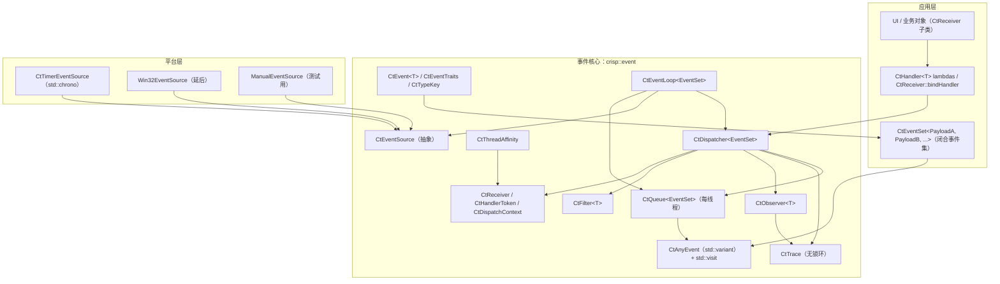
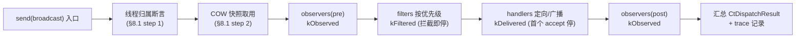

# CRISP 事件系统重设计（中文版）

> **状态**：架构设计文档（不含实现代码）
> **范围**：`crisp::event` — CRISP 项目事件子系统
> **工具链**：MinGW-w64 8.1.0（32 位）、C++17、CMake ≥ 3.20、禁用 `std::filesystem`
> **输入**：`AGENTS.md`、`docs/style-guide.md`、`docs/event-system/01..03`、现有原型代码 `src/event/`（`ct_event.h`、`ct_dispatcher.h`、`ct_trace.h`）、测试 `tests/event/`
> **设计原则**：类型安全第一、可观测性内置、所有权明确、线程规则显式、热路径零堆分配、无代码生成

---

## 修订记录（Revision Log）

| 版本 | 日期 | 内容 |
|------|------|------|
| Rev 1 | （首版） | 初始重设计文档（§1–§14）。 |
| Rev 2 | 2026-10-02 | **架构审查打回后修订**：修复 6 个 P1 编译级矛盾与 6 个 P2 完整性问题；§14 开放问题 #3/#7 给出裁定。逐条见下。 |
| **Rev 3** | 2026-10-02 | **架构审查 Rev 2 打回（N1–N4）后修订**：修复 2 个 P1（线程违例、2 个编译级问题）与 2 个 P2（M2 完整性缺口），并落实编辑层回写。逐条见下。 |
| Rev 4 | 2026-10-02 | **架构审查 Rev 3 打回（P1-1…P1-7 / P2-8…P2-12 / P3）后修订**：修复 7 个 P1（N1 残留旧语义全文改写、push 签名、friend 清单、队列成员编译级、四个缺失定义、post 路由、错误文件命名）、5 个 P2（include/归属/编辑层回写/平台裁定/查找策略）与 3 项 P3 清理。逐条见下。 |
| **Rev 5** | 2026-10-02 | **架构审查 Rev 4 打回（P1-1…P1-6 / P2-1…P2-6 / P3）后修订**：重定类型擦除边界（`front/popFront` 引用语义替代不可覆写的 `optional<抽象基类> pop`）、补 `CtQueue::pushAny` 覆写、`CtDispatcherBase` 补 `friend class CtEventLoop`、解除 `ct_receiver.h`↔`ct_dispatcher.h` 循环 include（前置声明）、补 `ct_event_loop.h`/`ct_event_source.h` 缺失 include、`CtEvent` 补 `setSequence/setPriority`（friend `CtDispatcherBase`/`CtQueue`）、`CtEventLoop` 队列惰性创建 + 路由注销契约、`CtHandlerToken` §6.4↔§7.7 同步、P3 三项落正文。逐条见下。 |
| **Rev 6** | 2026-10-02 | **架构审查 Rev 5 打回（N-1…N-13）后修订**：修复 2 个 M1 阻塞 P1（`ct_receiver.h` 补 `ct_handler_token.h` include；`ct_dispatcher.h` 补 `CtPendingEventBase` 前置声明）、4 个 M2 P1（擦除边界拆为"非模板 `CtAnyEventBase` 接口 + 模板 `CtAnyEventHolder` 持有者"、队列优先级统一为事件 `uint64_t` 提示、排空伪码修广播空 weak_ptr 丢弃 bug、post 经擦除边界入队 + 跨 EventSet 断言/drop）、1 个 M1 编译 P2（`CtEvent` 构造重载 `enable_if` 消歧）与 5 项 P3（`CtPendingEventBase` 措辞/`kDropped` 记录点/`~CtHandlerToken noexcept`/`m_inDispatch` 条件编译/`ct_dispatcher.h` 显式 include affinity）。逐条见下。 |
| **Rev 7** | 2026-10-02 | **架构审查 Rev 6 打回（P1-1…P1-3 / P2-1…P2-4）后修订**：`isBroadcast()` 改构造时固化广播标志（`CtPendingEvent` ctor 用 `owner_before` 判空，非活的 `expired()` 检查）；`CtDispatchTables` 移入 `crisp::event::detail`（与 §7.8 `detail::` 引用一致）；`m_inDispatch` 条件编译两分支真正不同（NDEBUG = 空成员）；`CtEvent::setPriority` 改 public；`CtAnyEventHolder` 补非 const `value()`（move 访问器）；`CtDispatcherBase` 补 `m_tokenStates` 弱引用集合成员（析构翻转 alive 的落点）；`CtEvent` 构造 `enable_if` 条件扩为"首参为 origin 即排除"。逐条见下。 |
| **Rev 8** | 2026-10-02 | **架构审查 Rev 7 打回（P1-1…P1-5 / P2-1…P2-8）后修订**：`CtEvent` 补 `template <typename> friend class CtDispatcher;`（友元不继承，send/broadcast 才能调 setSequence）；`isBroadcast` 判空方向修正（`!空.owner_before(target)`）；`CtTracePhase` 移入 `ct_event.h` 解循环 include（ctx↔trace 无环）；`ct_handler_token.h` 补 `CtDispatcherBase` 前置声明；`CtDispatcher` 补 `dispatchAny` override 声明（类不再抽象）；补 `ErasedHandler/Filter/Observer` 精确定义；`ct_dispatcher.h` 补 `<unordered_map>`；`kDropped` 记录点统一（排空不跳过 dispatchAny，内部记）；`CtAnyEventHolder` 补 `eventSetId()`（重叠集合跨 EventSet 检测）；`setDispatcher` 队列创建时机统一 + 线程约束；`CtPendingEvent` ctor 补 `sequence` 参数；friend 注释改写。逐条见下。 |
| **Rev 9** | 2026-10-02 | **架构审查 Rev 8 打回（P1-1…P1-4 / P2-1…P2-4 + P3）后修订**：擦除回调签名对齐 §5.2（`ErasedObserver` 携带 `const CtDispatchContext&`、`ErasedHandler/Filter` 用非 const `void*`）；`CtHandlerToken` 补 `template friend CtDispatcher`（友元不继承）；§8.2 广播条目判空调用（空 = 调用，非空已亡 = 跳过）；M1 `dispatchAny` 不可达 stub 定义 + M2 真实定义落点（dispatcher include queue，无环）；异步 sequence 单一事实来源（push 侧 stamp 入队序）；`CtEventLoop` 补 `attachSource/detachSource` + 源容器 + 注入路径（模板桥）；§5.3 同步 `CtTracePhase` 落点；`setDispatcher` 硬契约（同 EventSet 仅一次）+ `CtPendingEventBase::eventSetId()` 排空侧双重断言；跨 EventSet 丢弃归因（并入 `m_dropped`）；P3 清理（§14 措辞、record 签名、push 措辞、pushAny 序列来源）。逐条见下。 |
| **Rev 10** | 2026-10-02 | **架构审查 Rev 9 打回（P1-1 / P2-1…P2-4 + P3）后修订**：`dispatchAny` 异步例外（排空不重赋值 sequence、保留 accepted 复位 + kDispatched 记入队序）；`CtQueue` 补 `m_seqCounter`（入队序单一事实来源，push/pushAny 持锁 stamp）+ `m_trace` 成员（front/popDropped 记录落点）；`CtQueueBase` 补 `eventSetId()` 纯虚（injectEvent 下转型前校验）；`injectEvent` 补进 §7.11 类定义且写全 `template <typename EventSet, typename T>`；`CtDispatcher` 显式 shared_ptr 所有权声明（make_shared 唯一路径）；`setDispatcher` 补 `dispatcher->assertSameThread()`（dispatcher 与 loop 同线程）；§7.6/§7.9 record 参数形式统一（按值）；§5.3 补 `CtHandlerPriority`/`CtPendingEventBase` 行；异步 trace typeName 用数值 payloadTypeKey（M4 可补 typeName()）。逐条见下。 |
| **Rev 11** | 2026-10-02 | **架构审查 Rev 10 打回（P1-A / P2-A + P3）后修订**：`pushAny` 的 sequence 来源统一为 `m_seqCounter`（**不取 variant 内旧值**——发送方 CtEvent 的 sequence 可能为 0 或同步号），priority 从 variant 读（**删除 pushAny 的 priority 参数**避免双权威，`CtQueueBase`/`CtQueue` 签名同步）；源注入定**方案 A（源模板化）为首选**（非模板源在只持 `CtQueueBase&` 形态无注入通道），`injectEvent` 降级为应用/桥接层手工注入通道（有合法调用者）；§7.11 契约 #2 kDropped **三句分工**（kQueued→front 记队列 trace、溢出 kDropped→popDropped 记队列 trace、目标已亡 kDropped→dispatchAny 记 dispatcher trace）；异步 trace typeName 落点定死（`record()` 传占位 `"<async>"`，M4 补 typeName() 替换）；§8.2 Step 3 补异步例外（继承 §8.1 Step 3）；`ct_queue.h` include 清理（移除 ct_handler_token.h——priority 是 uint64_t）。逐条见下。 |
| **Rev 12** | 2026-10-02 | **架构审查 Rev 11 打回（P1-1 / P1-2 / P2-1…P2-3 + P3）后修订**：`send` 改**双归属断言**（receiver 归属 ∧ dispatcher 归属，§8.1 Step 1/§10.2 规则 #1/归属表同步——dispatcher `m_trace` 严格单线程，防跨线程写 data race）；`CtDispatcherBase` 补 **`m_nextSequence`** 成员（同步 sequence 计数器落点，§7.8/§8.1/§8.2/§7.10 契约 #9）；`unbindAll` 方案 a 定稿（receiver 补 `m_dispatchers` 弱引用列表 + 前置声明 `CtDispatcherBase` + `<vector>`，§7.5/§9.1 契约 #4）；`payloadPtr()` 改**非 const `void*`**（两处基类 + holder + CtPendingEvent override，§6.5/§7.10）；`injectEvent` 注释改写（应用/桥接层手工注入通道，§7.11）；模板化源签名定稿（`CtTimerEventSource<EventSet>`，§7.12 契约 #4）；EventSet 身份键注明确认（`CtTypeKey<EventSet>::value()`，§7.4 契约 #6）；`dispatchAny` 注释修正（Step 2 + 4-8 + Step 3 accepted 复位）；排空异常路径定义（dispatchAny 抛异常→队头保留、重复 kQueued 可接受）；`record` objectId 冗余注明（ctx.receiverId() 为真相）。逐条见下。 |
| **Rev 13（本轮）** | 2026-10-02 | **架构审查 Rev 12 打回（P1-1 / P2-A / P2-B + P3）后修订**：`payloadPtr()` **5 处去掉成员函数 `const` 限定符**（`virtual void* payloadPtr() noexcept`，override 同步——const 成员函数内 `&m_value` 转非 const `void*` 丢弃 const 是编译错误）；`CtDispatcherBase` 补 **`unregisterReceiver(uint64_t receiverObjectId)`**（protected + **`friend class CtReceiver;`**——unbindAll 遍历 `m_dispatchers` 逐个调用，COW 批量注销）；`CtEventSource` 补 **protected `setAffinityThread(CtThreadId)` + `friend class CtEventLoop;`**（attachSource 写入通道）；§8.1/§8.2 Step 3 显式 **`++m_nextSequence`**；`CtHandlerToken` move 赋值钉死（目标先注销旧注册再接管）；溢出丢弃策略裁定（**丢队尾**——优先级有序 deque 中"最旧"无精确落点）；`dispatchAny` 定向/广播分支显式（§7.8）。逐条见下。 |

**Rev 2 修订要点（对应审查报告）**：

- **P1-1**：`CtQueue::pop` 改为返回 `std::optional<any_event>`（裁定方案 (a)）；`CtEvent() = delete` 保持；同步 §7.10/§7.11/§13.3 的签名与用例。
- **P1-2**：`CtDispatchContext` 改为**私有默认构造 + friend**（`CtTrace` / `CtDispatcherBase` / `CtDispatcher<EventSet>`）；"应用不可伪造"不变；§7.9 的 `CtTraceRecord` aggregate 数组由此可行。
- **P1-3**：`CtDispatcherBase::m_tables` 改为**普通** `std::shared_ptr<const CtDispatchTables>` + `std::atomic_load/std::atomic_store`；§6.5/§7.8/§11.1 统一；"M4 换 C++20 `std::atomic<shared_ptr>`"的说法保留。
- **P1-4**：`CtTrace` 契约收紧为"**归属写者线程独占读写**"（record/dump/clear 均归属线程）+ 明确 release/acquire 内存序（P2-11 一并落地）；删除无锁载体的 "dump: locks" 表述。
- **P1-5**：`CtReceiver::bindHandler` 增加 dispatcher 参数并**委托** `CtDispatcher::addHandler`（并存、签名同步、职责划分明确）。
- **P1-6**：`CtReceiver` 与 `CtDispatcherBase` 新增 `isOnThread()` / `assertSameThread()`（内嵌 `CtThreadAffinity`）；§8.1/§8.2 对齐。
- **P2-7**：如实声明 C++17 `std::atomic_load(shared_ptr)` 在 libstdc++/MSVC 内部各有锁——COW 读入口非绝对零锁（低竞争、非写路径互斥）；M4 换 C++20 或自研原子指针实现真零锁（§6.5/§7.8/§11.1/§11.2）。
- **P2-8**：§7.3 显式声明保留 `accepted`（公有成员）与 `accept()/ignore()`；澄清"不可变"契约边界 = **载荷不可变、分发期 accepted 可变**。
- **P2-9**：§5.2 补全 `CtHandler<T>` / `CtFilter<T>` / `CtObserver<T>` 完整定义；§7.8 `addObserver` 签名改回 `CtObserver<T>`。
- **P2-10**：`CtTokenState::owner` 由 `void*` 改为 `std::weak_ptr<CtDispatcherBase>`；dispatcher 析构翻转 `alive` 与 token 注销例程**持同一 `m_writeMutex`**（锁内双检），关闭"token 读到 alive=true → dispatcher 析构中 → owner 悬垂"竞态窗口；`CtDispatcherBase` 继承 `enable_shared_from_this`。
- **P2-11**：`CtTrace::m_head`（写 release / 读 acquire）、`m_count`（seq_cst）内存序明确声明。
- **P2-12**：§10.4 偏差清单补 4 项：`defer_delete`（推迟 M3/M4）、`EventTraits<T>::compressible`（否决）、大负载 `unique_ptr`（细化）、`post(..., Priority)`（采纳但换位置为事件属性）。
- **§14**：#1 关闭（偏差清单已补全）；#3 裁定 **M1 落实 `m_inDispatch` debug 深度护栏**；#7 裁定 **平台 API**（Windows `GetCurrentThreadId`）；#2/#4/#5/#6/#8 标注 M2/M4 前裁定、未定前按原倾向执行。

**Rev 3 修订要点（对应审查报告 N1–N4）**：

- **N1（P1，线程违例）**：`CtTrace` 严格单线程（§7.9 契约 #1）与异步相位记录点（push/post 侧记 `kQueued`、pop 侧记 `kDropped`/`kDispatched`）矛盾——push/post 可运行于任意线程，触碰归属线程独占的 trace 即 data race。**裁定方案 (a)**：异步相位全部改由**归属线程**在排空/溢出处理时记录。具体：`CtQueue::push` **不记 trace**（返回 bool 表示受理）；`CtQueue::pop` 不记 trace；`CtEventLoop` 在排空循环内记 `kQueued/kDropped`（`kDropped` 经 `popDropped()` 报告、`kQueued` 经 `CtQueue::trace()` 获取合法构造 ctx 的 friend 通道记录）；`post/postTo` 侧只记错误不记相位。§7.8 契约 #8、§7.9 相位注释、§7.10 契约 #6、§7.11 契约 #2、§10.1 契约 #3/#4、§13.3 用例 #3 全部同步。
- **N2（P1，编译级）**：§7.8 `addObserver` 签名中的 `CtObserver<T, CtDispatchContext>` 传两个模板实参不可编译，且与 §5.2、§7.8 契约 #7 矛盾。**修复**：改回 `CtObserver<T>`（= `std::function<void(const CtEvent<T>&, const CtDispatchContext&)>`）；grep 核实全文无两参残留。
- **N3（P1，编译级）**：`CtHandlerToken::~CtHandlerToken` 调 `owner->unregisterHandler(id)`，但 `unregisterHandler` 在 `CtDispatcherBase` 是 protected。**修复**：`CtDispatcherBase` 声明 `friend class CtHandlerToken;`（完整 friend 清单见 §7.8）。
- **N4（P2，M2 完整性缺口）**：`CtPendingEvent<EventSet>` 只声明未定义、队列存储不携带目标 receiver、`dispatchAny` 未声明、`CtQueueBase` 接口未定义。**裁定方案 (A)，部分降级**：立即定死 `CtPendingEvent<EventSet>`（携带 `weak_ptr<CtReceiver>` 目标 + `CtAnyEvent` 载荷 + priority/sequence）与 `CtDispatcherBase::dispatchAny`（内部按变体分派、键匹配断言后调用擦除 lambda）；`CtQueueBase` 类型擦除接口**定义完整**（`push/pop/popDropped/size/trace/pendingEvent` 等），`CtEventLoop` 改持 `std::unique_ptr<CtQueueBase>`（避免按值基类切片与模板依赖），`CtEventSource::poll` 保留 `CtQueueBase&`。§5.3、§7.8、§7.10、§7.11、§7.12、§10.1、§12.2、§13.3 同步。
- **编辑层回写**：① §8.1 Step 3 补"将 `event.accepted` 复位为 `false`"；② §7.8 `CtDispatcherBase` 成员清单补 `m_inDispatch`（与 §9.2 契约 #3 对齐）；③ §7.14 契约 #1 明确 `currentThreadId()` 用平台 API（Windows `GetCurrentThreadId`，MinGW 下稳定；跨平台留接口抽象），§14 #1 标记已关闭、#3/#7 回写正文。
- **§14**：#1 **关闭**（编辑层回写 §10.4/§7.14）；#3 **已裁定并回写**（§7.8 `m_inDispatch`、§9.2 契约 #3）；#7 **已裁定并回写**（§7.14 平台 API）；#2/#4/#5/#6/#8 状态不变。

**Rev 4 修订要点（对应审查裁决 P1-1…P1-7 / P2-8…P2-12 / P3）**：

- **P1-1（N1 残留旧语义，全文改写）**：push/post 侧记 `kQueued`/`kDropped`、pop 侧记 `kDispatched` 的一切残留表述全部改写为裁定方案 (a)：**push/pop 一律不记 trace**；`kQueued`/`kDropped` 全部由**归属线程**在排空/溢出处理时记录（`CtEventLoop` 排空循环经 `popDropped()`/`trace()` friend 通道）；M1 占位明确"**不记任何相位**"。同步点：§7.8 契约 #8、§7.9 相位注释、§7.10 契约 #6（`push` 只记错误不记相位）、§7.11 契约 #2、§10.1 契约 #3/#4（#4 的"记 kQueued 占位相位"删除——§7.8 契约 #8 胜出）、§13.3 用例 #3。`CtEventLoop` 排空伪码更新为 `while (auto pe = q.pop()) { dispatcher->dispatchAny(*pe); }`。
- **P1-2（push 签名）**：`CtQueue::push` 签名改 `bool push(CtEvent<T>&& event);`——受理返回 `true`、溢出返回 `false`；`post` 据此返回 `kHandled`/`kUnhandled`。修订记录中"N1 裁定 push 返回 bool"的声明与正文（§7.10 签名与契约 #6、§10.1 契约 #3）统一为 `bool`。
- **P1-3（friend 清单三方矛盾）**：异步相位由 `CtQueue` 的 `popDropped()/trace()` 通道在**归属线程**记录——`CtQueue<EventSet>` 已是 friend，**不再新增 `CtEventLoop` friend**。`CtDispatchContext` friend 清单统一为 **4 个**：`CtTrace`、`CtDispatcherBase`、`CtDispatcher<EventSet>`、`CtQueue<EventSet>`；§7.6 契约 #6 文字同步（删除 `CtEventLoop`）。
- **P1-4（队列成员编译级）**：`CtEventLoop` 的 `CtQueueBase m_queue;`（抽象基类按值成员必切片/不可编译）改 **`std::unique_ptr<CtQueueBase> m_queue;`**；构造函数内 `make_unique<CtQueue<EventSet>>(...)`，经 `setDispatcher<EventSet>` 模板实例化。§7.11 签名与 §7.12 契约 #2（`poll(CtQueueBase&)` 实参形态）联动核对。
- **P1-5（四个缺失定义补全）**：① `CtPendingEvent<EventSet>` **完整定义**（`weak_ptr<CtReceiver>` 目标 + `CtAnyEvent` 载荷 + priority/sequence）；② `CtQueueBase` **类型擦除接口完整定义**（`push/pop/popDropped/size/trace/pendingEvent` 纯虚等）；③ `CtDispatcherBase::dispatchAny` 声明（§7.8）；④ 队列存储明确为 `deque<CtPendingEvent<EventSet>>`（与 P1-3 联动：定向投递需携带目标 receiver）。§5.3、§7.10、§7.11、§7.12、§10.1、§13.3 同步。
- **P1-6（post 路由机制缺失）**：补齐"线程 → CtEventLoop → CtQueue"的注册/查找机制：`CtEventLoop::current()`（**每线程 TLS 静态函数**，返回当前线程的 loop 指针）+ `CtEventLoop::attachToCurrentThread()`；`post(receiver, ev)` 经 `receiver->affinityThread()` → 查 loop → 入队。§7.11 契约新增；§10.1 契约 #1/#2 引用。
- **P1-7（错误文件命名不一致）**：统一为 **`ct_errors.h`**（§5.3 的写法）；§7.13 标题从 `ct_event_error.h` 改为 `ct_errors.h`，文件布局同步；`CtAffinityError`/`CtNoQueueError` **补定义**（简短，归入 `CtEventErrorKind` 枚举：`kWrongThread` 已有、新增 `kNoQueue` 替代 `CtNoQueueError`；`CtAffinityError` 即 `kWrongThread` 的错误类型别名语义，补 `CtEventError` 便捷构造）。
- **P2-8（include 自包含）**：§7.10 `ct_queue.h` 的 include 补 `ct_thread_affinity.h`（签名用 `CtThreadId` 必须自包含）。
- **P2-9（CtQueue 归属统一）**：`CtQueue` 内嵌 **`CtThreadAffinity m_affinity`**（构造记录当前线程），删除构造签名里的裸 `CtThreadId` 参数；`affinityThread()` 委托 `m_affinity.thread()`。§7.14 契约 #2/#6、§10.2 表同步。
- **P2-10（accepted 复位回写）**：§8.1 Step 3 明确"将 `event.accepted` 复位为 `false`"（与 §7.3 契约 #6 引用对齐）；§8.2 Step 3 同步。
- **P2-11（平台 API 裁定回写）**：§7.14 契约 #1 明确 `currentThreadId()` 用 Windows `GetCurrentThreadId`（MinGW 下稳定），跨平台留接口抽象；删除"std::hash<std::thread::id> 或平台 API"的摇摆表述。
- **P2-12（send 定向查找策略定死）**：§8.1 Step 6 M1 实现策略定为"**遍历快照向量、`lock()` 后比对 `objectId`**"（M1 规模可接受），并注明 M4 可引入按 receiver 的分组索引。
- **P3 清理（Rev 4）**：① `CtHandlerToken` 成员清单统一（§6.4 的 `m_id` 与 §7.7 的仅 `m_state`——统一为经 `m_state->id` 取 `id()`，`CtHandlerToken` 不再持有 `m_id`）；② `CtDispatcherBase::trace()` 与 `CtDispatcher::trace() const` 同名隐藏问题——**注明即可**（派生类 const 版本隐藏基类非 const 版本，属预期；实现侧保留基类 `trace()` 供内部使用）；③ §14 #1 标注"已关闭"（与修订记录一致）。

**Rev 5 修订要点（对应审查裁决 P1-1…P1-6 / P2-1…P2-6 / P3）**：

- **P1-1（擦除边界 pop 不可覆写）**：`CtQueueBase::pop()` 返回 `std::optional<CtPendingEventBase>` **不可实现**（抽象基类无法按值入 optional，且 `std::optional` 无返回类型协变，派生 `optional<CtPendingEvent<EventSet>>` 不构成覆写）→ **重定为 `front(CtPendingEventBase*&)` + `popFront()` 引用语义**（零堆、零拷贝、无切片；`CtPendingEvent<EventSet>` 继承非抽象 `CtPendingEventBase`，§6.5 边界类型具体化）。§7.10 契约 #3/#7、§7.11 契约 #2 排空伪码、§13.3 用例 #2/#3 同步。
- **P1-2（CtQueue 未覆写 pushAny）**：补 `CtQueue::pushAny(std::unique_ptr<CtAnyEventBase>, ...)` 具体覆写；`detail::CtAnyEventBase` 重定为**具体可持有 variant 的类型**（`pushAny` 所有权转移，异步路径允许一次堆分配，§6.5/§7.10 契约 #7/§11.2）。
- **P1-3（dispatchAny protected 访问）**：`CtDispatcherBase` 补 **`friend class CtEventLoop;`**（`exec` 排空调用 `dispatchAny`，与 `CtHandlerToken` 同理，§7.8 friend 清单）。
- **P1-4（循环 include）**：`ct_receiver.h` **移除** `#include "ct_dispatcher.h"`，改**前置声明** `template <typename EventSet> class CtDispatcher;`（`bindHandler` 只在实例化期解析依赖名；`ct_dispatcher.h` 是"更富"的头，它 include `ct_receiver.h`，§7.5）。
- **P1-5 / P1-6（头自包含）**：`ct_event_loop.h` 补 `#include "ct_dispatcher.h"`；`ct_event_source.h` 补 `#include "ct_queue.h"`（§7.11/§7.12）。
- **P2-1（kQueued/kDropped 记录通道）**：裁定方案 (a)——`kQueued` 由 **`CtQueue::front()` 成功时记录**（队列是 `CtDispatchContext` friend、归属线程调用，无数据竞争）；`kDropped` 由 **`CtQueue::popDropped()` 内部按计数记录**。记录主体统一为 `CtQueue`，loop 不直接构造 ctx（§7.6 契约 #6、§7.10 契约 #6、§7.11 契约 #2）。
- **P2-2（CtEvent sequence/priority 无写入机制）**：`CtEvent` 补 **`friend class CtDispatcherBase; template <typename> friend class CtQueue;`** 与私有 `setSequence(uint64_t)/setPriority(uint64_t)`（§7.3；§8.1 Step 3 与 §10.3 的写入落点）。
- **P2-3（队列创建时机）**：`CtEventLoop` 的 `m_queue` 改**在 `setDispatcher<EventSet>` 内惰性创建**（构造函数运行时 EventSet 未知，无法实例化 `CtQueue<EventSet>`）；`queue()` 加前置条件"必须先 setDispatcher"（§7.11 契约 #3）。
- **P2-4（路由映射生命周期）**：`~CtEventLoop` 契约**从 TLS 与线程→loop 映射移除自身**；post 侧校验目标 loop 存活（§7.11 契约 #7）。
- **P2-5（擦除类型文件落点）**：`CtPendingEventBase` 定为公开类型（落点 `ct_queue.h`）；`detail::CtAnyEventBase` 定为实现细节（落点 `ct_queue.h`/`ct_dispatcher.h`）——都不进 §5.3 公开布局，注明宿主头（§6.5 注记）。
- **P2-6（CtHandlerToken 两处不一致）**：§6.4 同步 §7.7（删 `m_id` 成员与 `reset()`，`id()` 经 `m_state->id` 取值），标注 §6.4 为摘录、§7.7 权威。
- **P3 落正文（Rev 5）**：① §7.8 契约 #9 补 `trace()` 同名隐藏注明；② §14 #1 标"已关闭"、#3/#7 标"已裁定"；③ §11.2 队列锁行、§13.3 用例同步 front/popFront。

**Rev 6 修订要点（对应审查裁决 N-1…N-13）**：

- **N-1（M1 阻塞）**：`ct_receiver.h` 补 `#include "ct_handler_token.h"`（`bindHandler` 返回 `CtHandlerToken`，头必须自包含，§7.5）。
- **N-2（M1 阻塞）**：`ct_dispatcher.h` 补 `namespace crisp::event { class CtPendingEventBase; }` 前置声明（`dispatchAny(CtPendingEventBase&)` 引用参数只需声明；完整定义在 `ct_queue.h`（M2），`CtEventLoop` 调用点提供完整类型，§7.8）。
- **N-3（M2）**：擦除边界拆两层——`detail::CtAnyEventBase`（**非模板接口**，纯虚 `payloadTypeKey/payloadPtr`）+ `detail::CtAnyEventHolder<EventSet>`（**模板具体持有者**，持有 variant）。`CtQueueBase::pushAny` 收 `std::unique_ptr<detail::CtAnyEventBase>`（无模板实参问题），`CtQueue<EventSet>::pushAny` 键断言后 `static_cast` 到 Holder（§6.5/§7.10）。
- **N-4（M2）**：队列存储与 `pushAny` 的 priority 统一为**事件的 `uint64_t` 排序提示**（`CtEvent::priority()`，§7.3）；`CtHandlerPriority` 仅保留作过滤器排序键（§7.15）。`CtPendingEventBase::priority()` 返回 `uint64_t`（§7.10/§10.3）。
- **N-5（M2 正确性）**：排空伪码**不再用 `target().expired()` 判定丢弃**——空 `weak_ptr`（广播条目）的 `expired()` 返回 true 会静默丢弃所有异步广播。改为 `isBroadcast()`（空 target = 必须投递）vs 非空且 `lock()` 失败（跳过 + `kDropped`）（§7.11 契约 #2）。
- **N-6（M2）**：`post` 入队路径定死为**经擦除边界 `CtQueueBase::pushAny`**（路由只给 `CtQueueBase&`，投递侧无法获知具体 EventSet；强类型 `CtQueue<EventSet>::push` 只在 EventSet 已知处用）（§10.1 契约 #5）。
- **N-7（M2）**：**跨 EventSet 投递契约**——`post/postTo` 要求目标 loop EventSet 与发送方一致；不一致时 `pushAny` 键断言失败 → 丢弃 + `kDropped` + `kTypeNotInSet`，post 返回 `kUnhandled`（§10.1 契约 #5）。
- **N-8（M1 编译）**：`CtEvent` 两个构造重载加 `enable_if` 消歧（首参为 `CtEventOrigin` 时仅 origin-first 重载参与；`CtEvent<T>(CtEventOrigin::kApplication)` 不再二义）（§7.3）。
- **N-9（P3）**：`CtPendingEventBase` 措辞统一为"抽象基类、仅引用语义"（纯虚 `payloadTypeKey/payloadPtr` 与"CONCRETE 非抽象"表述矛盾）（§6.5/§7.10 契约 #7）。
- **N-10（P3）**：`kDropped` 的"目标已亡"记录点补上——排空时非空 target 但 `lock()` 失败 → `dispatchAny` 记 `kDropped`（§7.10 契约 #6、§7.11 契约 #2）。
- **N-11（P3）**：`~CtHandlerToken() noexcept` 两处统一（§6.4/§7.7）。
- **N-12（P3）**：`m_inDispatch` 条件编译统一——`#if defined(NDEBUG)` 空成员 / 否则 `size_t`（§7.8 成员清单与 §9.2 契约 #3 一致）。
- **N-13（P3）**：`ct_dispatcher.h` 显式 `#include "ct_thread_affinity.h"`（`m_affinity` 成员直接依赖，不靠 `ct_receiver.h` 传递包含）（§7.8）。

**Rev 7 修订要点（对应审查裁决 P1-1…P1-3 / P2-1…P2-4）**：

- **P1-1（isBroadcast 实现层未修复）**：`CtPendingEventBase::isBroadcast()` 改**构造时固化标志**——`CtPendingEvent<EventSet>` 的构造器用 `owner_before` 判空（"push 时 target 是否为空"），存 `m_isBroadcast`；**不再用活的 `expired()` 检查**（空 weak_ptr 与已亡 weak_ptr 的 `expired()` 都返回 true，无法区分"广播必须投递"与"目标已亡跳过"）。§6.5、§7.10 契约 #7、§7.11 契约 #2 三处同步（§6.5/§7.10）。
- **P1-2（CtDispatchTables 命名空间不一致）**：`CtDispatchTables` **移入 `crisp::event::detail`**（纯实现细节，与 §7.8 的 `detail::CtDispatchTables` 引用一致）；§6.5 代码块命名空间改为 `namespace crisp::event::detail`（§6.5）。
- **P1-3（m_inDispatch 条件编译分支相同）**：`#if defined(NDEBUG)` 分支改**空成员**（`[[maybe_unused]] char m_inDispatchPadding`），`#else` 分支保留 `size_t m_inDispatch`——两分支真正不同，与 §9.2 契约 #3"release 零开销"对齐（§7.8）。
- **P2-1（priority 无公开设置路径）**：`CtEvent::setPriority(uint64_t)` 改 **public**（构造重载只转发给 T 的载荷构造，应用侧需公开 setter 产生非零 priority 供 §10.3 队列排序；`setSequence` 仍私有）（§7.3）。
- **P2-2（CtAnyEventHolder 缺 move 访问器）**：补**非 const `any_event& value() noexcept`**（`CtQueue<EventSet>::pushAny` 需 move variant 进 pending_event，const& 无法 move）（§6.5）。
- **P2-3（CtDispatcherBase 缺 token-state 集合）**：成员清单补 **`std::vector<std::weak_ptr<detail::CtTokenState>> m_tokenStates;`**（`makeTokenState` 登记、`unregisterHandler` 移除、析构持锁翻转所有 token 的 alive——§9.2 契约 #1 的落点）；`ct_dispatcher.h` include 补 `<vector>`（§7.8）。
- **P2-4（enable_if 只消歧单参）**：`CtEvent` 构造重载的 `enable_if` 条件扩为**"首参为 `CtEventOrigin` 即排除"**（`sizeof...(Args) >= 1 && first is CtEventOrigin` 时 generic 重载不参与——`(origin, args...)` 多参形态不再被转发引用重载捕获）；删除误导注释（§7.3）。

**Rev 8 修订要点（对应审查裁决 P1-1…P1-5 / P2-1…P2-8）**：

- **P1-1（CtEvent 缺 CtDispatcher friend）**：`CtEvent<T>` 私有区补 **`template <typename> friend class CtDispatcher;`**——C++ 友元不继承，`CtDispatcherBase` 的友元资格不延伸到模板派生类 `CtDispatcher<EventSet>`，而 §8.1/§8.2 Step 3 的 `event.setSequence(...)` 正执行于 `CtDispatcher<EventSet>::send/broadcast`（§7.3）。
- **P1-2（isBroadcast owner_before 方向）**：判空表达式改 **`m_isBroadcast = !std::weak_ptr<CtReceiver>{}.owner_before(target)`**——默认空 weak_ptr 是严格弱序最小元，`empty.owner_before(target)` 恰在 target 非空时为 true；**反向 `target.owner_before(empty)` 恒 false 会把所有定向事件标记为广播**。§6.5/§7.10 伪码统一（§6.5/§7.10）。
- **P1-3（ctx↔trace 循环 include）**：**`CtTracePhase` 移入 `ct_event.h`**（§7.3）；`ct_dispatch_context.h` **不得** include `ct_trace.h`（只从 `ct_event.h` 取 `CtTracePhase`）；`ct_trace.h` 保留 include `ct_dispatch_context.h`（§7.6/§7.9）。include 图：ctx→event，trace→ctx→event，无环。
- **P1-4（ct_handler_token.h 缺前置声明）**：文件开头补 **`namespace crisp::event { class CtDispatcherBase; }`**（`detail::CtTokenState::owner` 是 `weak_ptr<CtDispatcherBase>`，先于任何声明出现）（§7.7）。
- **P1-5（CtDispatcher 漏 dispatchAny override）**：`CtDispatcher<EventSet>` 私有区补 **`void dispatchAny(CtPendingEventBase& pending) override;`**——否则基类纯虚未实现、`CtDispatcher` 抽象、`make_shared` 不可编译（§7.8）。
- **P2-1（ErasedHandler/Filter/Observer 未定义）**：§6.5 补**精确定义**：`ErasedHandler = std::function<void(const void*)>`（event = CtEvent<T>*）、`ErasedFilter = std::function<bool(const void*)>`（event = const CtEvent<T>*）、`ErasedObserver = std::function<void(const void*, CtTracePhase)>`（event = const CtEvent<T>*）——注册时构造、键匹配断言后调用（§6.5）。
- **P2-2（ct_event.h 缺 `<tuple>`）**：`enable_if` 用 `std::tuple_element_t`，include 补 `<tuple>`（§7.3）。
- **P2-3（ct_dispatcher.h 缺 `<unordered_map>`）**：`detail::CtDispatchTables` 用 `unordered_map`，include 补 `<unordered_map>`（§7.8）。
- **P2-4（kDropped 记录点矛盾）**：排空循环**不跳过 `dispatchAny`**——广播与定向都调；`dispatchAny` 内部判定：`isBroadcast()`（投递全表）/ 非广播且 `lock()` 失败（**记 `kDropped` 并跳过**）。统一"目标已亡的 kDropped 由 dispatchAny 记录"（§7.10 契约 #6、§7.11 契约 #2）。
- **P2-5（重叠集合跨 EventSet 检测失效）**：`CtAnyEventBase` 补**纯虚 `eventSetId()`**，`CtAnyEventHolder<EventSet>` 以**地址派生键**（§6.1 方案）实现；`CtQueue<EventSet>::pushAny` 断言 `holder.eventSetId() == EventSet 自身键` **后再 cast**（payloadTypeKey 断言对共享类型 T 的重叠集合不够）（§6.5、§10.1 契约 #5）。
- **P2-6（队列创建时机矛盾）**：统一为 **`CtEventLoop` 在 `setDispatcher<EventSet>` 内创建队列**（构造时 EventSet 未知）；**归属 = 调用 setDispatcher 的线程（必须为 loop 线程，M2 断言）**；`queue()` 前置条件（§10.2 契约 #4、§7.11 契约 #3）。
- **P2-7（异步 sequence 悬空）**：`CtPendingEvent<EventSet>` 构造签名补 **`uint64_t sequence` 参数**（push 侧从 `CtEvent::sequence()` 拷贝，§7.3 的 `CtQueue` friend 通道落地）（§7.10）。
- **P2-8（friend 注释误导）**：§7.3 注释改写——明确 `CtDispatcherBase` 与 `CtDispatcher<EventSet>` **都是** friend（友元不继承）（随 P1-1）。

**Rev 9 修订要点（对应审查裁决 P1-1…P1-4 / P2-1…P2-4 + P3）**：

- **P1-1（擦除回调签名不对齐 §5.2）**：`ErasedObserver` 改 **`std::function<void(const void*, const CtDispatchContext&)>`**（相位经 `ctx.phase()`，观察者需完整上下文 receiverId/filterIndex/elapsed/handlerCount，`CtTracePhase` 参数承载不了，wrapper 无法伪造 ctx——§7.6 私有构造）；`ErasedHandler`/`ErasedFilter` 改**非 const `void*`**（与 §5.2 `CtHandler<T>`/`CtFilter<T>` 非 const 事件对齐，去掉 const_cast 需要）（§6.5）。
- **P1-2（CtHandlerToken 构造访问缺口）**：`CtHandlerToken` 私有区补 **`template <typename> friend class CtDispatcher;`**——非空 token 在 `CtDispatcher<EventSet>::addHandler` 构造，友元不继承（与 §7.3 CtEvent 同型问题）（§7.7 契约 #5）。
- **P1-3（同步广播条目被 lock() 跳过）**：§8.2 Step 6 广播条目**注册时固化判空**——receiver 为空（`owner_before` 判空）= 广播条目**无条件调用**；非空且 `lock()` 失败（已亡）= 跳过（与异步 `isBroadcast` 同型修复，Rev 8, P1-3）（§8.2 Step 6）。
- **P1-4（M1 dispatchAny 无定义 → 链接失败）**：§12.1 明确 **M1 提供不可达 stub 定义**（`assert(false)` 空体，引用参数不需完整类型）；**M2 真实定义**落点：`ct_dispatcher.h` include `ct_queue.h` 后实现（include 方向无环）（§12.1 step 9、§7.8 dispatchAny 注释）。
- **P2-1（异步 sequence 语义分裂）**：定**单一事实来源**——push 侧（`CtQueue<EventSet>` 是 CtEvent friend）先 `setSequence()` 再拷贝进 pending = **入队序**；同步路径 §8.1 Step 3 直接赋值；排空侧不重赋值（§6.5/§7.10 `sequence()` 注释、`CtPendingEvent` ctor）。
- **P2-2（CtEventLoop 缺源挂接）**：补 **`attachSource/detachSource`** API + **`m_sources` 容器**（shared_ptr，§11.5）；**注入路径定死**：loop 提供模板桥 `injectEvent<EventSet>`（下转型到具体 `CtQueue<EventSet>&` 后强类型 `push`）或源模板化（二选一）；`pushAny` 的 `eventSetId()` 断言兜底跨集合误注入（§7.11/§7.12 契约 #6）。
- **P2-3（§5.3 布局脱节）**：`ct_event.h` 行标注 `CtTracePhase`（Rev 7 P1-3 移入）；`ct_trace.h` 行注明"相位从 ct_event.h 取"；`ct_event_loop.h` 行补 `attachSource`（§5.3）。
- **P2-4（队列 EventSet == dispatcher EventSet 不变量）**：`setDispatcher` 定**硬契约**——同 `EventSet` 仅一次、重复（含异 `EventSet`）拒绝并断言；`CtPendingEventBase` 补 **`eventSetId()`**（地址派生，§6.1）供排空侧 `dispatchAny` 双重断言（payloadTypeKey + set 身份）（§7.11 契约 #3、§6.5/§7.10、§10.1 契约 #5）。
- **P3 清理（Rev 9）**：① §14 #3 措辞 `inDispatch_` → `m_inDispatch`；② 跨 EventSet 拒绝与溢出**都并入 `m_dropped`**（记 `kDropped`），`kTypeNotInSet` 仅作错误类别不单开计数；③ §7.10 契约 #2 措辞精确化（强类型 `push` 直接构造 pending，`std::visit` 仅属 `pushAny`）；④ `pushAny` 的 priority/sequence 来源明确（`std::visit` 读 variant 内事件）；⑤ §7.9 `record` 按值 `CtDispatchContext` 与 §7.6 契约文字对齐。

**Rev 10 修订要点（对应审查裁决 P1-1 / P2-1…P2-4 + P3）**：

- **P1-1（dispatchAny 异步例外）**：§7.8 `dispatchAny` 注释 + §8.1 Step 3 补**异步例外**——排空路径**跳过 sequence 重赋值**（pending 已在 push 侧 stamp 入队序），保留 `accepted` 复位与 `kDispatched` 记录（记入队序）；同步 `send` 才重赋值（§7.8、§8.1 Step 3）。**异步计数器来源**：`CtQueue` 补 **`m_seqCounter`**（push/pushAny 持 `m_mutex` 自增并 stamp），与 dispatcher 同步计数是**两个独立键空间**（§7.10 契约 #9）。
- **P2-1（injectEvent 安全网 + 声明 + 签名）**：`CtQueueBase` 补 **`virtual uint64_t eventSetId() const noexcept = 0;`**（injectEvent 下转型前校验——强类型 `push` 不经过 `pushAny` 的断言）；`injectEvent` **补进 §7.11 类定义**且写全 **`template <typename EventSet, typename T>`**（T 由实参推导）（§7.11、§7.12 契约 #6）。
- **P2-2（CtQueue 缺 m_trace）**：`CtQueue` 私有成员补 **`CtTrace m_trace;`**（`front` 记 kQueued、`popDropped` 记 kDropped 的落点）（§7.10）。
- **P2-3（dispatcher shared_ptr 所有权未声明）**：§7.8 类注释补**强制声明**——`CtDispatcher` 必须 `make_shared` 持有（`enable_shared_from_this` + `makeTokenState` 依赖 `shared_from_this()`，栈上创建首调 addHandler 抛 `std::bad_weak_ptr`）（§7.8）。
- **P2-4（dispatcher 与 loop 同线程）**：`setDispatcher` 补 **`dispatcher->assertSameThread()`** 断言——dispatcher 创建线程必须等于 loop 归属线程（否则异步广播走 §8.2 Step 1 的 dispatcher 归属断言误触发）（§7.11 契约 #3）。
- **P3（Rev 10）**：① §7.6 契约 #6 与 §7.9 `record` 参数形式统一（按值 `CtDispatchContext ctx`，调用侧传 const&）；② §5.3 补 `CtHandlerPriority`（§7.15 并入 ct_handler_token.h）与 `CtPendingEventBase`（公开，落点 ct_queue.h）行；③ 异步 trace typeName 用**数值 payloadTypeKey**（M4 可补 `virtual std::string_view typeName()`）。

**Rev 11 修订要点（对应审查裁决 P1-A / P2-A + P3）**：

- **P1-A（pushAny sequence 来源互斥）**：`CtQueue::pushAny` 注释改写——**sequence 不取自 variant**（发送方 `CtEvent<T>::sequence()` 可能为 0 或同步路径号），由本队列 `m_seqCounter` 持 `m_mutex` 自增 stamp（契约 #9）；**priority 从 variant 内事件读取**（`std::visit` 取 `CtEvent<T>::priority()`）。**`pushAny` 的 priority 参数删除**（`CtQueueBase::pushAny(std::unique_ptr<detail::CtAnyEventBase>, std::weak_ptr<CtReceiver>)` + `CtQueue::pushAny` 同步）——避免参数与 variant 值双权威（§7.10 签名与契约 #7）。
- **P2-A（injectEvent 无调用路径）**：定**方案 A 为首选**——内建源（`CtTimerEventSource`/`ManualEventSource`）一律**源侧模板化**（携带 `EventSet` 类型参数，`poll` 内经 `queue.eventSetId()` 断言后 `static_cast<CtQueue<EventSet>&>` 强类型 `push`）；非模板源在只持 `CtQueueBase&` 形态下**没有注入通道**（无法调 loop 模板成员、也无法构造 holder）。`CtEventLoop::injectEvent<EventSet, T>` **降级标注为应用/桥接层手工注入通道**（有合法调用者：应用代码或 Qt 桥经 loop 指针调用，同样先断言 eventSetId 再下转型）（§7.12 契约 #6）。
- **P3-1（§7.11 契约 #2 kDropped 三句分工）**：① `kQueued` 由 `CtQueue::front()` 记**队列 trace**；② 溢出 `kDropped` 由 `CtQueue::popDropped()` 记**队列 trace**；③ **目标已亡 `kDropped` 由 `dispatchAny` 记 dispatcher trace**（`dispatchAny` 只收 `CtPendingEventBase&`，无法访问队列 `m_trace`）——删除"一律经队列 trace"的矛盾表述（§7.11 契约 #2）。
- **P3-2（异步 trace typeName 落点）**：`CtTrace::record(std::string_view typeName, ...)` 保持字符串形参；异步相位（kQueued/kDropped）的队列 trace 传**占位 `"<async>"`**，M4 补 `CtPendingEventBase::typeName()` 后替换（§7.9 record 注释、§7.10 契约 #6）。
- **P3-3（§8.2 Step 3 异步例外）**：广播 pending 经 `dispatchAny` 排空时**继承 §8.1 Step 3 异步例外**（跳过 sequence 重赋值、保留 accepted 复位 + kDispatched 记入队序）（§8.2 Step 3）。
- **P3-4（ct_queue.h include 清理）**：移除 `ct_handler_token.h`（`CtQueue` 的 priority 是 `uint64_t`，不用 `CtHandlerPriority`）——防意外依赖（§7.10 include 清单）。

**Rev 12 修订要点（对应审查裁决 P1-1 / P1-2 / P2-1…P2-3 + P3）**：

- **P1-1（send 线程契约与 dispatcher 单线程矛盾）**：`send` Step 1 改**双归属断言** `if (!receiver->assertSameThread() || !this->assertSameThread())`——receiver 归属 **∧** dispatcher 归属；**隐含 "receiver 必须创建于 dispatcher 归属线程"**。§10.2 规则 #1 与归属表同步改写（dispatcher `m_trace` 严格单线程，§7.9 契约 #1；跨线程 send 写 trace = data race）（§8.1 Step 1、§10.2）。
- **P1-2（同步 sequence 计数器无落点）**：`CtDispatcherBase` 成员清单补 **`uint64_t m_nextSequence = 0;`**（同步路径单线程访问，普通 uint64_t 安全；§8.1/§8.2 Step 3 `++` 后 `setSequence`；异步走队列 `m_seqCounter`，两键空间独立）（§7.8）。
- **P2-1（unbindAll 无定位机制）**：方案 a 定稿——receiver 补 **`std::vector<std::weak_ptr<CtDispatcherBase>> m_dispatchers;`**（`bindHandler` 登记、注销/析构移除；`unbindAll()` 遍历逐个注销）；`ct_receiver.h` 补 `<vector>` + 前置声明 `CtDispatcherBase`；**澄清这不是第二套 handler 表**（§7.5 契约 #5 禁的是 handler 表，不排斥 dispatcher 指针列表）（§7.5、§9.1 契约 #4）。
- **P2-2（payloadPtr const 矛盾）**：`CtPendingEventBase::payloadPtr()`、`detail::CtAnyEventBase::payloadPtr()`、`CtAnyEventHolder::payloadPtr()`、`CtPendingEvent::payloadPtr()` **全部改非 const `void*`**——dispatchAny 走 §8.1 管线复位 accepted、handler/filter 收非 const `CtEvent<T>&`（§6.5/§7.10）。
- **P2-3（injectEvent 注释残留）**：改写为"**应用/桥接层手工注入通道**"（应用代码或 Qt 桥经 loop 指针调用），断言/下转型语义保留（§7.11）。
- **P3-1（模板化源签名）**：§7.12 契约 #4 定 `CtTimerEventSource<EventSet>`/`ManualEventSource<EventSet>`（携带 EventSet 类型参数的模板类，`poll` 内 eventSetId 断言 + 下转型强类型 push；抽象接口 `CtEventSource` 保持非模板，模板化落派生源）。
- **P3-2（EventSet 身份键 API）**：§7.4 契约 #6 注明——`eventSetId()` 的实现 = **`CtTypeKey<CtEventSet<Ts...>>::value()`**（§6.1 方案泛用）。
- **P3-3（dispatchAny 注释）**：修正为 "**Step 2（COW 快照）+ Steps 4-8 + Step 3 的 accepted 复位**（不含 sequence 重赋值）"（§7.8）。
- **P3-4（排空异常路径）**：`dispatchAny` 抛异常→`popFront` 未执行→队头保留、下一轮重复记 `kQueued`（可接受）；异常传播到 `exec()` 调用方；**不得吞异常跳过 popFront**（§7.11 契约 #2）。
- **P3-5（record objectId 冗余）**：`CtTrace::record` 的 `objectId` 参数注明是 `ctx.receiverId()` 的便捷拷贝（真相在 ctx；实现可省略该参数改读 ctx）——签名保持为认可形式（§7.9）。

**Rev 13 修订要点（对应审查裁决 P1-1 / P2-A / P2-B + P3）**：

- **P1-1（payloadPtr const 成员函数矛盾）**：`payloadPtr()` **5 处签名去掉成员函数 `const` 限定符** → `virtual void* payloadPtr() noexcept = 0;`（`CtPendingEventBase` §6.5/§7.10 ×2、`detail::CtAnyEventBase`、`CtAnyEventHolder` 内联体、`CtPendingEvent` override 同步）——const 成员函数内 `&m_value`（`const any_event*`）隐式转非 const `void*` 丢弃 const 是编译错误（§6.5/§7.10）。
- **P2-A（unbindAll 无落地机制）**：`CtDispatcherBase` 补 **`void unregisterReceiver(uint64_t receiverObjectId);`**（protected，持 `m_writeMutex` + COW 发布，移除快照中所有匹配 receiver 的 Handler/Filter/Observer 条目）+ **`friend class CtReceiver;`**；§7.5 `bindHandler` 向 `m_dispatchers` 登记、`unbindAll` 遍历逐个调 `unregisterReceiver(objectId())`；陈旧弱指针 `lock()` 失败即跳过（§7.8、§7.5 契约 #5/#6、§9.1 契约 #4）。
- **P2-B（CtEventSource affinity 写入通道）**：`CtEventSource` 补 **protected `void setAffinityThread(CtThreadId)` + `friend class CtEventLoop;`**；`attachSource` attach 成功时调用（§7.12 类定义 + 契约 #5、§7.11）。
- **P3-1（Step 3 显式化）**：§8.1/§8.2 Step 3 直接写 **`event.setSequence(++m_nextSequence)`**（不再靠 §7.8 注释指认）。
- **P3-2（token move 赋值）**：§7.7 契约 #2 钉死——move 赋值时目标若持有**存活注册**，**先注销旧注册再接管**（等价析构 + move-construct）。
- **P3-3（溢出丢弃策略）**：裁定**丢弃队尾**（最低优先级、同级中最旧；优先级有序 deque 中"最旧"无精确落点，队尾无需时间戳）——§7.10 契约 #5、§10.3 规则 #3 同步。
- **P3-4（dispatchAny 分支显式）**：§7.8 `dispatchAny` 注释明确——`pending.isBroadcast()` → §8.2 广播语义（全表投递，receiverId=0）；否则 → §8.1 定向语义（`pending.target()` 定向查找）；分支在 dispatchAny 内部解析（不在排空循环）。

---

## 1. 文档定位与阅读指南

### 1.1 定位

本文档是 CRISP 事件系统重设计的**权威架构与接口规范**，取代 `src/event/` 中临时拼凑的原型，作为实现的唯一参考。编码子agent 必须能**无歧义地**实现整个子系统——每个公开类、方法签名、语义契约、所有权规则、线程安全契约都在下文明确给出。

### 1.2 与其他文档的关系

| 文档 | 角色 |
|------|------|
| `01-qt-event-system-architecture.md` | Qt 怎么做（分析输入） |
| `02-qt-event-system-pain-points.md` | Qt 设计为什么痛（分析输入） |
| `03-rewrite-proposal.md` | 战略方向；本文档**实现并细化**它 |
| 本文档（`04`） | 可落地的具体设计；与 `03` 的偏差在 §10.4 显式说明 |

### 1.3 阅读方式

- §2–§3：原则→设计映射 + 现有原型评估（为什么重设计）。
- §4–§5：总览（分层、命名空间、文件布局）。
- §6–§11：规范设计（机制、接口、管线、所有权、线程、性能）。
- §12–§13：实现与测试的逐文件改动指引。
- §14：阻塞放行的开放问题清单。

### 1.4 全程遵守的工具链约束

- 仅 C++17（`__cplusplus == 201703L`）：无 concepts、无 `<=>` 默认比较、无协程。
- 禁用 `std::filesystem`（MinGW 8.1 libstdc++ bug）。
- 无 moc / qmake / 代码生成；CMake ≥ 3.20。
- 无裸 `new`/`delete`；无 C 风格 cast；RAII 遍布；函数 ≤ 60 行；公开 API 用 Doxygen 英文注释。

---

## 2. 设计原则映射

六条项目原则逐一映射到强制执行它的具体类/接口。若某原则仅"文档声明"而未由类型系统或契约强制，则标注。

| # | 原则 | 强制载体 | 机制 |
|---|------|----------|------|
| 1 | **类型安全第一** | `CtEvent<T>`、`CtTypeKey<T>`、`CtEventSet<Ts...>` + `CtAnyEvent`（`std::variant`） | 事件类型即 C++ 类型 `T`；无 int 枚举、无分发时 `static_cast`。载荷类型必须声明（特化 traits），否则编译失败。异构存储是编译期闭合的 `std::variant`；`std::visit` 穷尽。跨 TU 唯一类型键为地址派生（零碰撞，见 §6.4）。 |
| 2 | **可观测性内置** | `CtTrace`、`CtObserver`、`CtDispatchContext`、`CtTracePhase` | 每次分发步骤由每线程无锁、零分配的环形缓冲区（`CtTrace`）记录，默认开启。观察者是纯只读、可多挂载的回调，绝不改变分发结果。上下文携带相位、接收者 id、过滤器序号、耗时。 |
| 3 | **所有权明确（RAII/智能指针）** | `CtReceiver`（`enable_shared_from_this`）、`weak_ptr` 注册、`CtHandlerToken`、`CtQueue` | 接收者由 `shared_ptr` 持有；分发器与队列只存 `weak_ptr<CtReceiver>`，销毁的接收者被跳过/丢弃——无悬垂指针、析构无需手动注销遍历。注册是 RAII 的 `CtHandlerToken` 句柄（析构自动注销）。事件为值语义。 |
| 4 | **线程规则显式** | `CtThreadAffinity`、`CtDispatcher::send/post/postTo`、`CtEventLoop`、`CtQueue` | 投递 API 按线程语义拆分：`send`（同线程、断言）、`post`（投到接收者归属线程）、`postTo`（显式目标线程）。跨线程投递是**不同命名的操作**，绝非运行时碰运气。`CtEventLoop` 每线程一个，持有自己的队列并向分发器注册。 |
| 5 | **热路径零堆分配** | `CtEvent<T>` 值语义、`CtAnyEvent` variant 存储、`CtTypeKey::value()` 记忆化、COW 分发表、无锁 `CtTrace` | 分发零分配：事件在栈上、类型键为预计算静态量、分发表经原子 COW 快照只读访问、trace 写入固定环形缓冲。`std::function` 只出现在注册 API 边界（绝不在分发热路径构造）。 |
| 6 | **无代码生成** | 整个子系统 | 纯标准 C++17 + CMake。`CRISP_EVENT_TYPE` 宏只是 traits 特化的预处理器展开（非代码生成）；无 moc、无 qmake、无反射。 |

---

## 3. 现有原型（v0）评估

评估文件：`src/event/ct_event.h`、`ct_dispatcher.h`、`ct_trace.h`；测试 `tests/event/`。

| 方面 | v0 现状 | 裁决 | 设计修复（章节） |
|------|---------|------|------------------|
| 事件类型标识 | `CtEventTraits<T>::name` 默认 `"CtEvent"`；`typeKey<T>()` = 对该字符串做 FNV-1a | **偏离** — 所有未特化载荷类型映射到同一个键 → 跨 TU 碰撞、分发到错误 handler、静默类型混淆。FNV-1a 仅 64 位概率性。 | 地址派生编译期唯一键 + 强制 traits 特化（`static_assert`）（§6.4）。 |
| 类型安全 | `CtEvent<T>` + 擦除 lambda 调用时 `const void*` 再 cast | **部分** — 类型化 API 表面安全，但擦除存储依赖"只从 `dispatch<T>` 调用"的纪律；键碰撞（见上）会静默破坏不变量。 | 无碰撞键；异步路径用基于 variant 的闭合集取代再 cast；分发时 debug 断言键匹配（§6、§10）。 |
| 可观测性 | `CtTrace` 环 + `CtTracePhase`（4 相位）、`CtObserver` | **部分** — 存在且默认开启，但 `record()` 每次分发步骤取 `std::mutex`（争用、零分配但加锁），相位缺失异步路径（入队/丢弃）与观察者拆分。 | 每线程无锁序列号环；扩展相位（§7.7–7.8、§11.4）。 |
| 接收者生命周期 | `addHandler(CtReceiver* receiver, ...)` 存裸指针；"按约定"接收者比 handler 长寿 | **偏离** — 接收者析构后悬垂指针；无自动注销；广播与定向查找都用裸指针。 | `shared_ptr` 持有接收者、`weak_ptr` 注册、`CtHandlerToken`（§7.1–7.3、§9）。 |
| 线程 | 无异步路径；`dispatch()` 仅注释"非线程安全" | **偏离** — 无 `post`/队列/循环；无归属；跨线程叙事缺失。 | `send`/`post`/`postTo` 拆分、`CtQueue`、`CtEventLoop`、`CtThreadAffinity`（§10）。 |
| 热路径分配 | 值语义事件（好）；每注册存 `std::function`；每次分发 `unordered_map` 查找；trace 加锁 | **部分** — 事件本身零分配，但类型键哈希每类型一次（可接受），trace 锁与 map 查找是每次分发成本；`std::function` 分配仅发生在注册时。 | COW 表快照（无锁读）、记忆化键、无锁 trace（§11）。 |
| 命名（`Ct` 前缀、`lowerCamelCase`） | v0 符合 | **符合** | 保留。 |
| 命名冲突 | `enum class CtEventSource { kSystem, kApplication }` 与 `03` 方案的 `EventSource` 概念冲突 | **偏离** — 同一命名空间同一名字两种含义 | 枚举改名 `CtEventOrigin`；`CtEventSource` 成为抽象平台源接口（§5.3、§12）。 |
| 无 moc / CMake / 纯 C++ | 符合 | **符合** | 保留。 |
| 测试 | 手写 harness，无 mock 框架 | **符合** — 但测试断言了易碰撞行为（`CtEventTraits` 特化在测试中可选） | 扩展：跨 TU 键唯一性、token 生命周期、weak_ptr 自动跳过、归属违规、队列排序（§13）。 |

**结论**：v0 的骨架（类型化 `CtEvent<T>`、带观察者/过滤器/handler 的分发管线、内置 trace）方向正确，但四个缺陷使其不能作为地基：(1) 类型键碰撞、(2) 悬垂接收者指针、(3) 无异步/线程模型、(4) 加锁 trace。重设计保留骨架并修复缺陷。

---

## 4. 架构总览

### 4.1 分层图



分层规则：

1. **应用层**只能依赖**核心层**；核心层绝不依赖应用层或平台层。
2. **核心层**是纯 C++17、头优先、可独立编译测试（"逐步替代 Qt"的前置条件）。
3. **平台层**源实现 `CtEventSource`，把事件注入 `CtQueue`；绝不直接接触接收者或分发器。
4. `CtEventLoop` 是连接队列→分发器的唯一场所；`CtDispatcher` 是连接源输出（经队列排空）到类型化投递的唯一场所。

### 4.2 演进路线

| 里程碑 | 内容 | 退出标准 |
|--------|------|----------|
| **M0（本文档）** | 完整架构 + 接口规范定稿 | 本文档到达 `READY_FOR_REVIEW` 并获批准 |
| **M1** | 同步核心：`CtEvent`、`CtTypeKey`、`CtEventTraits`（强制）、`CtReceiver`（shared_ptr）、`CtHandlerToken`、COW `CtDispatcher` 全管线、无锁 `CtTrace` | 所有 M1 测试绿；同步路径相对 v0 无回归 |
| **M2** | 异步核心：`CtEventSet`、`CtAnyEvent`、`CtQueue`、`CtEventLoop`、`CtThreadAffinity`、`send/post/postTo`、`CtTimerEventSource`、`ManualEventSource` | 队列排序、归属断言、定时器测试绿；分配计数器显示分发零分配 |
| **M3** | Qt 桥（可选）：`QtEventBridge` 适配器、双跑验证（同一业务代码同一行为） | 桥测试通过；`docs/event-system/05` 记录桥 |
| **M4** | 加固：槽对象池（§11.3）、flat-map 表、`CtOpaqueEvent` 逃生舱（§6.5）、跨 DLL 键稳定性 | 性能剖析驱动；不承诺排期 |

M1 与 M2 是本文档隐含的实现范围。M3/M4 项在 §14 标记为可推迟。

---

## 5. 命名空间与文件布局

### 5.1 命名空间

- `crisp` — 项目顶层命名空间。
- `crisp::event` — 整个事件子系统（公开）。
- `crisp::event::detail` — 内部辅助（类型锚点、擦除存储）；**非**公开 API，随时可改。

### 5.2 命名规则（来自 `AGENTS.md` / `style-guide.md`）

- 所有公开类/结构体前缀 `Ct`；枚举前缀 `Ct`；枚举值 `k` 前缀；成员变量 `m_`；静态成员 `s_`；自由函数与方法 `lowerCamelCase()`。
- 模板参数、局部变量、函数参数无需前缀。
- `CtXxx<T>` 形式的类型别名保留 `Ct` 前缀便于检索。全部完整定义如下（**审查补全 P2-9**）：

```cpp
// 三个回调类型的规范定义（位于 ct_receiver.h / ct_dispatcher.h，公共别名）

/// Handler: the delivery callback for CtEvent<T> to one receiver.
/// Non-const event reference so the handler may accept()/ignore() (§7.3).
template <typename T>
using CtHandler = std::function<void(CtEvent<T>&)>;

/// Filter: returns true to intercept (event NOT delivered); false passes.
template <typename T>
using CtFilter = std::function<bool(CtEvent<T>&)>;

/// Observer: pure, read-only callback for one dispatch step.
/// Const event reference — observation MUST NOT affect the outcome (§8.3).
template <typename T>
using CtObserver = std::function<void(const CtEvent<T>&, const CtDispatchContext&)>;
```

> **实现注意**：`CtObserver<T>` 的**回调签名**携带两个参数 `(const CtEvent<T>&, const CtDispatchContext&)`，是 **v0 形态的直接升级**（v0 为 `(const CtEvent<T>&, CtTracePhase)`，§7.6 契约）；但 `CtObserver<T>` 本身是**单模板参数别名**（§5.2 定义），`addObserver` 的签名一律写作 `addObserver(CtObserver<T>, ...)`（**不是** `CtObserver<T, CtDispatchContext>`——Rev 3 N2 已修复）。三个别名均为 `std::function`（SBO 友好），只允许在**注册 API 边界**构造，绝不在分发热路径构造（§11.1）。

### 5.3 `src/event/` 下的公开文件布局

```
src/event/
├── CMakeLists.txt                 （不变：INTERFACE 库 crisp::event，cxx_std_17）
├── ct_event.h                     保留+修改：CtEvent<T>, CtEventTraits, CtTracePhase（Rev 7 P1-3 移入）, CtEventOrigin, CtDispatchResult
├── ct_type_key.h                  新增：CtTypeKey<T>, fnv1a (detail), CRISP_EVENT_TYPE 宏
├── ct_event_set.h                 新增：CtEventSet<Ts...>, CtAnyEvent 别名, visit() 辅助
├── ct_receiver.h                  新增：CtReceiver (enable_shared_from_this, affinity, bindHandler)
├── ct_dispatch_context.h          新增：CtDispatchContext
├── ct_handler_token.h             新增：CtHandlerId, CtHandlerToken, CtHandlerPriority（§7.15 并入）
├── ct_thread_affinity.h           新增：CtThreadAffinity
├── ct_dispatcher.h                保留+修改：CtDispatcher<EventSet>（COW 表、管线、send/post/postTo）
├── ct_trace.h                     保留+修改：CtTraceRecord, CtTrace（无锁环；相位从 ct_event.h 取，Rev 7 P1-3）
├── ct_queue.h                     新增：CtQueueBase（类型擦除 + eventSetId）, CtPendingEventBase（公开）, CtPendingEvent<EventSet>, CtQueue<EventSet>（优先级插入、popDropped）
├── ct_event_loop.h                新增：CtEventLoop（每线程、exec/quit、attachSource、current()/attachToCurrentThread）
├── ct_event_source.h              新增：CtEventSource（抽象）
├── ct_timer_event_source.h        新增：CtTimerEventSource, CtTimerId, CtTimerPayload
├── ct_errors.h                    新增：CtEventError, CtAffinityError, CtNoQueueError
└── （未来）ct_opaque_event.h       推迟（M4）
```

头文件必须自包含（`#pragma once`，含全部依赖）且可独立编译。模板代码位于头文件（语言要求的 .cpp/.h 分离例外）；所有非模板机制（`CtTrace`、`CtQueue` 存储、错误类型）在 M1/M2 加入的 `.cpp` 中实现，且不改变消费方接口。库保持 `INTERFACE` 直到引入 `.cpp`；届时改 `add_library(crisp_event STATIC)`。

### 5.4 命名冲突解决

v0 的 `enum class CtEventSource { kSystem, kApplication }` **改名**为 `enum class CtEventOrigin`。`CtEventSource` 这个名字预留给 `03-rewrite-proposal.md` §3.5 要求的抽象平台源接口。`CtEvent` 成员 `source` 相应改名 `origin`。

---

## 6. 机制设计（Mechanisms）

本节回答"每个机制**如何**做到设计原则承诺的事"。只给出机制与不变量；精确接口签名在 §7。

### 6.1 类型键：地址派生唯一键（CtTypeKey）

**问题**：v0 用 `fnv1a(CtEventTraits<T>::name)` 做 64 位哈希键。`CtEventTraits` 未特化时所有类型落到同一个 name（`"CtEvent"`），键碰撞导致跨 TU 分发到错误 handler；即使特化，FNV-1a 也只是 64 位概率性唯一。

**方案**：`CtTypeKey<T>::value()` 返回**编译期锚点对象的地址**。每个 `T` 实例化一个不同的 `inline` 静态数据成员；C++17 保证 `inline` 变量跨 TU 是同一实体（ODR），因此：

- 同一 `T` 在任何 TU 中键相同（内联语义统一）；
- 不同 `T` 键不同（不同类型 → 不同对象 → 不同地址）；
- 键稳定性：只要程序不重新链接，地址不变（M4 之前不做跨进程持久化需求）。

```cpp
// ct_type_key.h（新增，接口摘录）
namespace crisp::event::detail {
/// Empty tag type whose address serves as a unique, TU-stable identity.
struct CtTypeAnchor {};
} // namespace crisp::event::detail

namespace crisp::event {

/// Address-derived compile-time type key. Unique per type across TUs.
///
/// The key is the address of a function-template-scoped inline static data
/// member. C++17 guarantees exactly one entity per (template, argument)
/// specialization across the whole program, so `CtTypeKey<A>::value()` and
/// `CtTypeKey<B>::value()` can never collide — no hashing, no RTTI.
template <typename T>
struct CtTypeKey {
    using value_type = uint64_t;

    /// Returns the unique key. Thread-safe; cheap (reads a static address).
    static value_type value() noexcept {
        return reinterpret_cast<value_type>(&s_anchor);
    }

    /// The anchor object itself; address is the identity.
    static inline const detail::CtTypeAnchor s_anchor{};
};

} // namespace crisp::event
```

**机制要点**：

1. 键类型固定为 `uint64_t`（32 位指针提升到 64 位，够用且与现有 trace/表结构兼容）。
2. `reinterpret_cast` 是唯一的 C 风格 cast 豁免——文档明确允许：`uintptr_t` 与 `uint64_t` 之间的指针↔整数转换是标准 `reinterpret_cast` 用法，需注释理由。
3. **ICF（identical code folding）风险**：链接器可能折叠"机器码相同的函数"，但我们的身份是**数据对象地址**且该地址被取用（逃逸），折叠算法必须保守保留地址唯一的实体。若未来遇到 MSVC `/OPT:ICF` 场景，M4 提供验证测试（§13.2 的跨 TU 键唯一性用例即为此设计）。
4. 调试可读性仍由 `CtEventTraits<T>::name`（人类可读字符串）提供，键只做机器身份。Trace 记录**同时**存键与名称（§7.5）。

**不变量**：`CtTypeKey<T>::value() == CtTypeKey<T>::value()` 恒真；`T != U` 时 `value()` 不相等（编译期 `std::is_same_v` 保证类型不同，地址不同）。

### 6.2 CtEventTraits：强制特化（static_assert）

**问题**：v0 的 `CtEventTraits<T>` 主模板给了默认 `name = "CtEvent"`，导致未特化类型"能用但键碰撞"。类型安全第一原则要求**未特化 = 编译失败**。

**方案**：主模板提供一个显式无效标记，所有使用事件类型的地方 `static_assert` 校验。

```cpp
// ct_event.h（保留+修改，接口摘录）
namespace crisp::event {

/// Compile-time metadata for payload type T.
///
/// The primary template is intentionally INVALID: every payload type used
/// with the event system MUST specialize this struct (use CRISP_EVENT_TYPE).
/// Forgetting the specialization is a compile error, not a runtime surprise.
template <typename T>
struct CtEventTraits {
    static constexpr bool kIsValid = false;             ///< must be true in a specialization
    static constexpr std::string_view name = "<unspecialized>";
};

} // namespace crisp::event

/// Macro that expands to a specialization of CtEventTraits.
/// This is plain preprocessor expansion of a template specialization —
/// NOT code generation (no moc, no qmake, no reflection).
#define CRISP_EVENT_TYPE(TYPE, NAME)                                   \
    static_assert(!std::is_same_v<TYPE, void>,                          \
                  "CRISP_EVENT_TYPE: TYPE must be a concrete type");    \
    namespace crisp::event {                                            \
    template <>                                                         \
    struct CtEventTraits<TYPE> {                                        \
        static constexpr bool kIsValid = true;                          \
        static constexpr std::string_view name = NAME;                  \
    };                                                                  \
    }
```

**强制点（三处 static_assert）**：

1. `CtEvent<T>` 类体内：`static_assert(CtEventTraits<T>::kIsValid, "CtEvent<T> requires CRISP_EVENT_TYPE(T, ...)")`——构造事件必须先特化 traits。
2. `CtDispatcher::addHandler<T>/send<T>/post<T>` 内部：同一断言——注册/投递必须先特化 traits。
3. `CtEventSet<Ts...>` 折叠展开：对每个 `Ts` 断言——进入闭合事件集必须先特化。

**宏语义**：`CRISP_EVENT_TYPE(TYPE, NAME)` 展开为对 `crisp::event::CtEventTraits<TYPE>` 的特化。必须在**命名空间外**的文件作用域调用（宏内部打开 `crisp::event`）。`NAME` 必须是字符串字面量。这不是代码生成：产物就是普通 C++ 模板特化，moc 不存在，编译期即可验证。

### 6.3 闭合事件集：CtEventSet 与 CtAnyEvent

**问题**：v0 异步路径缺失；要用 `std::variant` 做异构存储，必须先有**编译期闭合的类型集合**。

**方案**：

```cpp
// ct_event_set.h（新增，接口摘录）
namespace crisp::event {

/// A closed set of event payload types known at compile time.
///
/// Every type in the set must be unique and must have a specialized
/// CtEventTraits. The set defines the `any_type` used for asynchronous
/// storage and exhaustive dispatch via std::visit.
template <typename... Ts>
struct CtEventSet {
    static_assert(sizeof...(Ts) >= 1, "CtEventSet needs at least one payload type");
    static_assert((... && CtEventTraits<Ts>::kIsValid),
                  "every payload type in CtEventSet must specialize CtEventTraits");
    static_assert(allDistinct<Ts...>(), "payload types in CtEventSet must be pairwise distinct");

    /// The variant that can hold any event of this set (value semantics).
    using any_type = std::variant<CtEvent<Ts>...>;

    /// Number of payload types in the set.
    static constexpr std::size_t size = sizeof...(Ts);

private:
    template <typename... Us>
    static constexpr bool allDistinct() {
        return true; // 折叠检查两两 std::is_same_v 为 false（细节实现）
    }
};

/// Convenience alias: the variant capable of holding any event in the set.
template <typename... Ts>
using CtAnyEvent = typename CtEventSet<Ts...>::any_type;

/// Type-safe accessor: returns pointer to CtEvent<T> inside the variant.
/// Returns nullptr if `any` currently holds a different event type.
template <typename T, typename... Ts>
CtEvent<T>* getIf(CtAnyEvent<Ts...>& any) noexcept;

/// Exhaustive visitor helper: calls `fn` for whichever event the variant
/// currently holds. Same semantics as std::visit — this exists only as a
/// convenience with a crisper name for dispatcher internals.
template <typename Visitor, typename... Ts>
decltype(auto) visitEvent(Visitor&& fn, CtAnyEvent<Ts...>& any);
template <typename Visitor, typename... Ts>
decltype(auto) visitEvent(Visitor&& fn, const CtAnyEvent<Ts...>& any);

} // namespace crisp::event
```

**机制要点**：

1. `std::variant<CtEvent<Ts>...>` 是值语义容器：栈上或队列 `deque` 中存储，无堆分配、无指针 cast。取出时 `std::get_if<CtEvent<T>>` 返回**完整类型**，分发是 `std::visit` 穷尽遍历——不存在 v0 的"再 cast"擦除调用。
2. 三个 `static_assert`（非空、全部特化 traits、两两不同）保证 variant 合法且可读。
3. `CtDispatcher<CtEventSet<Ts...>>` 的类型域即此集合：`send<T>` 要求 `T` 属于集合（`static_assert`），注册接口同理。**代价**：一个 dispatcher 绑定一个闭合集；需要多种事件的应用用更大集合或分多个 dispatcher（§7.4 说明取舍）。
4. `CtAnyEvent` 为方便别名；`std::visit` 本身即穷尽分发工具，无需自定义 `visitEvent`（避免与标准库重复 API）。

### 6.4 CtHandlerToken：RAII 注销句柄

**问题**：v0 `addHandler` 返回 `bool`，注销只能"销毁 dispatcher 或手动移除"，且裸指针接收者悬垂。要求：**注册是 RAII，析构自动注销**。

**方案**：注册返回 move-only 的 `CtHandlerToken`。token 与 dispatcher 共享一个 `CtTokenState`（`shared_ptr`），其中保存 dispatcher 指针与存活标志：

```cpp
// ct_handler_token.h（新增，接口摘录）
namespace crisp::event {

using CtHandlerId = uint64_t;  ///< globally unique handler id (atomic counter)

namespace detail {
/// Shared state linking a handler token to its owning dispatcher.
/// Created on registration; alive=false once the dispatcher is gone.
/// (Rev 2, P2-10) `owner` is a weak_ptr to the dispatcher base so a token
/// destroyed on an arbitrary thread (§7.7 契约 #6) can never dereference
/// a dispatcher that is mid-destruction (see 机制要点 #1 and §9.2).
struct CtTokenState {
    std::atomic<bool> alive{true};          ///< false once the dispatcher is gone
    std::weak_ptr<CtDispatcherBase> owner;  ///< owning dispatcher (weak, Rev 2)
    CtHandlerId id = 0;                     ///< registration id (global)
};
} // namespace detail

/// RAII handle for a registration in a CtDispatcher.
///
/// Destroying the token unregisters the handler. Tokens are move-only;
/// copying is impossible because two owners cannot share one registration.
/// A token outliving its dispatcher is safe: the dispatcher's destructor
/// flips `CtTokenState::alive`, and the token's destructor then skips the
/// (dangling) unregister call.
/// (Rev 5, P2-6) This is an EXCERPT — §7.7 is authoritative. The final
/// CtHandlerToken has NO m_id member (id() delegates to m_state->id) and
/// NO reset() (destroying the token unregisters; valid() reports state).
class CtHandlerToken {
public:
    CtHandlerToken() noexcept = default;                    // null token
    ~CtHandlerToken() noexcept;                             // auto-unregister

    CtHandlerToken(const CtHandlerToken&) = delete;
    CtHandlerToken& operator=(const CtHandlerToken&) = delete;
    CtHandlerToken(CtHandlerToken&& other) noexcept;
    CtHandlerToken& operator=(CtHandlerToken&& other) noexcept;

    /// True if this token currently owns a live registration.
    bool valid() const noexcept;

    /// The unique registration id (0 for a null token).
    CtHandlerId id() const noexcept;

private:
    std::shared_ptr<detail::CtTokenState> m_state;  ///< shared with dispatcher
};

} // namespace crisp::event
```

**机制要点**：

1. **生命周期契约（Rev 2, P2-10 更新）**：`CtTokenState` 由 dispatcher 构造时创建；dispatcher 析构时持 `m_writeMutex` 翻转 `alive=false` 并清空 `owner`（§9.2 契约 #1 的锁内双检）。token 析构：若 `alive` 已为 false 则跳过 unregister（不触碰 dispatcher 内存）；否则 `lock()` 其 `weak_ptr<CtDispatcherBase>` 得 `shared_ptr`（引用计数 +1，**保证 dispatcher 在注销例程执行期间不会析构**），再调 `owner->unregisterHandler(id)`（该例程自身持 `m_writeMutex`）。锁内双检 + weak_ptr 引用计数两道防线共同关闭 "token 读到 alive=true → dispatcher 析构中 → owner 悬垂" 的竞态窗口。**token 比 dispatcher 长寿不会 UB**（这是设计承诺，§9 详述）。
2. **所有权**：注册时 dispatcher 表存 `weak_ptr<CtReceiver>`（不延长接收者生命周期）+ 强存 handler 可调用对象 + token 强持 `CtTokenState`。注销 = 从快照表中移除该 `CtHandlerId` 的条目（COW 表，§6.5）。
3. **move 语义**：move 转移 `m_state`，源 token 置空（`valid()==false`）。禁止拷贝（一份注册只能有一个注销者）。`id()` 经 `m_state->id` 取值（§7.7）。
4. **热路径**：token 的 `shared_ptr` 分配只发生在注册时（非热路径）；分发时表内只读。

### 6.5 COW 分发表（Copy-on-Write Dispatch Tables）

**问题**：v0 每次分发做 `unordered_map` 查找且注册/分发共用可变表，无并发概念。要求"热路径零堆分配 + 只读访问"。

**方案**：三种表（handlers / filters / observers）聚合为一个**不可变快照** `CtDispatchTables`，由 `std::shared_ptr<const CtDispatchTables>` 持有并**原子发布**。写路径（注册/注销）持互斥锁拷贝-修改-发布；读路径（分发）原子取快照后全程只读——分发中注册/注销产生新快照，不影响本次分发的一致性视图。

```cpp
// ct_dispatcher.h（保留+修改，机制摘录）
// (Rev 6, P1-2) CtDispatchTables lives in crisp::event::detail — it is a pure
// implementation detail (erased storage), and §7.8 references it as
// detail::CtDispatchTables. Keeping it out of the public namespace avoids a
// namespace mismatch between §6.5 and §7.8.
namespace crisp::event::detail {

/// Type-erased registration callbacks (Rev 7, P2-1 + Rev 8, P1-1 — precise
/// definitions so the coder need not guess; signatures ALIGN with §5.2's
/// public aliases). All are std::function wrappers built ONCE at
/// registration time (write path, allocation allowed); dispatch invokes them
/// with a pointer cast back to the concrete CtEvent<T> — the SAME disciplined
/// cast as §6.5's key-match assert (§8.1/§8.2 never call them otherwise).
///   - ErasedHandler:  void(void* event)            — event = CtEvent<T>*   (non-const: handler may accept())
///   - ErasedFilter:   bool(void* event)            — event = CtEvent<T>*   (non-const to match §5.2 CtFilter<T>)
///   - ErasedObserver: void(const void* event, const CtDispatchContext& ctx)
///                                                  — event = const CtEvent<T>* (pure read-only, §5.2);
///                                                    phase = ctx.phase() (Rev 8, P1-1: the observer needs the
///                                                    FULL context — receiverId/filterIndex/elapsed/handlerCount —
///                                                    a bare CtTracePhase cannot carry them, and the wrapper
///                                                    cannot fabricate a CtDispatchContext (§7.6 private ctor).
using ErasedHandler  = std::function<void(void*)>;
using ErasedFilter   = std::function<bool(void*)>;
using ErasedObserver = std::function<void(const void*, const CtDispatchContext&)>;

/// One immutable snapshot of all registration tables.
/// Read-only during dispatch; replaced wholesale on mutation (COW).
struct CtDispatchTables {
    struct HandlerEntry {
        std::weak_ptr<CtReceiver> receiver;   ///< target receiver (or null = broadcast)
        detail::ErasedHandler fn;             ///< type-erased callable (safe, see below)
        CtHandlerId id = 0;                   ///< unique registration id (order key)
        CtHandlerPriority priority{CtHandlerPriority::kNormal};
        std::string_view name;                ///< registration name for traces
    };
    struct FilterEntry {
        detail::ErasedFilter fn;
        uint64_t filterSeq = 0;               ///< user-assigned deterministic order
        CtHandlerId id = 0;
        std::string_view name;
    };
    struct ObserverEntry {
        detail::ErasedObserver fn;
        CtHandlerId id = 0;
        std::string_view name;
    };

    std::unordered_map<uint64_t, std::vector<HandlerEntry>> handlers;   // key: CtTypeKey
    std::unordered_map<uint64_t, std::vector<FilterEntry>>  filters;    // key: CtTypeKey
    std::unordered_map<uint64_t, std::vector<ObserverEntry>> observers; // key: CtTypeKey
    uint64_t version = 0;               ///< bumped on every publish
};

} // namespace crisp::event::detail
```

**发布机制（写入路径）**：成员声明为**普通** `std::shared_ptr<const CtDispatchTables>`，配合 C++17 标准自由函数 `std::atomic_load(&m_tables)` / `std::atomic_store(&m_tables, ptr)`（`<memory>`，对 `shared_ptr` 提供原子访问；C++20 弃用但可用，**M4 升级工具链后换 `std::atomic<std::shared_ptr<...>>`（P0718）成员**——这是成员为什么保持普通 `shared_ptr` 的原因，Rev 2, P1-3）。注册/注销临界区由 `std::mutex` 保护（**注册不是热路径**，允许锁）：

1. 持锁 → 拷贝 `*m_tables`（浅拷贝：`unordered_map` 与 `vector` 拷贝，**唯一允许在写路径发生堆分配**）→ 增删条目 → `version+1` → `std::atomic_store`。
2. 所有读方 `std::atomic_load` 拿到快照；旧快照由最后一个持有者释放。

**读路径（分发）**：进入 `send/broadcast` 时取一次快照 `auto tables = std::atomic_load(&m_tables);`，后续所有查找都针对 `*tables`。

> **性能如实声明（Rev 2, P2-7）**：C++17 的 `std::atomic_load(shared_ptr)` 在 libstdc++ 与 MSVC 中**内部各有锁**（实现细节，非标准要求），因此 COW 读入口并非字面意义的"零锁"——它是**一次标准库内部锁（低竞争：仅与写路径的短暂 `atomic_store` 竞争）+ 无写路径互斥**；热路径其余部分（表查找、trace、管线）零锁零分配。**M4 换 C++20 `std::atomic<shared_ptr>`（无锁实现）或自研原子指针（无锁栈/acquire-release CAS）后，读入口才达到真零锁**。写路径（注册/注销）依然是**唯一**持 `m_writeMutex` 的路径；`atomic_load/atomic_store` 的锁与 `m_writeMutex` 正交。测试断言"分发零分配"不受此影响（§13.1 用例 #12），但 §11.1/§11.2 的"零锁"表述已按此声明修正。

**擦除调用安全性**：`ErasedHandler/Filter/Observer` 仍是 `std::function` 包装（注册时构造，非热路径）。调用时从 `CtAnyEvent`/`CtEvent<T>&` 取地址——与 v0 不同，**类型键零碰撞**（§6.1），且注册接口 `static_assert` 了 `T` 属于集合，`getIf<T>` 只可能命中，因此在分发入口处一次 `std::get_if<CtEvent<T>>` 失败即断言（§8.2），杜绝静默类型混淆。文档明确：**擦除 lambda 仅在键匹配断言通过后调用**。

**不变量**：分发期间观察到的表集合是单调一致快照（无半更新）；注册/注销不阻塞分发；`version` 单调递增供测试断言 COW 发布次数。

**类型擦除边界类型（Rev 3, N4 / Rev 4, P1-5 定义；供 §7.10 `CtQueueBase` 与 §7.8 `dispatchAny` 使用）**：队列↔loop↔dispatcher 边界需要**一次**类型擦除（避免 loop/queue 依赖具体 `EventSet`）。擦除发生在边界，分发管线内仍是强类型（`std::visit` 还原，§10.1 契约 #5）：

```cpp
namespace crisp::event {
/// Base of a pending (asynchronously queued) event: common delivery fields.
/// ABSTRACT base used ONLY via reference semantics (never stored by value;
/// the boundary is reference/pointer, §7.10 契约 #7). CtPendingEvent<EventSet>
/// derives from it and is stored BY VALUE in the deque; the loop and
/// dispatcher hold `CtPendingEventBase&`/`CtPendingEventBase*` (base
/// subobject of a live deque element — no slicing, no heap, no copy).
class CtPendingEventBase {
public:
    virtual ~CtPendingEventBase() = default;

    /// Delivery target; null = broadcast (§8.2).
    const std::weak_ptr<CtReceiver>& target() const noexcept { return m_target; }

    /// True if this is a broadcast (target was EMPTY at push time; §8.2).
    /// (Rev 6, P1-1) This flag is FIXED AT CONSTRUCTION by
    /// CtPendingEvent<EventSet>'s ctor — NOT derived from a live expired()
    /// check. An empty weak_ptr and an expired weak_ptr both report
    /// expired()==true, so a live check cannot distinguish "broadcast (must
    /// deliver)" from "target died (skip + kDropped)". The fixed flag can.
    /// (Rev 7, P1-2) Emptiness is tested with
    /// `m_isBroadcast = !std::weak_ptr<CtReceiver>{}.owner_before(target)` —
    /// the DEFAULT (empty) weak_ptr is the strict-weak-order minimum, so
    /// `empty.owner_before(target)` is true exactly when `target` is
    /// NON-empty. The REVERSE (`target.owner_before(empty)`) is false for
    /// both empty and non-empty targets and would mark every event as a
    /// broadcast — the direction matters.
    bool isBroadcast() const noexcept { return m_isBroadcast; }

    /// Ordering hint copied from CtEvent::priority() at push time — the
    /// event's uint64_t priority (§7.3), NOT CtHandlerPriority (Rev 5, N-4:
    /// CtHandlerPriority is a filter-ordering key only, §7.15).
    uint64_t priority() const noexcept { return m_priority; }

    /// Dispatcher-assigned sequence number (§8.2).
    uint64_t sequence() const noexcept { return m_sequence; }

    /// EventSet identity of the queue that CREATED this pending event
    /// (Rev 8, P2-4: address-derived, §6.1). The drain side (dispatchAny)
    /// asserts this == ITS OWN set id BEFORE static_casting the payload to
    /// its variant type — a payloadTypeKey() check alone cannot detect a
    /// cross-set pending record when two sets share type T (cast would be
    /// UB). Same discipline as CtAnyEventHolder::eventSetId() (§6.5).
    virtual uint64_t eventSetId() const noexcept = 0;

    /// CtTypeKey of the payload T (for the dispatcher's set-membership assert).
    virtual uint64_t payloadTypeKey() const noexcept = 0;

    /// Pointer to the concrete CtAnyEvent (variant) inside the deque element.
    /// The templated CtDispatcher<EventSet> static_casts this to its known
    /// variant type AFTER asserting payloadTypeKey() ∈ EventSet — the SAME
    /// disciplined cast as §6.5 erased handlers (never called otherwise).
    /// (Rev 11, P2-2 + Rev 12, P1-1) NON-const return AND non-const member
    /// function: dispatchAny runs the §8.1 pipeline which resets accepted
    /// (Step 3) and passes non-const CtEvent<T>& to handlers/filters (§5.2).
    virtual void* payloadPtr() noexcept = 0;

protected:
    std::weak_ptr<CtReceiver> m_target;      ///< null = broadcast (§8.2)
    bool m_isBroadcast = false;              ///< fixed at construction (Rev 6, P1-1)
    uint64_t m_priority = 0;                 ///< event priority hint (§10.3)
    uint64_t m_sequence = 0;                 ///< enqueue-order sequence (Rev 8, P2-1: stamped at push, §7.10)
};
} // namespace crisp::event

namespace crisp::event::detail {
/// Type-erased payload interface (NON-template; Rev 5, N-3). The boundary
/// types (CtQueueBase, CtEventSource) cannot depend on a concrete EventSet,
/// so pushAny carries this abstract holder. The concrete templated
/// CtQueue<EventSet> static_casts to its own CtAnyEventHolder<EventSet>
/// AFTER a payloadTypeKey() assert (never otherwise — same discipline as
/// §6.5 erased handlers).
class CtAnyEventBase {
public:
    virtual ~CtAnyEventBase() = default;

    /// CtTypeKey<T> of the held payload (for key-match assert).
    virtual uint64_t payloadTypeKey() const noexcept = 0;

    /// Identity of the EventSet that CREATED this holder (Rev 7, P2-5:
    /// address-derived, §6.1 — the SAME scheme as payload type keys). Two
    /// sets that share payload type T have different identities; a
    /// payloadTypeKey() check alone cannot detect a cross-set cast when T is
    /// shared (the static_cast would be UB). pushAny asserts
    /// eventSetId() == the receiver queue's set id BEFORE casting.
    virtual uint64_t eventSetId() const noexcept = 0;

    /// Pointer to the held variant; the receiving CtQueue<EventSet>
    /// static_casts to `CtAnyEventHolder<EventSet>::any_event` after assert.
    /// (Rev 11, P2-2 + Rev 12, P1-1) NON-const return AND non-const member
    /// function: the dispatch pipeline mutates the event (accepted reset,
    /// §8.1 Step 3) and handlers/filters take a non-const CtEvent<T>& (§5.2).
    /// A const member function returning void* from a const this would
    /// discard const on &m_value — compile error.
    virtual void* payloadPtr() noexcept = 0;
};

/// Concrete holder: owns a CtAnyEvent (variant) through the ONE heap
/// allocation made at the async-path boundary (post / event source
/// injection). `pushAny(std::unique_ptr<CtAnyEventBase>, ...)` transfers
/// ownership to the queue. Async-path-only allocation — the sync dispatch
/// hot path never constructs one (§10.1 契约 #5, §11 预算).
template <typename EventSet>
class CtAnyEventHolder final : public CtAnyEventBase {
public:
    using any_event = typename EventSet::any_type;

    template <typename T>
    explicit CtAnyEventHolder(CtEvent<T>&& event)
        : m_value(std::move(event)) {}

    uint64_t payloadTypeKey() const noexcept override;   ///< CtTypeKey<T> of payload

    /// Address-derived identity of EventSet (Rev 7, P2-5; §6.1 scheme).
    uint64_t eventSetId() const noexcept override;

    void* payloadPtr() noexcept override { return &m_value; }  ///< (Rev 11, P2-2 + Rev 12, P1-1) non-const member fn

    /// Access the held variant (concrete EventSet known at this site).
    /// (Rev 6, P2-2) const and non-const accessors: CtQueue<EventSet>::pushAny
    /// must MOVE the variant into a CtPendingEvent — a const& cannot move.
    const any_event& value() const noexcept { return m_value; }
    any_event& value() noexcept { return m_value; }

private:
    any_event m_value;   ///< std::variant<CtEvent<Ts>...> (value semantics)
};
} // namespace crisp::event::detail
```

> **编码子agent 注意**：`CtPendingEventBase` 是**公开类型**（§7.10 契约 #7，供 `CtQueueBase::front` 与 `CtDispatcherBase::dispatchAny` 使用，落点 `ct_queue.h`）；`detail::CtAnyEventBase`（非模板接口）/`detail::CtAnyEventHolder<EventSet>`（具体持有者）是**实现细节**（落点 `ct_queue.h` 或 `ct_dispatcher.h`，可随 M2 实现自由调整），两者都**不进入 §5.3 的公开文件布局**——布局只列公开接口文件，detail 类型随宿主头。`CtQueueBase::pushAny` 与 `CtDispatcherBase::dispatchAny` 的签名以本节 + §7.8/§7.10 为准。**抽象类型不得按值进出边界**（Rev 5, P1-1 根因：`std::optional<抽象基类>` 不可编译）——边界一律引用/指针语义。**边界上的模板实参必须显式**：`CtQueueBase::pushAny` 收 `std::unique_ptr<detail::CtAnyEventBase>`（非模板接口），`CtQueue<EventSet>::pushAny` 键断言后 `static_cast` 到 `CtAnyEventHolder<EventSet>`（Rev 5, N-3）。

---

## 7. 接口规范（Interfaces）

本节给每个公开类型**精确的 C++ 接口签名**——编码子agent 照此实现即可，无需猜测。与 §6 的分工：§6 讲机制与不变量（**为什么**），本节给头文件级别的完整 API（**是什么**）。所有签名遵守 `AGENTS.md` / `docs/style-guide.md`：`Ct` 前缀、`k` 前缀、`m_` 前缀、`lowerCamelCase()`、函数体 ≤ 60 行、公开 API 用英文 Doxygen 注释、C++17、无裸 `new`/`delete`、无 C 风格 cast（唯一的 `reinterpret_cast` 豁免已在 §6.1 声明）。

每小节结构固定：**职责**（一句）→ **头文件** → **精确签名**（代码块）→ **语义契约**（行为、前置条件、后置条件、错误处理）→ **与 v0 的差异**。接口按 §5.3 文件布局归位；`crisp::event::detail` 内容不在此承诺范围内，随时可改。**本节与 §6 重复处只引用不重抄**；冲突以本节为准。

### 7.1 CtTypeKey<T>（ct_type_key.h，新增）

**职责**：编译期类型 → `uint64_t` 唯一键映射，用于分发表索引与 trace 记录。

**精确签名**（机制见 §6.1）：

```cpp
// ct_type_key.h
#pragma once
#include <cstdint>
#include <type_traits>

namespace crisp::event::detail {

/// FNV-1a 64-bit hash, kept ONLY for debug/diagnostic name hashing.
/// NOT used for type identity — see CtTypeKey. Moved here from v0's
/// ct_event.h so no public header depends on a hashing function.
constexpr uint64_t fnv1a(const char* s,
                         uint64_t seed = 14695981039346656037ull) noexcept;

/// Empty tag type whose address serves as a unique, TU-stable identity.
struct CtTypeAnchor {};

} // namespace crisp::event::detail

namespace crisp::event {

/// Address-derived compile-time type key. Unique per type across TUs.
template <typename T>
struct CtTypeKey {
    using value_type = uint64_t;

    /// The unique key: address of the anchor object.
    static value_type value() noexcept;

    /// Anchor object; its address is the identity.
    static inline const detail::CtTypeAnchor s_anchor{};

    CtTypeKey() = delete;   ///< stateless; never instantiate
};

} // namespace crisp::event
```

**语义契约**：

1. **键即地址**：`value()` 返回 `reinterpret_cast<value_type>(&s_anchor)`。C++17 `inline` 静态数据成员保证跨 TU 同一实体（ODR），因此同一 `T` 在任意 TU 中键相同；不同 `T` 的键不同（不同类型 ⇒ 不同对象 ⇒ 不同地址）。键零碰撞是**设计承诺**，非概率性。
2. **作为 `uint64_t` 使用**：键直接参与 `std::unordered_map<uint64_t, ...>` 查找（§6.5）与 trace 记录，**不做二次哈希**。32 位 MinGW 上指针提升到 64 位后仍唯一；键只用于进程内身份，不做持久化/跨进程序列化（M4 前）。
3. **fnv1a 降级到 `detail`**：v0 用 `fnv1a(CtEventTraits<T>::name)` 作身份键（会碰撞），现仅保留为调试辅助；**任何表查找、任何身份比较都不得使用 fnv1a**。编码子agent 若在公开头看到 fnv1a 依赖即视为违规。
4. **性能**：`value()` 读取静态地址，编译器内联为常量加载；热路径零开销。调试可读性由 `CtEventTraits<T>::name` 提供，键只做机器身份。
5. **线程安全**：`value()` 无状态、无锁，任意线程可调用。

**与 v0 的差异**：v0 的 `typeKey<T>()`（fnv1a 于 name）**移除**，收敛为 `CtTypeKey<T>::value()`；`fnv1a` 迁入 `detail`。v0 中依赖 `typeKey<T>()` 的测试改用 `CtTypeKey<T>::value()`（§13 测试计划同步更新）。

### 7.2 CtEventTraits 强制（ct_event.h，保留+修改）

**职责**：载荷类型 `T` 的编译期元数据（`kIsValid`、`name`）；**未特化 = 编译失败**。

**精确签名**（机制见 §6.2）：

```cpp
// ct_event.h（节选）
#pragma once
#include <string_view>
#include <type_traits>

namespace crisp::event {

/// Compile-time metadata for payload type T.
/// The primary template is intentionally INVALID — every payload type MUST
/// specialize it via CRISP_EVENT_TYPE. Forgetting is a compile error, not a runtime surprise.
template <typename T>
struct CtEventTraits {
    static constexpr bool kIsValid = false;              ///< must be true in a specialization
    static constexpr std::string_view name = "<unspecialized>";
};

} // namespace crisp::event

/// Macro that expands to a specialization of CtEventTraits.
/// Plain preprocessor expansion of a template specialization — NOT code
/// generation (no moc, no qmake, no reflection). Call at file scope,
/// outside any namespace.
#define CRISP_EVENT_TYPE(TYPE, NAME)                                   \
    static_assert(!std::is_same_v<TYPE, void>,                          \
                  "CRISP_EVENT_TYPE: TYPE must be a concrete type");    \
    namespace crisp::event {                                            \
    template <>                                                         \
    struct CtEventTraits<TYPE> {                                        \
        static constexpr bool kIsValid = true;                          \
        static constexpr std::string_view name = NAME;                  \
    };                                                                  \
    }
```

**语义契约**：

1. **强制点落位**（§6.2 三处 static_assert 的接口层落点）：
   - `CtEvent<T>` 类体内：`static_assert(CtEventTraits<T>::kIsValid, "CtEvent<T> requires CRISP_EVENT_TYPE(T, ...)")`；
   - `CtDispatcher::addHandler<T>/send<T>/post<T>/postTo<T>` 内部：同一断言；
   - `CtEventSet<Ts...>` 折叠展开：对每个 `Ts` 断言（§7.4）。
2. **name 要求**：`NAME` 必须是字符串字面量，仅作 trace 的人类可读标签；**不参与类型身份**（身份是 `CtTypeKey<T>::value()`）。两个类型共享 name 合法但不推荐（避免 trace 混淆）。
3. **特化位置**：`CRISP_EVENT_TYPE` 只能在文件作用域（命名空间外）调用；同一 `TYPE` 全项目只允许一个特化——重复特化触发 ODR 链接错误，这是**期望行为**（防止重复定义）。
4. **宏不是代码生成**：展开产物是普通模板特化，编译期可验证；无 moc、无反射、无 qmake。

**与 v0 的差异**：v0 主模板有默认 `name = "CtEvent"` 且特化可选（未特化可用但键碰撞）；现在未特化直接编译失败（`kIsValid == false`）。

### 7.3 CtEvent<T> 修改点（ct_event.h，保留+修改）

**职责**：类型化事件值对象——携带载荷 `T`、时间戳、优先级与来源（origin）。

**精确签名**（v0 保留项不动，仅列修改点与新语义；完整签名以最终头文件为准）：

```cpp
// ct_event.h（节选：修改点）
#pragma once
#include <cstdint>
#include <string_view>
#include <tuple>            // (Rev 7, P2-2) enable_if uses std::tuple_element_t
#include <type_traits>

namespace crisp::event {

/// Lifecycle phases of an event during its journey through the system.
/// (Rev 7, P1-3) Lives in ct_event.h — BOTH ct_dispatch_context.h and
/// ct_trace.h need it; moving it here keeps the include graph acyclic
/// (ct_dispatch_context.h must NOT include ct_trace.h, and vice versa).
/// v0 had 4 phases; we add the asynchronous phases kQueued/kDropped.
enum class CtTracePhase : uint8_t {
    kDispatched, ///< event entered the dispatcher (sync path)
    kFiltered,   ///< event was intercepted by a filter (kFiltered result)
    kDelivered,  ///< event reached a receiver handler
    kObserved,   ///< observer callback fired
    kQueued,     ///< event accepted into a CtQueue (async path, §10)
    kDropped,    ///< event dropped by queue overflow / expired receiver (§10)
};

/// Where an event originated. Renamed from v0's `enum class CtEventSource`
/// so that the name CtEventSource is free for the abstract platform source
/// interface (see ct_event_source.h, §7.12).
enum class CtEventOrigin {
    kSystem,        ///< produced by the framework/platform layer (timers, io...)
    kApplication,   ///< produced by application code
};

/// Type-safe event value. Payload immutable after construction; the
/// dispatch state (accepted) is MUTABLE during delivery (§8.1 Step 6);
/// value semantics.
/// The payload T must have a specialized CtEventTraits (compile-time).
template <typename T>
class CtEvent {
public:
    CtEvent() = delete;                 ///< events always carry a payload

    /// Construct in place with the given origin (default: application).
    template <typename... Args>
    explicit CtEvent(CtEventOrigin origin, Args&&... args);

    /// In-place payload construction from the event set/variant path.
    /// (Rev 5, N-8 + Rev 6, P2-4) enable_if disambiguates from the
    /// origin-first overload for BOTH single- and multi-arg forms: the
    /// generic overload is excluded whenever the FIRST argument is a
    /// CtEventOrigin, so CtEvent<T>(CtEventOrigin::kApplication[, args...])
    /// always resolves to the origin-first overload and never forwards the
    /// origin into T's constructor.
    template <typename... Args,
              typename = std::enable_if_t<!(
                  sizeof...(Args) >= 1 &&
                  std::is_same_v<std::decay_t<
                      std::tuple_element_t<0, std::tuple<Args...>>>, CtEventOrigin>)>>
    explicit CtEvent(Args&&... args);

    /// The strongly-typed payload (read-only view).
    const T& payload() const noexcept;

    /// The origin of the event (renamed from `source`).
    CtEventOrigin origin() const noexcept;

    /// Monotonic sequence number assigned at dispatch time (see §8.2).
    uint64_t sequence() const noexcept;

    /// Optional user-defined ordering hint; 0 means "no hint" (see §10.3).
    uint64_t priority() const noexcept;

    /// Set the ordering hint BEFORE posting/sending (Rev 6, P2-1: the
    /// constructors forward only to T's payload ctor, so a public setter is
    /// the application-facing way to produce a non-zero priority that §10.3
    /// queue ordering can act on. Must be called before dispatch/queue push;
    /// the dispatcher/queue stamp it into CtPendingEvent at push time).
    void setPriority(uint64_t prio) noexcept { m_priority = prio; }

    /// Mark the event as accepted (consumed) — called by a handler during
    /// delivery (§8.1 Step 6). v0 API preserved (§7.3 契约 #6, Rev 2 P2-8).
    void accept();

    /// Mark the event as not accepted — v0 API preserved.
    void ignore();

    /// The accepted flag (v0 kept as a PUBLIC member — see 契约 #6).
    bool accepted = false;

private:
    // (Rev 5, P2-2 / Rev 6, P2-1 / Rev 7, P1-1) §8.1/§8.2 Step 3's
    // event.setSequence(...) executes inside CtDispatcher<EventSet>::send/
    // broadcast — a TEMPLATE DERIVED class. C++ friendship does NOT inherit:
    // CtDispatcherBase being a friend does NOT extend to CtDispatcher<EventSet>,
    // so the templated dispatcher MUST be a friend too. CtQueue's push path
    // also stamps sequence into the pending event. setPriority is PUBLIC
    // (Rev 6, P2-1) — priority is an application-facing event attribute;
    // only setSequence stays private (the producer must never forge a
    // sequence number).
    friend class CtDispatcherBase;
    template <typename> friend class CtDispatcher;
    template <typename> friend class CtQueue;

    /// Assign the dispatch sequence number (dispatcher/queue only; §8.2).
    void setSequence(uint64_t seq) noexcept { m_sequence = seq; }

    T m_payload;              ///< value semantics, no heap allocation
    CtEventOrigin m_origin{CtEventOrigin::kApplication};
    uint64_t m_sequence = 0;  ///< assigned by the dispatcher, not the producer
    uint64_t m_priority = 0;  ///< ordering hint for queues (public setPriority)
};

/// Result of a synchronous dispatch call.
enum class CtDispatchResult {
    kHandled,       ///< at least one handler invoked
    kUnhandled,     ///< no handler matched
    kFiltered,      ///< a filter intercepted the event (§8.1 Step 5)
    kNoReceiver,    ///< broadcast found no live receiver (informational)
};

} // namespace crisp::event
```

**语义契约**：

1. **source → origin 改名**（§5.4 的落地）：`CtEventOrigin` 枚举取代 v0 的 `CtEventSource`；`CtEvent::source()` 改名 `origin()`。**`CtEventSource` 名字本版本内不得再作任何含义使用**——它预留给 §7.12 的抽象平台源接口。所有 v0 调用点与测试同步改名。
2. **值语义**：`CtEvent<T>` 在栈上/队列中按值存储，析构无堆释放；`T` 自身可含 `std::string` 等（非热路径事件允许），但**热路径载荷**应为 POD/小对象（§11 约束）。
3. **不可变契约的边界（Rev 2, P2-8 澄清）**：**载荷** `payload()` 返回 `const T&`，无修改器，构造后不可变；`accepted` 是**分发状态**，在分发期（§8.1 Step 6 / §8.2 Step 6 的 handler 回调内）**可变**——"事件不可变"指载荷与 origin/sequence/priority，**不含 accepted**。`sequence`/`priority` 语义见 §8.2/§10.3。
4. **构造重载**：`explicit CtEvent(CtEventOrigin, Args&&...)` 与 `explicit CtEvent(Args&&...)`（默认 `kApplication`）二选一，均转发给 `T` 的构造函数；禁止默认构造（事件必须携带载荷）。
5. **`CtDispatchResult`**：`send`/`broadcast` 返回值；`kNoReceiver` 是信息性状态（广播未命中存活接收者），不是错误——错误由 `CtEventError`（§7.13）表达。§8.1/§8.2 用到的 `kFiltered` 在此一并声明。
6. **`accepted` 与 `accept()/ignore()` 保留（Rev 2, P2-8）**：v0 的公有成员 `bool accepted`（默认 `false`）与成员函数 `accept()/ignore()` **原样保留**——它们被 §8.1 Step 6 / §8.2 Step 6 的分发语义依赖（首个 accept 停止 send 的后续投递；broadcast 取 OR）。**编码子agent 注意**：`accepted` 保持 public 以与 v0 兼容（handler 可读可写），`accept()/ignore()` 是推荐写法；分发入口将 `accepted` 复位为 `false`（§8.1 Step 3）。

**与 v0 的差异**：仅 `source`→`origin` 改名与 `CtEventSource` 改名；`CtEvent<T>` 其余公开形态（`payload()`、值语义、`accepted/accept/ignore`）保留不动，避免无谓 churn。

### 7.4 CtEventSet<Ts...> 与 CtAnyEvent（ct_event_set.h，新增）

**职责**：编译期闭合的事件载荷类型集合，提供异构存储（`any_type`）与类型安全访问。

**精确签名**（机制见 §6.3）：

```cpp
// ct_event_set.h
#pragma once
#include <type_traits>
#include <variant>
#include "ct_event.h"
#include "ct_type_key.h"

namespace crisp::event {

/// A closed set of event payload types known at compile time.
template <typename... Ts>
struct CtEventSet {
    static_assert(sizeof...(Ts) >= 1,
                  "CtEventSet needs at least one payload type");
    static_assert((... && CtEventTraits<Ts>::kIsValid),
                  "every payload type in CtEventSet must specialize CtEventTraits");
    static_assert(allDistinct<Ts...>(),
                  "payload types in CtEventSet must be pairwise distinct");

    /// The variant that can hold any event of this set (value semantics).
    using any_type = std::variant<CtEvent<Ts>...>;

    /// Number of payload types in the set.
    static constexpr std::size_t size = sizeof...(Ts);

    /// True if payload type T is a member of this set.
    template <typename T>
    static constexpr bool contains = (std::is_same_v<T, Ts> || ...);

private:
    template <typename... Us>
    static constexpr bool allDistinct() {
        // 折叠展开：对每一对 (Ui, Uj) 检查 !std::is_same_v（细节实现，见 §6.3）
        return true;
    }
};

/// Convenience alias: the variant capable of holding any event in the set.
template <typename... Ts>
using CtAnyEvent = typename CtEventSet<Ts...>::any_type;

/// Type-safe accessor: returns pointer to CtEvent<T> inside the variant.
/// Returns nullptr if `any` currently holds a different event type.
template <typename T, typename... Ts>
CtEvent<T>* getIf(CtAnyEvent<Ts...>& any) noexcept;

/// Exhaustive visitor helper: calls `fn` for whichever event the variant
/// currently holds. Same semantics as std::visit — this exists only as a
/// convenience with a crisper name for dispatcher internals.
template <typename Visitor, typename... Ts>
decltype(auto) visitEvent(Visitor&& fn, CtAnyEvent<Ts...>& any);
template <typename Visitor, typename... Ts>
decltype(auto) visitEvent(Visitor&& fn, const CtAnyEvent<Ts...>& any);

} // namespace crisp::event
```

**语义契约**：

1. **闭合集合**：`CtDispatcher<CtEventSet<Ts...>>`（§7.8）的类型域即 `Ts...`；`send<T>`/`addHandler<T>` 要求 `T ∈ {Ts...}`（`static_assert(CtEventSet::contains<T>)`）。**取舍**：集合闭合 ⇒ 一个 dispatcher 无法事后接纳新事件类型；需要扩展时（a）扩大集合重新实例化 dispatcher，或（b）应用层分多个 dispatcher 并按职责分发（§4.1 分层图）。M4 的 `CtOpaqueEvent` 逃生舱（§14）缓解该限制。
2. **`any_type` 即 `std::variant`**：值语义、栈/`deque` 存储、无堆分配；`std::get_if<CtEvent<T>>` 返回完整类型指针，失败返回 `nullptr`（异类型时）。**分发只可能在匹配类型上成功**——集合静态断言 + 键断言（§8.2）双重保证，杜绝 v0 的"再 cast"。
3. **`visitEvent`**：内部等价 `std::visit`；提供 const/非 const 两个重载。**编码子agent 注意**：实现必须直接调用 `std::visit`，不得自行遍历 variant 的 `index()`（自遍历易漏分支且与标准库重复）。
4. **`contains<T>`**：编译期成员，供 dispatcher 的 `static_assert` 使用（`CtEventSet<Ts...>::contains<T>`）。
5. **跨 TU 稳定性**：集合的 `any_type` 是普通类型别名，无 ODR 风险；同一集合在多个 TU 实例化是同一类型（`CtEvent<Ts>...` 相同 ⇒ variant 相同）。
6. **EventSet 身份键（Rev 11, P3 注明确认）**：`CtEventSet<Ts...>` 自身的地址派生身份键 = **`CtTypeKey<CtEventSet<Ts...>>::value()`**（§6.1 方案泛用于任何类型）——`eventSetId()`（`CtQueueBase`/`CtAnyEventHolder`/`CtPendingEventBase`，§6.5/§7.10）与源/`injectEvent` 的下转型断言都用它。实现侧直接调用 `CtTypeKey<EventSet>::value()` 即可。

### 7.5 CtReceiver（ct_receiver.h，新增）

**职责**：事件接收者的基类——唯一会被 `CtDispatcher` 直接寻址的对象。持有全局唯一 `objectId`、所属线程（`CtThreadAffinity`），并提供类型安全的 `bindHandler<T>` 注册入口。

**精确签名**：

```cpp
// ct_receiver.h（新增）
#pragma once
#include <cstdint>
#include <memory>
#include <functional>
#include "ct_event.h"
#include "ct_handler_token.h"       // CtHandlerToken (§7.7; Rev 5, N-1: bindHandler returns it — self-contained)
#include "ct_thread_affinity.h"     // §7.14（CtThreadAffinity）
#include <vector>                   // (Rev 11, P2-1) m_dispatchers collection

// (Rev 5, P1-4) NO #include "ct_dispatcher.h" here — that would create a
// circular dependency (ct_dispatcher.h includes ct_receiver.h). CtDispatcher
// is forward-declared; bindHandler<T> only names it as a dependent parameter
// type, resolved at template instantiation time (§7.5 契约 #5). ct_dispatcher.h
// (the "richer" header) is the one that includes ct_receiver.h.
// (Rev 11, P2-1) CtDispatcherBase is also forward-declared for the
// m_dispatchers weak_ptr member.
namespace crisp::event {
class CtDispatcherBase;                 ///< (Rev 11, P2-1) for m_dispatchers
template <typename EventSet>
class CtDispatcher;
}

namespace crisp::event {

/// Base class for objects that can receive events.
///
/// Ownership rule (MANDATORY): a CtReceiver MUST be owned by a
/// std::shared_ptr for its entire lifetime. CtDispatcher and CtQueue store
/// only std::weak_ptr<CtReceiver> (never extending lifetime); bindHandler()
/// relies on shared_from_this(). Creating a CtReceiver on the stack or via
/// new is a contract violation — the class provides CtReceiver::create<T>()
/// as the only sanctioned construction path (see below).
class CtReceiver : public std::enable_shared_from_this<CtReceiver> {
public:
    /// Default-construct the receiver; assigns a globally unique objectId.
    CtReceiver();

    CtReceiver(const CtReceiver&) = delete;            ///< identity is not copyable
    CtReceiver& operator=(const CtReceiver&) = delete;

    /// Virtual destructor: receivers may be subclassed.
    virtual ~CtReceiver() = default;

    /// Globally unique, stable object id (used in traces, tables, queues).
    uint64_t objectId() const noexcept;

    /// The thread this receiver is affined to (see §7.14 / §10.2).
    /// Set at construction to the creating thread's id.
    CtThreadId affinityThread() const noexcept;

    /// Thread-affinity checks (Rev 2, P1-6): forwarded to the embedded
    /// CtThreadAffinity (契约 #4). Used by CtDispatcher::send (Step 1,
    /// §8.1) and by post routing (§10.1). Debug: assertSameThread() aborts
    /// on mismatch; release: returns false (caller degrades, §7.14).
    bool isOnThread() const noexcept;
    bool assertSameThread() const noexcept;

    /// Register a handler for event payload type T on THIS receiver,
    /// delivered by `dispatcher`.
    ///
    /// This is the application-facing convenience entry point: it DELEGATES
    /// to `dispatcher->addHandler<T>(shared_from_this(), handler, name)`
    /// (see §7.8) — there is exactly ONE registration table (the
    /// dispatcher's COW tables). bindHandler and addHandler are two names
    /// for the same registration (Rev 2, P1-5: 职责划分见 契约 #5).
    ///
    /// Requires: CtEventTraits<T>::kIsValid (see §7.2) and
    ///           T ∈ EventSet of `dispatcher` (static_asserted there).
    ///
    /// Returns a move-only RAII token; destroying it unregisters (see §7.7).
    /// `name` is an optional human-readable tag stored for traces.
    template <typename EventSet, typename T>
    CtHandlerToken bindHandler(const std::shared_ptr<CtDispatcher<EventSet>>& dispatcher,
                               CtHandler<T> handler,
                               std::string_view name = {});

    /// Unregister all handlers bound to this receiver (used by ~CtReceiver
    /// and by CtDispatcher's receiver reaping; see §9). Typically not called
    /// directly by application code. Affects every dispatcher this receiver
    /// registered with.
    void unbindAll();

private:
    static uint64_t allocateObjectId();  ///< global atomic counter (see §6.1)

    uint64_t m_objectId = 0;             ///< assigned by allocateObjectId()
    CtThreadAffinity m_affinity;         ///< embedded affinity (Rev 2, P1-6)
    std::vector<std::weak_ptr<CtDispatcherBase>> m_dispatchers;  ///< (Rev 11, P2-1) dispatchers this receiver registered with — bindHandler registers, unbindAll traverses. NOT a second handler table (§7.5 契约 #5 allows this dispatcher list).
};

/// Sanctioned factory: create a receiver (or subclass R) owned by shared_ptr.
/// Only receivers held by shared_ptr may be dispatched to.
template <typename R = CtReceiver, typename... Args>
std::shared_ptr<R> createReceiver(Args&&... args);

} // namespace crisp::event
```

**语义契约**：

1. **所有权（继承约束 #2）**：`CtReceiver` 必须由 `std::shared_ptr` 持有。分发器与队列只存 `weak_ptr<CtReceiver>`；接收者销毁时 `weak_ptr` 失效，分发自动跳过——**无悬垂指针、析构无需手动注销遍历**。`bindHandler` 内部经 `shared_from_this()` 获取 `shared_ptr` 与分发器交互，因此栈上/裸 `new` 创建会抛 `std::bad_weak_ptr`（这是**设计上的强制**，不是意外）。
2. **`createReceiver<R>` 工厂**：唯一受认可的构造路径。`R` 默认 `CtReceiver`；子类直接 `createReceiver<MyWidget>(...)` 即可。**编码子agent 注意**：工厂内部必须 `std::shared_ptr<R>(new R(...))` 或 `std::make_shared`（R 的构造函数可访问性由 R 自己控制；`CtReceiver` 自身构造函数为 public，但文档强制"不经工厂不得创建"）。
3. **`objectId()`**：全局递增原子计数器（复用 §6.1 的地址派生思路；接收者 id 与类型键是两个独立键空间）。id 稳定、单调、无碰撞（64 位回绕在实践上不可达）。
4. **`affinityThread()` / `isOnThread()` / `assertSameThread()`（Rev 2, P1-6）**：三个方法都转发到内嵌的 `CtThreadAffinity m_affinity`（构造时记录创建线程）。`affinityThread()` = `m_affinity.thread()`；`isOnThread()` = `m_affinity.isOnThread()`；`assertSameThread()` = `m_affinity.assertSameThread()`。它定义 `send/post` 的归属判定基准（§8.1 Step 1、§10.2）——**§8.1 的 `receiver->assertSameThread()` 调用点与这里签名严格对应**。
5. **`bindHandler<T>` 与 `CtDispatcher::addHandler<T>` 的关系（Rev 2, P1-5 裁定：并存，职责划分）**：
   - **一个注册表**：两者落进**同一** dispatcher COW 表，无第二套注册机制。`bindHandler` 是**应用侧便捷入口**（接收者视角、隐含 `shared_from_this()`）；`addHandler` 是**dispatcher 原始入口**（可用 `nullptr`/广播条目、内部与桥接层使用）。
   - `bindHandler` 的实现 = `return dispatcher->template addHandler<T>(shared_from_this(), std::move(handler), name);`。**编译期校验完全复用 addHandler 的 `static_assert`**（`T ∈ EventSet`），bindHandler 自身不加重复断言。**（Rev 12, P2-A）bindHandler 同时向 `m_dispatchers` 登记该 dispatcher（weak_ptr），供 `unbindAll()` 定位**——这是 dispatcher 指针列表，**不是**第二套 handler 表（§9.1 契约 #4）。
   - 若两者签名未来演化必须保持"bindHandler 委托 addHandler"这一关系；**不得**在 receiver 侧维护独立注册集合（否则 §9 的所有权不变量被破坏）。
6. **`unbindAll()`（Rev 12, P2-A）**：析构与回收路径使用；应用代码一般不直接调用（析构会调用它）。实现 = 遍历 `m_dispatchers`，对每个 `lock()` 成功的 dispatcher 调 **`unregisterReceiver(objectId())`**（§7.8，protected，CtReceiver 是 friend）——经 COW 注销例程移除该接收者的全部条目。**陈旧弱指针无害**：token 已注销/dispatcher 已析构的条目 `lock()` 失败即跳过（§9.1 契约 #4）。dispatcher 不维护反向索引，回收是惰性的。

**与 v0 的差异**：
- v0 的 `CtReceiver` 无 `enable_shared_from_this`、无工厂、`addHandler(CtReceiver*, ...)` 直接收裸指针且返回 `bool`——注册生命周期靠"纪律"。现在：**shared_ptr 持有 + 工厂 + RAII token**。
- v0 无线程归属概念；新增 `affinityThread()` 与 `isOnThread()/assertSameThread()`。
- v0 无 `bindHandler`（注册在 dispatcher 上）；现在 `bindHandler` 收在接收者一侧、**委托** dispatcher 的 `addHandler`（Rev 2 裁定：并存而非废弃其一）。

### 7.6 CtDispatchContext（ct_dispatch_context.h，新增）

**职责**：一次分发步骤的不可变上下文——**只读**，在分发管线中填充，传给观察者（`CtObserver`）与 trace。它让观察者"看见"事件当前处于哪个相位、发给谁、经过第几个过滤器、耗时多少，而**不暴露任何可改变分发结果的句柄**。

**精确签名**：

```cpp
// ct_dispatch_context.h（新增）
#pragma once
#include <chrono>
#include <cstdint>
#include "ct_event.h"      // CtEventOrigin, CtTracePhase (Rev 7, P1-3: CtTracePhase lives here now)

// (Rev 7, P1-3) NO #include "ct_trace.h" here — ct_trace.h includes THIS
// header (CtTraceRecord holds a CtDispatchContext by value). CtTracePhase
// has moved into ct_event.h so both headers get it from a single common
// source; the include graph is now acyclic (ctx -> event, trace -> ctx).

namespace crisp::event {

/// Immutable, read-only context describing one dispatch step.
/// Filled by CtDispatcher during dispatch; handed to observers and trace.
/// Observers MUST NOT mutate it (const) — observation cannot affect outcome.
///
/// (Rev 2, P1-2) The default constructor is PRIVATE so application code can
/// never fabricate a context ("应用不可伪造" holds); the dispatcher and the
/// trace ring are friends. Because the default constructor still EXISTS
/// (private), CtTraceRecord (§7.9) remains a default-constructible
/// aggregate and `m_buffer[kCapacity]{}` value-initialization compiles.
class CtDispatchContext {
public:
    CtDispatchContext(const CtDispatchContext&) = default;   ///< cheap value snapshot
    CtDispatchContext& operator=(const CtDispatchContext&) = default;

    /// The pipeline phase this step corresponds to (see §7.9).
    CtTracePhase phase() const noexcept;

    /// objectId of the target receiver (0 for broadcast / not yet known).
    uint64_t receiverId() const noexcept;

    /// 1-based ordinal of the filter being evaluated (0 when not a filter step).
    uint64_t filterIndex() const noexcept;

    /// Elapsed time of this dispatch step (steady clock, measured internally).
    std::chrono::steady_clock::duration elapsed() const noexcept;

    /// Number of live handlers for this event type in the current snapshot.
    std::size_t handlerCount() const noexcept;

private:
    // Filled only by CtDispatcher (friend) — application code never builds one.
    // (Rev 2, P1-2) Private default ctor: exists so CtTraceRecord can hold
    // and value-initialize it, but is inaccessible to application code.
    CtDispatchContext() noexcept = default;

    friend class CtTrace;
    friend class CtDispatcherBase;
    template <typename> friend class CtDispatcher;
    template <typename> friend class CtQueue;   ///< (Rev 4, P1-3) records async phases during drain/overflow (§7.10 契约 #6)

    CtTracePhase m_phase = CtTracePhase::kDispatched;
    uint64_t m_receiverId = 0;
    uint64_t m_filterIndex = 0;
    std::chrono::steady_clock::duration m_elapsed{};
    std::size_t m_handlerCount = 0;
};

} // namespace crisp::event
```

**语义契约**：

1. **纯只读**：所有 getter 返回 const 值；无修改器。观察者拿到它只能"看"，不能改分发结果（继承约束 #4：`CtObserver<T>` 纯只读）。
2. **生命周期**：由分发器在栈上构造（每步骤一个，零堆分配），仅在一次回调期间有效；观察者**不得**存储引用跨回调使用（文档契约，非编译期强制）。
3. **`phase()`** 覆盖同步四相 + 异步相位（`kQueued/kDropped`，§7.9）——观察者据此区分"入队了"与"被丢弃了"等异步状态，这是 v0 缺失的观测能力。
4. **`filterIndex()`**：1 基序号，标识"第几个过滤器"；`elapsed()` 供耗时观测（热路径 `steady_clock::now()` 只调用一次、由分发器统一计时并复用）。**编码子agent 注意**：分发器在进入管线时记录 `t0`，每个步骤结束时填 `m_elapsed = now() - t0`，不要每个回调内各自 `now()`。
5. **`handlerCount()`**：当前快照中该类型存活 handler 数——让观察者区分"广播空表"与"有 handler 但 receiver 已死"。
6. **不可伪造（Rev 2, P1-2；Rev 3, N1；Rev 4, P1-3 统一）**：默认构造**私有** + 四个 friend（`CtTrace`、`CtDispatcherBase`、`CtDispatcher<EventSet>`、`CtQueue<EventSet>`）。dispatcher 在分发时用 `CtDispatchContext ctx;` 构造栈上实例并填充成员；`CtTrace::record` **按值**接收 `CtDispatchContext ctx`（§7.9 签名；调用侧传 `const&` 拷贝进 `CtTraceRecord`，Rev 9, P3 文字对齐）。"应用不可伪造"仍然成立：应用代码无法默认构造、也无法访问私有成员。**friend 通道用于异步相位记录**：`kQueued/kDropped` 由**归属线程**在 `CtEventLoop` 排空（经 `CtQueue` 的 `trace()`/`popDropped()` 通道）与 `CtQueue` 溢出处理时记录——**记录主体是 `CtQueue<EventSet>`**（friend 已含，契约 #6/§7.10），`CtEventLoop` **不直接构造 ctx**（不需要 friend——它经 `CtQueue` 的通道记录，Rev 4, P1-3 裁定）。**编码子agent 注意**：不得把构造改成 public（会重新打开伪造窗口），也不得把默认构造改回 `= delete`（会破坏 §7.9 的 `CtTraceRecord` aggregate 数组）；`CtQueue<EventSet>` 模板的友元声明写全模板参数（`template <typename> friend class CtQueue;`）。

**与 v0 的差异**：v0 的 `CtObserver<T>` 只收到 `(const CtEvent<T>&, CtTracePhase)`，无上下文；现在观察者获得完整只读上下文。**CtDispatchContext 由 dispatcher 独占构造（friend），应用代码不可伪造**。

### 7.7 CtHandlerId / CtHandlerToken（ct_handler_token.h，新增）

**职责**：`CtHandlerId` 是注册的全局唯一整数句柄；`CtHandlerToken` 是把"注册"变成 RAII 资源的 move-only 句柄——析构自动注销，与分发器共享 `CtTokenState`（§6.4），token 比 dispatcher 长寿不 UB。

**精确签名**（机制见 §6.4；此处给出最终公开形态）：

```cpp
// ct_handler_token.h（新增）
#pragma once
#include <atomic>
#include <cstdint>
#include <memory>

// (Rev 7, P1-4) detail::CtTokenState holds std::weak_ptr<CtDispatcherBase>
// BEFORE any declaration of that name appears in this header (the friend
// declaration inside CtHandlerToken comes later). A forward declaration is
// required for the weak_ptr member to compile.
namespace crisp::event {
class CtDispatcherBase;
}

namespace crisp::event {

/// Globally unique registration id (monotonic counter, see §6.1).
using CtHandlerId = std::uint64_t;

namespace detail {

/// Shared state linking a handler token to its owning dispatcher.
/// Created on registration; alive=false once the dispatcher is gone.
/// (Rev 2, P2-10) `owner` is a weak_ptr: a token destroyed on an arbitrary
/// thread (契约 #6) lock()s it before calling unregisterHandler, so the
/// dispatcher stays alive through the unregister call.
struct CtTokenState {
    std::atomic<bool> alive{true};          ///< false once the dispatcher is destroyed
    std::weak_ptr<CtDispatcherBase> owner;  ///< owning dispatcher (weak, Rev 2)
    CtHandlerId id = 0;                     ///< registration id (global)
};
} // namespace detail

/// Move-only RAII handle for a registration in a CtDispatcher.
///
/// Invariants:
///  - at most one live token per registration (no copies);
///  - a token outliving its dispatcher is safe: the dispatcher's destructor
///    flips alive=false, the token's destructor then skips unregister;
///  - destroying a token unregisters the handler atomically (COW publish).
class CtHandlerToken {
public:
    CtHandlerToken() noexcept = default;         ///< null token
    ~CtHandlerToken() noexcept;                  ///< unregisters if still alive (Rev 5, N-11: noexcept unified with §6.4)

    CtHandlerToken(CtHandlerToken&& other) noexcept;  ///< transfers ownership
    CtHandlerToken& operator=(CtHandlerToken&& other) noexcept;

    CtHandlerToken(const CtHandlerToken&) = delete;   ///< one owner only
    CtHandlerToken& operator=(const CtHandlerToken&) = delete;

    /// True if this token refers to a live registration (not yet unregistered).
    bool valid() const noexcept;

    /// The global registration id (0 for a null token).
    CtHandlerId id() const noexcept;

private:
    // (Rev 8, P1-2) Friendship does NOT inherit: the non-empty token is
    // constructed inside CtDispatcher<EventSet>::addHandler/addFilter/
    // addObserver (template derived class, §7.8), so the TEMPLATED dispatcher
    // must be a friend too — exactly the same gap fixed for CtEvent in §7.3.
    friend class CtDispatcherBase;
    template <typename> friend class CtDispatcher;
    std::shared_ptr<detail::CtTokenState> m_state;  ///< shared with dispatcher
};

} // namespace crisp::event
```

**语义契约**：

1. **`CtHandlerId` = `uint64_t`**：全局单调递增（独立计数器，与 objectId 分开）。它**不是**分发表下标——表内用 `CtTypeKey<T>` 索引，id 只用于 token 对账、trace 与测试。
2. **move-only（Rev 12, P3 钉死赋值语义）**：拷贝删除——一份注册只有一个注销者。move 转移 `m_state`，源 token 变空（`valid() == false`）。**move 赋值**：目标 token 若已持有**存活注册**，**必须先注销旧注册再接管**（等价于先析构目标、再 move-construct；实现 = 目标先走 `~CtHandlerToken` 注销流程，再接管源的 `m_state`）。禁止拷贝。
3. **析构自动注销（Rev 2, P2-10 修订）**：`~CtHandlerToken` 流程——① 读 `m_state->alive`；② 若 true，`auto owner = m_state->owner.lock()`；③ 若 `lock()` 成功，调 `owner->unregisterHandler(id)`（该例程**持 `m_writeMutex`**，见 §7.8/§9.2）；④ 若 `alive==false` 或 `lock()` 失败（dispatcher 已析构/析构中），静默跳过——**不触碰 dispatcher 内存，不 UB**。第②步的 `lock()`（引用计数 +1）保证 dispatcher 在注销例程执行期间**不会析构**——"token 读到 alive=true → dispatcher 析构中 → owner 悬垂"竞态被关闭（dispatcher 析构与注销例程持**同一把** `m_writeMutex`，锁内双检，§9.2 契约 #1）。
4. **空 token**：默认构造即 null（`valid()==false`, `id()==0`）；析构空 token 是无操作。
5. **`CtDispatcherBase` 与 `CtDispatcher<EventSet>` 为友元（Rev 8, P1-2）**：只有分发器（基类 + 模板派生类）能构造非空 token。应用代码只能持有/移动/析构。
6. **线程安全**：`~CtHandlerToken` 可在任意线程调用（注销例程自身持 `m_writeMutex`，弱引用 `lock()` 保护 dispatcher 生命周期）；但**推荐在注册线程注销**（避免跨线程 COW 发布与随后 §10 的归属规则纠缠）。

### 7.8 CtDispatcher<EventSet>（ct_dispatcher.h，保留+修改）

**职责**：类型安全的事件分发器——持有 COW 分发表（§6.5）、驱动管线 `observers(pre) → filters → handlers → observers(post)`，并提供 `send`/`broadcast`（同步）与 `post`/`postTo`（异步，M2，§10）四类入口。

**精确签名**：

```cpp
// ct_dispatcher.h（保留+修改；v0 移除项不再列出）
#pragma once
#include <atomic>
#include <cstdint>
#include <functional>
#include <memory>
#include <mutex>
#include <string_view>
#include <unordered_map>       // (Rev 7, P2-3) detail::CtDispatchTables uses unordered_map
#include <vector>               // (Rev 6, P2-3) m_tokenStates collection
#include "ct_event.h"
#include "ct_event_set.h"        // CtEventSet, CtAnyEvent
#include "ct_handler_token.h"    // CtHandlerId, CtHandlerToken
#include "ct_receiver.h"         // CtReceiver
#include "ct_dispatch_context.h" // CtDispatchContext
#include "ct_thread_affinity.h"  // CtThreadAffinity, CtThreadId (Rev 5, N-13: self-contained — m_affinity member)
#include "ct_trace.h"            // CtTrace, CtTracePhase

// (Rev 5, N-2) CtDispatcherBase::dispatchAny takes CtPendingEventBase&. The
// full definition lives in ct_queue.h (M2); a forward declaration suffices
// for a reference parameter, keeping ct_dispatcher.h free of a ct_queue.h
// dependency in M1 (§12.1 step 9). CtEventLoop (which includes ct_queue.h)
// provides the complete type at its call site.
namespace crisp::event {
class CtPendingEventBase;
}

namespace crisp::event {

/// Type-erased base (non-template). Holds the COW table + unregister logic.
/// Templated CtDispatcher<EventSet> derives from it to reuse non-template
/// machinery (tables, mutex, token state).
/// (Rev 9, P2-3) Ownership rule (MANDATORY, same as CtReceiver §7.5): a
/// CtDispatcher MUST be created via std::make_shared and held by
/// shared_ptr. CtDispatcherBase inherits enable_shared_from_this; the token
/// state's `owner` is a weak_ptr<CtDispatcherBase> and makeTokenState()
/// relies on shared_from_this() — a stack-allocated dispatcher would throw
/// std::bad_weak_ptr on the first addHandler. Stack/new construction is a
/// contract violation. (CtEventLoop::setDispatcher takes shared_ptr for the
/// same reason.)
class CtDispatcherBase : public std::enable_shared_from_this<CtDispatcherBase> {
public:
    CtDispatcherBase() = default;
    virtual ~CtDispatcherBase();

    CtDispatcherBase(const CtDispatcherBase&) = delete;
    CtDispatcherBase& operator=(const CtDispatcherBase&) = delete;

    /// The trace store of this dispatcher (observability, §7.9).
    CtTrace& trace() noexcept;

    /// Dispatcher-owned thread affinity (Rev 2, P1-6): recorded at
    /// construction; the basis for broadcast's Step 1 assertion (§8.2).
    /// isOnThread() is a cheap non-fatal check; assertSameThread() aborts
    /// in debug builds on mismatch and returns false in release (§7.14).
    bool isOnThread() const noexcept;
    bool assertSameThread() const noexcept;

protected:
    /// Internal unregister path invoked by CtHandlerToken's destructor.
    /// Holds m_writeMutex; called with the owner weak_ptr already locked
    /// (reference count holds the dispatcher alive, §9.2 契约 #1).
    void unregisterHandler(CtHandlerId id);

    /// (Rev 12, P2-A) Bulk unregister ALL entries (Handler/Filter/Observer)
    /// whose HandlerEntry::receiver matches receiverObjectId. Holds
    /// m_writeMutex, COW-publishes. Called by CtReceiver::unbindAll() (§7.5,
    /// §9.1 契约 #4) — receiver is a friend (below) so it can reach this
    /// protected entry; NOT callable by application code directly.
    void unregisterReceiver(uint64_t receiverObjectId);

    std::shared_ptr<detail::CtTokenState> makeTokenState(CtHandlerId id);

    /// Dispatch a type-erased pending event (Rev 3, N4 / Rev 4, P1-5 ③).
    /// Called by CtEventLoop::exec during drain (§7.11 契约 #2). Internally
    /// std::visit's the payload back to the concrete CtEvent<T> and runs the
    /// §8.1 pipeline; key-match + eventSetId asserted before calling the
    /// erased handler (§6.5). Defined in the templated CtDispatcher<EventSet>
    /// via CRTP-free virtual dispatch on the erased variant index.
    /// (Rev 8, P1-4) M1 provides an UNREACHABLE stub definition
    /// (`assert(false)` empty body — a reference parameter needs no complete
    /// type, so the empty body links without ct_queue.h); the real definition
    /// lands in M2 once ct_dispatcher.h includes ct_queue.h (§12.1 step 9).
    /// (Rev 9, P1-1 + Rev 11, P3) ASYNC EXCEPTION: the drain path must NOT
    /// re-assign the event's sequence number — the pending record was already
    /// stamped at push time (enqueue order, §7.10 `sequence()`). "Runs the
    /// §8.1 pipeline" means **Step 2 (COW snapshot) + Steps 4-8
    /// (observers/filters/handlers/result) + Step 3's accepted reset** — NOT
    /// Step 3's sequence assignment; `kDispatched` is recorded with the
    /// pending's enqueue sequence (§8.1 Step 3 async note).
    /// (Rev 12, P3) BRANCH: `pending.isBroadcast()` → run the §8.2 broadcast
    /// semantics (deliver to ALL live receivers registered for T, §8.2
    /// Steps 1-8 with receiverId=0); otherwise → run the §8.1 directed
    /// semantics (targeted lookup of `pending.target()`, §8.1 Steps 1-8).
    /// The branch is resolved HERE (dispatchAny), not in the drain loop.
    virtual void dispatchAny(CtPendingEventBase& pending) = 0;

    // COW snapshot access (see §6.5): std::atomic_load(&m_tables).
    std::shared_ptr<const detail::CtDispatchTables> snapshot() const;

    std::mutex m_writeMutex;                          ///< guards registration/unregistration
    std::shared_ptr<const detail::CtDispatchTables> m_tables;  ///< plain shared_ptr + atomic_load/store (Rev 2, P1-3)
    CtThreadAffinity m_affinity;                      ///< dispatcher thread affinity (Rev 2, P1-6)
    CtTrace m_trace;
    // (Rev 11, P1-2) SYNC sequence counter (single source for the sync path,
    // §8.1 Step 3 / §8.2 / §7.10 契约 #9 "two independent key spaces").
    // send/broadcast run on the dispatcher's OWNING thread only (Rev 11,
    // P1-1 dual assertion), so a plain uint64_t is safe; ++ then copy into
    // event.setSequence() at §8.1/§8.2 Step 3. Async events use the queue's
    // m_seqCounter instead — this counter is never shared across threads.
    uint64_t m_nextSequence = 0;
    // (Rev 6, P1-3 / N-12 truly landed) debug dispatch-depth guard (§9.2
    // 契约 #3): in release (NDEBUG) the guard is an EMPTY member — zero
    // overhead; in debug it is a real size_t counter. The two branches MUST
    // differ (a both-size_t conditional would be meaningless).
#if defined(NDEBUG)
    [[maybe_unused]] char m_inDispatchPadding = 0;   ///< release: empty, zero cost
#else
    std::size_t m_inDispatch = 0;                    ///< debug: dispatch-depth guard
#endif

    /// (Rev 6, P2-3) Every live CtTokenState created by makeTokenState is
    /// registered here (weak) so the destructor can flip alive=false + clear
    /// owner for ALL tokens while holding m_writeMutex (§9.2 契约 #1 — the
    /// destuctor must reach every token, so a collection is required).
    /// A token's unregisterHandler removes its own entry.
    std::vector<std::weak_ptr<detail::CtTokenState>> m_tokenStates;

    /// (Rev 3, N3) CtHandlerToken's destructor calls unregisterHandler(id)
    /// on the owning dispatcher base. The method is protected; the token is
    /// neither a derived class nor a member, so it MUST be a friend. The
    /// destructor may run on an arbitrary thread (§7.7 契约 #6), making this
    /// the ONLY sanctioned external path into unregisterHandler. NOT public:
    /// keeps the unregister entry point non-callable by application code.
    friend class CtHandlerToken;

    /// (Rev 5, P1-3) CtEventLoop::exec calls dispatchAny (protected) during
    /// drain (§7.11 契约 #2). The loop is neither a derived class nor a
    /// member, so it MUST be a friend — same rationale as CtHandlerToken.
    friend class CtEventLoop;

    /// (Rev 12, P2-A) CtReceiver::unbindAll() calls unregisterReceiver
    /// (protected, §7.8). The receiver is neither a derived class nor a
    /// member, so it MUST be a friend. NOT public: keeps bulk-unregister
    /// non-callable by application code (same rationale as CtHandlerToken).
    friend class CtReceiver;
};

/// Type-safe, event-set-bounded dispatcher.
///
/// EventSet is a CtEventSet<Ts...> (§7.4): all addHandler<T>/send<T> etc.
/// require T ∈ EventSet (static_assert). This is the ONLY public dispatcher
/// type applications use; CtDispatcherBase is an implementation detail.
template <typename EventSet>
class CtDispatcher : public CtDispatcherBase {
public:
    using event_set = EventSet;

    /// Register a handler for event type T on receiver.
    /// Requires: CtEventTraits<T>::kIsValid && EventSet::contains<T>.
    /// Returns a move-only RAII token (§7.7).
    template <typename T>
    CtHandlerToken addHandler(const std::shared_ptr<CtReceiver>& receiver,
                              CtHandler<T> handler,
                              std::string_view name = {});

    /// Register a filter for event type T. Return true to intercept (event
    /// NOT delivered); false passes through. Filters run before handlers.
    template <typename T>
    CtHandlerToken addFilter(CtFilter<T> filter,
                             std::string_view name = {});

    /// Register a pure observer for event type T (const, read-only; runs
    /// both pre-dispatch and post-dispatch, see §8.1).
    /// (Rev 3, N2) `CtObserver<T>` is the §5.2 single-argument alias:
    /// std::function<void(const CtEvent<T>&, const CtDispatchContext&)>.
    template <typename T>
    CtHandlerToken addObserver(CtObserver<T> observer,
                               std::string_view name = {});

    /// Synchronously dispatch `event` to a single receiver's handlers.
    /// Requires: T ∈ EventSet (static_assert) and the current thread OWNS
    /// `receiver` (thread-affinity assert, §8.2). Zero heap allocations.
    template <typename T>
    CtDispatchResult send(const std::shared_ptr<CtReceiver>& receiver,
                          CtEvent<T>& event);

    /// Broadcast: deliver to ALL live receivers registered for T
    /// (publish-subscribe). Same thread-affinity assert as send.
    template <typename T>
    CtDispatchResult broadcast(CtEvent<T>& event);

    /// Queue `event` to be delivered on the receiver's affinity thread
    /// (async, §10). M2: placeholder returning kUnhandled is acceptable.
    template <typename T>
    CtDispatchResult post(const std::shared_ptr<CtReceiver>& receiver,
                          CtEvent<T>&& event);

    /// Queue `event` to an EXPLICIT target thread (async, §10). M2.
    template <typename T>
    CtDispatchResult postTo(CtThreadId targetThread,
                            CtEvent<T>&& event);

    /// Read the current trace snapshot (observability, §7.9).
    const CtTrace& trace() const noexcept;

private:
    /// (Rev 7, P1-5) Concrete override of the pure virtual on the base: the
    /// templated dispatcher std::visits the erased pending event's payload
    /// back to the concrete CtEvent<T> and runs the §8.1 pipeline. Declared
    /// here so CtDispatcher<EventSet> is instantiable (the base's pure
    /// virtual is otherwise unimplemented → abstract class). Called by
    /// CtEventLoop::exec during drain (§7.11 契约 #2, friend access).
    void dispatchAny(CtPendingEventBase& pending) override;
};

} // namespace crisp::event
```

**语义契约**：

1. **类型域闭合**：`EventSet` 必须是 `CtEventSet<Ts...>`。**所有公开模板成员**（`addHandler/addFilter/addObserver/send/broadcast/post/postTo`）开头 `static_assert(EventSet::template contains<T>, "T is not a member of the dispatcher's event set")`——注册与投递超出集合即编译失败。**这是"杜绝再 cast"的编译期防线**（§6.3、§7.4、§8.2 三重保证）。
2. **COW 表 + 原子快照（§6.5, Rev 2 P1-3/P2-7）**：`m_tables` 是**普通** `std::shared_ptr<const CtDispatchTables>`（**不是** `std::atomic<shared_ptr>`——那是 C++20 P0718，C++17 非法且与 `std::atomic_load` 语义矛盾）；读写一律经 `std::atomic_load(&m_tables)` / `std::atomic_store(&m_tables, ptr)`。分发入口取一次快照，全程只读。**如实声明**：C++17 的 `std::atomic_load(shared_ptr)` 在 libstdc++/MSVC 内部各有锁，因此读入口是"一次标准库内部锁（低竞争）+ 无写路径互斥"，非字面零锁；M4 换 C++20 `std::atomic<shared_ptr>` 或自研原子指针后读入口真零锁（§6.5 声明、§11.1/§11.2 预算表已按此修正）。写路径（注册/注销）持 `m_writeMutex` 拷贝-修改-发布。
3. **管线顺序（固定）**：`observers(pre) → filters → handlers → observers(post)`。过滤器任一返回 true 即拦截（`kFiltered`，后续全不执行）；handlers 按注册序逐一向目标 receiver 投递；`observers(post)` 在 handlers 之后执行**且不改变结果**。管线各步的 trace 相位见 §7.9。
4. **`addHandler<T>` 与接收者**：接收者必须由 `shared_ptr` 持有（§7.5）。表内存 `weak_ptr<CtReceiver>`——接收者销毁后该条目在下次 COW 写时被回收（或分发时按 `lock()` 失败跳过，二选一由 §8.2 定）。`name` 只进 trace。
5. **`send<T>` 同线程断言**：`send` 只能在"接收者归属线程"被调用；否则触发 `assert`（debug）或返回 `kUnhandled`（release，§8.1 Step 1 归属规则）。**编码子agent 注意**：跨线程投递请用 `post/postTo`，不是 `send`——命名即语义（继承约束 #3）。
6. **`CtHandlerToken` 由 addXxx 返回**：注册即 RAII；析构 token 经 `CtDispatcherBase::unregisterHandler(id)` 走 COW 注销（`m_writeMutex` 保护）。dispatcher 析构时持 `m_writeMutex` 翻转所有 `CtTokenState::alive` 并清空 `owner`（§9.2 契约 #1）。
7. **`CtObserver<T>`（Rev 2, P2-9）**：`addObserver` 参数即 §5.2 定义的 `CtObserver<T>` = `std::function<void(const CtEvent<T>&, const CtDispatchContext&)>`——**两参版本**（v0 的 `(const CtEvent<T>&, CtTracePhase)` 升级为携带 `CtDispatchContext`，§7.6），保持纯只读。
8. **异步入口为 M2 占位（Rev 3, N1 修正）**：`post/postTo` 在 M1 可返回 `kUnhandled` 占位（**不记录 `kQueued` 相位**——post 侧可能运行于任意线程，不能触碰归属线程独占的 `CtTrace`，见 §10.1 契约 #4/N1）；完整语义见 §10。**接口签名现在定死**，避免 M2 破坏 ABI/API。异步相位（`kQueued/kDropped`）一律由**归属线程**在排空/溢出处理时记录（§7.10 契约 #6、§7.11 契约 #2）。
9. **`trace()` 同名隐藏注明（Rev 5, P3-② 落正文）**：`CtDispatcherBase::trace()`（非 const，返回 `CtTrace&`）与 `CtDispatcher<EventSet>::trace() const`（返回 `const CtTrace&`）同名——派生类 const 版本**隐藏**基类非 const 版本，属预期（应用代码只能拿到 const 视图；内部实现用基类非 const 版本）。实现侧不得在 `CtDispatcher` 中再声明非 const `trace()`（避免重载歧义）。

### 7.9 CtTrace（ct_trace.h，保留+修改）

**职责**：每线程一个的**无锁、零堆分配**环形缓冲 trace 存储（可观测性内置，默认开启）。记录每个事件在分发管线中的每一步（相位、接收者、过滤器序号、耗时），供调试、测试与性能观测。

**精确签名**：

```cpp
// ct_trace.h（保留+修改；v0 移除项不再列出）
#pragma once
#include <atomic>
#include <chrono>
#include <cstddef>
#include <cstdint>
#include <string_view>
#include "ct_event.h"              // CtTracePhase (Rev 7, P1-3: moved here from this header)
#include "ct_dispatch_context.h"   // CtDispatchContext (const&)
#include "ct_handler_token.h"      // CtHandlerId

namespace crisp::event {

// (Rev 7, P1-3) CtTracePhase now lives in ct_event.h (see §7.3) — both
// ct_dispatch_context.h and this header consume it from there, breaking the
// circular include (ctx -> event, trace -> ctx -> event; no trace <-> ctx).

/// A single trace record: one step of an event's journey.
/// Strings are compile-time names + numeric ids only — hot path stays
/// allocation-free. `context` is a full snapshot of the dispatch context
/// (phase, receiverId, filterIndex, elapsed) for rich post-hoc analysis.
struct CtTraceRecord {
    std::chrono::steady_clock::time_point when{};
    std::string_view typeName{};      ///< compile-time name of the payload type
    CtTracePhase phase{CtTracePhase::kDispatched};
    uint64_t objectId = 0;            ///< receiver objectId (0 = none)
    uint64_t sequence = 0;            ///< dispatcher-assigned sequence (§8.2)
    CtDispatchContext context;        ///< full read-only context snapshot
};

/// Per-thread, fixed-capacity ring buffer (lock-free writes, Rev 2 P1-4).
/// SINGLE producer AND SINGLE consumer: the OWNING thread of the
/// CtEventLoop/dispatcher — it is the only thread that may call record(),
/// dump() or clear(). All other threads MUST NOT touch this object.
/// Cross-thread observability is NOT provided by CtTrace itself; it is
/// provided by CtDispatcher's trace() being called from the owning thread
/// only (see §9.2 / §11.4 — the dispatcher is single-threaded by design).
class CtTrace {
public:
    static constexpr std::size_t kCapacity = 4096;   ///< power of two (ring)

    /// Record one dispatch step (hot path, zero allocation, no locks).
    /// Calling thread MUST be the owning thread (contract #1).
    /// `typeName` is the compile-time payload name on the SYNC path (§8.1);
    /// on the ASYNC path (queue trace) the caller passes a fixed placeholder
    /// "<async>" — §7.10 契约 #6 / Rev 10 P3 / Rev 11 P3.
    /// (Rev 11, P3) `objectId` is a convenience copy of ctx.receiverId()
    /// (kept for v0-compatible dump output; the source of truth is
    /// ctx.receiverId() — implementers MAY drop the parameter and read the
    /// field from ctx; the signature above is the sanctioned form).
    void record(std::string_view typeName, CtTracePhase phase,
                CtDispatchContext ctx, uint64_t objectId);

    /// Monotonic write counter; increments per record. Never wraps for
    /// ordering checks (64-bit). Same ownership contract as record().
    std::uint64_t sequence() const noexcept;

    /// Number of records captured since construction (monotonic).
    /// Same ownership contract as record().
    std::size_t count() const noexcept;

    /// Dump retained records in chronological order (debugging).
    /// Same ownership contract as record() — NO locks, NO extra
    /// synchronization (Rev 2, P1-4: "dump: locks" removed).
    void dump() const;

    /// Clear all retained records (debugging).
    /// Same ownership contract as record().
    void clear();

private:
    // Single-producer/single-consumer ring: m_head advances by the owning
    // thread only. Memory ordering (Rev 2, P2-11):
    //   - m_head:  store with std::memory_order_release, load with
    //     std::memory_order_acquire (writer publishes the slot contents
    //     before advancing the head; the same thread re-reads with
    //     acquire so it observes its own prior stores — no data race);
    //   - m_count: std::memory_order_seq_cst (diagnostics only; cheap).
    // No other thread ever reads or writes these fields, so no further
    // synchronization is needed.
    CtTraceRecord m_buffer[kCapacity]{};
    std::atomic<std::uint64_t> m_head{0};        ///< next slot to write (release/acquire)
    std::atomic<std::size_t> m_count{0};         ///< records since construction (seq_cst)
};

} // namespace crisp::event
```

**语义契约（Rev 2, P1-4 收紧）**：

1. **单生产者 + 单消费者**：`CtTrace` 是**严格单线程对象**——只有归属线程（`CtEventLoop`/dispatcher 的创建线程）可以调用 `record/dump/clear/sequence/count`。**不存在"任意线程读者"**：跨线程读 trace 是 data race（读侧在环满时会覆盖未消费槽位），因此**契约强制所有读（含 dump/clear）也在归属线程**。想要跨线程观测，由归属线程把 trace 数据**复制**到线程安全的中介（如日志/测试收集器）——`CtTrace` 自身不做。写路径零锁零分配（继承约束 #4/#5）；dump/clear 也不加锁（单线程内无需锁）——**"dump: locks"表述已删除**。
2. **`CtTracePhase` 扩展**：新增 `kQueued`（入队成功）与 `kDropped`（溢出/接收者已亡被丢弃）两个**异步相位**，让 trace 完整覆盖异步路径——这是 v0 缺失的观测维度（§3 评估"相位缺失异步路径"的落地）。
3. **零分配**：`typeName` 是编译期字符串视图（`CtEventTraits<T>::name`）；`ctx` 是值快照（无堆成员）；槽位固定数组。**`record()` 不得分配、不得加锁**。
4. **默认开启**：无开关——可观测性内置（继承约束 #2）。若未来需要关闭（M4 性能剖析），只允许整体编译宏 `CRISP_TRACE_DISABLED`（宏前缀见 `AGENTS.md`），不得按次开关。
5. **容量**：`kCapacity = 4096`（2 的幂，环掩码用 `&` 运算）。溢出覆盖最旧记录；`sequence()` 单调递增（64 位不回绕），供测试断言"至少产生 N 条"。
6. **内存序（Rev 2, P2-11）**：`m_head` 写用 `release`、读用 `acquire`（写者先写槽位内容、后 release 推进 head，确保槽位内容对自身后续 acquire 读可见——单线程内本无数据竞争，此声明让实现不依赖默认 seq_cst 且防止未来误用）；`m_count` 用 `seq_cst`（仅诊断，廉价）。实现不得省略显式内存序参数（默认 seq_cst 可用但性能较差，且与本契约不符）。
7. **`dump/clear`**：调试用途，**不加锁、不分配**（单线程独占）；`dump` 输出格式沿用 v0（`phase/objectId/sequence`）并追加耗时与过滤器序号。

**与 v0 的差异**：
- 相位从 4 个 → 6 个（+`kQueued/kDropped`）。
- `record()` 签名从 `(name, phase, objectId, accepted)` 升级为携带 `CtDispatchContext`（含耗时、过滤器序号、handler 数）——观测信息大幅丰富，成本不变。
- 移除 `std::mutex`（v0 每步加锁）→ 无锁单生产者环。
- **（Rev 2）读写线程契约从"单生产者任意读者"收紧为"严格单线程"**——消除 data race；跨线程观测由归属线程复制到外部中介承担。
- 容量 1024 → 4096；`accepted` 标志移入 `CtDispatchContext` 的语义（由结果枚举表达）。

### 7.10 CtQueue<EventSet>（ct_queue.h，新增）

**职责**：每线程一个的**有序事件队列**（M2 异步核心的存储）。持有待投递的 `CtAnyEvent`（值语义 variant，零堆分配），由归属线程的 `CtEventLoop` 排空。跨线程入队由队列自身加锁（**入队是异步路径，允许锁**）；出队（排空）只在归属线程进行。

**精确签名**：

```cpp
// ct_queue.h（新增）
#pragma once
#include <cstdint>
#include <deque>
#include <memory>
#include <mutex>
#include <optional>
#include "ct_event_set.h"        // CtAnyEvent, CtEventSet
#include "ct_event.h"            // CtEventOrigin, CtTracePhase, CtEvent<T>::priority() (uint64_t)
#include "ct_receiver.h"         // CtReceiver (CtPendingEvent target)
#include "ct_thread_affinity.h"  // CtThreadId, CtThreadAffinity  (Rev 4, P2-8: self-contained)
#include "ct_trace.h"            // CtTracePhase (kQueued/kDropped)

namespace crisp::event {

/// Base of a pending (asynchronously queued) event: common delivery fields.
/// ABSTRACT base used ONLY via reference semantics (never stored by value;
/// the boundary is reference/pointer, §7.10 契约 #7 — Rev 5, N-9 wording
/// fixed: it IS abstract, via pure virtual payloadTypeKey/payloadPtr).
/// CtPendingEvent<EventSet> (below) derives from it and is stored BY VALUE
/// in the deque; the loop and dispatcher hold `CtPendingEventBase&`/`*`
/// (base subobject of a live deque element — no slicing, no heap, no copy).
class CtPendingEventBase {
public:
    virtual ~CtPendingEventBase() = default;

    /// Delivery target; null = broadcast (§8.2).
    const std::weak_ptr<CtReceiver>& target() const noexcept { return m_target; }

    /// True if this is a broadcast (target was EMPTY at push time; §8.2).
    /// (Rev 6, P1-1) FIXED AT CONSTRUCTION — NOT a live expired() check
    /// (empty and expired weak_ptrs both report expired()==true, so a live
    /// check cannot distinguish "broadcast, must deliver" from "target died,
    /// skip + kDropped"). CtPendingEvent's ctor sets it from the pushed
    /// target's emptiness (Rev 7, P1-2: `!empty.owner_before(target)` — the
    /// default weak_ptr is the SWO minimum, so empty.owner_before(target) is
    /// true iff target is NON-empty; the reverse direction is always false).
    bool isBroadcast() const noexcept { return m_isBroadcast; }

    /// Ordering hint copied from CtEvent::priority() at push time — the
    /// event's uint64_t priority (§7.3), NOT CtHandlerPriority (Rev 5, N-4:
    /// CtHandlerPriority is a filter-ordering key only, §7.15).
    uint64_t priority() const noexcept { return m_priority; }

    /// Sequence number — SINGLE source of truth (Rev 8, P2-1): copied from
    /// CtEvent::sequence() at PUSH time (enqueue order). CtQueue<EventSet> is
    /// a CtEvent friend (§7.3) and calls setSequence() on the event before
    /// constructing the pending record. Sync path (§8.1 Step 3) assigns the
    /// same field on the event directly. Async events are NOT re-assigned at
    /// drain — the trace sequence matches what was stamped at enqueue.
    uint64_t sequence() const noexcept { return m_sequence; }

    /// EventSet identity of the queue that CREATED this pending event
    /// (Rev 8, P2-4: address-derived, §6.1). The drain side (dispatchAny)
    /// asserts this == ITS OWN set id BEFORE static_casting the payload to
    /// its variant type — a payloadTypeKey() check alone cannot detect a
    /// cross-set pending record when two sets share type T (cast would be
    /// UB). Same discipline as CtAnyEventHolder::eventSetId() (§6.5).
    virtual uint64_t eventSetId() const noexcept = 0;

    /// CtTypeKey of the payload T (for the dispatcher's set-membership assert).
    virtual uint64_t payloadTypeKey() const noexcept = 0;

    /// Pointer to the concrete CtAnyEvent (variant) inside the deque element.
    /// The templated CtDispatcher<EventSet> static_casts this to its known
    /// variant type AFTER asserting payloadTypeKey() ∈ EventSet — the SAME
    /// disciplined cast as §6.5 erased handlers (never called otherwise).
    /// (Rev 11, P2-2 + Rev 12, P1-1) NON-const return AND non-const member
    /// function: dispatchAny runs the §8.1 pipeline which resets accepted
    /// (Step 3) and passes non-const CtEvent<T>& to handlers/filters (§5.2).
    virtual void* payloadPtr() noexcept = 0;

protected:
    std::weak_ptr<CtReceiver> m_target;      ///< null = broadcast (§8.2)
    bool m_isBroadcast = false;              ///< fixed at construction (Rev 6, P1-1)
    uint64_t m_priority = 0;                 ///< event priority hint (§10.3)
    uint64_t m_sequence = 0;                 ///< enqueue-order sequence (Rev 8, P2-1)
};

/// One pending (asynchronously queued) event: the event plus its delivery
/// target. Concrete subclass stored BY VALUE in the queue (Rev 5, P1-1):
/// the target is a weak_ptr<CtReceiver> so a destroyed receiver is skipped
/// at drain time without extending its lifetime; priority/sequence are
/// copied from the event at push time for deterministic ordering (§10.3).
template <typename EventSet>
struct CtPendingEvent : CtPendingEventBase {
    using any_event = typename EventSet::any_type;

    /// Construct from a concrete event + target (called by CtQueue::push).
    /// (Rev 6, P1-1 + Rev 7, P1-2) Sets m_isBroadcast from the pushed
    /// target's emptiness: `m_isBroadcast = !std::weak_ptr<CtReceiver>{}.owner_before(target)`
    /// (default empty weak_ptr is the strict-weak-order minimum, so
    /// empty.owner_before(target) is true iff target is non-empty; the
    /// reversed expression is ALWAYS false — see §6.5).
    template <typename T>
    CtPendingEvent(const std::weak_ptr<CtReceiver>& target,
                   CtEvent<T>&& event, uint64_t priority, uint64_t sequence);

    uint64_t eventSetId() const noexcept override;      ///< address-derived key of EventSet (§6.1, Rev 8 P2-4)
    uint64_t payloadTypeKey() const noexcept override;  ///< CtTypeKey<T> of payload
    void* payloadPtr() noexcept override;              ///< &m_payload (variant; Rev 11, P2-2 + Rev 12, P1-1 non-const)

    any_event m_payload;                                ///< CtAnyEvent value (no heap)
};

/// Type-erased base of CtQueue<EventSet>. Lets CtEventLoop and
/// CtEventSource hold a queue WITHOUT depending on the concrete EventSet
/// (Rev 3, N4 / Rev 4, P1-5 / Rev 5, P1-1/P1-2, N-3). All virtual — the hot
/// path (sync dispatch) never touches a queue, so virtual dispatch cost
/// here is off the hot path. The erased payload is the NON-template
/// detail::CtAnyEventBase interface (Rev 5, N-3: no bare template name).
class CtQueueBase {
public:
    virtual ~CtQueueBase() = default;

    /// Push an erased payload (cross-thread safe). Returns false on overflow
    /// (event dropped; reported later via popDropped()). Ownership of
    /// `payload` transfers to the queue. Async path only — one heap
    /// allocation for the erased holder is permitted here (§10.1 契约 #5).
    /// (Rev 10, P1-A) Priority is read from the event INSIDE the holder
    /// (std::visit → CtEvent<T>::priority()); sequence is stamped by the
    /// concrete queue's m_seqCounter (契约 #9). No priority parameter — a
    /// separate one would be a second authority conflicting with the
    /// variant's value (§7.3).
    virtual bool pushAny(std::unique_ptr<detail::CtAnyEventBase> payload,
                         std::weak_ptr<CtReceiver> target) = 0;

    /// Peek the front pending event (ONLY on the affinity thread; asserts).
    /// Sets `out` to a pointer to the front deque element's base subobject
    /// and returns true; false when empty. On success RECORDS kQueued in the
    /// queue's own trace (Rev 5, P2-1: the queue is the record主体 and is a
    /// CtDispatchContext friend, §7.6 — affinity-thread-only, no data race).
    virtual bool front(CtPendingEventBase*& out) = 0;

    /// Remove the front element (ONLY on the affinity thread; asserts).
    /// No trace, no allocation.
    virtual void popFront() = 0;

    /// Drain-and-drop report: number of events dropped since the last call
    /// (overflow at push time). Records kDropped in the queue's own trace
    /// for the reported count (affinity thread; Rev 5, P2-1).
    virtual std::size_t popDropped() = 0;

    /// Number of queued events (approximate; diagnostics).
    virtual std::size_t size() const noexcept = 0;

    /// The thread that may drain this queue.
    virtual CtThreadId affinityThread() const noexcept = 0;

    /// Address-derived identity of this queue's EventSet (Rev 9, P2-1,
    /// §6.1 scheme). CtEventLoop::injectEvent<EventSet> compares this BEFORE
    /// downcasting to CtQueue<EventSet>& — the strong-typed push path does
    /// NOT go through pushAny, so without this accessor a cross-set
    /// downcast would be unchecked UB.
    virtual uint64_t eventSetId() const noexcept = 0;

    /// Own trace store (per-queue, owned by the affinity thread).
    virtual CtTrace& trace() noexcept = 0;
};

/// A thread-affined, priority-aware queue of type-safe events (M2 async
/// core storage). Events are stored as CtPendingEvent<EventSet> — value
/// semantics, zero heap allocation per stored event (§7.4).
template <typename EventSet>
class CtQueue : public CtQueueBase {
public:
    using any_event = typename EventSet::any_type;
    using pending_event = CtPendingEvent<EventSet>;

    /// Construct bound to the CURRENT thread (Rev 4, P2-9: embedded
    /// CtThreadAffinity records the creating thread; no CtThreadId param).
    CtQueue();

    CtQueue(const CtQueue&) = delete;              ///< per-thread identity
    CtQueue& operator=(const CtQueue&) = delete;

    /// Push an event to `target` (cross-thread safe; takes the queue mutex).
    /// Returns TRUE if accepted (queued), FALSE on overflow (dropped).
    /// NEVER records trace itself (Rev 4, P1-1 — see contract #6).
    template <typename T>
    bool push(const std::weak_ptr<CtReceiver>& target, CtEvent<T>&& event);

    /// Erased push (Rev 5, P1-2/N-3 + Rev 10, P1-A): concrete override of
    /// CtQueueBase::pushAny. Asserts eventSetId() == EventSet key (Rev 7,
    /// P2-5) AND payloadTypeKey() ∈ EventSet, then static_casts the holder to
    /// detail::CtAnyEventHolder<EventSet> and re-homes its variant into a
    /// pending_event. (Rev 10, P1-A) SEQUENCE SINGLE SOURCE: the sequence is
    /// NOT read from the variant (the sender's CtEvent<T>::sequence() may be
    /// 0 or a sync-path number) — it is stamped from THIS queue's
    /// m_seqCounter under m_mutex (契约 #9, enqueue order), written into the
    /// pending's m_sequence via the CtEvent/CtPendingEvent friend path.
    /// PRIORITY is read from the variant via std::visit (CtEvent<T>::priority(),
    /// §7.3 — the only source; see Rev 10, P1-A: the separate pushAny
    /// priority parameter has been REMOVED to avoid dual authority).
    /// One heap allocation (the holder) was already spent by the caller —
    /// async path.
    bool pushAny(std::unique_ptr<detail::CtAnyEventBase> payload,
                 std::weak_ptr<CtReceiver> target) override;

    /// Peek front (affinity thread; records kQueued on success).
    bool front(CtPendingEventBase*& out) override;

    /// Remove front (affinity thread; no trace).
    void popFront() override;

    /// Number of queued events (approximate; for diagnostics).
    std::size_t size() const noexcept override;

    /// True if the affinity thread may drain this queue.
    CtThreadId affinityThread() const noexcept override;

    /// Own trace store (Rev 4, P1-1): the OWNING thread records async
    /// phases here during drain/overflow handling. Never written by push.
    CtTrace& trace() noexcept override;

    /// Drain-and-drop report: events dropped since the last call (overflow).
    /// Owned by the affinity thread; records kDropped for the count.
    std::size_t popDropped() override;

private:
    // Priority-aware insertion keeps events ordered by §10.3 rules.
    std::deque<pending_event> m_events;
    mutable std::mutex m_mutex;
    CtThreadAffinity m_affinity;                 ///< embedded (Rev 4, P2-9)
    std::size_t m_dropped = 0;                   ///< dropped count since last popDropped()
    CtTrace m_trace;                             ///< own trace store (Rev 9, P2-2: front/popDropped record here)
    std::uint64_t m_seqCounter = 0;              ///< enqueue-order counter (Rev 9, P1-1: stamped under m_mutex)
    static constexpr std::size_t kMaxQueued = 8192;  ///< overflow → dropped
};

} // namespace crisp::event
```

**语义契约（Rev 2, P1-1 + Rev 4, P1-1/P1-5/P2-8/P2-9 + Rev 5, P1-1/P1-2/P2-1/N-3/N-4/N-5 同步）**：

1. **每线程一个**（`CtEventLoop` 持有）：队列的归属线程即 `CtEventLoop` 的归属线程（构造时由内嵌 `CtThreadAffinity` 记录，§7.14）。**`front/popFront/size/popDropped/trace` 只能在归属线程调用**（debug 断言）；跨线程只允许 `push`。
2. **值语义存储**：`std::deque<pending_event>` 存 `CtPendingEvent<EventSet>`（`CtAnyEvent` variant + 目标 weak_ptr + priority/sequence，零堆分配）。**强类型 `push` 直接构造 `CtPendingEvent<EventSet>`（move 事件进 variant，无 `std::visit` 需要，Rev 8, P3 措辞精确化）**；`std::visit` 只属于 `pushAny`（擦除路径）的 re-home 步骤——**无 new、无指针 cast**（继承约束 #6）。
3. **出队形态（Rev 5, P1-1 重定：front/popFront 引用语义）**：v0 的 `bool pop(any_event& out)` 形态要求 out 可默认构造（`CtEvent() = delete` 下 variant 不可默认构造），且"按值返回多态"在类型擦除边界不成立（抽象基类无法按值存 `std::optional`）。**因此改 `front(CtPendingEventBase*&)` + `popFront()`**：
   - `front()` 空队列 → false、`out` 不动；非空 → `out` 指向队头 `deque` 元素（`CtPendingEvent<EventSet>`）的基类子对象——**零堆、零拷贝、无切片**。
   - `popFront()` 移除队头（归属线程，无 trace、无分配）。
   - **`CtPendingEvent<EventSet>` 继承 `CtPendingEventBase`**（§6.5 边界类型的具体化）：loop/dispatcher 持 `CtPendingEventBase&` 访问公共字段（`target/priority/sequence/isBroadcast`），`dispatchAny` 经 `payloadTypeKey()` 断言后 `static_cast` 回具体 variant 指针（§6.5 纪律化 cast，仅在键匹配后调用）。
   - 调用点形态（§7.11 排空循环与 §13.3 用例）：`CtPendingEventBase* pe; while (q.front(pe)) { ...; q.popFront(); }`——**注意：`front` 成功后必须先处理再 `popFront`**（迭代期 `pe` 指向队头元素，`popFront` 后失效）。
4. **锁**：`push` 跨线程，取 `m_mutex`；`front/popFront` 归属线程独占（M2 初版同锁简化，M4 可降级为无锁 MPMC——§11 性能策略）。**热路径（同步分发）不经过队列**。`front` 与 `popFront` 各取一次锁（M2 可合并为单次临界区，文档允许实现优化，语义不变）。
5. **优先级与溢出（Rev 12, P3 丢弃策略裁定）**：`kMaxQueued = 8192` 溢出时**丢弃队尾**（最低优先级、同级中插入最旧的——deque 尾部，无需时间戳）并计数（`popDropped()` 报告）；**`priority` 是事件的 `uint64_t` 排序提示（§7.3 `CtEvent::priority()`），不是 `CtHandlerPriority`**（Rev 5, N-4：`CtHandlerPriority` 仅作过滤器排序键，§7.15）——`priority` 影响插入位置（§10.3 详述排序规则；插入 = 持锁按 priority 降序二分，同级追加尾部）。溢出计数由归属线程经 `popDropped()` 取回。
6. **trace 集成（Rev 4, P1-1 + Rev 5, P2-1 定稿）**：**`push` 永不记 trace**（可运行于任意线程，`CtTrace` 严格单线程，§7.9 契约 #1，触碰即 data race）。异步相位由**归属线程**经 `CtQueue` 自身的 `CtTrace`（`trace()`）记录：
   - `kQueued`：**`CtQueue::front()` 成功时由队列自身记录**（`CtQueue<EventSet>` 是 `CtDispatchContext` 的 friend，§7.6；front 只在归属线程调用，无数据竞争）——记录主体是队列，不是 loop（Rev 5, P2-1 裁定方案 (a)）。
   - `kDropped`：**`CtQueue::popDropped()` 内部按返回计数记录**（归属线程；溢出计数在 push 侧只计数不记 trace）。**排空时目标已亡的丢弃（target 非空但 `lock()` 失败）由 `dispatchAny` 记 `kDropped`**（Rev 5, N-10：`kDropped` 定义含"expired receiver"，记录点必须存在）。
   - 队列的 trace 与 dispatcher 的 trace 分离——队列 trace 不跨线程、不进 dispatcher 环。
   - **typeName 来源（Rev 9, P3 + Rev 10, P3 落点定死）**：`CtPendingEventBase` 只携带数值 `payloadTypeKey()`（无字符串名，variant 内事件的具体 trait name 需 `std::visit` 才知道）——**异步相位（kQueued/kDropped）的队列 trace `record()` 调用传固定占位 `"<async>"` 作为 typeName**（§13.3 用例 #3 不依赖名称）；M4 若需人类可读异步 trace，给 `CtPendingEventBase` 补 `virtual std::string_view typeName()`（经 visit 取 trait name）后替换占位。
7. **`CtQueueBase` 类型擦除（Rev 3, N4 / Rev 4, P1-5 / Rev 5, P1-1/P1-2/N-3 修正）**：`CtEventLoop` 与 `CtEventSource` 持 `CtQueueBase&`/`std::unique_ptr<CtQueueBase>`，避免依赖具体 `EventSet`（§7.11/§7.12）。边界接口：
   - `pushAny(std::unique_ptr<detail::CtAnyEventBase>, std::weak_ptr<CtReceiver>)`（Rev 10, P1-A：**无 priority 参数**——priority 从 variant 内事件读，避免双权威）：**异步路径允许一次堆分配**（`detail::CtAnyEventHolder<EventSet>` 构造，§6.5）——`post`/源注入侧构造，队列接管所有权。**`detail::CtAnyEventBase` 是非模板接口**（Rev 5, N-3），`CtQueue<EventSet>::pushAny` 键断言后 `static_cast` 到 `CtAnyEventHolder<EventSet>`。同步分发热路径不经过此接口。
   - `front/popFront`：引用语义出队（契约 #3）。
   - `CtPendingEventBase` 是**抽象基类**（纯虚 `payloadTypeKey/payloadPtr`），但**只经引用/指针使用**（Rev 5, N-9 措辞统一）——`CtPendingEvent<EventSet>` 继承它并按值存 deque，避免"抽象类型按值入 optional"的编译错误（Rev 5, P1-1 根因）。
   - **编码子agent 注意**：擦除仅在队列↔loop↔dispatcher 边界发生一次，分发管线内仍是强类型（`std::visit` 还原，§10.1 契约 #5）。
8. **M2 占位**：`CtEventLoop` 才真正排空它；M1 不实例化队列。
9. **异步 sequence 计数器（Rev 9, P1-1 定稿）**：`CtQueue` 持 **`m_seqCounter`**（`uint64_t`，`push`/`pushAny` 持 `m_mutex` 时自增并 stamp 进 pending 的 `m_sequence`）——**入队序**是异步事件 sequence 的单一事实来源。它与 dispatcher 的同步单调计数（§8.2）是**两个独立键空间**（异步事件从不同步路径重赋值，§8.1 Step 3 异步例外）。`CtEvent::setSequence` 的 `CtQueue` friend 通道在此落地（§7.3）。

### 7.11 CtEventLoop（ct_event_loop.h，新增）

**职责**：每线程一个的事件循环——连接"队列"与"分发器"的唯一场所（§4.1 分层规则 #4）。从归属队列弹出事件、按 §8.2 归属规则调 `CtDispatcher::send`，并驱动平台源（定时器等）。Qt 对应物：`QEventLoop` + `QCoreApplication::exec`。

**精确签名**：

```cpp
// ct_event_loop.h（新增）
#pragma once
#include <atomic>
#include <cstdint>
#include <memory>
#include <functional>
#include <vector>               // (Rev 8, P2-2) m_sources collection
#include "ct_queue.h"              // CtQueueBase (CtPendingEventBase, front/popFront)
#include "ct_event_source.h"       // CtEventSource (attachSource/detachSource; Rev 8, P2-2)
#include "ct_dispatcher.h"        // CtDispatcherBase, CtDispatcher<EventSet> (Rev 5, P1-5: self-contained)
#include "ct_thread_affinity.h"   // CtThreadId

namespace crisp::event {

/// The per-thread event loop. Owns one CtQueue and drives one dispatcher.
/// Qt analog: QEventLoop::exec().
class CtEventLoop {
public:
    CtEventLoop();
    ~CtEventLoop();

    CtEventLoop(const CtEventLoop&) = delete;
    CtEventLoop& operator=(const CtEventLoop&) = delete;

    /// Attach the dispatcher this loop drains into.
    /// A loop may attach only one dispatcher at a time.
    /// (Rev 5, P2-3) Lazily creates m_queue (CtQueue<EventSet>) here — the
    /// constructor cannot know EventSet.
    template <typename EventSet>
    void setDispatcher(std::shared_ptr<CtDispatcher<EventSet>> dispatcher);

    /// Enter the loop: drain the queue and process platform sources
    /// until quit() is called. Blocking; MUST run on the loop's thread.
    int exec();

    /// Ask the loop to exit after the current iteration.
    /// Thread-safe; may be called from any thread.
    void quit() noexcept;

    /// The thread this loop is affined to (set at construction).
    CtThreadId affinityThread() const noexcept;

    /// The queue this loop drains (used by post/postTo, §10).
    CtQueueBase& queue() noexcept;

    /// The loop affined to the CURRENT thread, or nullptr if the current
    /// thread has no loop attached. Per-thread TLS lookup (Rev 4, P1-6):
    /// the routing primitive post/postTo use to find the target queue.
    static CtEventLoop* current() noexcept;

    /// Attach THIS loop to the current thread (TLS registration).
    /// A thread may host at most one loop at a time (asserts otherwise).
    void attachToCurrentThread();

    /// Attach a platform event source to this loop (Rev 8, P2-2). The loop
    /// owns it (shared_ptr, §11.5); exec() polls all attached sources each
    /// iteration (§7.12 契约 #3). Thread-affined to the loop's thread.
    /// Returns false if the source is already attached.
    bool attachSource(const std::shared_ptr<CtEventSource>& source);

    /// Detach a source; returns false if not attached. Idempotent.
    bool detachSource(const std::shared_ptr<CtEventSource>& source);

    /// Template bridge for APPLICATION/BRIDGE-layer manual injection
    /// (Rev 10, P2-A: demoted — built-in sources are templated and inject
    /// directly via eventSetId-asserted downcast in poll, §7.12 契约 #6;
    /// THIS entry serves app code / Qt bridge holding a loop pointer).
    /// Injects a concrete event into THIS loop's queue: asserts
    /// eventSetId() == EventSet key BEFORE the downcast (the strong-typed
    /// push path bypasses pushAny's check), then calls
    /// CtQueue<EventSet>::push(target, std::move(event)). `T` is deduced
    /// from the argument (full form: template <typename EventSet,
    /// typename T>). Callable only after setDispatcher (asserts otherwise).
    template <typename EventSet, typename T>
    void injectEvent(std::weak_ptr<CtReceiver> target, CtEvent<T>&& event);

private:
    std::shared_ptr<CtDispatcherBase> m_dispatcher;  ///< attached dispatcher
    std::unique_ptr<CtQueueBase> m_queue;            ///< per-thread queue; lazily created in setDispatcher (Rev 5, P2-3)
    std::atomic<bool> m_quit{false};
    CtThreadId m_affinityThread = 0;
    std::vector<std::shared_ptr<CtEventSource>> m_sources;  ///< attached sources (Rev 8, P2-2)
};

} // namespace crisp::event
```

**语义契约（Rev 2, P1-1 + Rev 3, N4 + Rev 4, P1-4/P1-6 + Rev 5, P1-3/P2-1/P2-3/P2-4 同步）**：

1. **每线程一个**：构造时记录创建线程（`m_affinityThread`）。`exec()` 必须在归属线程调用（断言）。Qt 的对等物 `QThread::exec` 是每线程的——我们复刻该模型（§10.2 归属规则）。
2. **循环体（排空循环形态，Rev 5 更新为 front/popFront + N-5 修正 + Rev 7, P2-4 统一记录主体 + Rev 11, P3 异常路径注）**：`exec()` = 反复：
   ```
   CtPendingEventBase* pe = nullptr;
   while (m_queue->front(pe)) {          // front() 内部已记 kQueued（§7.10 契约 #6）
       m_dispatcher->dispatchAny(*pe);   // ALWAYS called — even for expired targets
       m_queue->popFront();
   }
   m_queue->popDropped();                // 内部按计数记 kDropped（§7.10 契约 #6）
   ```
   **异常路径（Rev 11, P3）**：若 `dispatchAny` 抛出（观察者/handler 用户代码异常，§8.3 异常传播），`popFront()` 未执行——**该事件留在队头，下一轮 `front()` 再次成功并重复记 `kQueued`**（trace 会重复记录同一事件）。文档定义：异常传播到 `exec()` 调用方（循环终止或由调用方重启），队列状态保持（队头事件不丢、不损坏）；重复 `kQueued` 是可接受的 trace 表现。**编码子agent 不得为吞异常而跳过 `popFront`**。
   **N-5 修正**：**不得用 `pe->target().expired()` 判定丢弃**——空 `weak_ptr`（广播条目）的 `expired()` 返回 `true`（`use_count()==0`），会把所有异步广播静默丢弃。**广播（空 target）与定向（非空 target）都走 `dispatchAny`**；`dispatchAny` 内部判定：`isBroadcast()`（投递全表）/ 非广播且 `target().lock()` 失败（**记 `kDropped` 并跳过投递**）。**Rev 7, P2-4 统一**：目标已亡的 `kDropped` 由 `dispatchAny` 内部记录——排空循环不跳过 `dispatchAny`，避免"跳过 → 无人记录"的矛盾。
   然后等待平台源/唤醒（M2 用条件变量或平台事件）→ 处理平台源 → 检查 `quit`。**kDropped 三句分工（Rev 10, P3 措辞修正）**：① `kQueued` 由 `CtQueue::front()` 记**队列 trace**（§7.10 契约 #6）；② 溢出 `kDropped` 由 `CtQueue::popDropped()` 记**队列 trace**；③ **目标已亡的 `kDropped` 由 `dispatchAny` 记 dispatcher trace**（`dispatchAny` 只收 `CtPendingEventBase&`，无法访问队列的 `m_trace`，只能记 dispatcher 自己的 trace）——**不是**"一律经队列 trace"。**`push` 侧不记 trace**。**`CtEventLoop` 不是 `CtDispatchContext` 的友元**——它不直接构造 ctx，只调用队列公开接口（Rev 5, P1-3 同步）。`dispatchAny` 内部 `std::visit` 还原类型进分发管线（§10.1 契约 #5）。**分发永远发生在队列归属线程**（§10 保证）。
3. **`setDispatcher` 模板（Rev 5, P2-3 修正：队列惰性创建 + Rev 8, P2-4 硬契约 + Rev 9, P2-4 线程约束）**：接受 `CtDispatcher<EventSet>`（类型域闭合）。**队列在 `setDispatcher<EventSet>` 内惰性创建**（`m_queue = std::make_unique<CtQueue<EventSet>>()`）——构造函数运行时 `EventSet` 未知，默认构造不可能实例化 `CtQueue<EventSet>`；只有 `setDispatcher` 模板实例化点才知道 `EventSet`。**硬契约（Rev 8, P2-4）**：一个 loop 同一时刻只 attach 一个 dispatcher；**`setDispatcher` 只允许以同一 `EventSet` 调用一次**，重复 attach（含不同 `EventSet`）**拒绝并断言**——保证"队列 EventSet == dispatcher EventSet"不变量（排空侧 `dispatchAny` 的 `eventSetId()` 断言依赖它，§6.5/§10.1 契约 #5）。**线程约束（Rev 9, P2-4）**：`setDispatcher` 断言 **`dispatcher->assertSameThread()`**——dispatcher 的创建线程必须等于 loop 的归属线程（否则排空时异步广播走 §8.2 Step 1 的 dispatcher 归属断言会误触发：A 线程创建的 dispatcher、B 线程的 loop → A≠B 时 debug abort / release 丢事件）。**`queue()` 前置条件：必须先 `setDispatcher`（否则空指针解引用，M2 断言）**。**禁止按值 `CtQueueBase` 成员**（抽象基类按值必切片/不可编译，Rev 4, P1-4）。
4. **`quit` 线程安全**：任意线程可调（`std::atomic<bool>`）。
5. **`queue()` 暴露**：`post/postTo` 需要往目标线程的队列投递（§10）。`CtQueueBase` 是类型擦除基（`CtQueue<EventSet>` 派生），避免 loop 依赖具体 EventSet。
6. **`current()` / `attachToCurrentThread()`（Rev 4, P1-6 路由机制）**：每线程 TLS 注册表——`attachToCurrentThread()` 把本 loop 注册为当前线程的 loop；`current()` 查当前线程的 loop（无则 `nullptr`）。`post(receiver, ev)` 的路由 = `receiver->affinityThread()` → 目标线程的 loop（`CtEventLoop::current()` 只对调用线程有效，跨线程查找需经线程→loop 映射，M2 定具体存储；`post` 语义依赖此路由，§10.1 契约 #1）。
7. **析构与路由注销（Rev 5, P2-4）**：`~CtEventLoop` 必须**从 TLS 与线程→loop 映射中移除自身**（否则另一线程的 `post` 在 loop 析构后查到悬垂指针）。具体契约：析构时若本 loop 仍是当前线程 TLS 的 loop，则清空 TLS；若在跨线程映射中，则加锁移除本 loop 条目。**`post` 侧拿到 loop 指针后必须校验其队列仍存活**（经 `CtQueueBase&` 引用计数语义或锁内校验，M2 定细节；文档要求"post 语义可落地、无悬垂投递"）。
8. **M2 占位**：M1 不实现 `CtEventLoop`；签名与循环语义在本文档定死。

### 7.12 CtEventSource（ct_event_source.h，新增）

**职责**：抽象**平台层**事件源接口（Qt 对应物：`QAbstractEventDispatcher`、`QSocketNotifier`、`QTimer`）。**这个名字在 §5.4 被保留**——v0 的 `enum CtEventSource` 已改名 `CtEventOrigin`（§7.3）。源实现（定时器、I/O、手工源）只负责把事件注入 `CtQueue`，**绝不接触接收者或分发器**（§4.1 分层规则 #3）。

**精确签名**：

```cpp
// ct_event_source.h（新增）
#pragma once
#include <cstdint>
#include <functional>
#include <string_view>
#include "ct_queue.h"              // CtQueueBase (Rev 5, P1-6: self-contained)
#include "ct_thread_affinity.h"   // CtThreadId

namespace crisp::event {

/// Abstract platform event source. A source produces CtEvents and injects
/// them into a CtQueue (never into a dispatcher or receiver directly).
/// Qt analog: QAbstractEventDispatcher / QTimer / QSocketNotifier.
class CtEventSource {
public:
    virtual ~CtEventSource() = default;

    /// One shot: check for pending platform events; enqueue any found.
    /// Called by CtEventLoop each iteration (polling model, M2).
    virtual void poll(CtQueueBase& queue) = 0;

    /// Arm/activate the source (e.g. start a timer, watch a socket).
    /// Returns false if activation is not possible on this platform.
    virtual bool activate() = 0;

    /// Deactivate; stop producing events.
    virtual void deactivate() noexcept = 0;

    /// The thread this source must run on (usually the loop's thread).
    CtThreadId affinityThread() const noexcept;

    /// Short human-readable source name for traces.
    virtual std::string_view sourceName() const noexcept = 0;

protected:
    /// (Rev 12, P2-B) Set the affinity thread; called by CtEventLoop::
    /// attachSource on success (§7.11). CtEventLoop is a friend so it can
    /// reach this protected setter; derived sources may also call it if they
    /// know their thread in advance.
    void setAffinityThread(CtThreadId tid) noexcept { m_affinityThread = tid; }

    friend class CtEventLoop;   ///< (Rev 12, P2-B) attachSource sets affinity

    CtThreadId m_affinityThread = 0;   ///< set by the loop when attaching (Rev 12, P2-B)
};

} // namespace crisp::event
```

**语义契约**：

1. **名字占用**：`CtEventSource` 是**新类名**，v0 的 `enum CtEventSource` 已改为 `CtEventOrigin`（§7.3）——本项目内 `CtEventSource` 从此专指抽象源接口。
2. **注入方式唯一**：源只向 `CtQueue` 注入（`poll(CtQueueBase&)`）；**绝不直接调 `send`/接触接收者**。队列→分发器的转换只发生在 `CtEventLoop`（§4.1 规则 #4）。
3. **轮询模型（M2）**：`CtEventLoop::exec` 每轮调所有已 attach 源的 `poll()`。M4 可加平台等待（epoll/select 桥）以支持阻塞 sleep——接口不变。
4. **内建实现（M2 交付，Rev 11, P3 签名定稿）**：`CtTimerEventSource<EventSet>` 与 `ManualEventSource<EventSet>`——**携带 `EventSet` 类型参数的模板类**（方案 A，契约 #6），示例签名：
   ```cpp
   template <typename EventSet>
   class CtTimerEventSource final : public CtEventSource {
       /// poll: assert queue.eventSetId() == CtTypeKey<EventSet>::value(),
       /// static_cast<CtQueue<EventSet>&>(queue), strong-typed push(...).
       void poll(CtQueueBase& queue) override;
   };
   ```
   两者都实现本接口；`CtTimerPayload ∈ EventSet` 由使用时 `static_assert` 保证。**`CtEventSource` 抽象接口本身保持非模板**（`poll(CtQueueBase&)` 签名不变）——模板化落在**派生源**上。
5. **生命周期（Rev 12, P2-B）**：源由 loop 持 `shared_ptr`（`attachSource/detachSource`，§7.11 Rev 8, P2-2）；`activate/deactivate` 幂等；`affinityThread()` 由 loop attach 时设置——**写入通道**：`CtEventSource` 补 **protected `void setAffinityThread(CtThreadId)`**（或 `friend class CtEventLoop;` 二选一；建议 setter），`CtEventLoop::attachSource` 在 attach 成功时调用之（§7.11 契约新增）。
6. **注入路径（Rev 8, P2-2 + Rev 9, P2-1 + Rev 10, P2-A 定稿：方案 A 为首选）**：源是**非模板**接口（`poll(CtQueueBase&)`），但注入需落进具体 `CtQueue<EventSet>`——源不掌握 `EventSet`。**首选方案 A（内建源一律模板化）**：`CtTimerEventSource`/`ManualEventSource` 携带 `EventSet` 类型参数，`poll` 内经 `queue.eventSetId() == EventSet 键` 断言（§6.1；`CtQueueBase::eventSetId()`）后 `static_cast<CtQueue<EventSet>&>(queue)` 强类型 `push`——**非模板源在只持 `CtQueueBase&` 的形态下没有注入通道**（既无法调用 loop 的模板成员、也无法构造 `detail::CtAnyEventHolder<EventSet>`），故源侧模板化是**唯一可行**的内建源形态。**`CtEventLoop::injectEvent<EventSet, T>`**（§7.11）**降级标注为应用/桥接层手工注入通道**（此时它有合法调用者：应用代码或 Qt 桥经 loop 指针调用；同样先断言 `queue().eventSetId()` 再 `static_cast` + 强类型 `push`）。**契约要求**：注入必须落在与 loop 队列相同 `EventSet` 的强类型路径上。

**与 v0 的差异**：v0 无此类（v0 无异步、无源）；`CtEventSource` 枚举名让位给本接口——这是 §5.4 命名冲突解决的落地。

### 7.13 错误类型（ct_errors.h，新增；Rev 4, P1-7 文件名统一）

**职责**：统一、类型安全的事件系统错误表达。v0 用 `CtDispatchResult`（`kConsumed/kIgnored/kFiltered`）表达**分发结果**（信息性）；错误（编程错误、配置错误、运行时故障）由 `CtEventError` 携带**类别 + 消息**，二者分开——结果不是错误。

**精确签名**：

```cpp
// ct_errors.h（新增）  （Rev 4, P1-7：文件名从 ct_event_error.h 统一为 ct_errors.h，与 §5.3 一致）
#pragma once
#include <cstdint>
#include <string>
#include <string_view>

namespace crisp::event {

/// Error categories for the event system. Extensible via kOther.
/// (Rev 4, P1-7) CtAffinityError / CtNoQueueError are NOT separate types;
/// they map to the kind enum below (kWrongThread / kNoQueue).
enum class CtEventErrorKind : uint8_t {
    kNone,            ///< no error (default)
    kTypeNotInSet,    ///< T not in the dispatcher's EventSet (programming error)
    kReceiverGone,    ///< weak_ptr<CtReceiver> expired before delivery
    kQueueOverflow,   ///< CtQueue dropped an event (kDropped trace)
    kWrongThread,     ///< thread-affinity violation (assert failed in release)
    kNoQueue,         ///< no CtEventLoop/CtQueue for the target thread (Rev 4, P1-7)
    kSourceFailure,   ///< CtEventSource failed to activate/poll
    kOther,           ///< application-defined failure
};

/// Value-type error descriptor. Cheap to copy; never on the hot path
/// (errors are exceptional).
struct CtEventError {
    CtEventErrorKind kind{CtEventErrorKind::kNone};
    std::string message;               ///< human-readable detail (may be empty)
    uint64_t sequence = 0;             ///< related event sequence (§8.2)

    explicit operator bool() const noexcept;  ///< true iff kind != kNone
};

/// Convenience alias for "wrong-thread" errors (Rev 4, P1-7): the old
/// CtAffinityError name maps to CtEventError{kind = kWrongThread}.
using CtAffinityError = CtEventError;

/// Convenience alias for "no target queue" errors (Rev 4, P1-7): the old
/// CtNoQueueError name maps to CtEventError{kind = kNoQueue}.
using CtNoQueueError = CtEventError;

/// Free helper: build an error quickly.
CtEventError makeError(CtEventErrorKind kind, std::string_view message);

} // namespace crisp::event
```

**语义契约**：

1. **结果 ≠ 错误**：`CtDispatchResult`（§7.3）表达"这次分发有没有 handler 接住"——信息性、非异常；`CtEventError` 表达"系统哪里坏了"——异常路径。两者不混用（`CtDispatchResult::kNoReceiver` 是信息，不是 `kReceiverGone` 错误）。
2. **`operator bool`**：`kNone` → false。编码子agent 用 `if (err)` 判断，不用 `kind ==`。
3. **热路径不产生错误**：错误只在异常路径构造（类型不在集合、线程违规等），**绝不在 `send/broadcast` 分发热路径构造**（分配 `std::string` 只在错误时）。
4. **`kTypeNotInSet`**：编程错误——运行期看到（理论上 static_assert 已挡）；保留它用于动态/跨 DLL 场景（M4 `CtOpaqueEvent` 逃生舱）。
5. **`kWrongThread`**：release 模式下线程归属断言的替代回报（debug 下直接 `assert`，§8.2）。`send` 返回 `kUnhandled` 的同时，dispatcher 可记一次 `kWrongThread` 错误——**编码子agent 注意**：错误不改变返回类型，只进 trace/日志。

### 7.14 CtThreadAffinity（ct_thread_affinity.h，新增）

**职责**：把"线程归属"从注释变成**类型化、可断言的数据**——记录创建线程 id，并提供 `isOnThread()` / `assertSameThread()` 两个归属校验原语。`CtReceiver`（§7.5）与 `CtQueue`（§7.10）都内嵌它做归属判定；`CtDispatcher::send/post/postTo`（§7.8、§10）用它决定"同线程断言"还是"跨线程投递"。

**精确签名**：

```cpp
// ct_thread_affinity.h（新增）
#pragma once
#include <cstdint>
#include <thread>
#include <cassert>

namespace crisp::event {

/// Opaque, numeric thread id used across the event system.
/// Wraps std::thread::id but stores it as a 64-bit integer so it can be
/// compared, logged and traced cheaply (std::thread::id is not guaranteed
/// to be numeric). 0 == "no thread / unset".
using CtThreadId = std::uint64_t;

/// Convert the current thread's std::thread::id to a CtThreadId.
CtThreadId currentThreadId() noexcept;

/// A named, data-carrying "must run on THIS thread" contract.
///
/// Owned by CtReceiver and CtQueue. Records the creating thread and exposes
/// two checks:
///  - isOnThread():  cheap, non-fatal test (used by post/postTo routing);
///  - assertSameThread(): fatal in debug builds (used by send / pop / exec).
///
/// In release builds assertSameThread() degrades to a return value so the
/// caller can fail gracefully (see §8.2 归属规则).
class CtThreadAffinity {
public:
    CtThreadAffinity() noexcept;               ///< records currentThreadId()
    CtThreadAffinity(const CtThreadAffinity&) = delete;
    CtThreadAffinity& operator=(const CtThreadAffinity&) = delete;

    /// The thread recorded at construction.
    CtThreadId thread() const noexcept;

    /// True if the calling thread == the recorded thread (cheap compare).
    bool isOnThread() const noexcept;

    /// Assert the calling thread owns this affinity. Debug: abort. Release:
    /// no-op returning false so callers can degrade to kUnhandled.
    /// Returns true if the calling thread is the owner.
    bool assertSameThread() const noexcept;

    /// Re-bind to the current thread (used when a receiver is deliberately
    /// moved between threads — see §10.2 edge case). Only permitted when no
    /// registrations are pending; callers must guarantee that.
    void rebindToCurrentThread() noexcept;

private:
    CtThreadId m_threadId = 0;                 ///< 0 = unset (never after ctor)
};

} // namespace crisp::event
```

**语义契约**：

1. **`CtThreadId` 数值化（Rev 3, #7 裁定已回写；Rev 4, P2-11 定稿）**：`currentThreadId()` 用**平台 API**——Windows/MinGW 下 `GetCurrentThreadId()`（稳定、确定、O(1)，无需映射表）；跨平台保留接口抽象（`CtThreadId currentThreadId()` 声明不变，实现按平台切换）。**不使用 `std::hash<std::thread::id>`**（跨标准库实现不稳定、不可序列化）。`0` 保留为"未绑定"哨兵。只要求进程内稳定、可相等比较——不做持久化。
2. **构造即绑定**：`CtThreadAffinity` 默认构造时记录 `currentThreadId()`。`CtReceiver` 与 `CtQueue` 在各自构造函数中内嵌一个（`m_affinity` 成员），归属线程 = 创建线程（§10.2 归属规则）。
3. **`isOnThread()` 廉价**：一次整数比较，无锁无分配——**异步路由（post/postTo）与分发入口（send）都依赖它**，必须廉价。
4. **`assertSameThread()` 分级**：debug 构建下 `assert(m_threadId == currentThreadId())` 失败即终止；release 构建下退化为 `return m_threadId == currentThreadId()`，由调用方决定降级路径（`send` 返回 `kUnhandled` 并记 `kWrongThread`，§7.13/§8.2）。**编码子agent 注意**：两种构建的调用点写法必须统一为 `if (!affinity.assertSameThread()) { ...degrade... }`，断言本身在 debug 下先触发。
5. **`rebindToCurrentThread()`**：线程迁移的逃生舱（§10.2 开放问题）——默认**不允许**（应用代码不得直接调用；仅在 dispatcher 确认无该接收者的待投递/待注册项时经内部路径调用）。M1 可暂不实现，标记 TODO。
6. **归属判定基准统一**：`CtReceiver::affinityThread()`（§7.5）返回内嵌 affinity 的 `thread()`；`CtQueue::affinityThread()`（§7.10）同理。**所有"同线程/跨线程"判定只通过 CtThreadAffinity，不得另写 `std::this_thread::get_id()` 比较**——保证单一事实来源。

**与 v0 的差异**：v0 无任何线程归属概念（`dispatch()` 仅注释"非线程安全"）。`CtThreadAffinity` 是"线程规则显式"（继承约束 #4 / 设计原则 #4）的核心载体。

### 7.15 CtHandlerPriority（并入 ct_handler_token.h，新增）

**职责**：handler/filter 的**确定性排序优先级**。定义 `kHigh/kNormal/kLow` 三档（可扩展为任意 `int`），作用于两类有序结构：
- **filters**：同一类型键下**按优先级降序执行**（高优先级先判），同级按**注册序号**（`id`）升序——保证确定性；
- **handlers**：§6.5 表中已含 `priority` 字段，但**默认 `kNormal` 且同类型下 handler 仍按注册顺序执行**（v0 语义保留）——priority 仅作 M4 队列排序（§10.3）与未来优先级投递的预留，**M1 同步路径不因 priority 改变 handler 执行顺序**。

**精确签名**（追加到 `ct_handler_token.h`）：

```cpp
// ct_handler_token.h（追加）
namespace crisp::event {

/// Registration priority for filters (and future queue ordering, §10.3).
/// Filters with HIGHER priority run FIRST; equal priority keeps
/// registration order (stable by CtHandlerId). M1 handlers: this value is
/// stored in the table (§6.5) but does NOT reorder handler delivery —
/// handlers always run in registration order (v0 semantics preserved).
enum class CtHandlerPriority : int {
    kHigh   = 100,
    kNormal = 0,
    kLow    = -100,
};

} // namespace crisp::event
```

**语义契约**：

1. **`int` 底层 + 三档命名值**：任何在 `[kLow, kHigh]` 之外的应用定义值都合法（枚举底层是 `int`，可 `static_cast<CtHandlerPriority>(int)`），但**默认只承诺三档语义**。编码子agent 不得假定 `kHigh` 是最大值（未来可加 `kUrgent = 1000`）。
2. **filters 排序规则（M1 生效）**：同一 `CtTypeKey<T>` 的 filter 向量按 `(priority 降序, id 升序)` 稳定排序。**`addFilter<T>` 内部必须持锁在写入时插入正确位置**（COW 拷贝是写路径，允许锁与排序），或写入后在下一次快照发布前排序——两种实现都满足"分发快照内已有序"。`CtDispatchContext::filterIndex()`（§7.6）即本次执行序中的 1 基位置，**不是注册 id**。
3. **handlers 排序规则（M1 不变）**：handler 按注册顺序（`id` 升序）执行；`priority` 字段仅记录、不参与 M1 分发排序——避免改变 v0 已建立的行为。M4 若引入优先级 handler，需在 §14 开放问题中重新评审。
4. **默认值**：`HandlerEntry::priority` 默认 `kNormal`（§6.5 已含）；`FilterEntry` 的 `filterSeq`（§6.5 已含）是**用户赋序**、与 `CtHandlerPriority` 正交——`filterSeq` 仅在两个 filter 优先级相同时作次级键（升序），保证完全确定性。
5. **与 token 的关系**：`addFilter/addHandler` 的公开签名**不新增 priority 参数**（M1 保持简洁）；priority 通过 `CtHandlerToken` 之后的可选 setter 或 `addFilter<T>(filter, priority, name)` 重载在 M4 引入。**§7.8 签名本轮不变**——文档与实现保持一致，避免编码子agent 落空。

**与 v0 的差异**：v0 无优先级概念（filter 按 push 序执行）。§7.15 引入确定性排序，但不改变 v0 的 handler 执行顺序语义。

---

## 8. 分发管线（Dispatch Pipeline）

本节把 §7.8 的 `send/broadcast` 从"签名"展开为**逐步可实现的执行语义**：每一步做什么、顺序、断言、trace 记录、结果判定。编码子agent 依此写 `CtDispatcher::send/broadcast` 的实现，不得自行发明步骤或顺序。

**管线总览**（同步路径，§8.1/§8.2 详述；异步路径 §10 复用同一管线，只是入口换成队列排空）：



固定不变式（全管线，任何实现必须遵守）：

1. **每事件一条序列号**：`send/broadcast` 入口为该事件分配 `event.sequence()`（§8.2 详述），全管线（含 observer 回调内）可见且不变。
2. **一次快照贯穿全程**：进入管线取一次 `std::atomic_load(&m_tables)` 快照，所有表查找针对该快照——**分发中发生的注册/注销不影响本次分发的视图**（§6.5、§8.4）。
3. **观察者绝不改变结果**：`observers(pre)` 抛出的异常向上传播（观察者是用户代码，不吞异常）；但它不能改变 `CtDispatchResult`、不能拦截、不能改 `event`（只读 `const CtEvent<T>&`）。
4. **过滤器拦截即短路**：任一 filter 返回 true → 立即记 `kFiltered`、返回 `kFiltered`，**不再执行任何 handler 与 observers(post)**（v0 语义保留）。
5. **handler accept 语义**：handler 通过 `event.accept()` / `event.ignore()` 表达是否消费（v0 的 `CtEvent::accept/ignore` 保留，§7.3）。**首个 accept 的 handler 停止后续 delivery**（定向 send）；broadcast 例外见 §8.2。
6. **热路径零堆分配**：管线内不得出现 `new`、`std::function` 构造、`std::string` 构造（观察者/filter/handler 内部由用户负责；框架侧零分配）。`CtDispatchContext` 栈上构造、trace 环零分配（§7.9）。

### 8.1 send<T> 逐步语义（同步定向分发）

`send(receiver, event)`：把 `CtEvent<T>` **同步**投递给一个指定接收者的 handler。Qt 对应物：`QCoreApplication::sendEvent` + `QObject::event()`。逐步语义如下（编码子agent 逐条实现）：

**Step 0 — 编译期校验**：`static_assert(EventSet::template contains<T>)`（§7.8 契约 #1）。模板实例化即失败。

**Step 1 — 线程归属断言（Rev 2, P1-6 已对齐签名 + Rev 11, P1-1 双断言）**：
- 取 `receiver->affinityThread()`（§7.5 内嵌 `CtThreadAffinity`，§7.14）。
- **双断言（Rev 11, P1-1）**：`if (!receiver->assertSameThread() || !this->assertSameThread())`：debug 构建直接 `assert` 终止；release 构建返回 `kUnhandled`，并**记一次 `kWrongThread` 错误到 trace/日志**（§7.13 契约 #5），**不执行后续任何步骤**。
  - `receiver->assertSameThread()`：§7.5 内嵌 `CtThreadAffinity` 方法——编码子agent 直接在 `CtReceiver` 上实现/调用，**不得**改调 `receiver->affinityThread().assertSameThread()`（后者不公开）。
  - `this->assertSameThread()`：`CtDispatcherBase::assertSameThread()`（§7.8 内嵌 affinity）——**dispatcher 的 `m_trace` 是严格单线程对象（§7.9 契约 #1）**，send 管线 Step 3/4/5/6/7 会写它；若不断言 dispatcher 归属，A 线程建 dispatcher、B 线程建 receiver 并从 B 线程 `send` 会跨线程写 trace（data race）。**双断言隐含 "receiver 必须创建于 dispatcher 归属线程"**（§10.2 规则 #1）。
- 语义：`send` 只在"当前线程 == receiver 创建线程 **且** == dispatcher 创建线程"时合法。**跨线程投递请用 `post/postTo`（§10），不是 `send`**——命名即语义（继承约束 #3）。

**Step 2 — 取 COW 快照**：`auto tables = std::atomic_load(&m_tables);`（§6.5 读路径）。此后全管线对该快照只读。

**Step 3 — 分配序列号 + 复位 accepted（Rev 4, P2-10 回写 + Rev 9, P1-1 异步例外 + Rev 12, P3 显式化）**：`event.setSequence(++m_nextSequence)`（§7.8 `CtDispatcherBase::m_nextSequence`，同步路径单线程访问）；**将 `event.accepted` 复位为 `false`**（§7.3 契约 #6——事件可能被复用/重投，分发入口保证干净起点）；同一步记 trace `kDispatched`（`objectId = receiver->objectId()`）。**异步例外（Rev 9, P1-1）**：当本管线由 `dispatchAny`（异步排空）驱动时，**跳过 sequence 重赋值**——pending 记录已在 push 侧 stamp 入队序（`CtQueue` 的 `m_seqCounter`，§7.10 契约 #9），trace 的 `kDispatched` 用该入队序；`accepted` 复位与 `kDispatched` 记录保留。同步入口（`send`）才执行 sequence 重赋值。

**Step 4 — observers(pre)**：遍历快照中 `CtTypeKey<T>` 的 observers 向量，逐个以 `(const CtEvent<T>&, CtDispatchContext{phase=kObserved, receiverId, filterIndex=0, elapsed})` 调用（§7.6）。每个 observer 回调后记一次 trace `kObserved`。**观察者不得改 event**。

**Step 5 — filters（按优先级）**：
- 取快照中 `CtTypeKey<T>` 的 filters 向量（**已按 `(CtHandlerPriority 降序, id 升序)` 排序**，§7.15 契约 #2——实现不得在分发时现场排序）。
- 从 `filterIndex = 1` 开始逐个调用 `CtFilter<T>`（返回 `bool`）。
  - 返回 `true` → 记 trace `kFiltered`（`filterIndex` 即当前序号，`ctx.filterIndex()` 填充），返回 `CtDispatchResult::kFiltered`——**短路**，Step 6/7 不执行。
  - 返回 `false` → `filterIndex++` 继续。
- 全部返回 `false` → 进入 Step 6。
- **过滤器序号语义**：`CtDispatchContext::filterIndex()`（§7.6）记录"第几个 filter 触发了拦截"（拦截时）或"当前评估到第几个"（观察者视角）；**它是执行序中的 1 基位置，不是注册 id**。trace 记录同值。

**Step 6 — handlers（定向查找，Rev 4, P2-12 策略定死）**：
- 快照中 `CtTypeKey<T>` 的 handlers 向量**按注册顺序存储、不按 receiver 预分组**（§6.5 `HandlerEntry::receiver` 的 `weak_ptr`）。**M1 定向查找策略定死为：线性遍历快照向量，`lock()` 每个 `weak_ptr<CtReceiver>` 后比对 `objectId`**——M1 规模下线性遍历可接受（每接收者每类型 handler 数少）；M4 若剖析证明需要，可引入"按 receiver 分组索引"（§14 开放问题 #6）。
- 对命中的 handler 逐个（**按注册顺序**，§7.15 契约 #3）调用：
  - `lock()` 该 `weak_ptr<CtReceiver>`；失败（receiver 已亡）→ 跳过该条目（§8.4 详述）。
  - 调用 `handler(event)`（`CtEvent<T>&` 非 const——handler 可 `accept()/ignore()`）。
  - 若 `event.accepted == true` → 记 trace `kDelivered`，返回 `CtDispatchResult::kHandled`——**停止**（首个 accept 停止后续 handler）。
  - 若 `event.accepted == false` → 记 trace `kDelivered`（仍记录该次投递），继续下一个 handler。
- 无命中条目或全部 handler 未 accept → 记 trace `kDelivered`（无）或按 §8.2 决定，返回 `kUnhandled`。

**Step 7 — observers(post)**：handlers 执行完毕后（无论 accept 与否），遍历 observers 再调用一次，相位 `kObserved`、`ctx.filterIndex()=0`、`receiverId` 同 Step 4。**不改变结果**（继承约束 #4）。

**Step 8 — 返回结果**：`kHandled`（≥1 handler accept）/ `kUnhandled`（无 accept 或 receiver 已亡）/ `kFiltered`（Step 5 短路）。**`kNoReceiver` 仅 broadcast 用**（§8.2）。

**与 v0 的差异**：v0 的 `dispatch()` 无归属断言（Step 1）、无 COW 快照（Step 2，每次分发查可变表）、无过滤器序号（Step 5）、observers 不分 pre/post（Step 4/7 合并为一次）；现在四者补齐。

### 8.2 broadcast<T> 逐步语义（同步广播）

`broadcast(event)`：把 `CtEvent<T>` **同步**投递给该类型**所有存活接收者**的 handler（发布-订阅）。Qt 对应物：`QApplication::sendEvent` 对所有目标——更接近 Qt 信号槽的"多接收者"形态。逐步语义如下：

**Step 0 — 编译期校验**：同 §8.1 Step 0。

**Step 1 — 线程归属断言（Rev 2, P1-6 已对齐签名）**：`broadcast` 无单一接收者，归属判定基准是 **dispatcher 自身的归属线程**（`CtDispatcherBase` 内嵌 `CtThreadAffinity m_affinity`，构造时记录——见 §7.8/§7.14/§10.2）。调用 `this->assertSameThread()`（**即 §7.8 Rev 2 新增的 `CtDispatcherBase::assertSameThread()`**）：debug 断言；release 返回 `kUnhandled` 并记 `kWrongThread`。语义：**broadcast 只能在 dispatcher 创建线程调用**——与 send 的"receiver 归属线程"不同基准，编码子agent 注意区分。

**Step 2 — 取 COW 快照**：同 §8.1 Step 2。

**Step 3 — 分配序列号 + 记 `kDispatched`**：同 §8.1 Step 3（`event.setSequence(++m_nextSequence)`），但 `objectId = 0`（无单一目标）。**异步例外（Rev 10, P3）**：`dispatchAny` 对广播 pending 走本节语义时，**继承 §8.1 Step 3 的异步例外**——跳过 sequence 重赋值（pending 已 stamp 入队序），保留 `accepted` 复位与 `kDispatched` 记录。

**Step 4 — observers(pre)**：同 §8.1 Step 4，`receiverId = 0`。

**Step 5 — filters（按优先级）**：同 §8.1 Step 5。任一 filter 拦截 → `kFiltered` 短路，**后续 handler 全部不执行**（广播同样受过滤器约束）。

**Step 6 — handlers（广播全表，Rev 8, P1-3 判空修正）**：
- 遍历快照中 `CtTypeKey<T>` 的 **全部** handler 条目（不按 receiver 过滤——`HandlerEntry::receiver == null` 时即广播条目，§6.5 注明"or null = broadcast"）。
- 逐个 handler：
  - **广播条目（receiver 为空）→ 无条件调用**（注册时固化判空，§6.5 `HandlerEntry` 语义——空 = 广播、非空 = 定向）。**不得用 `lock()` 失败跳过广播条目**：空 `weak_ptr` 的 `lock()` 也返回 null（与"已亡"无法区分），会把广播专用 handler 静默跳过（Rev 8, P1-3——与异步 `isBroadcast` 同型问题）。判定：`receiver` 为空（`owner_before` 判空，§6.1 方案）→ 调用；非空且 `lock()` 失败（已亡）→ 跳过，**继续下一个**（广播不因单个失效 receiver 短路）。
  - 调用 `handler(event)`。
  - **广播的 accept 语义（与 send 不同）**：**不因某个 handler accept 而停止**——所有 handler 都收到事件（发布-订阅：每个人都消费副本语义，但框架只投递一份引用、由 handler 各自决定 accept/ignore；结果取 OR）。`event.accepted` 累积 OR：任一 handler accept → 最终 `kHandled`。
- 遍历完成后，若无任何存活 receiver 的 handler 被调用 → 返回 `kNoReceiver`（信息性，§7.3 契约 #5）；否则按 accept OR 返回 `kHandled` / `kUnhandled`。
- 每调用一个 handler 记一次 trace `kDelivered`（`objectId = 该 handler 的 receiver->objectId()`，广播条目记 0）。

**Step 7 — observers(post)**：同 §8.1 Step 7（`receiverId = 0`）。所有 handler 执行完毕后调用，不改变结果。

**Step 8 — 返回结果**：`kHandled`（≥1 accept）/ `kUnhandled`（全未 accept）/ `kNoReceiver`（快照中无存活目标）/ `kFiltered`（Step 5 短路）。

**与 v0 的差异**：v0 的 `dispatch(receiver=nullptr)` 已实现"广播到全表"（§3 评估引用的 v0 代码），但**无归属断言、无 COW 快照、无结果 OR 语义的显式定义**；§8.2 将这三者定死。v0 的 `kConsumed/kIgnored` 改名为 `kHandled/kUnhandled`（§7.3 契约 #5）。

### 8.3 观察者拆分与过滤器序号（Observers pre/post & filter ordinal）

**问题**：v0 的 `CtObserver<T>` 只在管线开始调一次，无法区分"分发前"与"分发后"；trace 也没有"第几个过滤器"的概念。§7.6 的 `CtDispatchContext` 与 §7.9 的相位已为二者留位，本节定死填充规则。

**观察者 pre/post 拆分**：

1. **同一份 observers 向量、两次回调**：注册一个 observer（§7.8 `addObserver<T>`）后，它在每次分发中**被调用两次**——Step 4（pre）与 Step 7（post）。区分信号是 `CtDispatchContext::phase()`：
   - pre 回调：`phase == kObserved`，`receiverId` 已填（send 定向）或 0（broadcast），`filterIndex == 0`（filter 尚未跑）。
   - post 回调：`phase == kObserved`，`filterIndex == 0`（filter 已跑完），`elapsed()` 反映全管线耗时。
2. **观察者无法伪造上下文**：`CtDispatchContext` 仅由 dispatcher 构造（friend，§7.6 契约）。**编码子agent 注意**：同一个 `CtDispatchContext` 值在 pre 与 post 回调中**不得复用同一实例**——每回调构造一个新的（栈上、零分配）；仅 `elapsed` 语义延续（Step 4 的 ctx 记 pre 耗时，Step 7 的 ctx 记全管线耗时）。
3. **拦截时不触发 post**：filter 拦截（Step 5 短路）后 **observers(post) 不执行**——post 观察者看到的是"成功走完 handler 阶段"的事件。被拦截事件只留 `kDispatched/kFiltered` 两条 trace（+pre 观察者记录）。这是**有意的语义**：post 观察者不应对未投递事件误报"已投递"。
4. **异常传播**：pre/post 观察者抛出的异常都向上传播（不吞）；被拦截的路径上 pre 观察者已抛出的异常同样传播。异常路径不记 `kDelivered`。

**过滤器序号进 `CtDispatchContext`**：

1. **填充者唯一**：`filterIndex()` 只由 dispatcher 在 Step 5 填充（§8.1）。**其他步骤恒为 0**。
2. **序号定义**：1 基、执行序位置（§7.15 契约 #2）。若快照中该类型有 5 个 filter（已排序），第 3 个被评估时 `filterIndex()==3`；它拦截则 trace `kFiltered` 携带 `ctx.filterIndex()==3`。
3. **消费方**：trace（§7.9 `record` 内嵌 ctx）与测试断言（"第 2 个 filter 拦截"可断言 `ctx.filterIndex()==2`）；观察者可用它识别"哪个 filter 拦住了我的事件"。
4. **与 `filterSeq` 的区分**：§6.5 `FilterEntry::filterSeq` 是用户赋序（次级排序键，§7.15 契约 #4），`filterIndex()` 是**实际执行位置**——两者在存在同优先级 filter 时可能不同，**编码子agent 不得把二者混用**。

**与 v0 的差异**：v0 观察者只回调一次、无 pre/post 之分、无上下文；现在观察者获得两阶段、携带 `filterIndex/elapsed/receiverId` 的只读上下文（§7.6 契约）。

### 8.4 send 与 token 注销的交互（COW 快照期间的注销）

**问题**：分发进行中（已取快照），另一线程（或同一分发内的 handler 回调）注销了一个 handler——本次分发还能看到它吗？语义必须确定，编码子agent 不得含糊。

**契约**（继承 §6.5 的 COW 不变量）：

1. **快照内仍可见**：注销 = 写路径（持 `m_writeMutex` 拷贝-修改-发布新快照，§6.5）。**本次分发持有的旧快照不变**——已注销的 handler 在本快照内**仍然可见、仍会被调用**（若 receiver 仍存活）。这是 COW 的必然结果，**不是 bug**。
2. **下次分发不可见**：下一次 `send/broadcast` 取到新快照，已注销条目消失。**"注销即时生效"只在两次分发的边界**，不在分发中途。
3. **receiver 已亡的弱引用**：`HandlerEntry` 存 `weak_ptr<CtReceiver>`（§6.5）。即使快照中还留着该条目，分发时 `lock()` 失败 → 跳过（§8.1 Step 6 / §8.2 Step 6）。**这是双重保险**：token 注销（快照层）与 weak_ptr 失效（运行时层）共同保证无悬垂调用。
4. **同分发内 handler 自我注销**：handler 回调内部析构自己的 token → 触发写路径 COW 发布。**但当前分发继续用旧快照**，后续 handler 仍按旧快照执行——**当前分发完成前，本次投递序列不变**。这是"分发一致性视图"的直接推论，文档固定此行为，测试须覆盖（§13）。
5. **token 比 dispatcher 长寿**：dispatcher 析构翻转所有 `CtTokenState::alive`（§6.4/§7.7 契约 #3），之后 token 析构静默跳过——**分发中 dispatcher 被析构属于应用层错误**（dispatcher 生命周期必须长于所有在途分发；§14 开放问题确认），框架不做防护但文档声明 UB 边界。
6. **编码子agent 落地要点**：`send/broadcast` 全程只读 `snapshot()` 返回的 `shared_ptr<const CtDispatchTables>`，**不得在分发中调用 `atomic_store` 或触碰 `m_writeMutex`**；`lock()` 失败跳过是分发内唯一的"表外"检查。

---

## 9. 所有权与生命周期（Ownership & Lifetime）

本节把 §6.4/§7.5/§7.7/§8.4 的所有权与生命周期语义汇总为**不变量清单**——编码子agent 实现析构路径、回收逻辑与 token 对账时以此为准。所有条款均是前文契约的推论，不引入新机制。

### 9.1 接收者生命周期（shared_ptr 持有 + weak_ptr 注册）

1. **唯一持有路径**：`CtReceiver` 必须由 `std::shared_ptr` 持有（§7.5 契约 #1）；唯一受认可的构造路径是 `createReceiver<R>` 工厂。栈上/裸 `new` 创建会在 `bindHandler` 时抛 `std::bad_weak_ptr`——这是**设计上的强制**，不是意外。
2. **表内弱引用**：`CtDispatchTables::HandlerEntry::receiver` 存 `std::weak_ptr<CtReceiver>`（§6.5）——分发器与队列**绝不延长**接收者生命周期。
3. **双重保险（无悬垂调用）**：
   - 快照层：token 注销（§6.4）把条目从 COW 快照移除；
   - 运行时层：分发时 `lock()` 失败跳过（§8.1 Step 6 / §8.2 Step 6）。
   两者独立成立，任一都能阻止对已亡接收者的调用——**不存在"注册了但析构后仍被调用"的路径**。
4. **`unbindAll()`（Rev 11, P2-1 方案 a 定稿）**：`~CtReceiver` 调用（§7.5 契约 #6），经 dispatcher 注销该接收者的全部条目（COW 发布）。**定位机制**：receiver 持 **`std::vector<std::weak_ptr<CtDispatcherBase>> m_dispatchers`**（`bindHandler` 登记该 dispatcher、token 注销/析构时移除）——`unbindAll()` 遍历列表逐个经 dispatcher 的注销例程移除条目。**这不算"独立注册集合"**（§7.5 契约 #5 禁的是第二套 handler 表，不排斥 dispatcher 指针列表）。dispatcher **不维护"接收者→条目"反向索引**：回收仍惰性（条目残留到下次 COW 写路径，或每次分发经 `lock()` 跳过）。M4 可加反向索引做主动回收（§14 开放问题 #6）。
5. **receiver 比 dispatcher 短命（正常路径）**：weak_ptr 失效 + 条目残留——安全，无需任何手动注销遍历。dispatcher 比 receiver 短命见 §9.2。

### 9.2 CtHandlerToken 生命周期（token 可长于 dispatcher）

1. **`CtTokenState` 契约（§6.4 / §7.7 契约 #3，Rev 2 P2-10 更新）**：dispatcher 构造时创建；**析构路径持 `m_writeMutex`**：① 取锁 → ② 对每个 token 的 `m_state`：`alive.store(false, seq_cst)` + 清空 `owner`（weak_ptr reset）→ ③ 释放锁。token 析构（可在任意线程）**也持 `m_writeMutex`** 的注销例程内做**锁内双检**：持锁下重读 `alive`，若仍为 true 再 `owner.lock()`（引用计数 +1，保证 dispatcher 本次调用期间不析构）并执行注销。**同一把锁串行化"析构翻转 alive"与"注销例程"**，因此不可能出现"token 读到 alive=true → dispatcher 析构进行中 → owner 悬垂"——两条路径互斥，且 weak_ptr `lock()` 提供第二次保护（§7.7 契约 #3）。
2. **token 比 dispatcher 长寿 → 不 UB**：这是设计承诺。`~CtHandlerToken` 可在任意线程调用（注销例程自身持 `m_writeMutex`）；但**推荐在注册线程注销**（避免跨线程 COW 发布与 §10.2 归属规则纠缠，§7.7 契约 #6）。
3. **分发中 dispatcher 被析构 → 应用错误（UB 边界）**：`send/broadcast` 持快照执行期间 dispatcher 析构，在途分发会触碰已释放对象。**框架不防护**：文档要求 dispatcher 生命周期长于所有在途分发与 token。**M1 落实 debug 深度计数器护栏（§14 开放问题 #3 已裁定加）**：`CtDispatcherBase` 持 `m_inDispatch`（debug 构建为 `size_t`，release 为 `[[maybe_unused]]` 空成员），`send/broadcast` 入口 `++m_inDispatch`、出口 `--`（RAII guard 对象）；析构断言 `m_inDispatch == 0`（仅 debug）。release 构建零开销（空成员 + 无操作）。
4. **move-only**：一份注册只有一个注销者（§7.7 契约 #2）；move 后源 token 为空（`valid()==false`）。

### 9.3 分发一致性视图（§8.4 的不变量汇总）

- COW 快照保证：**一次分发内的注册/注销不影响本次分发的表视图**——已注销条目在本快照内仍可见、下次分发消失；receiver 已亡的条目经 `lock()` 跳过（§8.4 契约 #1–#4）。这是 §9.1/§9.2 各条款成立的基础，单独列为不变量。

## 10. 线程与异步投递（Threading & Async Delivery）

本节定义线程归属规则与异步投递（`post/postTo`、`CtQueue`、`CtEventLoop`）的完整语义；同步 `send/broadcast` 的归属断言见 §8.1/§8.2 Step 1。**所有线程判定只经 `CtThreadAffinity`（§7.14）——单一事实来源，不得另写 `std::this_thread::get_id()` 比较。**

### 10.1 post / postTo 语义（M2 实现；签名已定死，§7.8）

1. **`post(receiver, event)`**：把事件投递到 `receiver` 归属线程——目标 = `receiver->affinityThread()` 所在 `CtEventLoop` 的队列。**路由机制（Rev 4, P1-6）**：`CtEventLoop::current()`（§7.11 契约 #6）提供"当前线程的 loop"；跨线程查找经线程→loop 映射（`attachToCurrentThread()` 注册，M2 定具体存储：静态 `unordered_map<CtThreadId, CtEventLoop*>` + 互斥，或 TLS + 广播查找；**文档要求 post 语义可落地，编码子agent 在 M2 实现时选择并注明**）。调用线程不限（任意线程可 post）。**命名即语义**：`post` = "我要投到接收者的线程"，绝不做运行时碰运气。
2. **`postTo(targetThread, event)`**：显式指定目标线程，不经过任何 receiver 的归属——用于"投到指定线程、由该线程的接收者处理"或临时目标。
3. **返回值语义（Rev 4, P1-1 修正）**：`CtQueue::push` 返回 `bool`（受理 true / 溢出 false，§7.10 契约 #6）。`post` 据此：入队成功 → 返回 `kHandled`（**受理**语义，非"已处理"）；队列溢出/无目标 loop → 返回 `kUnhandled`。**post 侧不记任何 trace 相位**（post 可运行于任意线程，`CtTrace` 严格单线程，§7.9 契约 #1 / §7.8 契约 #8）——`kQueued` 由归属线程在排空时记、`kDropped` 由归属线程经 `popDropped()` 记（§7.10 契约 #6、§7.11 契约 #2）。**编码子agent 注意**：post 的返回值含义与 send 不同（send 表达处理结果，post 表达受理结果）——是否引入独立 `CtPostResult` 见 §14 开放问题 #2（当前倾向复用，避免 API churn）。
4. **M1 占位**：`post/postTo` 返回 `kUnhandled` 且**不记任何相位**（§7.8 契约 #8；M1 无队列无 loop）；接口签名本轮定死，M2 实现完整语义。
5. **类型还原与跨 EventSet 语义（Rev 5, P1-2 + N-6/N-7 定稿）**：
   - **post 的入队路径**：`post(receiver, ev)` 经路由拿到目标 loop 的 **`CtQueueBase&`**（§7.11 契约 #5）。投递侧**无法获知目标队列的具体 `CtQueue<EventSet>` 类型**，因此 post **经擦除边界 `CtQueueBase::pushAny` 入队**（构造 `detail::CtAnyEventHolder<EventSet_sender>`，一次堆分配，§6.5/§7.10 契约 #7），而不是强类型 `CtQueue<EventSet_target>::push`（N-6 定稿）。
   - **跨 EventSet 投递（N-7 定稿 + Rev 7, P2-5 强化）**：目标队列是 `CtQueue<EventSet_target>`，其 `pushAny` 对载荷做 `static_cast` 到 `CtAnyEventHolder<EventSet_target>`——**若发送方的 `EventSet_sender` ≠ 目标 `EventSet_target`，此 cast 是 UB**。契约：**`post/postTo` 要求目标 loop 的 EventSet 与发送方 EventSet 一致**；不一致时 `pushAny` 返回 false（丢弃 + 记 `kDropped`，§7.13 `kTypeNotInSet`），post 返回 `kUnhandled`。**注意（Rev 7, P2-5）**：`payloadTypeKey()` 断言**不足以**检测跨 EventSet——当两集合**共享类型 T** 时键断言通过但 cast 仍 UB。因此 `CtAnyEventHolder<EventSet>` 携带**地址派生的 `eventSetId()`**（§6.1 方案），`CtQueue<EventSet>::pushAny` 断言 `holder.eventSetId() == EventSet 自身的 set 键` **后再 cast**；`dispatchAny` 排空侧同理（键 + set 双重断言，`CtPendingEventBase::eventSetId()`，Rev 8 P2-4）。
   - **丢弃的归因（Rev 8, P3 明确）**：跨 EventSet 拒绝（`eventSetId` 断言失败）与队列溢出（`kMaxQueued`）**都计入 `m_dropped`（`popDropped()` 报告、记 `kDropped` 相位）**——两者都是"入队被拒"；`kTypeNotInSet` 仅作 `CtEventError` 的错误类别（若调用侧查询错误对象），不单独计数。**编码子agent 不得为跨 EventSet 拒绝单开计数通道**。
   - 排空时 `front()` 给出 `CtPendingEventBase*`，`dispatchAny` 经 `payloadTypeKey()` 断言后还原具体 variant 再进分发管线（§8.1 全管线复用，无再 cast）。

### 10.2 归属规则（Affinity Rules）

| 对象 | 归属基准 | 判定用途 |
|------|----------|----------|
| `CtReceiver` | 创建线程（构造时记录，§7.5/§7.14） | `send` 的断言基准之一；`post` 的目标线程 |
| `CtDispatcher` | 创建线程（`CtDispatcherBase` 内嵌 affinity） | `send`（双断言之一，Rev 11 P1-1）与 `broadcast` 的断言基准 |
| `CtQueue` | 创建线程（= 所属 loop 线程，§7.10） | `front/popFront` 仅限归属线程；`push/pushAny` 任意线程 |
| `CtEventLoop` | 创建线程（§7.11） | `exec()` 仅限归属线程 |

1. **`send` 基准 = receiver 归属 **∧** dispatcher 归属（双断言，Rev 11, P1-1）；`broadcast` 基准 = dispatcher 归属**（§8.1/§8.2 Step 1）。**双断言隐含 "receiver 必须创建于 dispatcher 归属线程"**——dispatcher 的 `m_trace` 是严格单线程对象（§7.9 契约 #1），send 管线写它；若不断言 dispatcher 归属，跨线程 send 会 data race。编码子agent 不得只断 receiver。
2. **`post` 目标 = receiver 归属线程**：发送线程 ≠ 接收者线程是合法且唯一合法的异步用法；`postTo` 允许绕过 receiver 归属（显式目标）。
3. **线程迁移（edge case）**：`CtThreadAffinity::rebindToCurrentThread()`（§7.14 契约 #5）仅在 dispatcher 确认无该接收者待投递/待注册项时允许；M1 不实现（§14 开放问题 #4）。
4. **队列与 loop 绑定（Rev 7, P2-6 修正）**：**`CtEventLoop` 在 `setDispatcher<EventSet>` 内创建自己的 `CtQueue<EventSet>`**（§7.11 契约 #3）——构造函数运行时 `EventSet` 未知，无法实例化 `CtQueue<EventSet>`；`setDispatcher` 是模板实例化点。**归属 = 调用 `setDispatcher` 的线程（必须为 loop 线程，M2 断言）**；`setDispatcher` 之后 `queue()` 才可用。**分发永远发生在队列归属线程**——异步路径的归属自洽闭环（§7.11 契约 #2）。

### 10.3 队列排序规则

1. **事件序（队列内，§7.10 契约 #4）**：`CtEvent::priority()`（§7.3）非零值作为插序提示，**数值大的先出队**；`0`（默认）表示"无提示"，按 FIFO 插入顺序。
2. **注册序（表内，§7.15）**：filters 按 `(CtHandlerPriority 降序, id 升序)`；handlers 按 `id` 升序（M1 语义不变）。
3. **实现方式（Rev 12, P3 溢出策略裁定）**：`CtQueue::push` 持锁后按 priority 二分插入（`std::deque`），同级追加到尾部（稳定 FIFO）；`front` 恒取队头。**溢出**：`kMaxQueued = 8192` 时**丢弃队尾**（最低优先级、同级中最旧；记 `kDropped`，§7.10 契约 #5——"最旧"在优先级有序 deque 中无精确落点，统一裁定为队尾，无需时间戳）。
4. **确定性**：同 priority 事件按插入序出队——"同批次事件顺序可复现"（测试依赖，§13.3 用例 #1）。

### 10.4 与 03-rewrite-proposal 的偏差（显式声明）

| # | 03 方案 | 本文档裁决 | 理由 |
|---|---------|-----------|------|
| 1 | 03 §3.5 的抽象 `EventSource` 概念 | 采纳为 `CtEventSource`（§7.12），v0 枚举改名 `CtEventOrigin` | 命名冲突解决（§5.4） |
| 2 | 03 若要求分发器非模板 | 否决——`CtDispatcher<CtEventSet<Ts...>>` 模板化（§7.8） | 编译期类型域闭合是"杜绝再 cast"的前提（§6.3） |
| 3 | 03 若只提单一异步 `post` | 拆分为 `post/postTo`（§7.8） | 归属显式化（继承约束 #4） |
| 4 | 03 若允许源直接送分发器 | 否决——源只注入 `CtQueue`，经 `CtEventLoop` 排空 | 分层规则 #3/#4（§4.1） |
| 5 | 03 §3.3 延迟删除 `defer_delete(obj)`：由 dispatcher 统一处理 | **推迟到 M3/M4**（Qt 桥阶段或更晚）。M1/M2 **不实现**：`CtReceiver` 的销毁由应用 `shared_ptr` 控制（§9.1），事件系统不持有接收者所有权，`defer_delete` 需要"系统持有待删对象 + 循环对齐点"，与"shared_ptr 唯一持有路径"（§7.5 契约 #1）冲突。落地形态（若做）：dispatcher 侧一个 `defer_delete(std::shared_ptr<CtReceiver>)` 辅助，在事件循环安全点批量释放——接口**不在本轮定死**，避免为未定需求锁 ABI。 | 所有权模型（shared_ptr 持有，§9.1）已解决 Qt 的 `deleteLater` 痛点；`defer_delete` 只是便利层，非必需 |
| 6 | 03 §3.3 事件压缩 `EventTraits<T>::compressible` 编译期开关 | **否决（不采纳）**：事件系统不做事件**内容**压缩/合并。Qt 的压缩动机（`QEvent::spontaneous` 合并、timer 去重）在 CRISP 中由**队列层面的策略**覆盖——`CtQueue::push` 的 `priority` 排序（§10.3）与 `kDropped` 溢出语义（§7.10）可表达去重/丢弃意图；载荷本身不可变（§7.3 契约 #3），压缩语义与"载荷不可变"矛盾。若未来需要 timer 合并，在 `CtTimerEventSource`（§7.12）内部实现合并逻辑，**不进入 `CtEventTraits`**。 | 载荷不可变 + 零分配（§11）优先；`CtEventTraits` 只承载 `kIsValid/name`（§7.2），不膨胀 |
| 7 | 03 §3.6 大负载用 `unique_ptr` 明确转移所有权 | **细化采纳（部分）**：事件**载荷容器**是值语义 `CtEvent<T>`（§7.3），其中 `T` 可以是 `std::unique_ptr<Big>`——此时"转移所有权"由 **`T` 的 move 语义**表达，`CtEvent<T>` 本身不需要 unique_ptr 包装；跨线程队列存储是 `std::variant<CtEvent<Ts>...>`（§7.4），`CtEvent<T>` 内部 `T` 可含 unique_ptr，`deque` 移动无拷贝。**编码子agent 注意**：队列内 `CtAnyEvent` 的移动/析构必须尊重 `T` 的 move-only 性——`std::variant` 原生支持；**不要在 `CtEvent<T>` 上再加一层 unique_ptr**（双所有权语义混乱）。 | 值语义事件 + `T` 自身 move 语义即可表达（03 §6"内存：`std::unique_ptr`/值语义"的落地）；M4 若需 <64B 小对象 SBO 优化，另见 §11.3 |
| 8 | 03 §3.4 `post(Receiver&, Event<T>, Priority = Normal)` 带优先级参数 | **采纳（参数位置调整）**：优先级**不作为 post 的参数**，而是**事件属性** `CtEvent<T>::priority()`（§7.3，公开 `setPriority(uint64_t)` 在投递前设置、默认 0 = 无提示，Rev 7, P2-1）——队列按 `priority()` 排序（§10.3 规则 #1）。03 的 `Priority = Normal` 默认参在 CRISP 中失去意义（`0` 即"无提示"），显式事件属性让**同一事件不同投递**（send/post）优先级一致、且注册侧不引入多余参数。`post` 签名保持 §7.8 定死的形态。 | 优先级属于事件而非投递调用；避免 post 参数膨胀；与 §7.15 注册优先级正交 |

---

## 11. 性能与资源管理（Performance & Resource Management）

本节是"热路径零堆分配"（设计原则 #5）的**量化落地**与资源预算。所有条款服务于 §4.2 退出标准（"分配计数器显示分发零分配"）。

### 11.1 热路径分配审计（每分发布业）

| 步骤（§8.1） | 分配？ | 说明 |
|--------------|--------|------|
| 线程断言 | 否 | `CtThreadId` 整数比较（§7.14） |
| COW 快照 | 否 | `shared_ptr` 拷贝 = 指针 + 原子引用计数（§6.5） |
| 序列号 | 否 | 单调计数（§8.2） |
| trace `kDispatched` | 否 | 无锁环，槽位预分配（§7.9） |
| observers/filters/handlers 回调 | 否 | 表内 `std::function` 已构造（注册边界），调用零分配 |
| `CtDispatchContext` | 否 | 栈上构造，值语义（§7.6） |
| 结果返回 | 否 | 枚举值 |

**不变量（Rev 2, P2-7 修正）**：`send/broadcast` 全程（框架侧）**零堆分配**；锁方面——COW 快照入口的 `std::atomic_load(shared_ptr)` 在 C++17 标准库内部各有一把锁（libstdc++/MSVC 实现细节），因此是"**一次标准库内部锁（低竞争，仅与写路径短暂竞争）+ 无写路径互斥**"，**不是字面零锁**；热路径其余部分（表查找、trace、管线、上下文构造）零锁零分配。注册/注销是唯一分配点（`std::function`、COW 拷贝）——**写路径允许分配**（§6.5）。**M4 换 C++20 `std::atomic<shared_ptr>`（无锁）或自研原子指针后，读入口才达到真零锁**（§6.5 声明）。§13.1 用例 #12 的分配断言不受影响。

### 11.2 锁预算（Rev 2, P2-7 修正）

| 对象 | 锁 | 路径 |
|------|-----|------|
| COW 分发表 | `m_writeMutex` | 仅注册/注销（写路径，§6.5）；**读入口另有 `std::atomic_load(shared_ptr)` 标准库内部锁（C++17 实现细节，低竞争）——已如实声明（§11.1），M4 消除** |
| `CtTrace` | 无锁（严格单线程，§7.9 契约 #1，Rev 2 P1-4） | 热路径 |
| `CtQueue` | `m_mutex` | 仅 `push`（跨线程入队）；`front/popFront` 归属线程独占（§7.10 契约 #4） |
| `CtThreadAffinity` | 无锁（整数比较） | 热路径 |

**同步分发不触碰 `CtQueue` 的锁**（§7.10 契约 #4）；trace 无锁。跨线程 `post` 会触碰目标队列的 `m_mutex`——**异步路径允许锁**（§10.1）。**异步路径（post/源注入）允许一次堆分配**：`CtQueueBase::pushAny` 的擦除持有者 `detail::CtAnyEventHolder<EventSet>`（§6.5/§7.10 契约 #7）——同步分发热路径不经过它（§11.1 审计不变）。

### 11.3 槽对象池（M4，可推迟）

高频且固定大小的回调上下文（观察者/filter 包装）可在 M4 用**对象池**复用 `std::function` 存储，消除注册边界的分配抖动。**M1/M2 不实现**——注册不是热路径，池化收益小、复杂度高。见 §14 开放问题 #5。

### 11.4 trace 环容量与相位开销

- `kCapacity = 4096`（§7.9 契约 #5）：覆盖最旧记录，`sequence()` 单调不回的断言基准。
- 6 相位（`kDispatched/kFiltered/kDelivered/kObserved/kQueued/kDropped`）各自开销恒定：一次槽位写入 + 一次 `sequence++`，**零分配零锁**（严格单线程，§7.9 契约 #1）。
- `dump/clear` **不加锁不分配**（单线程独占，调试用途，非热路径，§7.9 契约 #7——Rev 2 P1-4 已删除"可加锁可分配"表述）。

### 11.5 资源所有权汇总（继承约束 #3）

| 资源 | 持有者 | 释放 |
|------|--------|------|
| `CtReceiver` | 应用（`shared_ptr`） | 应用析构；表内仅 weak_ptr |
| `CtHandlerToken` | 应用（move-only） | 析构自动注销（§9.2） |
| `CtEvent` | 栈/队列（值语义） | 作用域/出队 |
| `CtTrace` 环 | dispatcher（成员） | dispatcher 析构 |
| `CtQueue` | loop（成员，每线程一个） | loop 析构 |
| `CtEventSource` | loop（`shared_ptr`） | loop 析构 |
| COW 快照 | 分发临时持有 | 引用计数归零 |

## 12. 实现与逐文件改动指引（Implementation Guide）

本节给编码子agent 的**实施顺序**与每文件的落地要点。M1 范围 = 同步核心；M2 范围 = 异步核心（§4.2）。

### 12.1 M1 实施顺序（同步核心）

按依赖拓扑排序，每步可独立编译 + 测试：

1. `ct_thread_affinity.h`（§7.14）——`CtThreadId`/`currentThreadId()`/`CtThreadAffinity`（平台 API `GetCurrentThreadId`）。
2. `ct_type_key.h`（§7.1）——`CtTypeKey<T>`、`detail::CtTypeAnchor`、`fnv1a`（detail）、`CRISP_EVENT_TYPE` 宏。
3. `ct_event.h`（§7.2/§7.3 修改）——`CtEventTraits`（强制特化）、`CtTracePhase`（6 相位，**移入本头**，Rev 7, P1-3）、`CtEvent<T>`（`origin` 改名、`sequence/priority` + friend `CtDispatcherBase`/`CtDispatcher`/`CtQueue`、私有 `setSequence`、**public `setPriority`**、构造重载 `enable_if` 消歧 + `<tuple>`）、`CtEventOrigin`、`CtDispatchResult`（改名）。
4. `ct_event_set.h`（§7.4）——`CtEventSet<Ts...>`、`CtAnyEvent`、`visitEvent`。
5. `ct_dispatch_context.h`（§7.6）——`CtDispatchContext`（私有默认构造 + 4 friend，**不 include ct_trace.h**，从 ct_event.h 取 CtTracePhase）。
6. `ct_handler_token.h`（§7.7 + §7.15）——`CtHandlerId`、`detail::CtTokenState`、`CtHandlerToken`（无 `m_id`/`reset()`，`~CtHandlerToken() noexcept`，**开头前置声明 `CtDispatcherBase`**）、`CtHandlerPriority`。
7. `ct_receiver.h`（§7.5）——`CtReceiver`（`enable_shared_from_this`、affinity、`bindHandler`，**include ct_handler_token.h + `<vector>`、前置声明 `CtDispatcher`/`CtDispatcherBase`、不 include ct_dispatcher.h**、**`m_dispatchers` 弱引用列表（Rev 12, P2-A）**）、`createReceiver` 工厂。
8. `ct_trace.h`（§7.9 修改）——`CtTraceRecord`、`CtTrace`（无锁环；**相位从 ct_event.h 取**，不重复定义）。
9. `ct_dispatcher.h`（§7.8 修改 + §8）——`CtDispatcherBase`（COW 表、`unregisterHandler`、**`unregisterReceiver(objectId)`（Rev 12, P2-A）**、`dispatchAny` 纯虚 + `CtPendingEventBase` 前置声明、**friend `CtHandlerToken`/`CtEventLoop`/`CtReceiver`**、debug-only `m_inDispatch`（NDEBUG 空成员）、**`m_tokenStates` 弱引用集合**、**`m_nextSequence` 同步计数器**）、`CtDispatcher<EventSet>`（`addHandler/addFilter/addObserver`、`send/broadcast` 全管线、`post/postTo` 占位、**`dispatchAny` override 声明 + M1 不可达 stub 定义**（`assert(false)` 空体——`CtPendingEventBase` 完整类型在 ct_queue.h（M2），引用参数 + 空体不需要完整类型，链接即可用，Rev 8, P1-4））。**M2 真实定义落点**：`ct_dispatcher.h` include `ct_queue.h` 后实现完整 `dispatchAny`（include 方向无环：dispatcher→queue→receiver/event，queue 不反向 include dispatcher）。
10. `ct_errors.h`（§7.13）——`CtEventError`、`CtEventErrorKind`、`CtAffinityError`/`CtNoQueueError` 别名、`makeError`。

**每文件落地检查**：头文件自包含（`#pragma once` + 完整 include，§5.3）；模板实现可放头文件（语言要求例外）；非模板机制进 `.cpp`（M1 起库改 `add_library(crisp_event STATIC)`，§5.3）。**include 方向唯一**：`ct_dispatcher.h` → `ct_receiver.h` → `ct_event.h`；`ct_dispatch_context.h` 不 include `ct_trace.h`（§7.6 P1-3）——receiver 不得反向 include dispatcher（§7.5 P1-4）。

### 12.2 M2 实施顺序（异步核心）

1. `ct_queue.h`（§7.10）——`CtPendingEventBase`（公开抽象基类，仅引用语义，`isBroadcast()` 构造时固化、判空方向 `!空.owner_before(target)`）、`CtPendingEvent<EventSet>`（继承 + 存 variant + ctor 设 `m_isBroadcast`/`sequence`）、`CtQueueBase`（`pushAny(unique_ptr<detail::CtAnyEventBase>)/front/popFront/popDropped/size/trace/affinityThread`/`eventSetId`，**pushAny 无 priority 参数** Rev 10 P1-A）、`CtQueue<EventSet>`（优先级插入、`push` 返回 bool、`front` 记 kQueued、`popDropped` 记 kDropped、自带 `trace()`/`m_trace`、**`m_seqCounter` 入队序 stamp（sequence 单一来源）**、`pushAny` 覆写 + **set 身份断言 + 键断言** static_cast）、`detail::CtAnyEventBase`（非模板接口，含 `eventSetId()`）+ `detail::CtAnyEventHolder<EventSet>`（具体持有者，const/非 const `value()`）。
2. `ct_event_loop.h`（§7.11）——`CtEventLoop`（`exec/quit`、`setDispatcher` 内**惰性建队列**（归属 = 调用线程，硬契约同 EventSet 仅一次，**断言 dispatcher 同线程**）、`queue()` 前置条件、`current()`/`attachToCurrentThread()` TLS 路由 + 析构注销、**`attachSource/detachSource` + 源容器 + `injectEvent<EventSet, T>`（应用/桥接层手工注入通道，`eventSetId()` 断言后下转型，Rev 10 P2-A）**）。
3. `ct_event_source.h`（§7.12）——`CtEventSource` 抽象接口（**内建源模板化方案 A 首选**——非模板源无注入通道，Rev 10 P2-A）。
4. `ct_timer_event_source.h` + `ManualEventSource`（§7.12 契约 #4）——内建源实现（**携带 EventSet 类型参数**；`setAffinityThread` 由 attachSource 调用，Rev 12, P2-B）。
5. `post/postTo` 完整实现（§10.1，含"线程→loop→队列"路由、`pushAny` 擦除入队、跨 EventSet 断言/drop、`dispatchAny` 排空）。

### 12.3 必须遵守的命名与风格（AGENTS.md 强制）

- 类/结构体 `Ct` 前缀、枚举值 `k` 前缀、成员 `m_` 前缀、静态成员 `s_` 前缀、方法 `lowerCamelCase()`、常量 `k` 前缀。
- 函数单一职责、函数体 ≤ 60 行；公开 API 英文 Doxygen 注释。
- C++17、无裸 `new`/`delete`、无 C 风格 cast（唯一豁免 = §6.1 地址派生键）、无 moc/代码生成。
- 不用 `std::filesystem`（MinGW 8.1 bug）。

## 13. 测试计划（Test Plan）

手写 test double（**禁止 mock 框架**，AGENTS.md）。测试目录 `tests/event/`，CMake 集成沿用现有 harness（`tests/event/CMakeLists.txt`）。每条测试对应一条契约，**契约变化必须同步测试**。

### 13.1 M1 测试清单（同步核心）

1. **键唯一性（跨 TU）**：两个 TU 各注册同型 `T` 的 handler，断言 `CtTypeKey<T>::value()` 相等；不同类型键不等。§6.1/§7.1 契约 #1–#2。（§13.2 的跨 TU 用例即此。）
2. **强制特化**：未特化 `CtEventTraits<T>` 的 `CtEvent<T>` 编译失败（`static_assert`）。§7.2。
3. **COW 快照一致性**：分发中途注册/注销，断言本次分发视图不变（§8.4 契约 #1–#4）。用观察者计数 + 分发内 token 析构验证。
4. **weak_ptr 跳过**：receiver 析构后，快照残留条目被 `lock()` 跳过、不调用 handler（§9.1 契约 #3）。
5. **token 生命周期**：move-only、析构注销、token 比 dispatcher 长寿不 UB（§9.2）。
6. **send 归属断言**：非归属线程 `send` → debug 断言失败 / release 返回 `kUnhandled` 且记 `kWrongThread`（§8.1 Step 1、§7.13）。
7. **过滤器排序**：注册 `kHigh/kNormal/kLow` 各一，断言执行顺序与 `filterIndex()`（§7.15、§8.3）。
8. **首个 accept 停止**：两个 handler，第一个 accept → 第二个不调用（§8.1 Step 6）。
9. **broadcast OR 语义**：任一 handler accept → `kHandled`；全 ignore → `kUnhandled`；无存活目标 → `kNoReceiver`（§8.2）。
10. **观察者 pre/post**：观察者记录 `phase()`，断言 pre/post 各一次、拦截时不触发 post（§8.3）。
11. **trace 相位**：一次完整 send 产生 `kDispatched/kObserved/kDelivered/kObserved` 序列；拦截产生 `kDispatched/kObserved/kFiltered` 且无 post（§7.9/§8.1/§8.3）。
12. **热路径零分配**：分配计数器（自定义 `operator new` 计数或平台 API）断言一次 send 框架侧零分配（§11.1）。

### 13.2 M1 跨 TU 测试

`tests/event/` 下建 `tu_a.cpp` / `tu_b.cpp` 两 TU，各特化同型 `T` 的 traits 并注册 handler，主测试断言两 TU 的键与分发行为一致（§6.1 的 ODR/ICF 关注点，§6.1 契约 #3）。

### 13.3 M2 测试清单（异步核心）

1. **队列排序确定性**：同 priority 事件按插入序出队；不同 priority 按数值降序（§10.3 契约 #4）。
2. **归属断言**：`front/popFront` 非归属线程断言失败；`exec` 非归属线程断言失败（§7.10/§7.11）。
3. **post 受理语义（Rev 4, P1-1 + Rev 5 同步）**：`post` 返回 `kHandled`（受理）；溢出返回 `kUnhandled`；`kQueued` 由 `CtQueue::front()` 成功时记录、`kDropped` 由 `CtQueue::popDropped()` 记录（§7.10 契约 #6、§10.1 契约 #3）——断言相位记录发生在归属线程、队列的独立 trace 中。
4. **广播/定向判定（Rev 7, P1-2 新增）**：定向 post（非空 target）的 `CtPendingEvent::isBroadcast() == false`、广播 post（空 target）的 `isBroadcast() == true`——验证 `owner_before` 判空方向正确（定向事件不被误标为广播、异步广播不被静默丢弃）；排空后两类事件都到达 handler（§6.5/§7.10/§7.11）。
5. **定时器源**：`CtTimerEventSource` 按周期注入事件、`deactivate` 停止（§7.12 契约 #4）。
6. **ManualEventSource**：测试用手工注入事件、经 loop 排空进分发管线（§7.12）。

## 14. 开放问题（Open Questions for Review）

以下问题不阻塞 M1 同步核心实现，但**架构评审须逐条拍板**；未定前编码子agent 按括号内的"当前倾向"执行：

1. **03 偏差清单完整性**（§10.4）：03 方案是否有本文档未覆盖的条款？**状态：已关闭（Rev 4）**——§10.4 偏差表 8 项已补全，未再发现遗漏；若后续评审发现新偏差，追加进 §10.4 表。
2. **post 返回值类型**：`post/postTo` 复用 `CtDispatchResult`（受理语义）还是引入 `CtPostResult`？**当前倾向**：复用，避免 API churn（§10.1 契约 #3）。
3. **分发中 dispatcher 析构护栏**：M1 是否加 debug 深度计数器护栏（`m_inDispatch` 计数 + 析构断言）？**状态：已裁定（Rev 3 回写 §7.8/§9.2）**——加，M1 落实 `m_inDispatch` debug 护栏（NDEBUG 下为空成员，Rev 6 P1-3），release 零开销。
4. **线程迁移 `rebindToCurrentThread`**：M1 不实现，语义是否保留在文档？**当前倾向**：保留（§7.14 契约 #5），M4 再实现。
5. **槽对象池（§11.3）**：M4 是否做？**当前倾向**：性能剖析驱动，暂不承诺。
6. **接收者反向索引**：M4 是否加"接收者→条目"反向索引做主动回收（§9.1 契约 #4）？**当前倾向**：不加（惰性回收 + weak_ptr 足够），除非剖析证明需要。
7. **`CtThreadId` 数值化方式**：`std::hash<std::thread::id>` 还是平台 API（Windows `GetCurrentThreadId`）？**状态：已裁定（Rev 4 回写 §7.14 契约 #1）**——平台 API，跨平台留接口抽象。
8. **`CtEventLoop` 等待模型**：M2 用条件变量还是平台事件（M4 epoll/select 桥）？**当前倾向**：条件变量（纯 C++17、无平台依赖），M4 加平台等待。

---

## READY_FOR_REVIEW

本文档到达 **READY_FOR_REVIEW** 状态：§1–§8 为完整规范（含本轮新增的 §7.14 CtThreadAffinity、§7.15 CtHandlerPriority 与 §8 分发管线），§9–§14 为本轮补全的所有权/线程/性能/实现/测试/开放问题。请架构评审核对：§7.14/§7.15 与 §8 的衔接、§8.4 的 COW 注销语义、§9–§10 与 §4.2/§7.8 的引用一致性、§13 测试对契约的覆盖、§14 各开放问题的裁决。
