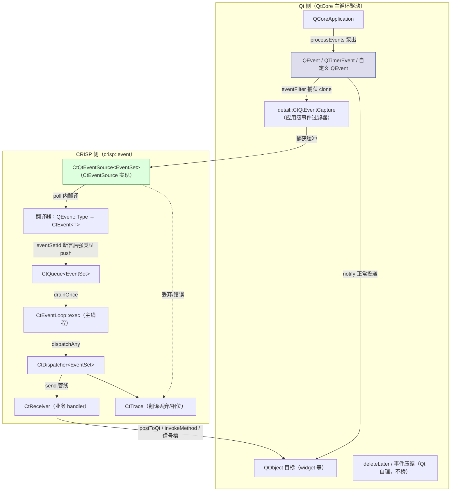

# CRISP Qt 桥（M3）设计（中文版）

> **状态**：架构设计文档（不含实现代码）
> **范围**：`crisp::event` + Qt 6.2.4 桥接层 — CRISP 项目 M3（QtEventBridge）
> **工具链**：MinGW-w64 8.1.0（x86_64 sjlj ABI）、C++17、CMake ≥ 3.20、Qt 6.2.4（`D:\Qt\6.2.4`，与工具链 ABI 匹配，`qt-hello/` 已验证可编译运行）
> **输入**：`04-event-system-redesign.md`（§4.2 退出标准、§7.10–§7.12、§10.4 偏差表、§13 测试计划、§14 开放问题）、`src/event/` 现有实现（M1/M2 已交付）、`qtbase-everywhere-src-6.2.4/`（`qcoreevent.h/cpp`、`qcoreapplication.cpp`、`qeventloop.cpp`、`qabstracteventdispatcher.h`、`qeventdispatcher_win.cpp`、`qobject.cpp`、`qthread.cpp`）
> **设计原则**：类型安全第一、可观测性内置、所有权明确、线程规则显式、热路径零堆分配、无代码生成（核心库保持无 moc；桥目标允许 moc，见 §5.2）

---

## 修订记录（Revision Log）

| 版本 | 日期 | 内容 |
|------|------|------|
| Rev 1 | 2026-10-06 | 首版 M3 设计。架构评审对 4 项阻塞先行裁定（下方"架构评审裁定"），本文档全部采纳并标注"已裁定"：①注入主路径 = 模板化 `QtEventSource<EventSet>`（§7.12 方案 A）；②循环共存 = `QCoreApplication` 主循环 + `processEvents()` 轮询；③`QtEventPayload` 持 `std::unique_ptr<QEvent>`；④`defer_delete` M3 继续推迟。 |
| **Rev 2** | 2026-10-06 | **架构审查 Rev 1 打回（P1-1…P1-3 / P2-1…P2-4 / P3-1…P3-3）后修订**：P1-1 `CtQtEventCapture` 泛型化（`template <typename EventSet>`，成员 `CtQtEventSource<EventSet>* m_sink`，Q_OBJECT 在类模板内由 AUTOMOC 处理）；P1-2 新增 **§3.4 子节"捕获缓冲与 eventFilter 行为规格"**（容器 `std::vector<std::unique_ptr<QEvent>>`、poll 排空/清空点、kIgnoredQtEvents 跳过层、判空与重入保护、QCoreApplication 为 null 的构造/析构、Quit 特殊处理）；P1-3 `CtQtEventSource` 补 **`bool m_inPoll`**（debug 断言 + release 降级，§4.2 契约 #2/§7.4 #16 落实）；P2-1 `activate/deactivate` 精确定义（§3.4 契约 #6）；P2-2 §2.4 明确 **M3 唯一形态 = `CtEventLoop::exec()` 驱动 + poll 内 `processEvents()`**（Qt 侧无独立 exec，嵌套形态移入 M4 清单，§6.2 对齐）；P2-3 §2.3 补投递/重入显式说明；P2-4 §7.4 #14 依据改述（Qt 自动移除过滤器，桥不持 QObject 引用）；P3-1 §3.2 补 `CtTimerPayload` 语义；P3-2 双跑对比改为**文件对比**（Windows/MinGW 无 fork）；P3-3 §3.4 `kIgnoredQtEvents` 边界写清（应用级事件显式决策）；§9 开放问题按评审拍板回写。逐条见正文。 |
| **Rev 3** | 2026-10-07 | **编码阶段暴露的 kDropped trace 冲突裁定（方案 A）后修订**：桥无法构造 `CtDispatchContext`（私有构造，friends 仅核心库），设计原"poll 内记 dispatcher trace kDropped"无法在零接口扩展下落地。架构裁定 **`CtQueueBase::recordAsyncDrop(uint64_t)` 接口扩展**（`CtQueue<EventSet>` 内部构造 ctx 记**队列 trace** kDropped，纯 C++17、零 Qt 依赖、M1/M2 语义不变）。五处修订：§3.3 契约 #5 改"记队列 trace（recordAsyncDrop 钩子）"、§7.2 用例 #8 改"队列 trace"、§7.6 用例 #22 明确队列 trace、§5.1 改"向后兼容接口扩展"、§8 偏差清单新增该项。 |
| **Rev 4** | 2026-10-07 | **实现阶段裁定（编码评审后回写）**：①P1-1 泛型 `Q_OBJECT` 裁定**作废**——Qt 6.2.4 moc 实测不支持类模板内 `Q_OBJECT`（`Template classes not supported by Q_OBJECT`）；捕获类仅重写普通虚函数 `eventFilter()`，**移除 Q_OBJECT**，桥目标 AUTOMOC 关闭（§5.2 契约 #1"零 moc"恢复，更贴合 AGENTS.md 原则 6）；②`installDefaults` 语义落实：**所有可桥 Qt 类型**（非忽略 built-in + User+）默认恒等翻译，未注册类型不再一律 drop——`translateAndPush` 增加 identity 兜底（§3.3 契约 #4/§3.4a #4 实现），真正不可桥（不可 clone）类型经 null 缓冲标记记 kDropped（§3.4a #6 实现，原实现漏记）；③不可 clone 类型记 drop 于 poll 层改为 **drain 层 null 标记**（captureClone 入 `nullptr`，`translateAndPush` 记 `recordAsyncDrop`）；④双跑验证发现并修正：**`CtHandlerToken` 析构即注销**——`bindHandler` 返回值必须保持存活，否则 handler 立即注销、事件被 drain 丢弃；⑤双跑 bridge 后端接收者由 `QWidget` 改 `QObject`（QWidget 构造/`show()` 产生 ~19 个窗口生命周期事件污染捕获流）；⑥Qt 6 对 `QCoreApplication` 下创建 `QWidget` fail-fast（`0xC0000602`），测试/后端入口统一用 `QApplication`；⑦`dual_compare` 修复：`cmake -P` 脚本路径用绝对路径 + `WORKING_DIRECTORY` 指定日志目录。 |
| **Rev 5** | 2026-10-11 | **M4 类型化翻译落地（见 `06-m4-typed-translation.md`）**：①桥集扩展 `CtQtEventSet = CtEventSet<CtTimerPayload, CtQtEventPayload, CtMousePayload, CtKeyPayload>`（§3.2 契约 #1/#2 修订——EventSet 必须含全部三载荷，06 §4 新契约）；②翻译器返回类型改 `CtQtTypedPayload = std::variant<CtQtEventPayload, CtMousePayload, CtKeyPayload>`，`translateAndPush` 用 `std::visit` 强类型 push（§3.3/§3.4 契约 #2 步骤④实现）；③默认翻译器安装：鼠标（Move/ButtonPress/ButtonRelease/ButtonDblClick → `CtMousePayload`，含 `CtMouseAction` 动作判别）与键盘（KeyPress/KeyRelease → `CtKeyPayload`，含 `CtKeyAction`）；④双跑 bridge 后端迁移为三 handler（mouse/key/raw-timer），对比输出仍字节一致；⑤桥库补链 `Qt6::Gui`（QMouseEvent/QKeyEvent 在 QtGui 模块）；⑥测试 30 个（新增 7 个 M4 用例），定时器测试改单次触发消除时序抖动。§9 #1 由"已裁定 M4"改"已落地"。 |

### 架构评审裁定（2026-10-06，依据 04 文档已定稿条款与 §14 倾向）

| # | 阻塞问题 | 裁定（本文档直接采纳，标注"已裁定"） |
|---|---------|-----------------------------------|
| 1 | 注入主路径 | **已裁定**：模板化 `CtQtEventSource<EventSet>`（方案 A 首选，§7.12 P2-A 已定稿）——`poll(CtQueueBase&)` 内经 `queue.eventSetId() == CtTypeKey<EventSet>::value()` 断言后 `static_cast<CtQueue<EventSet>&>` 强类型 push；`CtEventLoop::injectEvent<EventSet, T>` 保留为应用/桥接层手工注入备选通道（§7.11 注释语义不变）。Qt 事件翻译（`QEvent::Type` → `CtEvent<T>`）发生在源的 poll 内部。 |
| 2 | 循环共存模型 | **已裁定**：`QCoreApplication` 主循环 + `CtQtEventSource` 轮询 `QCoreApplication::processEvents()`（最简单、零 ABI 风险；符合 §14 #8 条件变量/平台等待倾向——平台等待留 M4）。嵌套 `QCoreApplication::exec` 于 `CtEventLoop` 内、以及实现 `QAbstractEventDispatcher` 将 Qt 事件完全转为 CRISP 入队，均标注为 **M4 可选演进**（只注明，不设计实现）。双跑验证不依赖真实嵌入：两个独立可执行（纯 Qt 版 vs CRISP+桥版）跑同一业务代码对比输出。 |
| 3 | QEvent 所有权 | **已裁定**：`CtQtEventPayload` 持 **`std::unique_ptr<QEvent>`**——桥对可克隆 QEvent 用 `clone()` 值拷贝（不可 clone 的自定义 QEvent 需要应用提供翻译器），RAII 管理生命周期，符合"所有权明确/值语义"原则。接口签名见 §3.1。 |
| 4 | defer_delete | **已裁定**：**M3 继续推迟**（04 §10.4 已注明"接口不在本轮定死"），桥不改变 `CtReceiver` shared_ptr 所有权模型；QObject 侧 `deleteLater` 由 Qt 自行处理。在 §8 偏差清单中显式声明"M3 不落地，理由：所有权模型不变 + ABI 未锁"。 |

---

## 1. 目标与范围（Goals & Scope）

### 1.1 目标

M3 交付 **QtEventBridge 适配器**，实现 Qt 事件系统与 CRISP 事件系统的双向互操作，满足 04 §4.2 的 M3 退出标准：

> 桥测试通过；`docs/event-system/05` 记录桥。

具体目标：

1. **Qt → CRISP**：把 Qt 应用运行期产生的 `QEvent`（含 `QTimerEvent`、可 clone 的用户自定义 `QEvent`）**翻译**为强类型 `CtEvent<T>`，经 `CtQueue` 注入 `CtDispatcher`，由 CRISP handler 处理（04 §4.1 分层规则 #3/#4：源只注入队列，绝不直接接触接收者/分发器）。
2. **CRISP → Qt**：CRISP handler 可直接调用 Qt API（`QCoreApplication::postEvent`、`QMetaObject::invokeMethod`、信号槽）驱动 Qt 侧；桥提供 `postToQt` 便捷助手（§3.5）。桥自身不包装 Qt 的元对象系统。
3. **双跑验证**：同一业务代码（纯逻辑函数）在纯 Qt 后端与 CRISP+桥后端下分别运行，行为一致（事件序列、载荷、模型状态输出逐字节相同）。
4. **可观测性**：桥的翻译/丢弃路径接入 CRISP trace（`kDropped` 等相位），丢失或不可翻译的 Qt 事件可见可查。

### 1.2 非目标（M3 明确不桥接的 Qt 特性）

| 特性 | 裁决 | 理由 |
|------|------|------|
| 事件压缩（Qt `compressEvent`） | **不桥**：CRISP 侧不做压缩；Qt 侧压缩在 Qt 内部继续（`processEvents()` 泵出的是压缩后的流） | 与 04 §10.4 #6 一致（载荷不可变；压缩属队列策略） |
| `deleteLater` / `QDeferredDeleteEvent` | **不桥**：QObject 生命周期完全由 Qt 自理；CRISP 侧 `defer_delete` M3 不落地（裁定 #4） | 04 §10.4 #5；所有权模型不变 + ABI 未锁 |
| 内部/合成事件（`Paint`、`UpdateRequest`、`LayoutRequest`、`Polish`、`MetaCall`、`DeferredDelete` 等） | **不捕获**：捕获过滤器显式跳过（§3.4 `kIgnoredQtEvents`），Qt 照常投递 | 非应用语义事件；避免无谓 clone 与队列噪声 |
| 鼠标/键盘等**类型化翻译**（`QMouseEvent`→CRISP 专用载荷） | **M4**：M3 以原始载荷 `CtQtEventPayload` 直通 + 定时器翻译为内置 | §9 开放问题 #1（已裁定 M4） |
| 嵌套 `QCoreApplication::exec` 于 `CtEventLoop` 内 | **M4 可选演进**（只注明，不设计） | 裁定 #2；嵌套循环的递归/退出语义复杂 |
| 实现 `QAbstractEventDispatcher` 完全替代 Qt 事件分发 | **M4 可选演进**（只注明，不设计） | 裁定 #2；ABI 风险高 |
| 平台等待（epoll/select 桥） | **M4** | 04 §14 #8 倾向；M3 用条件变量 + `processEvents()` 轮询 |

### 1.3 边界（Bridge 契约的硬边界）

1. **桥只出现在平台层**：`CtQtEventSource` 是 `CtEventSource` 的实现（04 §4.1 分层规则 #3/#4）——只向 `CtQueue` 注入，绝不调用 `send/broadcast`、绝不接触 `CtReceiver`。
2. **核心库零 Qt 依赖**：`crisp_event`（`src/event/`）不 include 任何 Qt 头；桥代码独立成库（`src/bridge/`），仅在 CMake 探测到 Qt6 时构建（§5.2）。
3. **CRISP 侧类型安全不破**：`QEvent::Type`（int 枚举）→ `CtEvent<T>` 的翻译是**运行时映射表**，只存在于 `CtQtEventSource` 内部（受控单一位置）；CRISP handler 永远只面对强类型 `CtEvent<T>`，不存在 int 枚举 + `static_cast` 裸奔（§3.3）。
4. **双跑语义**：桥模式（CRISP+桥后端）下，同一事件既被 Qt 正常投递（捕获过滤器**不拦截**，`eventFilter` 恒返回 `false`），又被捕获翻译进 CRISP——但**业务逻辑只在一侧执行**（桥模式下业务在 CRISP handler；纯 Qt 模式下业务在 Qt handler），防止重复执行（§6.3）。

---

## 2. 双向桥接架构（Bidirectional Bridge Architecture）

### 2.1 架构总览



分层对应 04 §4.1：应用层 → 核心层；平台层（本桥）→ `CtQueue` → `CtEventLoop` → `CtDispatcher`。Qt 侧是"外部世界"，桥是唯一接触点。

### 2.2 Qt → CRISP：注入主路径（已裁定 #1）

**主路径 = 模板化源**。`CtQtEventSource<EventSet>` 实现 `CtEventSource`，附加到 `CtEventLoop`：

```
CtQtEventSource<EventSet> 附加到 CtEventLoop（attachSource）
  └─ poll(CtQueueBase& queue) 每轮执行（细节见 §3.4 契约 #2）：
       ① 入口置 m_inPoll=true（重入保护，§4.2 契约 #2）
       ② 断言 queue.eventSetId() == CtTypeKey<EventSet>::value()（§7.12 契约 #6）
       ③ 若 m_active：调 QCoreApplication::processEvents()
            （Qt 泵出事件；捕获过滤器把可桥事件 clone 进缓冲，恒不拦截，§3.4a）
       ④ m_capture->drain(*concreteQueue)：排空缓冲，逐项翻译（§3.3）
            → 强类型 push 进 CtQueue<EventSet>&
       ⑤ 若捕获到 QEvent::Quit → 调用 quitHandler（如 loop->quit()）
       ⑥ 出口复位 m_inPoll=false
```

**备选通道 = `CtEventLoop::injectEvent<EventSet, T>`**（04 §7.11 语义不变）：应用/桥接层代码持有 loop 指针时，可手工注入一个已构造的 `CtEvent<T>`；同样先断言 `queue().eventSetId()` 再下转型强类型 push。**本桥不用它作为主路径**，但保留其为合法通道（应用可在 poll 之外的时机注入）。

**为什么是方案 A**（§7.12 P2-A 已定稿）：非模板源在只持 `CtQueueBase&` 形态下没有注入通道（无法调用 loop 模板成员、无法构造 `detail::CtAnyEventHolder<EventSet>`）；源侧携带 `EventSet` 类型参数后，poll 内经 `eventSetId()` 断言下转型即可强类型 push，杜绝跨 EventSet 的 UB 下转型。

### 2.3 CRISP → Qt（裁定 #2 的互补方向）

桥的 Qt→CRISP 是"系统机制"；CRISP→Qt 是**应用代码模式**，桥只提供最小助手（§3.5）：

- **模式一（推荐）**：CRISP handler 内直接调用 Qt API——`QCoreApplication::postEvent(target, new QEvent(...))`、`QMetaObject::invokeMethod`、或对已知 QObject 触发信号。桥不介入、不包装（Qt 的元对象系统原样可用，M3 桥本质）。
- **模式二**：桥提供 `postToQt` 自由函数（`QCoreApplication::postEvent` 的类型化薄封装，`std::unique_ptr<QEvent>` RAII 语义），handler 用它把 CRISP 事件翻译回 Qt 事件投递给 QObject（示例见 §3.5）。
- **契约 #4（Rev 2 P2-3 投递/重入显式区分）**：handler 内可安全使用的是**延迟投递**——`postToQt` / `QCoreApplication::postEvent`（入 Qt 队列，控制权立即返回，无重入；Qt 文档标注 `\threadsafe`）。**同步/重入操作禁止**——`QCoreApplication::sendEvent`（同步执行 Qt handler，若该 handler 再触发桥投递即嵌套）、`QCoreApplication::processEvents()`、`CtEventLoop::exec()`（后两者重入 poll，§4.2 契约 #2 / §7.4 #16 的 `m_inPoll` 断言落点）。

### 2.4 循环共存模型（已裁定 #2；Rev 2 P2-2 明确 M3 唯一形态）

- **M3 唯一受支持的形态（Rev 2 P2-2 定死）**：**`CtEventLoop::exec()` 是唯一事件循环驱动**——主线程运行 `CtEventLoop::exec()`；`CtQtEventSource` 附加到该 loop；poll 内部调 `QCoreApplication::processEvents()` 泵出 Qt 事件。**Qt 侧没有独立的 `exec()`**（`QCoreApplication` 实例存在，但不调用 `QCoreApplication::exec()`——`processEvents` 由桥源在 poll 内驱动）。`CtEventLoop::exec()` 的每轮迭代 = ①排空 CRISP 队列（drainOnce）→ ②poll 全部附加源（桥源泵 Qt 事件并翻译入队）→ ③队列空则 `waitForEvent()` 阻塞。
- **顺序语义**：Qt 事件与 CRISP 事件的相对顺序 = "上一轮排空 → 本轮泵入 → 下一轮排空"，文档固定此边界语义（§6 双跑对比以此为一致基准）。
- **M4 可选演进（只注明，不设计实现）**：
  - 嵌套 `QCoreApplication::exec()` 于 `CtEventLoop::exec()` 内（模态对话框等场景）——**Qt 侧独立主循环形态移入此清单**（Rev 2 P2-2）；
  - 实现 `QAbstractEventDispatcher`，让 Qt 事件直接翻译为 CRISP 入队（不再经 `processEvents` 泵）；
  - 平台等待（`MsgWaitForMultipleObjectsEx` 等）替代条件变量阻塞（04 §14 #8）。

---

## 3. 事件类型映射与接口规范（Interfaces）

命名遵守 AGENTS.md：`Ct` 前缀、`m_` 前缀、`lowerCamelCase()`、`k` 前缀、英文 Doxygen 注释、C++17、无裸 `new`/`delete`（`QEvent::clone()` 返回的裸指针由 `std::unique_ptr` 接管，无手工 delete）。

### 3.1 CtQtEventPayload（qt_event_payload.h，新增）

**职责**：桥载荷——以 RAII 持有**一个** Qt 事件（裁定 #3）。move-only：`QEvent` 一般不可安全拷贝，桥从 `clone()` 或应用翻译器取得事件所有权。

```cpp
// qt_event_payload.h
#pragma once
#include <QEvent>
#include <memory>
#include <string_view>

namespace crisp::event {

/// Bridge payload: owns exactly one QEvent (RAII via std::unique_ptr).
/// Move-only — QEvent is not safely copyable in general; the bridge creates
/// payloads from QEvent::clone() or from application-provided translators.
/// Stored inside CtEvent<CtQtEventPayload>; the queue stores it by value
/// in the CtAnyEvent variant (move semantics, no extra heap).
struct CtQtEventPayload {
    /// Wrap an owned QEvent (nullptr permitted as an "empty marker").
    explicit CtQtEventPayload(std::unique_ptr<QEvent> event) noexcept;

    CtQtEventPayload(CtQtEventPayload&&) noexcept = default;
    CtQtEventPayload& operator=(CtQtEventPayload&&) noexcept = default;

    CtQtEventPayload(const CtQtEventPayload&) = delete;
    CtQtEventPayload& operator=(const CtQtEventPayload&) = delete;

    /// The owned event (nullptr if the payload was default-created).
    QEvent* event() const noexcept { return m_event.get(); }

    /// Qt event type id (QEvent::Type as int); 0 (QEvent::None) for null.
    int qtType() const noexcept;

    /// True if this payload owns an event.
    bool hasEvent() const noexcept { return m_event != nullptr; }

    /// Release ownership (used by the CRISP->Qt direction helpers, §3.5).
    std::unique_ptr<QEvent> release() noexcept { return std::move(m_event); }

private:
    std::unique_ptr<QEvent> m_event;  ///< owned Qt event (RAII)
};

} // namespace crisp::event

/// EventTraits specialization — required by CtEvent<CtQtEventPayload>.
CRISP_EVENT_TYPE(crisp::event::CtQtEventPayload, "QtEvent");
```

**语义契约**：

1. **move-only**：`QEvent` 拷贝不安全（Qt 源码 `Q_EVENT_DISABLE_COPY` 且拷贝是"bad idea"）；桥从不复制载荷。`std::variant<CtEvent<CtQtEventPayload>>` 移动存储零额外堆分配（04 §7.4 值语义）。
2. **构造唯一来源**：a) 桥捕获过滤器对**可 clone** 事件调用 `QEvent::clone()`（`qcoreevent.h` 定义 `virtual QEvent *clone() const`，`QTimerEvent`/`QChildEvent` 等实现之）；b) 应用自定义翻译器为不可 clone 的自定义 QEvent 提供（§3.3 契约 #6）。**桥自身绝不 `new QEvent`**。
3. **nullptr 载荷合法**：表示"占位/空标记"，`qtType()==0`；handler 应先查 `hasEvent()`。
4. **`qtType()`**：`static_cast<int>(m_event->type())`——仅供 trace 与翻译回 Qt 用；CRISP 事件身份永远是 `CtTypeKey<CtQtEventPayload>`（§3.3 契约 #1）。

### 3.2 CtQtEventSet 与建议事件集（qt_event_set.h，新增；M4 扩展）

**职责**：桥事件集。`CtQtEventSet` 是框架提供的默认桥集（含定时器 + 原始 Qt 载荷 + M4 类型化鼠标/键盘载荷）；应用可自建更大的闭合集（含应用自有载荷）。

```cpp
// qt_event_set.h
#pragma once
#include "ct_event_set.h"
#include "ct_timer_event_source.h"  // CtTimerPayload
#include "qt_event_payload.h"       // CtQtEventPayload
#include "qt_mouse_payload.h"       // CtMousePayload (M4)
#include "qt_key_payload.h"         // CtKeyPayload (M4)

namespace crisp::event {

/// Default bridge event set: framework timer payload + raw Qt event payload
/// + M4 typed mouse/key payloads.
using CtQtEventSet =
    CtEventSet<CtTimerPayload, CtQtEventPayload, CtMousePayload, CtKeyPayload>;

} // namespace crisp::event
```

**契约**：

1. **闭集**：`CtQtEventSet` 编译期固定为四个载荷；需要更多类型时应用自定义 `CtEventSet<CtTimerPayload, CtQtEventPayload, CtMousePayload, CtKeyPayload, MyPayload...>`（04 §7.4 取舍：集合闭合，扩展 = 重新实例化 dispatcher）。
2. **`CtQtEventSource<EventSet>` 的 `EventSet` 必须含 `CtQtEventPayload`、`CtMousePayload`、`CtKeyPayload`**（`static_assert`，M4 契约：源的 `translateAndPush` 对 `CtQtTypedPayload` 三分支逐一 `queue.push<P>`，缺任一载荷即编译失败；06 §4 取舍——不采用 `if constexpr` 降级，防止静默丢失类型化语义），含 `CtTimerPayload` 可选。
3. **`CtTimerPayload` 的角色（Rev 2 P3-1 写清）**：`CtTimerPayload` 供应用**按需附加 `CtTimerEventSource<CtQtEventSet>`** 注入 CRISP 原生定时器事件（04 §7.12 内建源）；**桥自身定时器翻译产物是 `CtQtEventPayload`**（`QTimerEvent` 恒等翻译，§3.3 契约 #4）——二者并存且互不混淆：`CtTimerPayload` 来自 CRISP 定时器源、`CtQtEventPayload`（`qtType()==QEvent::Timer`）来自 Qt 定时器。
4. 与 `CtEventSet` 的所有静态断言一致（非空、traits 特化、两两不同）。

### 3.3 翻译器：QEvent::Type → CtEvent<T>（qt_translator.h，新增）

**职责**：把 Qt 事件映射为桥 CRISP 事件。类型安全方案（AGENTS.md 原则 1）：**运行时映射表只在 `CtQtEventSource` 内部**；CRISP 侧永远强类型，杜绝 int 枚举 + `static_cast` 裸奔。

```cpp
// qt_translator.h
#pragma once
#include <QEvent>
#include <functional>
#include <unordered_map>
#include "qt_event_payload.h"

namespace crisp::event {

/// Qt event type id (int) used as the runtime map key — Qt's own identity,
/// confined to the bridge layer (the only sanctioned place that sees it).
using CtQtTypeKey = int;

/// Callback: build a CRISP event from an owned Qt event.
/// May translate into CtQtEventPayload (identity) or any concrete payload T
/// (e.g. CtTimerPayload) for application-defined custom mappings.
/// `source` marks spontaneous Qt events (QEvent::spontaneous()) as
/// CtEventOrigin::kSystem, else kApplication.
using CtQtTranslator =
    std::function<CtQtEventPayload(std::unique_ptr<QEvent>, bool spontaneous)>;

/// The bridge's type-safe mapping table: Qt type id -> translator.
/// Implemented in qt_translator.cpp; hot path = one unordered_map lookup
/// per captured event (bridge path is not the CRISP dispatch hot path).
class CtQtTranslatorTable {
public:
    /// Register a translator for a Qt event type. Returns false if the type
    /// is already registered (single translator per Qt type — no ambiguity).
    bool registerTranslator(CtQtTypeKey qtType, CtQtTranslator translator);

    /// Look up a translator; nullptr if unregistered (event not bridged).
    const CtQtTranslator* find(CtQtTypeKey qtType) const noexcept;

    /// Built-in defaults (identity + timer translations), populated by the
    /// default constructor of CtQtEventSource (§3.4).
    static void installDefaults(CtQtTranslatorTable& table);

private:
    std::unordered_map<CtQtTypeKey, CtQtTranslator> m_table;
};

} // namespace crisp::event
```

**语义契约**：

1. **翻译产物为 `CtQtTypedPayload`**（M4，`CtQtEventSource::poll` push `CtEvent<T>`，T ∈ {`CtQtEventPayload`, `CtMousePayload`, `CtKeyPayload`}，经 `std::visit` 强类型分支；06 §3.3）：应用自定义映射可在翻译器内"把 Qt 事件载荷抽成自己的 payload"，但 CRISP 事件**类型**限定在 `CtQtTypedPayload` 闭集内（M4 范围，06 §8 #3；应用自定义载荷直通超出范围）。翻译器签名返回 `CtQtTypedPayload`——不存在"返回任意类型"的虚接口。
2. **`CtQtTypeKey` 只存在于桥层**：dispatcher/queue/handler 永远不直接见 int 枚举；映射表是"运行时 int → 闭集内唯一载荷"的受控边界（等效于 04 §6.1 对类型身份的编译期保证在桥入口处的一次性归一）。
3. **`spontaneous()` → origin**：`QEvent::spontaneous()` 为 true → `CtEventOrigin::kSystem`（04 §7.3），否则 `kApplication`。这解决 Qt 痛点"事件来源只有 1 bit 且调试不可见"（02 §1.1）——进入 CRISP 后 origin 可 trace。
4. **默认翻译器（installDefaults）**：
   - `QEvent::Timer`（1）→ 恒等翻译（`CtQtEventPayload`，无额外映射；Qt 定时器由 Qt 泵出）。
   - **M4 类型化**：`MouseMove/MouseButtonPress/MouseButtonRelease/MouseButtonDblClick` → `CtMousePayload`（含 `CtMouseAction` 动作判别）；`KeyPress/KeyRelease` → `CtKeyPayload`（含 `CtKeyAction`）（06 §5 表）。
   - 其余可桥事件（`User` 及以上、以及 §3.4 显式允许的系统事件）→ 恒等翻译（`clone()` 载荷直通）。
   - `kIgnoredQtEvents`（§3.4）→ **不注册翻译器**（捕获即跳过，不进队列）。
5. **查找失败**：未注册类型 → 事件不进队列，且记 trace `kDropped`（**队列 trace**——通过 `CtQueueBase::recordAsyncDrop` 公共钩子，桥无法构造 `CtDispatchContext`；dispatcher trace 的 kDropped 保留给"已入队但投递失败"语义，04 §8.1 Step 2；Rev 3 裁定）。
6. **不可 clone 自定义 QEvent**：应用通过 `registerTranslator` 注册自定义翻译器（可做字段抽取），或干脆**不注册**（则该类型不桥）。**桥不会在捕获过滤器中 `new` 一个不可 clone 事件的拷贝**。

### 3.4 CtQtEventSource（qt_event_source.h，新增；核心类）

**职责**：`CtEventSource` 的 Qt 实现（方案 A 模板化源，已裁定 #1）——附加到 `CtEventLoop`，poll 时泵出 Qt 事件、翻译、强类型入队。

```cpp
// qt_event_source.h
#pragma once
#include <QObject>
#include <functional>
#include <vector>
#include "ct_event_source.h"
#include "ct_queue.h"
#include "ct_event.h"
#include "qt_translator.h"

namespace crisp::event {

/// List of Qt event types the bridge never captures (Qt-internal/synthetic).
/// Timer/User+ are captured; everything else is skipped in the event filter
/// (never cloned, never queued — Qt still delivers them normally).
extern const std::vector<CtQtTypeKey>& kIgnoredQtEvents();

/// Application-level event filter + capture buffer (implementation detail of
/// CtQtEventSource; QObject subclass, so moc is allowed in the bridge).
/// eventFilter() ALWAYS returns false (never intercepts — Qt delivery
/// continues normally; §1.3 boundary #4). Captured events are cloned into
/// the buffer for the source's poll() to translate.
/// (Rev 2, P1-1) TEMPLATED on EventSet: the sink pointer must name the
/// concrete CtQtEventSource<EventSet> (a non-template "CtQtEventSourceBase"
/// does not exist — the source is only ever instantiated with an EventSet).
/// Q_OBJECT inside a class template is supported by moc; AUTOMOC processes
/// the template definition in qt_event_source.h the same way (§5.2).
template <typename EventSet>
class detail::CtQtEventCapture : public QObject {
    Q_OBJECT
public:
    /// The source that consumes the buffer (set by CtQtEventSource).
    void setSink(CtQtEventSource<EventSet>* sink) { m_sink = sink; }

    /// Drain the captured-event buffer into the sink's queue (called by
    /// CtQtEventSource::poll AFTER processEvents() returns; §3.4 契约 #2).
    void drain(CtQueue<EventSet>& queue);

    /// Number of events currently buffered (diagnostics/tests).
    std::size_t bufferedCount() const noexcept;

protected:
    bool eventFilter(QObject* watched, QEvent* event) override;

private:
    /// Buffer of owned, cloned Qt events captured since the last drain().
    /// (Rev 2, P1-2) Container FIXED: std::vector<std::unique_ptr<QEvent>>.
    std::vector<std::unique_ptr<QEvent>> m_buffer;
    CtQtEventSource<EventSet>* m_sink = nullptr;  ///< consuming source (owning)
    /// (Rev 2, P1-2) Set by eventFilter() on QEvent::Quit (never cloned);
    /// cleared by poll() step ⑤ after the quit handler runs (§3.4a #3).
    bool m_quitCaptured = false;
};

/// Template bridge source: pumps Qt events and injects them into a
/// CtQueue<EventSet> (scheme A — EventSet-carrying source, §7.12 P2-A).
template <typename EventSet>
class CtQtEventSource final : public CtEventSource {
public:
    static_assert(EventSet::template contains<CtQtEventPayload>,
                  "CtQtEventSource<EventSet> requires CtQtEventPayload in the "
                  "event set");

    /// Create with the loop whose queue this source injects into.
    /// Does NOT install the event filter yet (done by activate(), §3.4 契约 #6).
    /// Requires QCoreApplication::instance() != nullptr (asserts otherwise).
    explicit CtQtEventSource(CtEventLoop& loop);

    ~CtQtEventSource() override;  ///< deactivates + removes the event filter (RAII)

    /// poll: assert queue.eventSetId() == CtTypeKey<EventSet>::value(), then
    /// pump QCoreApplication::processEvents() once and translate captured
    /// events into strong-typed pushes (main injection path, §2.2).
    /// (Rev 2, P1-3) Sets/clears m_inPoll around the whole body.
    void poll(CtQueueBase& queue) override;

    /// Install the event filter and start capturing (idempotent: no-op if
    /// already active; §3.4 契约 #6).
    bool activate() override;

    /// Stop capturing + remove the event filter + clear the capture buffer
    /// (idempotent; noexcept). Subsequent poll() calls do NOT pump Qt events.
    void deactivate() noexcept override;

    std::string_view sourceName() const noexcept override;

    /// Qt event type id -> translator (defaults installed on construction).
    CtQtTranslatorTable& translatorTable() noexcept { return m_translators; }

    /// Called on QEvent::Quit capture (default: loop->quit()).
    void setQuitHandler(std::function<void()> quitHandler);

private:
    CtEventLoop& m_loop;             ///< owning loop (source's queue host)
    CtQtTranslatorTable m_translators;
    /// (Rev 2, P1-1) Concrete capture of the SAME EventSet (templated).
    std::unique_ptr<detail::CtQtEventCapture<EventSet>> m_capture;
    bool m_active = false;
    /// (Rev 2, P1-3) Re-entry guard: true while poll() is executing on the
    /// stack. Debug: assert(false) on re-entry. Release: record an error and
    /// skip the nested processEvents() call (§4.2 契约 #2 / §7.4 #16).
    bool m_inPoll = false;
    std::function<void()> m_quitHandler;  ///< invoked on captured Quit
};

} // namespace crisp::event
```

**语义契约**：

1. **附加前提**：`CtQtEventSource` 构造必须发生在**主线程**（`CtEventLoop` 归属线程；`attachSource` 会断言源与 loop 同线程，§7.11）。事件过滤器安装于 `QCoreApplication::instance()`（应用级过滤器，只作用于主线程，§01 3.2）。**构造时 `QCoreApplication::instance()` 必须非空**（断言；`processEvents` 与过滤器安装都需要 qApp）。
2. **poll 顺序（固定，Rev 2 P1-3 补 `m_inPoll`）**：①入口置 `m_inPoll=true`；②断言 `queue.eventSetId() == CtTypeKey<EventSet>::value()`；③若 `m_active`，`QCoreApplication::processEvents()` 泵出（Qt 内部先投递 Qt handler，捕获过滤器同时把可桥事件 clone 进缓冲——恒不拦截）；④`m_capture->drain(*concreteQueue)`：排空缓冲，逐项查 `m_translators` → 翻译 → 构造 `CtEvent<CtQtEventPayload>`（`CtEventOrigin::kSystem` 若 `spontaneous()`）→ `static_cast<CtQueue<EventSet>&>(queue).push(target={}, std::move(event))`（广播，§8.2 语义——桥事件投递给所有注册该载荷的 handler）；⑤若捕获 `QEvent::Quit` → 调 `m_quitHandler`；⑥出口复位 `m_inPoll=false`。**重入保护**：入口若已 `m_inPoll`，debug 断言失败；release 记错误（§7.13）并跳过本次 body（不泵出、不入队）。
3. **`CtQtEventCapture::eventFilter` 恒返回 false**：**绝不拦截** Qt 投递（Qt widget 照常工作）。它只负责"看一眼 + clone 进缓冲"。这是双跑一致性的前提（§6.3）。
4. **kIgnoredQtEvents**（02/01 调研结论 + Rev 2 P3-3 边界写清）：见下方"捕获缓冲与 eventFilter 行为规格" §3.4 契约 #5。
5. **热路径**：桥路径不在 CRISP 分发热路径上（§11 预算不变）；poll 内一次 `unordered_map` 查找 + 一次 clone 分配，均属"异步/源路径允许分配"（04 §11.2）。
6. **activate/deactivate（Rev 2 P2-1 精确定义）**：
   - `activate()`：若已激活 → 返回 true（幂等）；否则安装应用级事件过滤器于 `QCoreApplication::instance()`，置 `m_active=true`，返回 true。安装失败（qApp 为 null）→ 返回 false、不置位。
   - `deactivate()` noexcept：若未激活 → 无操作；否则移除过滤器（`QCoreApplication::instance()` 非空才调 `removeEventFilter`，§4.2 契约 #5）、**清空捕获缓冲**（`m_buffer.clear()`）、置 `m_active=false`。幂等。
   - **未激活的 poll 不泵出 Qt、不捕获**：poll 的 `processEvents()` 只在 `m_active` 时调用（§3.4 契约 #2 步骤③）；`deactivate` 后队列不再有新桥事件（§7.4 用例 #15 显式测试）。
7. **线程**：`poll` 只在主线程（loop 归属线程）；事件过滤器只在主线程被 Qt 调用；缓冲无跨线程竞争（`processEvents` 泵出与 poll 排空同线程）。**M3 不支持工作线程的 Qt 事件桥接**（QObject 线程归属 + 桥源单线程模型，§9 开放问题 #2 已裁定）。
8. **`setQuitHandler`**：默认 `m_quitHandler = [&loop]{ loop.quit(); }`；应用可改为仅记录（不退出）。

### 3.4a 捕获缓冲与 eventFilter 行为规格（Rev 2 P1-2 新增）

**容器（定死）**：`detail::CtQtEventCapture<EventSet>::m_buffer` 为 **`std::vector<std::unique_ptr<QEvent>>`**——每项持一个 clone 副本的所有权（RAII，无裸指针）；顺序 = 捕获序（保序翻译的关键，§6.2 顺序基准依赖它）。

**eventFilter 行为（逐分支规格）**：

1. **判空与重入保护**：`m_sink == nullptr`（源未构造完成 / 析构中 / 测试直用）→ **直接返回 false，不捕获**（无 sink 则无处投递；不持 QObject 引用，watched 已亡由 Qt 自理，P2-4）。**不抛异常**（Qt 事件过滤器不得抛）。
2. **类型跳过（kIgnoredQtEvents 分支在这一层）**：`event->type()` ∈ `kIgnoredQtEvents` → 直接返回 false（不 clone、不进缓冲）。跳过发生在**捕获层**而非翻译层——未注册翻译器的事件的 `kDropped` 记录在 poll 排空层（§3.3 契约 #5）。
3. **`QEvent::Quit` 特殊处理**：`type()==Quit` → **不 clone、不进缓冲**，置位内部标志 `m_quitCaptured=true`；返回 false。poll 步骤⑤读该标志触发 quitHandler，随后清标志。
4. **可桥事件（默认捕获集合，P3-3 边界写清）**：
   - `QEvent::Timer`（1）与 `type() >= QEvent::User`（1000）的自定义事件 → **捕获**（`clone()` 入缓冲）。
   - **应用级/系统通知事件**（`ApplicationStateChange(214)`、`LocaleChange(88)`、`LanguageChange(89)` 等）→ **显式决策：不默认捕获**（列入 `kIgnoredQtEvents`，P3-3 裁定"默认不捕获"）；应用若要桥接，用 `registerTranslator` 显式开启（注册后即不再属于 ignored 集合——见下方 kIgnoredQtEvents 定义）。
   - 其余 Qt 内置事件（鼠标/键盘/焦点/显示等，`type() < User` 且不在上述列表）→ **M3 默认捕获为原始载荷**（恒等翻译，`CtQtEventPayload` 直通）。这是双跑验证的输入基础（§6 用 `QMouseEvent`/`QKeyEvent`）。
5. **kIgnoredQtEvents 最终定义**（捕获层跳过，恒不 clone）：
   `Paint(12)`、`UpdateRequest(77)`、`UpdateLater(78)`、`LayoutRequest(76)`、`Polish(75)`、`PolishRequest(74)`、`MetaCall(43)`、`DeferredDelete(52)`、`ThreadChange(22)`、`ChildAdded(68)`、`ChildRemoved(71)`、`ChildPolished(69)`、`Quit(20)`（Quit 特殊：不 clone 但置 quit 标志）、**以及全部 `type() >= User` 之外的系统通知类**（`ApplicationStateChange(214)`、`ApplicationFontChange(36)`、`ApplicationPaletteChange(38)`、`LocaleChange(88)`、`LanguageChange(89)`、`LayoutDirectionChange(90)` 等 Qt 源码注释列出的 application-level 事件）——**显式决策：默认不捕获**；应用可 `registerTranslator` 显式开启（注册表 `find()` 命中即捕获，`kIgnoredQtEvents` 仅为默认值，二者合并逻辑：`eventFilter` 先查注册表，命中则捕获；未命中再查 ignored 集合，命中则跳过；其余捕获）。
6. **clone 失败处理**：`event->clone()` 返回 nullptr（不可 clone 的自定义类型）→ **跳过**（不捕获、不进缓冲、记 `kDropped` 于 poll 层）。`registerTranslator` 自定义翻译器为该类型提供替代路径（§3.3 契约 #6）。
7. **缓冲生命周期**：`m_buffer` 只被三类操作触碰——eventFilter 追加（主线程 Qt 调用）、`drain()` 排空并 `clear()`（poll 内同线程）、`deactivate()` 清空（同线程）。**无跨线程访问**（§3.4 契约 #7）。
8. **drain() 语义**：把 `m_buffer` 逐项 `std::move` 出（`std::unique_ptr<QEvent>` 转移），翻译并 push 后**整体清空**——"排空点 = poll 内 drain 调用处；清空点 = drain 返回前"（§6.2 顺序语义依赖：一个 poll 周期内缓冲恰好一次排空）。

### 3.5 CRISP → Qt 助手（qt_sink.h，新增）

**职责**：把 CRISP 事件翻译回 Qt 的最小助手（§2.3 模式二）。

```cpp
// qt_sink.h
#pragma once
#include <QCoreApplication>
#include <memory>
#include "ct_event.h"

namespace crisp::event {

/// Post an owned Qt event to a QObject (thin RAII wrapper around
/// QCoreApplication::postEvent — the queue takes ownership, matching Qt's
/// postEvent ownership rule: never touch the pointer afterwards).
/// Returns true if the event was accepted by Qt (non-null receiver).
bool postToQt(QObject* receiver, std::unique_ptr<QEvent> event, int priority = 0);

/// Convenience: post a generic (typeless) Qt event of a given type.
bool postToQt(QObject* receiver, QEvent::Type type, int priority = 0);

} // namespace crisp::event
```

**契约**：

1. `postToQt` 是 `QCoreApplication::postEvent` 的类型化薄封装；`std::unique_ptr` 表达"转移所有权"（Qt 队列接管后 delete，RAII 语义一致，AGENTS.md 无裸 delete）。
2. CRISP handler 内调用安全（主线程；postEvent 线程安全，Qt 文档标注 `\threadsafe`）。
3. **不提供** `sendToQt`（`sendEvent` 需同线程 + 栈上事件，语义与 CRISP `send` 不同；M3 不包装，应用直接用 `QCoreApplication::sendEvent`）。

---

## 4. 所有权与线程模型（Ownership & Threading）

### 4.1 所有权边界

| 资源 | 持有者 | 释放 | 备注 |
|------|--------|------|------|
| `QEvent`（桥内） | `CtQtEventPayload`（`std::unique_ptr<QEvent>`） | 载荷析构 | clone 来源；**绝无裸 delete** |
| 捕获缓冲内 clone 副本 | `detail::CtQtEventCapture<EventSet>::m_buffer`（`std::vector<std::unique_ptr<QEvent>>`） | 每轮 poll 的 `drain()` 排空并 `clear()` | 缓冲生命周期 ≤ 一次 poll（§3.4a #8） |
| `QObject`（widget 等） | Qt 父链 / `deleteLater` | Qt 自理 | 桥**永不** delete QObject、**不持有** QObject 引用（P2-4） |
| `CtReceiver` | 应用 `shared_ptr` | 应用析构 | 04 §9.1 不变；桥不改变 |
| `CtQtEventSource` | `CtEventLoop`（`attachSource` 的 shared_ptr） | loop 析构 | 04 §11.5 |
| `CtQtEventCapture<EventSet>` | `CtQtEventSource<EventSet>`（unique_ptr） | 源析构 | 析构时若 `QCoreApplication::instance()` 非空才移除过滤器（§4.2 契约 #5） |

### 4.2 线程契约（遵循 AGENTS.md 原则 3/4：所有权明确 + 线程规则显式）

1. **单线程模型（M3 固定）**：`CtQtEventSource`、`CtEventLoop`、`QCoreApplication` 全部绑主线程。`poll`/捕获过滤器/`processEvents`/CRISP 分发管线全部在主线程顺序执行，**不存在跨线程共享可变状态**（除 Qt 队列内部的锁，Qt 自理）。
2. **重入禁止（Rev 2 P1-3 机制落点）**：CRISP handler（分发管线内）**不得**调用 `QCoreApplication::processEvents()` 或 `CtEventLoop::exec()`（重入：会再次进入 poll 并可能重复排空；与 Qt"handler 内不得重入事件循环"同型规则）。**机制**：`CtQtEventSource` 持 **`bool m_inPoll`**（§3.4 私有成员）——poll 入口置位、出口复位（RAII 或 try/finally 语义，编码子 agent 用栈对象守卫，§3.4 契约 #2 步骤①⑥）。**重入断言**：入口若已置位，debug 构建 `assert(false)` 终止；release 构建**记一次错误**（`CtEventErrorKind::kOther`，§7.13）并**跳过本次 body**（不泵出、不入队、不清缓冲）——嵌套 `processEvents()` 永不执行。**Qt handler 侧的二次效应**：桥源 `poll` 内部调 `processEvents()` 时，Qt handler 若又触发了 CRISP 投递（如 handler 内 `postToQt`，那是延迟投递、非重入，见 §2.3 契约 #4），该 CRISP 事件进入下一轮排空——**文档固定"本轮 poll 内不排空本轮泵入的 CRISP 事件"**（§6.2 顺序语义 #4）。
3. **Qt 侧线程**：QObject 的线程归属由 Qt 自理（`moveToThread` 等）；桥只在主线程捕获。工作线程里由 `postEvent` 投递给主线程 QObject 的事件，会在主线程泵出时被捕获——**桥天然支持"跨线程投递进主线程"的 Qt 事件**，但 CRISP 侧 handler 仍只在主线程跑。
4. **`CtEventLoop::quit` 语义不变**：任意线程可调（`std::atomic<bool>`，04 §7.11 契约 #4）；桥的 quitHandler 默认从主线程调 `loop.quit()`。
5. **析构顺序（固定）**：先 `CtQtEventSource`（析构时移除 Qt 事件过滤器 → 停止捕获），再 `CtEventLoop`（析构时关闭队列、注销路由，04 §7.11 契约 #7），最后 `QCoreApplication`。**禁止**在 `QCoreApplication` 析构后仍存在捕获过滤器（`qApp` 为 null，`eventFilter` 内访问即 UB——编码子 agent 实现 `~CtQtEventCapture` 时若 `QCoreApplication::instance()` 非空才调用 `removeEventFilter`）。

---

## 5. 文件布局与 CMake 集成（File Layout & CMake Integration）

### 5.1 文件布局

```
src/
├── event/                          （M1/M2 已交付；M3 仅做向后兼容接口扩展——
│                                     `CtQueueBase::recordAsyncDrop`，纯 C++17、零
│                                     Qt 依赖、不改既有语义，Rev 3 裁定）
│   ├── ct_event.h / ct_event_set.h / ct_dispatcher.h / ct_receiver.h
│   ├── ct_queue.h / ct_event_loop.h / ct_event_source.h
│   ├── ct_timer_event_source.h / ct_trace.h / ...（现有）
│   └── CMakeLists.txt              （crisp::event，零 Qt 依赖，不变）
└── bridge/                         （M3 新增，Qt 依赖库）
    ├── CMakeLists.txt              （crisp::qt_bridge，可选）
    ├── qt_event_payload.h          （§3.1：CtQtEventPayload + traits 特化）
    ├── qt_event_payload.cpp        （qtType() 等非模板实现）
    ├── qt_event_set.h              （§3.2：CtQtEventSet）
    ├── qt_translator.h             （§3.3：CtQtTypeKey / CtQtTranslator /
    │                                 CtQtTranslatorTable）
    ├── qt_translator.cpp           （installDefaults、kIgnoredQtEvents 定义）
    ├── qt_event_source.h           （§3.4：detail::CtQtEventCapture<EventSet>
    │                                 类模板声明 + CtQtEventSource<EventSet>；
    │                                 模板方法（drain/eventFilter）在头文件定义，
    │                                 moc 由 AUTOMOC 处理，§5.1 末尾说明）
    ├── qt_event_source.cpp         （捕获过滤器安装/移除 + kIgnoredQtEvents 查表
    │                                 等非模板逻辑下沉于此；桥目标允许 moc）
    ├── qt_sink.h                   （§3.5：postToQt）
    ├── qt_sink.cpp
    └── qt_bridge.h                 （总入口：include 全部公开桥头）

tests/
├── event/                          （M1/M2 测试，不变）
└── bridge/                         （M3 新增，Qt 测试）
    ├── CMakeLists.txt
    ├── main.cpp                    （复用 tests/event/test_harness.h 风格
    │                                 ——复制一份到 tests/bridge/，不改 event 测试）
    ├── test_qt_payload.cpp         （§7.1）
    ├── test_qt_translator.cpp      （§7.2）
    ├── test_qt_event_source.cpp    （§7.3–§7.6，含双跑）
    └── dual/                       （双跑验证）
        ├── business_logic.h        （§6.1 同一业务头文件，两个后端共用）
        ├── main_qt.cpp             （纯 Qt 后端可执行）
        └── main_bridge.cpp         （CRISP+桥后端可执行）

examples/
└── qt_bridge_demo/                 （可选：一个最小 QWidget 演示桥
    ├── CMakeLists.txt                Qt→CRISP 鼠标/定时器事件）
    └── main.cpp
```

**头文件自包含**（`#pragma once` + 完整 include，同 04 §5.3 规则）。**`qt_event_source.h` 不 include `qt_event_source.cpp` 的 moc 产物**——模板 `CtQtEventSource` 的 `poll` 是模板实现（放头文件，语言例外）；`detail::CtQtEventCapture<EventSet>`（类模板，含 Q_OBJECT）的模板方法实现也放头文件（`drain`/`eventFilter`/`bufferedCount`——类模板成员定义必须在头文件，moc 对类模板同样生成），其 moc 产物由 CMake `AUTOMOC` 生成（§5.2）。`eventFilter` 等**非模板**逻辑（如 kIgnoredQtEvents 查表）可下沉到 `qt_translator.cpp` 的自由函数，供模板方法调用——保持头文件薄、实现进 `.cpp`（AGENTS.md .h/.cpp 分离）。

### 5.2 CMake 集成（Qt 可选，无 Qt 也能构建核心库）

```cmake
# src/event/CMakeLists.txt — 现有，保持不变：
#   add_library(crisp_event STATIC ...)
#   add_library(crisp::event ALIAS crisp_event)
#   无任何 find_package(Qt6) —— 核心库零 Qt 依赖（§1.3 边界 #2）

# ---------------------------------------------------------------------
# src/bridge/CMakeLists.txt — M3 新增
# ---------------------------------------------------------------------
find_package(Qt6 COMPONENTS Core QUIET)   # D:\Qt\6.2.4\lib\cmake\Qt6

if(Qt6_FOUND)
    # Bridge library: Qt-dependent, optional. Built only when Qt6 is found.
    add_library(crisp_qt_bridge STATIC
        qt_event_payload.cpp
        qt_translator.cpp
        qt_event_source.cpp
        qt_sink.cpp)

    target_include_directories(crisp_qt_bridge PUBLIC
        $<BUILD_INTERFACE:${CMAKE_CURRENT_SOURCE_DIR}/../event>
        $<BUILD_INTERFACE:${CMAKE_CURRENT_SOURCE_DIR}>)

    target_link_libraries(crisp_qt_bridge PUBLIC crisp::event Qt6::Core)

    target_compile_features(crisp_qt_bridge PUBLIC cxx_std_17)

    set_target_properties(crisp_qt_bridge PROPERTIES
        AUTOMOC ON)                       # bridge 目标允许 moc（AGENTS.md 例外）

    add_library(crisp::qt_bridge ALIAS crisp_qt_bridge)
else()
    message(STATUS "crisp_qt_bridge: Qt6 not found — bridge library skipped")
endif()

# ---------------------------------------------------------------------
# 顶层 CMakeLists.txt（修改点：仅加一行条件子目录）
# ---------------------------------------------------------------------
# add_subdirectory(src/event)                      # 始终构建
# if(Qt6_FOUND)                                    # 或让 bridge/ 自己 find_package
#     add_subdirectory(src/bridge)
# endif()
# add_subdirectory(tests/event)                    # 始终
# if(Qt6_FOUND)
#     add_subdirectory(tests/bridge)
# endif()
```

**契约**：

1. **核心库零 Qt**：`crisp::event` 的构建与测试**不依赖** Qt6 探测；无 Qt 环境下 M1/M2 全绿（回归防护）。
2. **桥库可选**：`crisp_qt_bridge` 仅 `find_package(Qt6)` 成功时构建；失败则跳过并打印状态消息（不报错）。
3. **AUTOMOC 仅桥目标**：`qt_event_source.cpp` 含 `Q_OBJECT`（捕获过滤器）需要 moc；`AUTOMOC ON` 只设在 `crisp_qt_bridge` 上——核心库保持无 moc（AGENTS.md 原则 6 的 M3 例外已由任务书与 §5.2 声明：**桥阶段可依赖 Qt、可用 Qt 的 moc/信号槽——这是 M3 桥的本质**）。
4. **测试可执行**：`tests/bridge/` 的可执行 `qt_bridge_tests` 链接 `crisp::qt_bridge` + `Qt6::Test`（或复用 `tests/event/test_harness.h` 手写断言，二选一——**M3 沿用现有手写 harness 风格**，避免引入 QtTest 的宏差异；`Qt6::Test` 可选）。双跑两个可执行（`dual_main_qt`、`dual_main_bridge`）各自注册到 `ctest`。
5. **MinGW 构建参数沿用**：`CMAKE_BUILD_PARALLEL_LEVEL 2`（AGENTS.md）；Qt 库在 `D:\Qt\6.2.4\bin`（运行期 PATH）与 `D:\Qt\6.2.4\lib\cmake\Qt6`（find_package 前缀，可经 `CMAKE_PREFIX_PATH` 传入）。

---

## 6. 双跑验证方案（Dual-Run Verification，已裁定 #2 的落地形态）

### 6.1 同一业务代码

**业务逻辑必须是纯函数式**（不直接依赖 Qt 或 CRISP 类型），以头文件共享：

```cpp
// tests/bridge/dual/business_logic.h
#pragma once

/// Pure business state machine: counts mouse moves, applies key presses,
/// fires a timeout after N moves. No Qt/CRISP types — both backends drive it.
struct CtDualModel {
    int mMouseMoves = 0;
    int mKeyPresses = 0;
    int mTimeouts = 0;

    void onMouseMove(int x, int y) { mMouseMoves++; mLastX = x; mLastY = y; }
    void onKeyPress(int key)       { mKeyPresses++; }
    void onTimeout()               { mTimeouts++; }

    /// Deterministic "log": append one line per event (stable ordering).
    std::vector<std::string>& log() { return mLog; }
    int mLastX = 0; int mLastY = 0;
private:
    std::vector<std::string> mLog;   // "M x y" / "K key" / "T"
};
```

两个后端把**同一驱动序列**（同一种子/同一次序的事件源：若干 `QMouseEvent`、`QKeyEvent`、一个 `QTimer`）喂给 `CtDualModel`，最后对比 `log()` 内容与模型终态。

### 6.2 驱动序列与对比

- **驱动序列（固定、可复现）**：由测试代码**手工构造** `QMouseEvent`/`QKeyEvent` 并以 `QCoreApplication::sendEvent`/`postEvent` 投递给一个 `QWidget`（纯 Qt 后端与桥后端用**完全相同**的序列与顺序）；定时器用 `QTimer::singleShot`（两后端一致）。
- **纯 Qt 后端**（`main_qt.cpp`）：`QWidget` 子类重写 `mouseMoveEvent/keyPressEvent/timerEvent`，事件到达时更新 `CtDualModel` 并写 `log()`。
- **桥后端**（`main_bridge.cpp`）：同一 `QWidget`（不重写事件处理）作为事件接收者；`CtQtEventSource` 捕获并翻译入 CRISP；`CtReceiver` 的 handler 更新**同一** `CtDualModel`。
- **对比（Rev 2 P3-2 改为文件对比，Windows/MinGW 无 fork）**：两可执行各把 `log()` **写入文件**（每行 `M x y` / `K key` / `T`；文件路径由命令行参数指定，如 `--log=qt.log` / `--log=bridge.log`）；`ctest` 分别运行两个可执行后，用 CTest 脚本或测试驱动**对比两个文件内容逐字节相同**，并对比退出码。**结论：`log()` 文件逐字节相同 + 模型终态相同 + 退出码相同 = 双跑通过**。
- **顺序语义基准**（§2.4/§4.2 固定；Rev 2 P2-2 对齐"无 Qt 独立 exec"形态）：桥后端的 CRISP handler 顺序 = Qt 泵出顺序——`CtEventLoop::exec()` 每轮由 `CtQtEventSource::poll()` 调 `QCoreApplication::processEvents()` 泵出（Qt 先投递原事件给 `QWidget` 并同时捕获 clone → 本轮 poll 的 drain 翻译入队 → **下一轮** drainOnce 排空投递 CRISP handler）。纯 Qt 后端 handler 顺序 = Qt 投递顺序（Qt 侧同样没有独立 exec——纯 Qt 后端用 `QCoreApplication::processEvents()` 循环或 `QTimer` 驱动，二者事件序一致）。两者都是"Qt 泵出序"，故逐事件一致；差异只可能是桥 bug（如丢失/乱序），双跑即暴露。

### 6.3 一致性与防重执行

- 捕获过滤器**恒不拦截**（§3.4 契约 #3）：Qt 原事件照常投递给 `QWidget`；`QWidget` 不重写处理 = 业务不执行；业务只执行在 CRISP handler 侧。纯 Qt 后端则相反（业务在 widget handler）。**同一业务代码在两侧各执行一次，无重复执行**（桥模式下 Qt 侧为"哑接收者"）。
- 对比维度：事件序列（类型+载荷字段）、模型终态、`log()` 字符串。**不做耗时对比**（桥多一跳，允许差异）。

---

## 7. 测试计划（Test Plan，对应 §13 风格）

手写 test double（禁止 mock 框架，AGENTS.md）。测试目录 `tests/bridge/`，复用 `tests/event/test_harness.h` 断言风格（复制一份到 `tests/bridge/`，不改动 event 测试）。**每个桥测试都在"有 `QCoreApplication` 实例"的前提下运行**（`main()` 里先 `QCoreApplication app(argc, argv)`）。

### 7.1 载荷与翻译器测试

1. **`CtQtEventPayload` RAII**：从 `std::unique_ptr<QEvent>` 构造、move 转移所有权、`release()` 后源为空；析构正确释放（`QEvent` 子类计数析构验证）。§3.1。
2. **`qtType()`/`hasEvent()`**：`QTimerEvent` → `qtType()==QEvent::Timer`；nullptr 载荷 → `qtType()==0`、`hasEvent()==false`。§3.1 契约 #3。
3. **翻译器表**：`registerTranslator` 重复注册同类型返回 false（单一翻译器约束）；`find` 未注册返回 nullptr；`installDefaults` 后 `Timer`/`User+` 有翻译器、`kIgnoredQtEvents` 无。§3.3。
4. **spontaneous 映射**：`spontaneous()==true` 的 Qt 事件 → `CtEvent<CtQtEventPayload>::origin()==kSystem`；false → `kApplication`。§3.3 契约 #3。

### 7.2 捕获与注入测试（单线程，直接驱动 poll）

5. **捕获不拦截**：安装 `CtQtEventSource`（不 attach 到 loop，直接测捕获过滤器）+ 一个 `QWidget`；`QCoreApplication::sendEvent(widget, QMouseEvent)` 返回值为 Qt 正常投递结果（widget 未消费），且捕获缓冲已克隆该事件。§3.4 契约 #3。
6. **poll 翻译入队**：构造 loop（`setDispatcher`）+ `CtQtEventSource<CtQtEventSet>`（attach）；`sendEvent` 一个 `QMouseEvent`；调用一次 `source.poll(queue)`；断言队列内有一个 `CtEvent<CtQtEventPayload>`（`front` 检查载荷 `qtType()==QEvent::MouseMove`）。§2.2、§3.4 契约 #2。
7. **kIgnoredQtEvents 跳过**：`sendEvent(widget, QEvent(QEvent::Paint))` → 捕获缓冲为空、队列无事件；Qt 正常投递。§3.4a 契约 #5（kIgnoredQtEvents 最终定义）。
8. **未注册类型跳过 + kDropped trace**：注册表不含某类型 → 该事件不进队列，**队列 trace** 出现 `kDropped`（`recordAsyncDrop` 产生）。§3.3 契约 #5。
9. **定时器翻译**：`QTimer::singleShot(1, ...)` + 桥源 poll 数轮 → 队列出现 `CtEvent<CtQtEventPayload>`（`qtType()==QEvent::Timer`），随后排空投递 CRISP handler。§3.3 契约 #4。
10. **事件集断言**：`CtQtEventSource<CtEventSet<CtTimerPayload>>`（缺 `CtQtEventPayload`）编译失败（static_assert）。§3.4。
11. **quitHandler**：捕获 `QEvent::Quit` 时调用注册的 handler（默认 `loop->quit()`）；替换为记录型 handler 后断言被调用且 loop 未退出。§3.4 契约 #8、§3.4a #3。

### 7.3 桥→CRISP→桥 全链路测试

12. **CRISP handler → `postToQt` 回投**：CRISP handler 收到 `CtQtEventPayload`（`qtType()==QEvent::Timer`）后调 `postToQt(widget, new QTimerEvent(42))`；下一轮 Qt 泵出时 `widget` 收到该 `QTimerEvent`。§3.5、§2.3 模式二。
13. **顺序语义**：同一轮内先后 `postEvent` 两个事件（不同 Qt 类型），桥后端 handler 收到顺序 = Qt 泵出顺序。§6.2 顺序基准。

### 7.4 所有权与线程测试

14. **QObject 生命周期（Rev 2 P2-4 改述依据）**：`QWidget` 用 `deleteLater()` 于桥运行中析构；随后 Qt 泵出的该对象事件被安全跳过（**Qt 在 QObject 析构时自动从事件过滤器链移除它**，Qt 源码 `QObjectPrivate::deleteChildren`/析构路径自带清理；桥的捕获过滤器是 `QObject` 过滤器，Qt 处理 watched 已亡的调用——**桥源不持有 QObject 引用**，天然安全），桥侧无悬垂调用、无崩溃。§4.1 所有权表（QObject 由 Qt 自理、桥不持引用）。
15. **捕获过滤器生命周期**：`CtQtEventSource` 析构后（`QCoreApplication` 仍在），再 `sendEvent` 一个事件 → 不被捕获、Qt 正常投递（过滤器已移除）。§3.4 契约 #1/#6、§4.2 契约 #5。
15a. **未激活 poll 不捕获（Rev 2 P2-1 显式测试）**：`activate()` 前调用 `source.poll(queue)` → 不调 `processEvents()`（无 Qt 泵出）、队列无事件；`deactivate()` 后同断言。§3.4 契约 #6。
16. **重入禁止断言（Rev 2 P1-3 机制落点）**：CRISP handler 内调 `QCoreApplication::processEvents()` → 触发 `m_inPoll` 重入检测：debug 构建断言失败（`assert(false)`）；release 构建记 `CtEventErrorKind::kOther` 错误并跳过（不泵出、不入队）。测试分别在 debug/release 形态下断言（release 断言错误计数 + 队列仍空）。§3.4 契约 #2、§4.2 契约 #2。
17. **跨线程投递进主线程**：工作线程 `postEvent` 一个可桥事件给主线程 `QWidget` → 主线程桥源 poll 泵出时被捕获并翻译入 CRISP。§4.2 契约 #3。

### 7.5 双跑验证测试（§6）

18. **双跑一致（ctest 级，Rev 2 P3-2 文件对比）**：`dual_main_qt --log=qt.log` 与 `dual_main_bridge --log=bridge.log` 各写文件；`ctest` 驱动（脚本或测试函数）对比两文件内容逐字节相同 + 退出码相同。§6.2。
19. **同一驱动序列**：两后端使用同一 `business_logic.h` 与同一序列构造代码（共享头文件 + 共享测试驱动函数），仅后端接线不同。§6.1。
20. **防重执行**：桥后端中 `QWidget` 不重写任何事件处理（哑接收者），业务只经 CRISP handler 执行一次——断言模型计数恰为驱动序列的事件数（无重复）。§6.3。

### 7.6 回归与可观测性测试

21. **核心库零 Qt 回归**：`tests/event/` 全绿不受桥影响（桥不在同一编译单元）。§5.2 契约 #1。
22. **trace 可观测**：桥翻译丢弃（未注册类型）产生 `kDropped` 记录（**队列 trace**）；一次完整桥投递在 dispatcher trace 中可见 `kDispatched/kDelivered`。§7.9 相位、§7.2 用例 #8。

---

## 8. 偏差清单（Deviation Register，对应 04 §10.4）

| # | 04 §10.4 / 03 条款 | 本文档裁决 | 理由 |
|---|--------------------|-----------|------|
| 1 | 04 §10.4 #5：`defer_delete` 推迟到 M3/M4 | **M3 继续推迟（已裁定 #4）**：桥不落地 `defer_delete`，`CtReceiver` shared_ptr 所有权模型不变；QObject 侧 `deleteLater` 由 Qt 自理，桥不介入。落地形态（若 M4 做）：dispatcher 侧 `defer_delete(std::shared_ptr<CtReceiver>)` 辅助 + 事件循环安全点批量释放，接口不在本轮定死（沿用 04 原文）。 | 所有权模型不变 + ABI 未锁；桥不新增延迟删除通道 |
| 2 | 04 §10.4 #6：事件压缩（`compressible`） | **不桥（维持 04 否决）**：CRISP 不做内容压缩；Qt 侧压缩在 `processEvents()` 内部继续（泵出的是压缩后流）。桥不暴露"事件被压掉"的语义。 | 载荷不可变 + 零分配优先（04 §10.4 #6 全文） |
| 3 | 03 §3.3：`defer_delete(obj)` 由 dispatcher 统一处理 | **不采纳（同 #1）**：所有权模型（shared_ptr 持有，§9.1）已解决 `deleteLater` 痛点；桥只是让 Qt 侧对象继续用 Qt 的删除语义。 | 04 §10.4 #5 理由 |
| 4 | 03 §2.2/§5：Qt 桥适配器（阶段 1 兼容层） | **采纳并定稿为本文档 §2–§3**：`CtQtEventSource`（Qt→CRISP 主路径）+ `postToQt`（CRISP→Qt 助手）+ 翻译器表。桥目标允许 moc/Qt 信号槽（AGENTS.md 例外）。 | M3 退出标准（§4.2）要求的落地形态 |
| 5 | 04 §7.11 `injectEvent` 语义 | **无偏差**：保留为应用/桥接层手工注入备选通道（已裁定 #1）；本桥主路径为模板化源（§2.2）。 | §7.12 P2-A 方案 A 定稿 |
| 6 | 04 §14 #8：等待模型（条件变量 vs 平台等待） | **M3 维持条件变量**：桥源 poll 经 `processEvents()` 泵 Qt，`CtEventLoop` 队列空时 `waitForEvent()` 条件变量阻塞。平台等待（`MsgWaitForMultipleObjectsEx` 等）标注 **M4 可选演进**（§2.4，不设计实现）。 | 裁定 #2 + 04 §14 #8 倾向 |
| 7 | 嵌套 Qt 循环 / 实现 `QAbstractEventDispatcher` 完全接管 Qt 事件 | **M4 可选演进**（§2.4，只注明不设计）。 | 裁定 #2（零 ABI 风险优先） |
| 8 | Qt `checkReceiverThread` 仅 debug 断言（02 §4.2 痛点） | **桥内解决**：捕获过滤器恒不拦截 + 恒在主线程泵出 → 不存在 Qt 跨线程 sendEvent；CRISP 侧 `send` 双归属断言（04 §8.1 Step 1）在桥内同样生效（handler 在主线程）。 | 线程规则显式（原则 4）在桥内的落地 |
| 9 | （新增，Rev 3）`src/event/` 接口扩展 | **采纳**：`CtQueueBase::recordAsyncDrop(uint64_t)` 纯虚方法 + `CtQueue<EventSet>` override + `typeNameFor` 辅助（记队列 trace 的 kDropped，供桥翻译失败分支调用）。纯 C++17、零 Qt 依赖、M1/M2 语义不变（`CtQueue<EventSet>` 是唯一实现类，补一个 override）。 | §5.2 契约 #1 本意是"**零 Qt 依赖**"而非"零接口扩展"（05 §1.3 边界 #2）；§3.3 契约 #5 的 kDropped 记录在"桥无法构造 `CtDispatchContext`"的约束下必须借道队列（friend）实现（Rev 3 架构裁定） |

**偏差结论**：M3 未引入 04 §10.4 之外的任何新偏差；#4 是本文档对 03 阶段 1"适配器"要求的正式定稿。所有已裁定项（§修订记录 表）在正文中均标注"已裁定"。

---

## 9. 开放问题（Open Questions for Review，Rev 2 按评审拍板回写）

以下问题**架构评审已裁定（Rev 2 回写）**，编码子 agent 直接按裁定执行：

1. **类型化翻译扩展**（M4，**已落地**：见 `06-m4-typed-translation.md`）：`QMouseEvent`/`QKeyEvent` → CRISP 专用载荷（`CtMousePayload`/`CtKeyPayload`，内置 CRISP 原生动作枚举）。桥集已扩展为 `CtEventSet<CtTimerPayload, CtQtEventPayload, CtMousePayload, CtKeyPayload>`，翻译器返回类型改为 `CtQtTypedPayload = std::variant<CtQtEventPayload, CtMousePayload, CtKeyPayload>`（06 §3）。**应用自定义载荷直通超出范围**（`CtQtTypedPayload` 为闭合三元 variant，06 §8 #3）。
2. **桥的多线程支持**（M4）：工作线程的 `QObject` 事件桥接（捕获过滤器需每线程实例 + 线程安全缓冲）。**裁定（评审同意）**：**M3 不做**（§4.2 契约 #7 已固定单线程）；M4 视需求。
3. **Qt 测试框架**：`tests/bridge/` 用 QtTest 还是继续手写 harness？**裁定（评审维持）**：沿用 `tests/event/test_harness.h` 风格（复制到 `tests/bridge/`），避免宏差异；QtTest 若评估更优再切换。
4. **桥源捕获缓冲容量**：缓冲无限增长（应用在 poll 间不断有事件）的风险——是否给缓冲设上限？**裁定（评审同意）**：不设上限，但**容器定死为 `std::vector<std::unique_ptr<QEvent>>`**（§3.4a #1，配合 P1-2）——poll 每轮排空、`processEvents` 泵出与 poll 同线程、缓冲在 poll 内即清空；M4 若需平台等待再评估。
5. **`kIgnoredQtEvents` 的完备性**：列表是否覆盖全部 Qt 内部/合成事件（含 `QEvent::ApplicationStateChange` 等应用级事件）？**裁定（评审接受 + P3-3 补充）**：M3 以 §3.4 契约 #5 的**最终定义**为准（含"应用级/系统通知事件默认不捕获，可 `registerTranslator` 显式开启"的边界决策）；发现遗漏在测试中补（§7.2 用例 #7 验证）。

---

## READY_FOR_REVIEW

本文档 Rev 2 到达 **READY_FOR_REVIEW** 状态：§1–§3 为完整 M3 桥规范（目标/范围、双向桥接架构、事件类型映射与 `CtQtEventPayload`/`CtQtEventSet`/`CtQtTranslatorTable`/`CtQtEventSource<EventSet>`/`postToQt` 接口签名，**Rev 2 修复 P1-1 捕获类泛型化、P1-2 新增 §3.4a 捕获缓冲与 eventFilter 行为规格、P1-3 补 `m_inPoll` 重入机制**），§4–§8 为所有权/线程（**含 P1-3 机制落点与 P2-2/P2-3/P2-4 修订**）、文件布局与 CMake 集成、双跑验证方案（**P2-2 对齐无 Qt 独立 exec 形态、P3-2 改文件对比**）、测试计划（**§7.4 #14/#15a/#16 修订**，§7.1–§7.6，对应 04 §13 风格）、偏差清单（§8，含四项已裁定）。§9 开放问题**已按评审拍板回写**。请架构评审复核：P1-1 的类模板 moc 处理（§5.1）、P1-2 的缓冲规格与 §4.2/§7.4 引用一致性、P1-3 的 `m_inPoll` 三处落点（§3.4 契约 #2 / §4.2 契约 #2 / §7.4 #16）、以及 §6.2 顺序基准与 §2.4 唯一形态的一致性。
