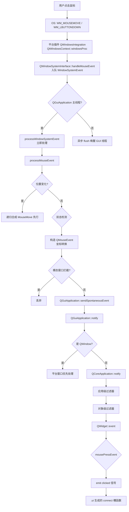

# Qt 6 XML UI 系统与事件系统原理深度分析

> 基于本地 Qt 6.2.4 源码（`qtbase-everywhere-src-6.2.4/`）逐行研读整理。
> 相关文件：
> - XML UI：`src/tools/uic/*`（uic.cpp / uic.h / treewalker.h / ui4.h / cpp/*）
> - GUI 事件：`src/gui/kernel/qguiapplication.cpp`、`qwindowsysteminterface.cpp`
> - 核心事件：`src/corelib/kernel/qcoreapplication.cpp`、`qeventloop.h`
> - Widget 事件：`src/widgets/kernel/qwidget.cpp`

---

## 1. 什么是 Qt 6 的 "XML 绘制 UI 系统"

Qt 6 的 UI 描述体系有**两套**，注意区分：

| 体系 | 描述文件 | 编译器/运行时 | 用途 |
|------|---------|--------------|------|
| **Qt Widgets + Designer** | `.ui`（XML） | `uic`（编译期生成 C++） | 传统桌面控件 UI |
| **QML + Qt Quick** | `.qml`（声明式 JS） | 运行时解释 + 场景图 | 现代声明式 UI |

**本分析聚焦第一套：`.ui` XML → `uic` → `Ui_Form` 类**（因为本地源码里有完整实现），并解析其与事件系统的关系。

### 1.1 `.ui` 文件本质

`.ui` 是一个 **XML 文档**，描述一棵"控件树 + 布局 + 属性 + 信号槽连接"。根元素 `<ui version="4.0">`。

```xml
<ui version="4.0">
  <class>ChatMainWindow</class>                          <!-- 生成类名 -->
  <widget class="QMainWindow" name="ChatMainWindow">     <!-- 顶层控件 -->
    <property name="geometry">
      <rect><x>0</x><y>0</y><width>800</width><height>600</height></rect>
    </property>
    <property name="windowTitle"><string>Qt D-Bus Chat</string></property>

    <widget class="QWidget" name="centralwidget">
      <layout class="QHBoxLayout">...</layout>
    </widget>
  </widget>

  <connections>                                          <!-- 信号槽连接 -->
    <connection>
      <sender>messageLineEdit</sender>
      <signal>returnPressed()</signal>
      <receiver>sendButton</receiver>
      <slot>animateClick()</slot>
    </connection>
  </connections>
  <tabstops>...</tabstops>
  <resources/>
</ui>
```

### 1.2 `uic` 编译器：XML → C++

```
.ui (XML)
  │
  │  QXmlStreamReader 流式解析
  ▼
DomUI / DomWidget / DomLayout ... (ui4.h 生成的 DOM 树)
  │
  │  TreeWalker 遍历模式 (treewalker.h)
  ▼
CPP::WriteDeclaration.acceptUI(ui)   → 生成 Ui_Form 类（setupUi()）
CPP::WriteIncludes.acceptUI(ui)      → 生成 #include
Validator.acceptUI(ui)               → 校验
```

`uic.cpp` 的核心流程（源码验证）：

```cpp
DomUI *Uic::parseUiFile(QXmlStreamReader &reader) {
    // 流式读取，遇到 <ui> 元素且 version >= 4.0 则 DomUI::read(reader)
    // 用 QXmlStreamReader 而非 DOM，省内存
}

bool Uic::write(DomUI *ui) {
    // 1. 写版权头 writeCopyrightHeaderCpp
    // 2. CPP::WriteIncludes  → #include <QtWidgets/...>
    // 3. Validator            → 校验 .ui 合法
    // 4. CPP::WriteDeclaration → 生成 class Ui_Form { setupUi(); retranslateUi(); }
}
```

### 1.3 生成的 `Ui_Form` 类（setupUi 的本质）

`uic` 生成的代码形如：

```cpp
class Ui_ChatMainWindow {
public:
    QTextBrowser *chatHistory;
    QLineEdit *messageLineEdit;
    QPushButton *sendButton;

    void setupUi(QMainWindow *ChatMainWindow) {
        // 1. new 出所有控件
        // 2. 设置属性（从 XML property 逐项还原）
        // 3. 建立布局（setLayout / addWidget）
        // 4. 建立信号槽连接（connect(sender, SIGNAL, receiver, SLOT)）
        // 5. retranslateUi()
    }
};
```

**关键点**：`uic` **不是运行时解释器**，而是**编译期代码生成器**。最终运行的是**手写等价的原生 C++**，没有 XML 解析开销。这与 QML（运行时解释）有本质区别。

---

## 2. Qt 6 事件系统完整原理

### 2.1 事件系统的两条大动脉

```
┌────────────────────────────────────────────────────────────┐
│                     Qt 6 事件系统总览                        │
├────────────────────────────────────────────────────────────┤
│                                                            │
│  动脉 A：自发事件 (Spontaneous, 平台驱动)                    │
│                                                            │
│   OS 消息 (Win32 MSG)                                      │
│     │                                                      │
│     ▼                                                      │
│   QWindowSystemInterface::handleMouseEvent()  ← 平台插件    │
│     │   (QWindowSystemInterfacePrivate 队列)                │
│     ▼                                                      │
│   QGuiApplicationPrivate::processWindowSystemEvent()       │
│     │                                                      │
│     ▼                                                      │
│   processMouseEvent/KeyEvent ... (合成 QMouseEvent 等)      │
│     │                                                      │
│     ▼                                                      │
│   QGuiApplication::sendSpontaneousEvent(window, &ev)        │
│     │                                                      │
│     ▼                                                      │
│   QCoreApplication::notify → 过滤器 → QWindow::event        │
│                                                             │
├────────────────────────────────────────────────────────────┤
│  动脉 B：投递事件 (Posted, 应用驱动)                         │
│                                                            │
│   QCoreApplication::postEvent(receiver, new QEvent(...))    │
│     │                                                      │
│     ▼                                                      │
│   QThreadData.postEventList (每线程队列, 加锁)               │
│     │                                                      │
│     ▼                                                      │
│   QAbstractEventDispatcher::processEvents (事件循环)         │
│     │                                                      │
│     ▼                                                      │
│   QCoreApplication::sendPostedEvents → notify                │
│                                                             │
└────────────────────────────────────────────────────────────┘
```

### 2.2 平台事件入口（动脉 A 起点）

`qwindowsysteminterface.cpp`（源码验证）：

```cpp
// 平台插件（如 Windows 的 QWindowsIntegration）把原生消息转成
// QWindowSystemInterfacePrivate::WindowSystemEvent 入队：

template<>
bool handleWindowSystemEvent<SynchronousDelivery>(WindowSystemEvent *ev) {
    if (QThread::currentThread() == guiThread) {
        // 主线程：立即处理
        QGuiApplicationPrivate::processWindowSystemEvent(ev);
    } else {
        // 非主线程：异步入队 + flush，唤醒 GUI 线程
        handleWindowSystemEvent<AsynchronousDelivery>(ev);
    }
}
```

**关键设计**：事件先进入 `QWindowSystemInterfacePrivate` 的**独立队列**，再由 GUI 线程的事件循环取出、经 `processWindowSystemEvent` 分发。这层队列与 QtCore 的 postEventList 不同——它是**平台事件缓冲**。

### 2.3 processWindowSystemEvent 的分发（switch 分派）

```cpp
void QGuiApplicationPrivate::processWindowSystemEvent(WindowSystemEvent *e) {
    switch (e->type) {
    case Mouse:   processMouseEvent(...);    break;
    case Wheel:   processWheelEvent(...);    break;
    case Key:     processKeyEvent(...);      break;
    case Touch:   processTouchEvent(...);    break;
    case Enter:   processEnterEvent(...);    break;
    case Leave:   processLeaveEvent(...);    break;
    // ... 几何、激活、关闭、屏幕等 20+ 种
    }
}
```

**这正是痛点文档里说的 "int 枚举 + switch 分派"** —— 平台事件类型是 `QWindowSystemInterfacePrivate::EventType` 枚举，靠 `static_cast` 还原具体事件。

### 2.4 processMouseEvent：平台事件 → QEvent（合成与修正）

`qguiapplication.cpp` 关键逻辑（源码验证）：

```cpp
void QGuiApplicationPrivate::processMouseEvent(MouseEvent *e) {
    // 1. 位置变化时先合成一个 MouseMove 事件（"move 前置"模式）
    if (!mouseMove && positionChanged) {
        MouseEvent moveEvent(...);         // 合成 move
        processMouseEvent(&moveEvent);     // 先处理 move
        processMouseEvent(e);              // 再处理原始事件
        return;
    }

    // 2. 双击检测（时间窗 + 距离窗 + 同按钮）
    doubleClick = e->timestamp - pressTimestamp < interval
                  && button == mousePressButton;

    // 3. 构造 QMouseEvent（合成、转换坐标）
    QMouseEvent ev(type, localPoint, localPoint, globalPoint, ...);
    ev.setTimestamp(e->timestamp);

    // 4. 模态窗口拦截
    if (window->blockedByModalWindow && !popupActive)
        return;   // 不投递

    // 5. 交付
    QGuiApplication::sendSpontaneousEvent(window, &ev);
}
```

**重要发现**：`processMouseEvent` 会**递归调用自身**来合成 MouseMove（当位置变了但事件本身是 Press/Release 时），保证 "先 move 后 press" 的语义。这是 Qt 平台事件的精妙之处。

### 2.5 notify：所有事件的唯一出口

`QGuiApplication::notify` → `QCoreApplication::notify` → `doNotify` → `notify_helper`：

```cpp
bool QGuiApplication::notify(QObject *object, QEvent *event) {
    if (object->isWindowType()) {
        // QWindow 先给平台窗口机会处理
        if (sendQWindowEventToQPlatformWindow(...))
            return true;                    // 平台插件"吃掉"了
    }
    return QCoreApplication::notify(object, event);
}

// QCoreApplicationPrivate::notify_helper（核心分发链）
static bool notify_helper(QObject *receiver, QEvent *event) {
    // 1. 应用级事件过滤器（仅主线程）
    if (sendThroughApplicationEventFilters(receiver, event))
        return true;                        // 过滤器吞掉
    // 2. 对象级事件过滤器
    if (sendThroughObjectEventFilters(receiver, event))
        return true;                        // 过滤器吞掉
    // 3. 最终交付
    return receiver->event(event);          // 虚函数分派
}
```

### 2.6 QWidget::event：从 QWindow 到控件

Qt 6 中 QWidget 内嵌 QWindow。事件到达 `QWidget::event` 后：

```cpp
bool QWidget::event(QEvent *event) {
    // 禁用态拦截（鼠标/键盘事件直接 return false）
    if (!isEnabled() && (MouseButtonPress || KeyPress || ...))
        return false;

    switch (event->type()) {
    case QEvent::MouseMove:         mouseMoveEvent(...);        break;
    case QEvent::MouseButtonPress:  mousePressEvent(...);        break;
    case QEvent::KeyPress:          keyPressEvent(...);          break;
    // ... 每种事件一个 case，static_cast 还原
    }
}
```

**注意**：`QWidget::event` 里依然是 **switch + static_cast** 模式——这就是我们要用 `std::variant`/类型化分发替代的样板。

### 2.7 定时器：动脉 B 的典型用例

```cpp
int QObject::startTimer(int interval, Qt::TimerType timerType) {
    // 委托给 QAbstractEventDispatcher::registerTimer
    int timerId = eventDispatcher->registerTimer(interval, timerType, this);
}

// Windows 实现（qeventdispatcher_win.cpp）：
//  - SetTimer 或 timeSetEvent
//  - WM_TIMER 到达 → 合成 QTimerEvent → QCoreApplication::postEvent
//  - 下一个循环迭代 sendPostedEvents 时派发
```

**关键点**：定时器事件是 **posted 事件**（异步排队），不是同步的。所以定时器精度受事件循环负载影响。

---

## 3. XML UI 系统如何与事件系统交互

`.ui` 文件中的 `<connections>` 把 UI 控件的事件/信号连接到槽函数：

```xml
<connections>
  <connection>
    <sender>messageLineEdit</sender>     <!-- 发送者对象 -->
    <signal>returnPressed()</signal>     <!-- 信号（事件出口） -->
    <receiver>sendButton</receiver>      <!-- 接收者对象 -->
    <slot>animateClick()</slot>          <!-- 槽（事件入口） -->
  </connection>
</connections>
```

`uic` 把它编译成（QObject::connect 运行时注册）：

```cpp
QObject::connect(messageLineEdit, SIGNAL(returnPressed()),
                 sendButton,     SLOT(animateClick()));
```

### 信号 → 事件的关系

| 层 | 机制 |
|----|------|
| **平台层** | 原生消息 → QWindowSystemInterface 队列 |
| **GUI 层** | QWindowSystemInterface → QEvent（如 QMouseEvent）→ sendSpontaneousEvent |
| **控件层** | QEvent → QWidget::event() → mousePressEvent() 等处理器 |
| **信号层** | 控件处理器内部 emit 信号（如 `clicked()`） |
| **应用层** | 信号 → 槽（用户代码） |

**本质**：`QEvent` 是**底层事件**（平台/框架产生），信号（signal）是**高层事件**（控件语义，如"被点击"）。`.ui` 的 `<connections>` 连接的是**信号层**。

---

## 4. 流程图：一次鼠标点击的完整旅程



---

## 5. 对 CRISP 项目的启示

对照我们的事件系统设计（`docs/event-system/03-rewrite-proposal.md`）：

| Qt 6 现状（源码证实） | CRISP 新方案 |
|----------------------|-------------|
| 平台事件用 `switch(e->type)` + `static_cast`（processWindowSystemEvent） | `std::variant` + `std::visit` 穷尽分发 |
| 事件类型是 int 枚举（`QWindowSystemInterfacePrivate::EventType`） | `CtEvent<T>` 类型即身份 |
| `QWidget::event` 里巨型 switch | 类型化 handler 注册 |
| 平台事件队列（QWindowSystemInterfacePrivate）与 posted 队列分离 | 统一 `CtQueue` + `CtEventSource` |
| `sendSpontaneousEvent` 标记来源（m_spont 一个 bit） | `CtEventSource::kSystem/kApplication` |
| 事件循环硬编码平台实现 | 可组合 `CtEventLoop`（Win32/epoll/定时器 source） |

**结论**：Qt 6 事件系统架构成熟但**类型安全与可观测性缺失**已被源码证实。CRISP 的 `CtEvent<T>` + 类型化分发方案恰好对症。XML UI 系统的 `uic` 思路（编译期代码生成）值得借鉴——**我们也可以为未来的 UI 层做一个"声明式描述 → 编译期生成"的轻量工具**，但那属于阶段 3 的规划。
