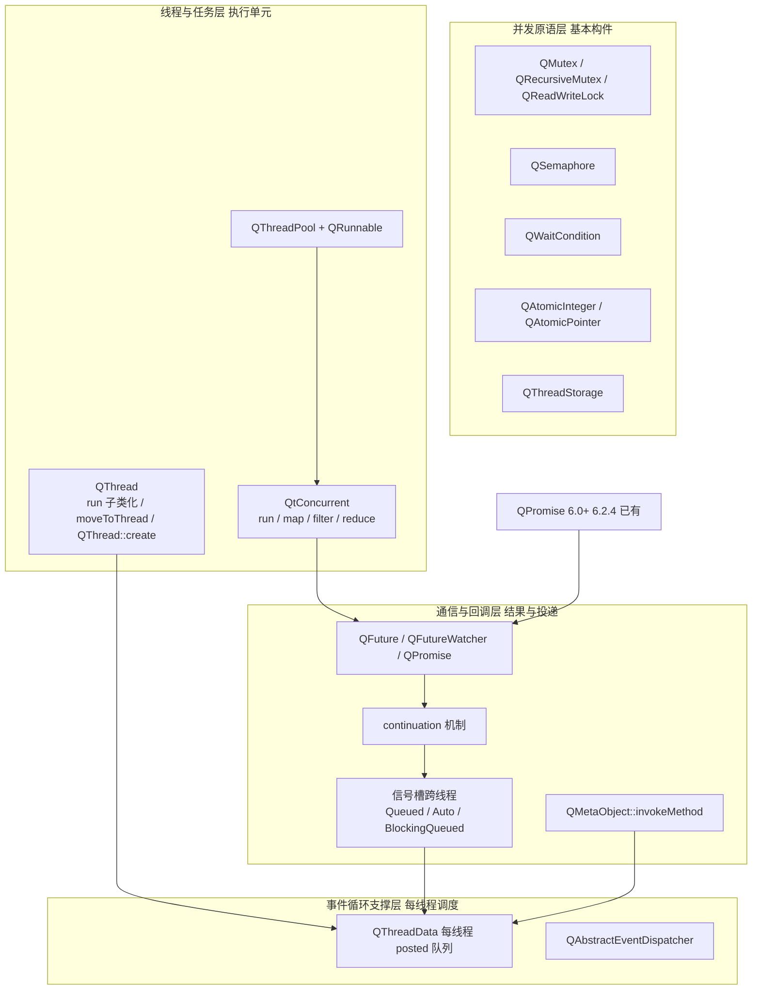

# Qt 6 多线程架构调研

> 本文基于 Qt 6.2.4 源码研读（`qtbase-everywhere-src-6.2.4/src/corelib/thread/` 与 `src/concurrent/`），整理 Qt 多线程的完整做法全景，作为 CRISP 多线程子系统（`crisp::thread`）重写的调研基础。
> 目的：为"重写 Qt 多线程"提供全景分类、场景分型与核心规则，供后续痛点分析（02）与重写方案（03）引用。

---

## 1. 全景分类

Qt 的多线程能力可以按"抽象层次"分成四层：

| 层 | 职责 | 典型类型 |
|----|------|---------|
| L1 并发原语 | 互斥、同步、原子、线程局部存储 | `QMutex`/`QSemaphore`/`QWaitCondition`/`QAtomic*`/`QThreadStorage` |
| L2 线程与任务 | 启动线程、执行任务、并行调度 | `QThread`/`QThreadPool`/`QRunnable`/`QtConcurrent` |
| L3 通信与回调 | 跨线程投递调用、异步结果、完成回调 | 信号槽/`invokeMethod`/`QFuture`/`QFutureWatcher`/`QPromise` |
| L4 事件循环支撑 | 每线程事件队列与分发器 | `QThreadData`/`QAbstractEventDispatcher` |

---

## 2. 按使用场景分型

| 场景 | Qt 手段 | 说明 |
|------|---------|------|
| 开一个后台线程跑一段代码 | `QThread::create(fn)` / `QtConcurrent::run(fn)` | `QThread` 子类化 `run()` 是旧风格，Qt 官方不推荐 |
| 长驻 worker + 收发消息 | `moveToThread()` worker 对象模式 | 对象 `moveToThread(t)` 后，信号槽跨线程自动转 `QueuedConnection`，由目标线程事件循环驱动 |
| 任务池 / 批量小任务 | `QThreadPool::globalInstance()->start(runnable)` | 底层线程池 + `QRunnable`，复用线程 |
| 并行容器算法 | `QtConcurrent::map / filter / reduce / mapped / filtered` | 分块 + 全局线程池，返回 `QFuture` |
| 异步结果获取 | `QFuture<T>` + `QFutureWatcher` | `QFuture::result()` 阻塞取 / `watcher` 信号回调（finished / resultReadyAt / progress） |
| 跨线程"投递"调用 | 信号槽 `Qt::QueuedConnection`、`QMetaObject::invokeMethod(obj, ..., Qt::QueuedConnection)` | 依赖目标线程事件循环，本质是往 `QThreadData::postEventList` 投 `QMetaCallEvent` |
| 跨线程阻塞等待结果 | `Qt::BlockingQueuedConnection` | 发送线程阻塞直到槽在目标线程执行完（易死锁，慎用） |
| 线程互斥 / 读写锁 / 信号量 / 条件变量 | `QMutex`(+Locker) / `QReadWriteLock` / `QSemaphore` / `QWaitCondition` | 与 std 对应物一一对应，Qt 6 中基本是 std 的薄封装 |
| 线程局部存储 | `QThreadStorage<T>` | 等价 `thread_local`，额外支持存 QObject 指针时线程退出自动清理 |
| 原子操作 | `QAtomicInteger<T>` / `QAtomicPointer<T>` | 等价 `std::atomic` |
| 线程间共享对象 | `QSharedPointer`（原子引用计数） | 无内置线程安全容器，容器需自己加锁 |
| 异步任务链 | `QFuture::then()/onFailed()/onCanceled()` 链式回调（**6.2.4 已公开**，含 `QtFuture::Launch`/`QThreadPool*`/`QObject*` 执行策略重载） | 6.2.4 已公开 `then()`（`qfuture.h` 4 个重载）；内部 run 路径用 `TaskResolver`/`StoredFunctionCall` + `QPromise`（`runWithPromise`），与 `then` 链**共用 continuation/promise 设施** |

---

## 3. 各机制要点（基于 6.2.4 源码）

### 3.1 `QThread`（`qthread.h` / `qthread_unix.cpp` / `qthread_win.cpp`）

- **三种用法**：
  1. 子类化重写 `run()`（旧风格，官方不推荐——继承侵入、只能跑一个任务、生命周期易错）
  2. **`moveToThread` + 信号槽**（官方推荐）：worker 对象整体搬家，跨线程信号槽自动排队
  3. `QThread::create(fn)`（Qt 5.10+）：静态工厂，跑一次性函数，底层仍是完整 `QThread` 生命周期
- **底层线程创建**：unix 侧是 `pthread_create`（非 `std::thread`）；Qt 6 **整理/简化了平台适配层**（移除重复的私有封装），但底层仍是平台线程 API（unix `pthread_create` / win `CreateThread`）。`QThread` 自己管理 `QThreadData`（每线程 posted 队列 + 事件分发器实例）。
- **生命周期契约**：`start()` → 线程运行 `run()`/事件循环 → `quit()`/`exit()` 请求退出 → `finished` 信号。**`run()` 返回 ≠ 线程结束**；线程对象析构时线程仍在 running 会崩溃（qWarning + abort 语义），必须 `requestInterruption` + `wait()` 或 `quit()+wait()`。
- **`QThreadStorage`** 与 `thread_local` 等价，额外支持 QObject 指针在线程退出时自动删除。

### 3.2 `QThreadPool` + `QRunnable`（`qthreadpool.h/cpp` + `qthreadpool_p.h`）

- 全局单例 `globalInstance()` + 每池 worker 线程集合。
- **任务队列**：`QQueue<QueuePair>`（优先级 + FIFO），`start()` 入队；空闲 worker 从队列取。
- **线程生命周期**：`activeThreadCount` 上限（`maxThreadCount`，默认 = 理想线程数，即硬件并发）；worker 超时 `expiryTimeout`（默认 30s）后退出；`shutdown()` 置 `isShutdown` 标志，worker 排空队列后退出。
- **QRunnable**：`run()` 虚函数 + `setAutoDelete`；**无返回值类型**，结果靠成员字段 + 互斥访问（类型擦除，无类型安全）。

### 3.3 `QtConcurrent`（`src/concurrent/`）

- `run`：`qtconcurrentrun.h/cpp`——封装 `QThreadPool::globalInstance()`，`start()` 一个 internal runnable，返回 `QFuture<T>`。
- **map / filter / reduce**：`qtconcurrentmapkernel.h` / `qtconcurrentfilterkernel.h` / `qtconcurrentreducekernel.h`——把容器**分块（chunk）**，每个块是一个任务投给线程池；`qtconcurrentthreadengine.h` 是共享的执行引擎（`QThreadPool` + 结果存储 + 取消/进度）。
- **调度**：依赖 `QThreadPool`（自研调度），**不依赖标准库 `std::execution`**——源码证据：`qtconcurrentiteratekernel.h` 自研 `BlockSizeManager` 分块，`qtconcurrentthreadengine.h` 的 `ThreadEngine` 基于 `QThreadPool`/`QFuture`/`QAtomic`/`QSemaphore`，无 `<execution>` 依赖。这一点对 CRISP 很关键（MinGW 8.1 无 PSTL，自研分块对齐 Qt 即可）。
- 取消：`QFuture::cancel()` 置 canceled 标志 + 请求中断；`QFutureWatcher` 通过 `QMetaObject::invokeMethod` 把信号投回监听线程。

### 3.4 `QFuture` / `QFutureWatcher` / `QPromise`（`qfuture*.h` / `qresultstore.h` / `qpromise.h`）

- **`QFuture<T>` 是值句柄**（拷贝共享同一个 `QFutureInterface<T>`，引用计数）。
- **结果存储**：`QResultStoreBase`（`qresultstore.h`）——索引化结果槽，`reportResult`/`reportFinished`；连续/离散结果两种模式（`QFuture::result()` 等待、`resultAt(i)` 按索引取）。
- **状态机**：`QFutureInterfaceBase::State` 原子标志（Pending/Started/Finished/Canceled），`reportFinished()` 置 Finished + 唤醒等待者。
- **`QFutureWatcher`**：QObject，信号 `started/progressValueChanged/resultReadyAt/finished/canceled`；信号经 `Qt::QueuedConnection` 语义投回 `watcher` 所在线程——**依赖监听线程有运行中的事件循环**。
- **continuation / 链式 API（6.2.4 已公开）**：`QFutureInterfaceBase::setContinuation(std::function<void(const QFutureInterfaceBase&)>)`——结果就绪后由报告线程直接调用，**不依赖事件循环**。公开的 `QFuture<T>::then()`（含 `QtFuture::Launch` / `QThreadPool*` / `QObject*` 执行策略重载）与 `onFailed()/onCanceled()` 在 **6.2.4 已正式暴露**（`qfuture.h` + `qfuture_impl.h`）；6.4 起进一步增强（`onReady` 等）。
- **`QPromise<T>`（6.2.4 已存在，非缺失）**：`QPromise` 是 task 生产者侧接口，与 `QFuture`（消费者侧）配对；6.2.4 已含完整类（`future()/addResult()/start()/finish()/isCanceled()/setException`）。`emplaceResult` 与异常传播增强是 **6.4 起的增量**（6.2.4 无 `emplaceResult`）。
- **取消**：`QFuture::cancel()` 是协作式——置 Canceled 状态 + 通知线程引擎中断；正在跑的不可强制中断，只能 `requestInterruption` 由任务自检。

### 3.5 事件循环支撑（L4，`qthread.cpp` 内部 `QThreadData`）

- 每线程一个 `QThreadData`：`postEventList`（posted 队列，`QPostEventList`）+ `eventDispatcher`（`QAbstractEventDispatcher` 实例）。
- `postEvent`/`sendPostedEvents` 走 `QThreadData::postEventList`，**加锁**（`postEventList.mutex`）；目标线程 `exec()` 里 `sendPostedEvents` 排空。
- 信号槽 QueuedConnection / `invokeMethod(QueuedConnection)` 本质都是投一个 `QMetaCallEvent` 到目标线程队列——**这是"QObject 系"跨线程通信的底层通道（每线程事件队列 + 投递）**。
- **注意**：QFuture 系另有一条**不依赖事件循环**的完成回调通道——`QFutureInterfaceBase::setContinuation`（结果就绪后由报告线程直接调用，见 §3.4）。两条通道并存：QObject 系走队列，QFuture 系可直调。

---

## 4. Qt 6 相对 Qt 5 的变化（基于 6.2.4）

| 变化 | 说明 |
|------|------|
| `QThread` 底层整理 | 移除平台私有细节依赖；unix 侧仍 `pthread_create`；生命周期语义不变 |
| `QMutex` 默认非递归 | `QRecursiveMutex` 单独存在；`QMutexLocker` 继续做 RAII |
| `QFuture` 内部重构 | `QResultStoreBase` 统一结果存储；`QFutureInterfaceBase` 引入 continuation（**6.2.4 已公开 `then()`，含 onFailed/onCanceled 与 Launch/QThreadPool/QObject 执行策略重载**；6.4 进一步增强 `onReady`/异常传播） |
| `QPromise` 加入 | Qt 6.0 引入，**6.2.4 已存在完整类**（`future()/addResult()/start()/finish()/isCanceled()/setException`）；`emplaceResult`、异常传播增强是 6.4 起的增量 |
| `QThreadPool` 默认并发 | 默认 `maxThreadCount` = 理想线程数（硬件并发），未变 |
| 推荐优先级明确化 | 官方文档明确：优先 `QtConcurrent` / `moveToThread` worker / `QThreadPool`，子类化 `QThread` 仅剩特殊场景 |

---

## 5. Qt 线程模型的三条核心规则（重写时最值得继承的心智模型）

1. **线程亲和性**：`QObject` 属于创建它的线程；跨线程直接调用对象方法/改属性是 UB，只有文档约束。
2. **跨线程通信 = 投递**：只能经事件队列（`QueuedConnection` / `postEvent` / `invokeMethod`），"碰运气"的直接调用被禁止。
3. **每线程一个事件循环**：队列、定时器、信号槽投递都挂在线程的事件循环上；目标线程必须有运行中的 `exec()` 才能收到投递。

> 这三条是 Qt 多线程"能跑起来"的底层契约，也是 CRISP 重写要**显式化、类型化**继承的（详见 03 方案）。

---

## 6. 与 CRISP 现状的关系

| Qt 层 | CRISP 现状（M1/M2） | 结论 |
|-------|--------------------|------|
| L1 并发原语 | 直接用 `std::mutex/condition_variable/atomic/thread_local` | **不重写**（Qt 就是 std 薄封装） |
| L2 线程生命周期 | 无 | **本次重写目标 MT1** |
| L2 线程池/任务 | 无 | **本次重写目标 MT1** |
| L3 异步结果 | 无 | **本次重写目标 MT2（CtFuture + 事件桥）** |
| L3 并行算法 | 无 | **本次重写目标 MT3（CtParallel，自研分块）** |
| L4 每线程队列/循环 | `CtQueue` + `CtEventLoop`（M2 已完成） | ✅ 已平替，直接复用 |

---

> 下一份文档：`02-qt-threading-pain-points.md`（痛点分析）。
