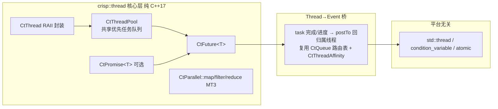
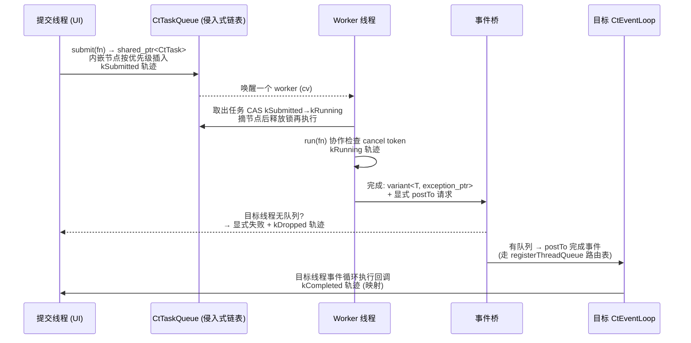

# 多线程子系统重写方案设计（调研版）

> 目标：设计一个**逐步替代 Qt 模块**的代码库中的**多线程子系统**——用现代 C++（C++17）重写，解决 Qt 多线程的核心痛点。
> 本文为**调研与方案设计**，不含实现代码。后续再进入原型阶段。
> 前置阅读：`docs/threading/01`（Qt 架构调研）、`docs/threading/02`（痛点分析）、`docs/event-system/03`（事件系统重写方案，六原则同源）。

---

## 1. 总体定位与战略

### 1.1 项目战略：多线程是事件系统的"执行侧"

```
┌─────────────────────────────────────────────────────────────┐
│ 你的代码库 (d:\crisp)                                          │
│                                                              │
│  M1/M2  事件系统（同步分发 + 每线程队列/事件循环）  ✅ 已完成    │
│  MT     多线程子系统（线程 / 线程池 / Future / 事件桥） ← 本方案 │
│  M3     Qt 桥（QtEventBridge 双跑验证）          ⬜ 进行中      │
│  M4     事件系统加固（对象池、flat-map 等）      ⬜ 未开始      │
└─────────────────────────────────────────────────────────────┘
```

**关键定位**：多线程子系统（`crisp::thread`）不是独立孤岛，而是事件系统 M2 的"执行侧延伸"——worker 线程产生结果，**唯一回传通道是 `post/postTo` 事件投递**（复用 M2 已完成的每线程队列 + 路由表）。

### 1.2 边界判断（先划清"重写什么 / 不重写什么"）

| 类别 | 结论 | 理由 |
|------|------|------|
| `QMutex/QSemaphore/QWaitCondition/QAtomic/QThreadStorage` 等价物 | **不重写** | Qt 6 中就是 std 薄封装，直接用 `std::` |
| 线程生命周期（对标 `QThread`） | **重写** | Qt 生命周期陷阱是痛点 #1；C++17 无 `std::jthread`，需自研 RAII 封装 |
| 任务执行（对标 `QThreadPool`/`QRunnable`） | **重写** | 痛点 #4 类型擦除；任务队列 + worker 是本子系统核心 |
| 异步结果（对标 `QFuture`/`QPromise`/watcher） | **重写** | 痛点 #3 不可取消/回调啰嗦；自研价值真实 |
| 并行算法（对标 `QtConcurrent`） | **重写（自研分块）** | MinGW 8.1 无 `std::execution`；Qt 也是自研分块（见 01 §3.3） |

### 1.3 设计原则映射（沿用六原则）

| 原则 | 落地于本子系统 |
|------|---------------|
| 类型安全第一 | `CtTask<T>` 强类型结果（`std::variant<T, std::exception_ptr>`）；替代 `QRunnable` 的 void* |
| 可观测性内置 | 任务轨迹复用 `CtTrace`，扩展任务相位（提交→运行→完成→取消） |
| 所有权明确 | RAII 任务句柄（类比 `CtHandlerToken`），析构自动取消/join；无裸 new/delete |
| 线程规则显式 | 完成回调**显式** `postTo` 回归属线程；worker 绝不直接触碰接收者 |
| 热路径零堆分配 | 任务队列用侵入式双向链表（任务对象内嵌节点），提交零分配 |
| 无代码生成 | 纯 C++17 + CMake，无 moc |

---

## 2. 核心架构设计

### 2.1 分层总览



### 2.2 模块划分（`crisp::thread` 命名空间）

```
crisp/thread/                 多线程子系统（纯 C++17）
├── thread.hpp                CtThread：RAII 线程封装
├── thread_pool.hpp           CtThreadPool：共享优先任务队列 + N worker
├── task.hpp                  CtTask<T>：强类型任务（variant<T, exception_ptr>）
├── task_queue.hpp            侵入式优先任务队列（热路径零堆分配）
├── future.hpp                CtFuture<T>：可取消、可注册完成回调；CtResult<T> = variant<T, exception_ptr>
├── promise.hpp               CtPromise<T>（可选，MT4）
├── parallel.hpp              CtParallel::map/filter/reduce（MT3）
├── thread_trace.hpp          任务轨迹相位扩展（crisp::thread::CtTaskPhase 独立枚举）
└── thread_event_bridge.hpp   任务→事件回传桥（postTo 封装）
```

### 2.3 与事件系统 M1/M2 的咬合点（直接复用，不另起炉灶）

| 事件系统类型 | 复用方式 |
|-------------|---------|
| `CtThreadId` / `currentThreadId()` | 线程身份统一；`CtThread` 记录 `m_affinityThread` |
| `CtThreadAffinity` | `CtTask` 记录"创建线程"；worker 线程持有自己的 affinity |
| `CtQueue` + `registerThreadQueue/unregisterThreadQueue` 路由表 | 完成回调走 `post/postTo`（`CtDispatcher::postErased`）：向目标线程队列投递 |
| `CtTrace` + `CtTracePhase` | 扩展任务相位（独立枚举 `crisp::thread::CtTaskPhase`，经事件桥映射，不污染事件系统枚举） |

> ⚠️ **明确不使用** `CtEventLoop::injectEvent` 做任务完成回传：`injectEvent` 语义是 setDispatcher 之后的强类型注入、只投本 loop 自己的队列，且跨线程取不到目标 loop 实例（`CtEventLoop::current()` 是 TLS 单 loop）。正确落点是 **`post/postTo` + `registerThreadQueue` 路由表**（与 §3.1 形态 A 一致）。

---

## 3. 关键设计决策详解

### 3.1 线程→事件回传桥（核心增量，对应痛点 #5）

**问题**：Qt 的完成回调要么依赖事件循环（watcher 信号），要么阻塞（wait()）；回调目标线程与执行线程混在一个 QObject 里。

**方案**：完成回调的两种显式形态：

```cpp
// 形态 A：postTo 投递（推荐，无事件循环依赖的线程也适用）
auto task = pool.submit<MyPayload>(computeFn);
task.onThread(uiThreadId, [](CtResult<MyPayload> r) {
    // 此 lambda 由事件桥转成一次 postTo，在 uiThread 的队列里执行
    // worker 线程绝不直接触碰这里捕获的对象
});

// 形态 B：线程内 poll（无事件循环的纯 worker 线程自取）
// 禁止忙等（自旋）：用条件变量/休眠等待 isReady，对齐项目 wait 纪律
task.waitReady();           // 内部 condition_variable 等待，不忙等
auto r = task.result();     // CtResult<T>
```

**规则（强制）**：
1. worker 线程**绝不直接调用**接收者/UI 对象的方法——唯一通道是 `postTo`。
2. 事件桥 = `CtThreadAffinity::assertSameThread()` + `postTo` 封装；目标线程无队列时**显式失败**（返回状态），不做静默丢弃。
3. **失败可观测**：`postErased` 无队列时返回 false 且不写 trace（M2 §10.1 contract #3）。事件桥层必须补一个**队列侧失败钩子**（仿 `CtQueue::recordAsyncDrop`，在 `postTo` 失败路径记录 `kDropped` 相位），保证"投递失败"在轨迹里可查——不依赖 `CtDispatchContext`（其默认构造私有，thread 层无法构造）。
4. 与 M3 Qt 桥同构：将来桥接 `QtConcurrent` 任务也有同一落点。

**任务分发时序（MT1/MT2 全链路）**：



### 3.2 任务队列数据结构（热路径零堆分配）

**方案**：侵入式双向链表（intrusive doubly-linked list），任务对象内嵌节点。

| 特性 | 侵入式链表 | `std::deque` |
|------|-----------|-------------|
| 提交堆分配 | **零**（节点内嵌在 CtTask 里） | 元素拷贝/移动（variant 可能堆分配） |
| 优先级插入 | O(n) 但零分配 | O(n) 且需移动元素 |
| 取消 | O(1) 摘除节点 | 标记+延迟清理 |
| 所有权 | 任务对象持有 | 队列持有 |

- 提交路径：`pool.submit(fn)` 构造 `CtTask<T>`（含内嵌节点），头插/按优先级插，`condition_variable` 唤醒一个 worker。
- 高频小任务场景**内嵌节点零分配**；大任务（`std::function` 负载）在 MinGW 8.1 libstdc++ 下无 SBO 保证，**仅负载本身一次分配**——"零分配"断言需限定为"内嵌节点零分配"（见风险表）。

**取消/执行/出队三方协议（必须定案，防实现者猜）**：
- **所有权**：`CtTask` 由 `shared_ptr<CtTask>` 持有（地址固定，节点内嵌合法）；持有者 = 提交者或线程池，二者以引用计数协调。
- **状态机**：`kSubmitted → kRunning → kCompleted/kCancelled`；`m_state` 为原子，worker 取出任务时 CAS `kSubmitted→kRunning`，失败（已被取消/摘除）则跳过。
- **锁序**：队列自旋锁/互斥锁只保护**链表结构**（入队/出队/摘除），不保护任务执行；worker 摘除节点后**释放锁再执行** `run()`——取消方拿锁摘除节点时，任务已不在队列（无"摘除正在执行的任务"竞态）；已 `kRunning` 的任务取消 = 置标志 + 协作自检（§3.3），绝不从队列摘除。
- **持有者析构**：析构 = `cancel()` + 若 `kSubmitted`（仍在队列）则摘除节点 + 等待 `kRunning` 任务完成（join 语义）；不允许析构方阻塞在队列锁上（锁内只做原子摘除）。

### 3.3 取消机制（C++17 无 stop_token）

**方案**：原子标志 + 协作式检查 + RAII 句柄三层：

1. `CtFuture::cancel()` → 置 `m_cancelled`（`std::atomic<bool>`）。
2. 任务函数通过 `CtCancelToken`（传给任务的可选参数）协作自检：`token.isCancelled()` 返回后提前退出。
3. RAII 任务句柄（类比 `CtHandlerToken`）：析构时若任务未完成 → 自动 cancel + 摘除队列节点；已运行则协作取消 + 等待。

**纪律**：不做强制线程 kill（`std::terminate` 语义不可恢复）；取消是协作的，文档明确。

### 3.4 任务轨迹（可观测性内置）

- **定案**：新增独立枚举 `crisp::thread::CtTaskPhase`（`kSubmitted/kRunning/kCompleted/kCancelled`），**不扩展** `crisp::event::CtTracePhase`（避免污染事件系统枚举、避免 `uint8_t` 枚举值集合变更影响 ABI/既有规范同步）。事件桥在投递完成事件时做相位映射（`kCompleted → 目标线程队列`），任务侧轨迹与事件侧轨迹经时间戳关联。
- 任务侧记录结构独立定义（不共享 `CtTraceRecord`）：`{ phase, taskId, submitThread, workerThread, queuedLatency, runDuration, cancelBy }`。
- 每条轨迹记录：提交线程、目标 worker 线程、入队到启动耗时（排队延迟）、执行耗时、取消方。
- 复用 `CtTrace` 环形缓冲（无锁 SPSC）的思想：任务侧写由 worker 线程写、提交侧由提交线程写，两个方向各一条 SPSC 通道；单任务的多条记录横跨两通道，**完成时按 taskId 聚合两段记录**（提交段 + 运行段）再落任务侧记录结构。

### 3.5 线程池生命周期（对齐 QThreadPool 但显式化）

- `CtThreadPool`：`start(N)` / `submit(fn)` / `shutdown()`（排空后退出 worker）/ `maxThreadCount` 可配。
- **结果存储分层**：`CtFuture<T>` 采用"单结果 + 多结果存储"双模式——单结果（`CtTask<T>` 默认）直接存 `variant<T, exception_ptr>`；多结果（`CtParallel::map/filter/reduce` 需要按块取）用索引化结果槽（对齐 Qt `QResultStoreBase`，见 01 §3.4）。结果存储归属 `crisp::thread` 层，事件桥只负责投递"完成"信号，不搬运结果。
- worker 数量默认策略（量化论据）：`min(std::thread::hardware_concurrency(), 显式上限)`；显式上限默认 8（32 位进程地址空间 4GB、默认栈 1MB，8 worker 栈占用 ≤8MB 可忽略，主要约束是任务负载本身；编译器 OOM（AGENTS.md 并行 ≤2）是**编译期内存**资源域，与运行期 worker 数无关，不混为一谈）。`setMaxThreadCount()` 可在 `start()` 前覆盖。
- `shutdown()` 幂等；析构自动 shutdown + join 所有 worker。

### 3.6 并行算法（MT3，对齐 QtConcurrent）

- **结论**：MinGW 8.1 的 libstdc++ 不支持 `<execution>`（PSTL），Qt 也是自研分块（`qtconcurrentiteratekernel`），故自研分块调度，不依赖标准库并行设施。
- `CtParallel::map(pool, first, last, fn)` → **阻塞同步**返回 `std::vector<Out>`（与 `std::for_each` 结果逐元素一致；设计草图的异步 `CtFuture` 形态不采用——同步语义满足 §4 验收且共享池更可测）。分块 + 每块一个任务投给 `CtThreadPool`；块结果按**块索引**装配（含 pool 拒绝的串行回退 park，保证确定性顺序）。
- 迭代器分块要处理随机访问/前向迭代器两种形态（前向迭代器物化一份，对齐 Qt 的 `qtconcurrentiteratekernel` 策略）。
- **API 形态定案（Rev 1）**：`map(pool, first, last, fn)` / `filter(pool, first, last, pred)` / `reduce(pool, first, last, init, op)`——显式传池（§3.5 共享池定位），阻塞等待全部块完成后返回；调用纪律：不得在池 worker 任务体内调用（会自死锁）。

---

## 4. 里程碑建议

| 里程碑 | 内容 | 验收标准 |
|--------|------|---------|
| MT0 | 调研文档（01/02/03 本文） | 过架构审查门禁 |
| MT1 | `CtThread` RAII + `CtThreadPool` + `CtTask<T>`（含侵入式队列 + 取消 + 任务轨迹 + `crisp::thread::CtTaskPhase` 独立枚举） | 单测：提交/优先级/取消（含"摘除 vs 执行"竞态用例）/shutdown/内嵌节点零分配（operator new 计数）/任务轨迹相位 kSubmitted→kRunning→kCompleted/kCancelled |
| MT2 | `CtFuture<T>`（单结果 + 多结果存储双模式）+ 线程→事件回传桥（postTo 封装） | 单测：完成回调在目标线程执行；**跨线程违规调用在 release 下被拒绝（返回码/轨迹）**；无事件循环线程显式失败且轨迹有 kDropped；可取消；`resultAt(i)` 多结果 |
| MT3 | `CtParallel::map/filter/reduce`（自研分块，**阻塞同步**返回；块序装配含拒绝回退） | 单测：与 std::for_each 结果一致；分块正确性（块边界）；按块索引装配（内部，含 pool 拒绝路径保序）；非结合 op 确定性；异常传播 |
| MT4 | work-stealing 队列 / `CtPromise<T>`（可选） | 性能对比 + 单测 |

> **类型定义**：`CtResult<T>` = `std::variant<T, std::exception_ptr>`（任务结果 + 异常通道，对齐 `CtTask<T>` §3.2）；`CtTask<T>` 强类型，替代 `QRunnable` 的 void* 类型擦除（§3.2 表）。此二类型在 MT1 定义、MT2 由 `CtFuture<T>` 暴露给消费者。

每个里程碑走项目流程：**编码 → 审计（代码审计子agent）→ 审查 → 测试**，直到 `DEPLOYED_OK`。

---

## 5. 风险与约束

| 风险 | 约束/对策 |
|------|----------|
| C++17 无 `std::jthread`/`stop_token` | 取消用原子标志 + 协作式 + RAII 句柄自兜 |
| MinGW 8.1 32 位 OOM | worker 默认数量保守（hardware_concurrency 取小）；显式可配 |
| 死锁（UI 线程阻塞等 worker） | 纪律：禁止 `wait()` 阻塞等待 worker 结果；一切完成回调走 `postTo` |
| 任务内嵌节点与任务移动语义冲突 | 节点持有者必须固定（任务对象不可移动/复制，用 `shared_ptr<CtTask>` 或固定地址池）；"零分配"限定为内嵌节点零分配，`std::function` 负载一次分配（MinGW 8.1 无 SBO） |
| 事件桥与 M3 Qt 桥耦合 | 事件桥只依赖 `post/postTo` 公共接口，不依赖桥接层内部 |
| 线程池任务堆积 | 显式队列上限（对齐 M2 `ct_queue.h` 的 `kMaxQueued = 8192` 纪律），超限拒绝/丢弃有轨迹记录 |

---

## 6. 一句话结论

**方向对，且时机正好**：M2 已完成"每线程事件循环 + 线程安全投递"（Qt 最难平替的一半），本次重写补齐另一半——线程生命周期、线程池、强类型任务、可取消 Future 与"任务→事件回传桥"；并把六原则中"显式线程规则 + 可观测性"延伸到任务域，这正是 Qt 里最易出 bug、最难排查的部分。
