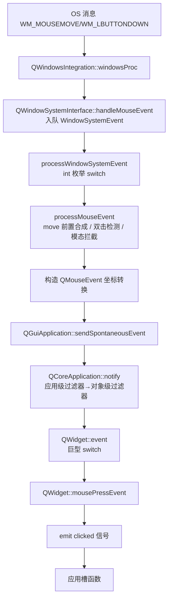

# Qt 6 GUI/Widgets 架构调研（crisp::ui 前置研究）

> 基于本地 Qt 6.2.4 源码（`qtbase-everywhere-src-6.2.4/`）逐行研读整理。本文是 crisp::ui 设计的"01 调研"文档，对应事件系统 01 调研（`docs/event-system/01-qt-event-system-architecture.md`）的地位。
> 相关文件：
> - 平台抽象：`src/gui/kernel/qwindowsysteminterface.cpp`、`qguiapplication.cpp`
> - 控件基座：`src/widgets/kernel/qwidget.cpp`、`qwidget_p.h`、`qwidgetrepaintmanager.cpp`
> - 绘制：`src/gui/painting/qpainter.h`、`qbackingstore*`
> - 样式：`src/widgets/styles/qstyle.h`、`qstylesheetstyle.cpp`
> - 布局：`src/widgets/kernel/qboxlayout.cpp`、`qlayout.cpp`
> - 焦点：`src/widgets/kernel/qapplication.cpp`

---

## 1. QPA：Qt 的平台抽象层

Qt 6 的 GUI 依赖 **QPA（Qt Platform Abstraction）** 把"平台窗口/输入/绘制"与"Qt 逻辑控件"解耦。

### 1.1 平台输入的两条路径

`qwindowsysteminterface.cpp`（源码验证）：

```cpp
template<>
bool handleWindowSystemEvent<SynchronousDelivery>(WindowSystemEvent *ev) {
    if (QThread::currentThread() == guiThread) {
        // 主线程：立即处理
        QGuiApplicationPrivate::processWindowSystemEvent(ev);
    } else {
        // 非主线程：异步入队 + flush，唤醒 GUI 线程
        handleWindowSystemEvent<AsynchronousDelivery>(ev);
    }
}
```

**关键设计**：
- 平台事件先进入 `QWindowSystemInterfacePrivate` 的**独立缓冲队列**，再由 GUI 线程的事件循环取出、经 `processWindowSystemEvent` 分发——这层队列与 QtCore 的 postEventList 不同，是**平台事件缓冲**。
- 事件类型是 `QWindowSystemInterfacePrivate::EventType` **int 枚举**，`processWindowSystemEvent` 里 `switch (e->type)` 分发 20+ 种事件。

### 1.2 processMouseEvent：平台事件 → QEvent（合成与修正）

`qguiapplication.cpp` 关键逻辑（源码验证）：

```cpp
void QGuiApplicationPrivate::processMouseEvent(MouseEvent *e) {
    // 1. 位置变化时先合成一个 MouseMove 事件（"move 前置"模式）
    if (!mouseMove && positionChanged) {
        MouseEvent moveEvent(...);         // 合成 move
        processMouseEvent(&moveEvent);     // 先处理 move
        processMouseEvent(e);              // 再处理原始事件
        return;
    }
    // 2. 双击检测（时间窗 + 距离窗 + 同按钮）
    doubleClick = e->timestamp - pressTimestamp < interval
                  && button == mousePressButton;
    // 3. 构造 QMouseEvent（合成、转换坐标）
    QMouseEvent ev(type, localPoint, localPoint, globalPoint, ...);
    // 4. 模态窗口拦截
    if (window->blockedByModalWindow && !popupActive)
        return;   // 不投递
    // 5. 交付
    QGuiApplication::sendSpontaneousEvent(window, &ev);
}
```

**重要发现**：`processMouseEvent` 会**递归调用自身**合成 MouseMove（位置变了但事件本身是 Press/Release 时），保证"先 move 后 press"语义。

### 1.3 QPA 的启示

| QPA 概念 | crisp::ui 对应 |
|---------|----------------|
| 平台事件缓冲队列 | `CtQueue`（事件系统已有） |
| `processWindowSystemEvent` 的 int 枚举 switch | typed 事件 + `std::variant` 分发（已有） |
| `sendSpontaneousEvent` 标记来源（m_spont 一个 bit） | `CtEventOrigin::kSystem/kApplication`（已有） |
| 平台窗口抽象 | `CtPlatformWindow`（UI3 设计） |

---

## 2. QWidget 基座

### 2.1 对象树与所有权

- `QObject` 树：父子关系由 `QObject::setParent` 建立，**子对象随父销毁**。
- 所有权：`QObject` 析构删除子对象（`deleteChildren`），配合 `deleteLater()`（posted 延迟删除）形成 Qt 的"手工所有权 + 延迟删除"模型。
- 痛点映射：所有权由 parent 树显式表达，但**不强制**——`new QWidget(parent)` 与 `setParent` 两条路并存，忘记父级即内存泄漏或悬垂。

### 2.2 geometry 与 QWidgetData

`QWidgetData`（`qwidget_p.h`）承载控件状态位域：`geometry`、`attributes`、`focusPolicy`、`visible/enabled` 位等。

```cpp
struct QWidgetData {
    QRectF geometry;      // 几何
    QRectF clipRect;
    Qt::WindowFlags windowFlags;
    Qt::WidgetAttribute attributes;  // 位域：WA_* 系列
    Qt::FocusPolicy focusPolicy;
    qint64 explicitMinSize, explicitMaxSize;
    uint32_t is_visible : 1, is_enabled : 1, ...  // 位域
};
```

**启示**：控件状态多且杂，Qt 用位域+属性宏（`WA_*`）维护。CRISP 倾向**显式枚举/布尔成员**，牺牲一点内存换可读性，同时保留"无堆分配"。

### 2.3 QWidget::event：巨型 switch

`qwidget.cpp:8641`（源码验证）：

```cpp
bool QWidget::event(QEvent *event) {
    // 禁用态拦截（鼠标/键盘事件直接 return false）
    if (!isEnabled() && (MouseButtonPress || KeyPress || ...))
        return false;

    switch (event->type()) {
    case QEvent::MouseMove:         mouseMoveEvent(...);   break;
    case QEvent::MouseButtonPress:  mousePressEvent(...);  break;
    case QEvent::KeyPress:          keyPressEvent(...);    break;
    // ... 每种事件一个 case，static_cast 还原
    }
}
```

**注意**：`QWidget::event` 里依然是 **switch + static_cast** 模式——正是 CRISP typed 分发要替代的样板（`CtEvent<T>` + `std::visit` 穷尽分发）。

### 2.4 焦点链

`qapplication.cpp:1936`（源码验证）：

```cpp
bool QApplicationPrivate::focusNextPrevChild_helper(...) { ... }
// Tab/Backtab 遍历 focusPolicy 为可聚焦的兄弟控件
// 全局可变状态：QApplicationPrivate::focus_widget
```

**启示**：Qt 焦点是"全局可变状态 + 树遍历 helper"。CRISP 将焦点链作为控件树的显式数据（`focus_next/focus_prev` 或按树序惰性遍历），开放问题 #3 待裁决。

### 2.5 重绘管理：脏区聚合

`qwidgetrepaintmanager.cpp`（源码验证）：

```cpp
void QWidgetRepaintManager::markDirty(const QRegion &region, ...) {
    // 脏区聚合：多次 markDirty 合并为并集
    // UpdateRequest 事件去重：一帧内只触发一次 paint
}
```

**关键设计**：
- **先合后绘**：一帧内所有 `markDirty` 合并成一个脏区，统一触发一次 `paintEvent`。
- 控件树遍历：从根到叶按 z 序绘制，只绘脏区。

**启示**：这就是 CRISP"damage/脏区"热路径零堆分配的核心参照——UI1 的 `markDamage(rect)` + UI2 的脏区合批都源于此。

---

## 3. QPainter：绘制模型

### 3.1 状态机 API

`qpainter.h`（源码验证）：

```cpp
class QPainter {
public:
    bool begin(QPaintDevice *device);
    void save();        // 入栈状态
    void restore();     // 出栈状态
    void translate(const QPointF &offset);
    void setClipRect(const QRectF &rect);
    void fillRect(const QRectF &rect, const QBrush &brush);
    void drawLine(...);
    void drawText(const QPointF &position, const QString &text);
    // ...
};
```

- 绘制必须 `begin()`，结束后 `end()`；`save/restore` 成对保存/恢复状态（变换+裁剪）。
- 绘制指令**即时执行**到 `QPaintDevice`（可能是窗口 backingstore、QPixmap、QImage）。

### 3.2 双缓冲：QBackingStore

- 每个顶层窗口一块 `QBackingStore`（离屏像素缓冲）。
- 控件树 `render()` 进缓冲 → `flush(region)` 到平台窗口。
- 支持部分刷新（脏区对应区域 BitBlt/memcpy）。

**启示**：CRISP UI2 的"双缓冲 = 每窗口一张完整像素缓冲 + 脏区合批 + BitBlt"直接参照此模型。

---

## 4. QStyle：样式委托

### 4.1 五枚举 + QStyleOption

`qstyle.h`（源码验证）：

```cpp
enum PrimitiveElement   { PE_* };   // 基元（边框/背景/箭头...）
enum ControlElement     { CE_* };   // 控件整体（CE_PushButton 等）
enum SubElement         { SE_* };   // 控件子元素
enum StylePixelMetric   { PM_* };   // 尺寸度量
enum ContentsType       { CT_* };   // 内容类型（sizeHint 依据）

class QStyleOption;  // 携带控件当前状态的绘制参数
```

绘制委托模型：

```cpp
// 控件不自己画，而是问 QStyle：
QStyle::drawControl(CE_PushButton, &option, painter, widget);
```

### 4.2 QStyleSheetStyle：运行时 CSS

- `QStyleSheetStyle` 在运行期解析样式表字符串（类 CSS），生成规则树，再映射到 QStyle 基元。
- **性能与调试代价**：字符串解析、规则匹配、选择器优先级计算全在运行期；出错静默。

**启示**：Qt 样式系统的"int 枚举 + 运行期解析"正是 CRISP 六原则要避免的。UI5 的 `CtStyle` 首版仅文本/边框/背景三原色集（开放问题 #7），不做 CSS 解析。

---

## 5. 布局系统

### 5.1 QLayout 与 QBoxLayout

`qboxlayout.cpp:760`（源码验证）：

```cpp
void QBoxLayout::setGeometry(const QRect &r) {
    QLayout::setGeometry(r);
    // qGeomCalc：按 stretch 权重把空间分配给各 item
    // 每 item: setGeometry(QRect(pos, size))
}
```

- `QLayout` 是 QObject 子类，但**不参与绘制**——只负责几何计算。
- sizeHint/sizePolicy 决定"想要多大"；`setGeometry` 决定"实际多大"。
- 嵌套布局通过 `addLayout` 递归。

### 5.2 QLayoutStruct

- Qt 内部用 `QLayoutStruct` 数组（`minSize/maxSize/stretch/hint/expansive`）做拉伸分配。
- 布局失效：`invalidate()` 会**沿树向上**递归标记所有祖先。

**启示**：CRISP `CtBoxLayout` 的"两遍算法：先定尺寸后摆位置 + stretch 拉伸"源自此处，但去掉 `invalidate()` 全树递归（改为显式 `relayout()`）。

---

## 6. 平台输入到控件的完整链路



**本质**：`QEvent` 是底层事件（平台/框架产生），信号是高层事件（控件语义"被点击"）。CRISP 用 typed 事件承载**底层输入**（`CtEvent<CtMousePayload>`），控件内部状态机产出**语义事件**（`CtEvent<CtClickPayload>`）暴露给应用——分层等价，但全程类型安全。

---

## 7. 对 crisp::ui 的启示汇总

| Qt 6 现状（源码证实） | crisp::ui 新方案 |
|----------------------|------------------|
| QWidgetData 位域 + WA_* 属性宏 | 显式成员 + 枚举（可读性优先） |
| `QWidget::event` 巨型 switch（qwidget.cpp:8641） | typed handler 注册 + `std::visit` |
| 平台事件 int 枚举 switch | typed 事件（CtMousePayload/CtKeyPayload） |
| 重绘全量（无内置脏区语义） | `markDamage` 脏区聚合 + 合批（参照 QWidgetRepaintManager） |
| QStyle 五枚举 + 运行期 CSS | CtStyle 三原色集首版（UI5） |
| QBoxLayout stretch 拉伸（qboxlayout.cpp:760） | CtBoxLayout 两遍算法 |
| 焦点全局可变状态 | 显式焦点链（UI1 裁决 #3） |
| 双缓冲 QBackingStore | 每窗口像素缓冲 + 脏区 BitBlt（UI2） |
| 样式/控件逻辑耦合 | CtStyle 独立绘制委托（UI5 再细化） |

**结论**：Qt GUI 层与事件层同病——int 枚举、巨型 switch、运行期解析、无可观测性。CRISP 的事件系统已经为 GUI 层备好了全部弹药（typed 事件、分发器、事件源、trace），crisp::ui 的工程量集中在**控件基座、绘制、平台窗口**三块。
