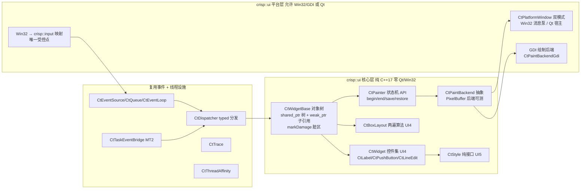
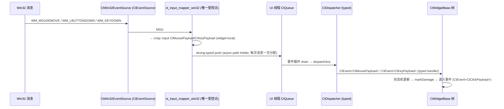

# CRISP UI 控件子系统重写方案设计（crisp::ui）

> 目标：设计一个**逐步替代 Qt GUI/Widgets 模块**（`QWidget`/`QPainter`/`QStyle`/`QLayout`）的 UI 子系统——用现代 C++（C++17）重写，解决 Qt GUI 层核心痛点（P1-P13，见 [02](./02-qt-gui-pain-points.md)）。
> 本文为 **UI0 调研与方案设计**，不含实现代码；UI1-UI5 里程碑再进入编码。
> 前置阅读：`docs/ui/01`（Qt GUI 架构调研）、`docs/ui/02`（痛点分析 P1-P13）、`docs/event-system/03`（六原则）、`docs/threading/03`（风格模板）、`docs/event-system/06` §8（输入载荷开放问题 #1/#2——**已落地**）。

---

## 1. 总体定位与战略

### 1.1 项目战略：UI 是事件系统的"消费侧"

```
┌────────────────────────────────────────────────────────────┐
│ 你的代码库 (d:\crisp)                                         │
│                                                              │
│  M1-M4  事件系统（typed 事件/分发器/队列/事件源/桥） ✅ 已完成   │
│  MT1-MT3 多线程（线程/线程池/Future/任务→事件桥）   ⬜ 进行中   │
│  UI pre-M1  输入载荷下放核心层（crisp::input）     ✅ 已落地   │
│  UI0    本方案（调研 + 重写设计）                   ← 本文档   │
│  UI1-UI5 crisp::ui（对象树/绘制/平台窗口/控件/样式） ⬜ 未开始   │
└────────────────────────────────────────────────────────────┘
```

**关键定位**：crisp::ui 是事件系统 M1-M4 的"消费侧"——平台输入经 `CtEventSource` 进入 `CtQueue`，由 UI 线程事件循环分发给 `CtWidgetBase` 树；控件语义事件（点击/文本变更）复用 typed 事件对外暴露。多线程子系统提供"重活丢后台、完成回投 UI 线程"通道（`CtTaskEventBridge`，MT2）。

### 1.2 边界判断（先划清"重写什么 / 不重写什么"）

| 类别 | 结论 | 理由 |
|------|------|------|
| QWidget 基座（对象树/几何/焦点/重绘调度） | **重写**（UI1） | P1/P4/P5/P12：巨型 switch、全量重绘、手工所有权、位域维护 |
| QPainter 绘制模型（状态机 + 后端抽象） | **重写**（UI2） | P4：脏区合批 + 双缓冲（参照 QBackingStore）；热路径零堆分配 |
| QStyle 样式委托 | **重写**（UI5 三原色集首版） | P2/P3：int 枚举 + 运行期 CSS 解析、样式与控件逻辑耦合 |
| QLayout 布局 | **重写**（UI4 CtBoxLayout 两遍算法） | P7：invalidate 全树递归、深嵌套全量重算 |
| 基础控件 QLabel/QPushButton/QLineEdit | **重写**（UI4） | P8/P9/P10：双击/hover 平台耦合、全局焦点、富文本过载 |
| 平台窗口（QWindow/QWidget 顶层） | **重写**（UI3 双模式） | 平台输入唯一受控映射点（01 §1.2 QPA 教训） |
| 富文本引擎（QTextDocument） | **不重写** | P10：CtLabel 首版纯文本；富文本明确不做 |
| 运行期 CSS 样式表（QSS） | **不重写** | P2/P3：CtStyle 纯接口 + 编译期常量，无解析 |
| 容器/字符串（QString/QVector/QMap/QHash） | **不重写** | 直接用 std::；文本用 `std::u16string`（事件系统 06 §8 #2 已落地） |
| 字体/QFontMetrics 全量 | **不重写（首版最小集）** | 文本度量走后端能力接口（§4.2、§7 风险表） |
| 高级容器控件（QStackedWidget/QTabWidget 等） | **暂不重写** | UI5+ 扩展；清单外不实现 |
| 全部 QWidget 派生控件（QComboBox 等） | **暂不重写** | UI4 只做三基础件 + 布局 + 焦点链 |

---

## 2. 设计原则映射（六原则 → UI 落点）

| 原则 | 落地于 UI 子系统 | 痛点/依据 |
|------|-----------------|-----------|
| 类型安全第一 | typed handler（`CtDispatcher` 穷尽分发）替代 `QWidget::event` 巨型 switch；输入统一 `crisp::input` 原生载荷（CtMousePayload/CtKeyPayload，**已落地**） | P1、P8 |
| 可观测性内置 | `CtTrace` 记录控件生命周期（创建/销毁）、绘制（markDamage 合批/damage 相位）、焦点流转（focus in/out） | P6 |
| 所有权明确 | `shared_ptr` 对象树 + `weak_ptr` 子引用 + RAII 注销；无裸 new/delete；子控件随父销毁自动解注册 | P5 |
| 线程规则显式 | UI 线程 = 主线程约定（`CtThreadAffinity` + `assertSameThread`）；跨线程操作控件 = 显式 postTo；worker 绝不触碰控件 | P8/P9、MT 桥 |
| 热路径零堆分配 | `markDamage(rect)` 脏区合批（参照 QWidgetRepaintManager）；绘制指令值语义；双缓冲一次分配复用 | P4、P7、P10 |
| 无代码生成 | 无 moc/无 qmake/无运行期 CSS 解析；`CtStyle` 纯虚接口 + 编译期三原色集 | P2、P3 |

---

## 3. 核心架构设计

### 3.1 分层总览



### 3.2 src/ui/ 文件布局草案（标注里程碑）

```
src/ui/                       crisp::ui 子系统
├── CMakeLists.txt            核心层零 Qt/Win32 依赖；平台层可选链接
├── ct_widget_base.h/.cpp     CtWidgetBase 对象树 + 脏区 + 输入消费（UI1）
├── ct_widget_trace.h/.cpp    CtWidgetPhase 独立枚举（生命周期/绘制/焦点）（UI1）
├── ct_painter.h/.cpp         CtPainter 状态机 API（UI2）
├── ct_paint_backend.h        CtPaintBackend 纯接口（UI2）
├── ct_paint_backend_pixel.h/.cpp PixelBuffer 后端（UI2，核心层可测）
├── ct_paint_backend_gdi.h/.cpp   GDI 后端（UI2，平台层）
├── ct_backing_store.h/.cpp   每窗口像素缓冲 + 脏区合批 + BitBlt（UI2）
├── ct_platform_window.h      双模式抽象（UI3）
├── ct_platform_window_win32.h/.cpp  Win32 消息泵 = CtEventSource（UI3，平台层）
├── ct_platform_window_qt.h/.cpp    Qt 宿主（复用 M3/M4 CtQtEventSource + 翻译器）（UI3，平台层）
├── ct_input_mapper_win32.h/.cpp    Win32 → crisp::input 唯一映射点（UI3，平台层）
├── ct_widget.h/.cpp          控件基类扩展（交互状态机、焦点链入口）（UI4）
├── ct_label.h/.cpp           CtLabel 纯文本（UI4）
├── ct_push_button.h/.cpp     CtPushButton 状态机（UI4）
├── ct_line_edit.h/.cpp       CtLineEdit 状态机 + 文本缓冲（UI4）
├── ct_box_layout.h/.cpp      CtBoxLayout 两遍算法（UI4）
├── ct_focus_chain.h/.cpp     焦点链显式数据（UI4）
├── ct_style.h                CtStyle 纯接口（UI5）
└── ct_style_basic.h/.cpp     CtBasicStyle 三原色集实现（UI5）
```

### 3.3 与事件/多线程的咬合点表

| 事件/线程设施 | 复用方式 |
|-------------|---------|
| `CtEvent<T>` + `CtDispatcher<EventSet>` | typed handler 注册（替代 event() switch）；控件语义事件对外投递 |
| `CtReceiver` | CtWidgetBase 的接收能力来源——开放问题 #5 裁决继承方式（倾向继承） |
| `CtQueue` + `post/postTo` 路由表 | 跨线程操作控件唯一通道（UI 线程规则） |
| `CtEventSource` / `CtEventLoop` | Win32 消息泵与 Qt 宿主源统一为 CtEventSource（UI3） |
| `CtTimerEventSource` | 控件级定时（闪烁光标、长按重复） |
| `CtTrace` | 控件生命周期/绘制/焦点相位记录（UI1 扩展 `CtWidgetPhase`） |
| `CtThreadAffinity` | 每个 CtWidgetBase 内嵌 affinity，`assertSameThread()` 守门 |
| `CtTaskEventBridge`（MT2） | 控件重活（文本排版、图像解码）丢线程池，完成 `postTo` 回 UI 线程 |
| `crisp::input`（CtMousePayload/CtKeyPayload/CtInput 枚举） | UI 输入统一载荷——**UI pre-M1 已落地**（commit c3f0b2f） |

> **输入载荷迁移状态（重要）**：M4 开放问题 #1/#2（`docs/event-system/06` §8）——"Qt 枚举进载荷字段 / text 用 QString"——已在 **UI pre-M1（commit c3f0b2f）** 解决：`crisp::input` 原生枚举（`CtMouseButton`/`CtKeyButton`/`CtModifiers`/`CtMouseAction`/`CtKeyAction`）与核心层载荷（`src/event/ct_input.h`/`ct_mouse_payload.h`/`ct_key_payload.h`，`text` 为 `std::u16string`）**已落地**。桥层保留 Qt 字段版本（`src/bridge/qt_mouse_payload.h`/`qt_key_payload.h`，命名空间 `crisp::event`）作 M3/M4 兼容。UI1 起控件直接消费核心层载荷，**不再涉及载荷类型改造**。
>
> ⚠️ **明确不使用** `CtEventLoop::injectEvent` 做平台输入注入：`injectEvent` 只投本 loop 自己的队列、需要 loop 实例且语义是强类型手动注入。平台输入正路是 **`CtEventSource` 接口**（`poll(CtQueueBase&)` + 强类型 push，M2 §7.12 契约）。

---

## 4. 关键设计决策详解

### 4.1 UI1 核心基座：CtWidgetBase 对象树

#### 4.1.1 对象树与所有权（P5）

**方案**：`shared_ptr` 树 + `std::weak_ptr` 子引用 + RAII 注销——替代 Qt 的 `new QWidget(parent)`/`setParent` 双入口 + `deleteLater()`（P5）。

```cpp
/// (UI1) Base class of every widget in the crisp::ui object tree.
/// OWNERSHIP CONTRACT (mandatory): every CtWidgetBase is owned by a
/// std::shared_ptr for its entire lifetime; the tree root keeps children
/// via shared_ptr. Children hold a std::weak_ptr back-reference to the
/// parent — no strong cycle, no manual delete, no deleteLater(). The
/// destructor detaches from the parent and unbinds every typed handler
/// (RAII, reuses CtReceiver::unbindAll()).
class CtWidgetBase : public std::enable_shared_from_this<CtWidgetBase> {
public:
    /// Sanctioned factory: create a widget owned by shared_ptr.
    /// `parent` may be empty (top-level widget).
    static std::shared_ptr<CtWidgetBase> create(
        const std::shared_ptr<CtWidgetBase>& parent = {});

    virtual ~CtWidgetBase();   ///< RAII: detach from parent, release children

    /// The parent (empty weak_ptr for a top-level widget).
    std::weak_ptr<CtWidgetBase> parent() const noexcept;

    /// Direct children, in z-order (front = topmost).
    const std::vector<std::weak_ptr<CtWidgetBase>>& children() const noexcept;

    /// Re-parent this widget: ownership MOVES to `newParent`
    /// (P5 — one sanctioned entry point, no new QWidget(parent) duality).
    void setParent(const std::shared_ptr<CtWidgetBase>& newParent);

    /// The widget's rect in parent coordinates (int rect, not QRectF).
    CtRect geometry() const noexcept;
    void setGeometry(const CtRect& rect);
};
```

**关键契约**：
- 无裸 new/delete：创建唯一入口 `CtWidgetBase::create()` / `createWidget<T>()`（仿 `createReceiver<T>()` 先例）。
- 析构 RAII：从父树摘除 → 子引用自动失效 → 解绑所有 typed handler → CtTrace 记 `kDestroyed`。**无 deleteLater**：树析构即销毁，所有权显式（对比 Qt 延迟删除语义，文档明确）。
- 弱引用只读、父指针不可借用（防悬垂）。

#### 4.1.2 显式成员替代位域（P12）

```cpp
/// (UI1) Explicit widget state — replaces QWidgetData's bitfields and the
/// WA_* attribute macros (pain point P12). Readability over bit-packing;
/// hot-path cost is unchanged (the struct stays in the widget, no heap).
struct CtWidgetState {
    bool visible = true;      ///< participates in layout + painting
    bool enabled = true;      ///< disabled widgets reject input (UI1 §4.1.3)
    bool focusable = false;   ///< participates in the focus chain (UI4)
    bool hasFocus = false;    ///< current focus owner (UI4)
    bool hovered = false;     ///< UI4: state machine owns the transition
    CtFocusPolicy focusPolicy{CtFocusPolicy::kNoFocus}; ///< UI4 enum
};
```

#### 4.1.3 typed handler（P1）

```cpp
/// (UI1) Register typed input handlers — replaces the QWidget::event
/// switch (pain point P1). The dispatcher's compile-time event set
/// guarantees exhaustive, type-safe delivery; a missing payload type in
/// the set is a compile error, not silent runtime ignore.
template <typename EventSet>
CtHandlerToken bindInput(const std::shared_ptr<CtDispatcher<EventSet>>& dispatcher,
                         CtHandler<crisp::input::CtMousePayload> onMouse,
                         CtHandler<crisp::input::CtKeyPayload> onKey,
                         std::string_view name = {});
```

- 控件侧**只**消费 `crisp::input` 载荷（`src/event/ct_mouse_payload.h`/`ct_key_payload.h`）：值语义、零 Qt 依赖。**前置改造已落地**（UI pre-M1，commit c3f0b2f）：原生枚举 `CtMouseButton`/`CtKeyButton`/`CtModifiers` 与 `std::u16string` text 均在核心层，UI1 不再涉及载荷类型改造，聚焦对象树 + 载荷消费。
- 禁用态拦截语义保留（仿 Qt `!isEnabled()` 拦鼠标/键盘），但作为**显式状态检查**写在分发入口，不是 switch 分支里的隐式条件。

#### 4.1.4 markDamage 脏区（P4，参照 QWidgetRepaintManager）

```cpp
/// (UI1) Mark `rect` (widget-local) as damaged. Damage accumulates into
/// the widget's dirty region; ONE repaint pass per frame serves ALL
/// accumulated damage (QWidgetRepaintManager::markDirty model, 01 §2.5).
void markDamage(const CtRect& rect) noexcept;

/// (UI1) The accumulated dirty region (widget-local, clipped to the
/// widget's own bounds). Consumed by the backing store at flush time (UI2).
const CtRegion& dirtyRegion() const noexcept;

/// (UI1) Damage has been flushed by the backing store; clears the region.
void clearDamage() noexcept;
```

**关键契约**：一帧内多次 `markDamage` → 并集合批 → 一次 paint（对齐 Qt"先合后绘"）；合批次数可测（§5 UI2 验收 `lastFlushBatchCount()`）。

#### 4.1.5 CtTrace 生命周期可观测（P6）

- 新增独立枚举 `crisp::ui::CtWidgetPhase`（`kCreated/kDestroyed/kDamage/kPainted/kFocusIn/kFocusOut`），**不扩展** `crisp::event::CtTracePhase`（仿 threading `CtTaskPhase` 独立枚举先例，不污染事件系统枚举）。
- 记录结构独立定义（不共享 `CtTraceRecord`）：`{ phase, objectId, parentObjectId, when, damageRectCount }`；绘制记录附加 damage 矩形数（合批统计）。
- 复用 `CtTrace` 环形缓冲思想（SPSC、属线程），UI 线程独占写。

#### 4.1.6 输入消费（已落地载荷的直接消费）

- `CtWidgetBase` 提供分发入口 `dispatchInput(CtEvent<crisp::input::CtMousePayload>&)` / `dispatchInput(CtEvent<crisp::input::CtKeyPayload>&)`；坐标已在载荷内（widget-local，`CtMousePayload::x/y`）。
- 控件自身**不解析平台值**——平台值只在 UI3 的映射器里存在（§4.3.4 唯一受控点）。
- **UI1 不做**双击/hover 判定（UI4 状态机）；timestamp 支撑见开放问题 #2（UI3 注入）。

### 4.2 UI2 绘制基元：CtPainter + CtPaintBackend

#### 4.2.1 CtPainter 状态机 API（P4，参照 QPainter 01 §3.1）

```cpp
/// (UI2) Painter state machine. begin() targets a CtPaintBackend;
/// end() flushes. save()/restore() pair the transformation+clip stack.
/// Explicit begin/end (Qt's begin-on-demand is a silent-footgun source).
class CtPainter {
public:
    /// Begin painting on `backend`; returns false if the backend refused
    /// (wrong thread / already active / zero-size surface).
    bool begin(CtPaintBackend& backend) noexcept;

    /// End painting: flush batched primitives to the backend. Idempotent.
    void end() noexcept;

    /// Whether a painting session is active.
    bool isActive() const noexcept;

    /// Push a copy of the current transform+clip state onto the stack.
    void save();
    /// Pop the top state; no-op when the stack is empty (documented).
    void restore();

    /// Translate subsequent drawing by (dx, dy).
    void translate(int dx, int dy) noexcept;

    /// Clip subsequent drawing to `rect` (intersected with current clip).
    void clip(const CtRect& rect) noexcept;

    /// Fill `rect` with a solid color (the only UI2 fill form).
    void fillRect(const CtRect& rect, const CtColor& color) noexcept;

    /// Draw `text` at `origin` using the font's metrics backend.
    void drawText(const CtPoint& origin, const std::u16string_view& text,
                  const CtFont& font, const CtColor& color) noexcept;
};
```

**关键契约**：`begin/end` 成对；`save/restore` 成对（栈深记录在 trace）；绘制指令**批缓冲**（记录式，值语义零堆分配），`end()` 一次性提交给后端——对齐"热路径零堆分配"（P4/P10）。

#### 4.2.2 CtPaintBackend 抽象（GDI + PixelBuffer）

```cpp
/// (UI2) Paint backend: the surface a CtPainter draws onto.
/// Core-layer PixelBuffer backend is pure C++17 (testable off-screen);
/// GDI backend (platform layer) targets a window's backing store.
class CtPaintBackend {
public:
    virtual ~CtPaintBackend() = default;

    /// Surface size in pixels; zero size refuses begin().
    virtual CtSize size() const noexcept = 0;

    /// Commit the batched primitives of one paint pass (called by
    /// CtPainter::end). Must be thread-affined to the UI thread.
    virtual void flush(const CtRegion& damage) = 0;

    /// Blit the backing store region to the window (double buffer).
    /// UI2 core: GDI BitBlt (platform layer); PixelBuffer: memcpy.
    virtual void present(const CtRect& rect) = 0;
};
```

**后端清单**：
- `CtPaintBackendPixelBuffer`（核心层，UI2 可测）：像素缓冲 + memcpy present，绘制正确性断言全部在这层做（离线渲染）。
- `CtPaintBackendGdi`（平台层，UI2）：GDI `FillRect`/`DrawTextW`/`BitBlt`，对接窗口 DC。

#### 4.2.3 双缓冲 + 脏区合批 + BitBlt（P4，参照 QBackingStore 01 §3.2）

```cpp
/// (UI2) Per-top-level-window backing store (QBackingStore model):
/// one full pixel buffer + damage batching + BitBlt partial flush.
class CtBackingStore {
public:
    explicit CtBackingStore(const CtSize& size);   ///< one buffer, reused
    /// Merge damage: union of all markDamage rects this frame.
    void addDamage(const CtRegion& damage) noexcept;
    /// Number of damage rects merged this frame (batch test hook, §5 UI2).
    std::size_t lastFlushBatchCount() const noexcept;
    /// Flush only the dirty region: repaint + BitBlt the union.
    void flush() noexcept;   ///< clears damage after success
};
```

**关键契约**：
- 每窗口一张完整像素缓冲，**创建时一次分配、整生命周期复用**（无 per-frame 分配）。
- 只绘脏区并集：`flush()` 内部 = paint(damage) → `present(damage)`（BitBlt/memcpy）。
- **热路径零堆分配断言**：markDamage → 合批 → flush 全程无堆分配（operator new 计数测试，见 §5 UI2 验收）。

### 4.3 UI3 平台窗口双模式

#### 4.3.1 CtPlatformWindow 抽象（双模式）

```cpp
/// (UI3) Platform window abstraction (QPA QWindow analog, 01 §1).
/// TWO modes, ONE interface:
///  - Win32 native: owns an HWND; the message pump IS a CtEventSource;
///  - Qt host: owns a QWindow/QWidget; reuses the M3/M4 CtQtEventSource.
class CtPlatformWindow {
public:
    virtual ~CtPlatformWindow() = default;

    /// The window's surface size in device pixels (for the backing store).
    virtual CtSize surfaceSize() const noexcept = 0;

    /// Show/hide the native window.
    virtual void show() = 0;
    virtual void hide() noexcept = 0;

    /// The event source this window contributes to the UI loop
    /// (attached via CtEventLoop::attachSource).
    virtual std::shared_ptr<crisp::event::CtEventSource> eventSource() = 0;
};
```

#### 4.3.2 Win32 模式：消息泵 = CtEventSource（P8）

```cpp
/// (UI3) Win32 message pump implemented AS a CtEventSource (M2 §7.12):
/// poll() drains the window's message queue (PeekMessageW) and injects
/// translated events via strong-typed push — never touches a dispatcher.
/// Allocates ONLY the async-path holder (one allocation per message,
/// M2 §10 boundary), never per-keystroke in the translation itself.
class CtWin32EventSource final : public crisp::event::CtEventSource {
public:
    explicit CtWin32EventSource(HWND hwnd); ///< the owned top-level window
    /// poll: PeekMessageW once per frame, translate → push to the loop queue.
    void poll(CtQueueBase& queue) override;
    bool activate() override;      ///< register the message-only window hook
    void deactivate() noexcept override;
    std::string_view sourceName() const noexcept override;
};
```

- 轮询模型与 M2 `CtEventSource` 完全一致（`CtEventLoop::exec` 每迭代 poll 一次）；不引入第二套消息泵。
- `WM_TIMER` 也可在 poll 内映射为 `CtTimerPayload`（或复用 `CtTimerEventSource`，二选一由实现决定，文档须注明）。

#### 4.3.3 Qt 宿主模式：复用 M3/M4 桥（P8）

- 宿主窗口 = `QWindow`（或 `QWidget` 容器）内嵌一块 CRISP 控件树；Qt 侧事件经 **M3/M4 `CtQtEventSource`**（`src/bridge/`）+ 翻译器进入 CRISP 事件流。
- M4 翻译产物（`crisp::event::CtMousePayload`/`CtKeyPayload`，桥层 Qt 字段版）在 UI3 宿主模式下需**再映射到核心层 `crisp::input` 载荷**——映射边界即 §4.3.4 的唯一受控点（双模式共用同一张映射表，保证控件层看到的载荷完全一致）。

#### 4.3.4 平台输入 → crisp::input 映射边界（唯一受控点）

```cpp
/// (UI3, platform layer) THE only sanctioned mapping from platform input
/// (Win32 messages / Qt events) into crisp::input payloads. Handler code
/// NEVER sees platform values (docs/ui/README "Joint design points",
/// ct_input.h header contract).
namespace crisp::ui::platform {

/// Translate a Win32 MSG into a crisp::input payload (mouse or key).
/// Returns std::nullopt for messages that carry no UI input (WM_PAINT...).
std::optional<crisp::input::CtMousePayload>
    mapWin32Mouse(const MSG& msg, const CtSize& widgetLocalSize) noexcept;
std::optional<crisp::input::CtKeyPayload>
    mapWin32Key(const MSG& msg) noexcept;

/// Translate a bridged M4 payload (crisp::event, Qt fields) into the
/// core crisp::input payload (Qt-host mode).
crisp::input::CtMousePayload
    mapBridgeMouse(const crisp::event::CtMousePayload& qtFields) noexcept;
crisp::input::CtKeyPayload
    mapBridgeKey(const crisp::event::CtKeyPayload& qtFields) noexcept;

} // namespace crisp::ui::platform
```

**关键契约**：
- 映射表只存在于 `src/ui/ct_input_mapper_win32.h/.cpp`（及 Qt 宿主对应翻译点）——**唯一受控点**，handler 零平台依赖（类型安全第一，P1）。
- `CtKeyButton` 不镜像任何平台 scancode 集（`ct_input.h` 契约）；`WM_KEYDOWN`/`WM_SYSKEYDOWN` 的 VK 码映射为 `CtKeyButton` 的**归属问题**见开放问题 #7。
- 双击检测：Win32 模式可由 `GetDoubleClickTime()` + 距离窗在映射器做（Qt 模式已由 Qt 合成）；控件层统一消费 `CtMouseAction::kDblClick`。

#### 4.3.5 输入全链路图



Qt 宿主模式链路：`QEvent → M3/M4 CtQtEventSource 翻译器 → crisp::event 桥载荷 → mapBridge* → crisp::input 载荷 → 同一 CtQueue 分发`——**控件层之后完全一致**（双模式可双跑对比，§5 UI3 验收）。

### 4.4 UI4 基础控件 + 布局 + 焦点链

#### 4.4.1 CtLabel（纯文本，P10）

```cpp
/// (UI4) Plain-text label. NO rich text (QTextDocument is out of scope,
/// pain point P10): a single line of u16 text, drawn via the backend's
/// text primitive. Width/height hints come from backend font metrics.
class CtLabel : public CtWidgetBase {
public:
    /// Create with initial text (parent optional, see CtWidgetBase).
    static std::shared_ptr<CtLabel> create(
        const std::shared_ptr<CtWidgetBase>& parent, std::u16string text);

    std::u16string_view text() const noexcept;
    void setText(std::u16string text);   ///< triggers markDamage + relayout

    /// Preferred size from the backend's font metrics (one measure pass).
    CtSize sizeHint() const noexcept;
};
```

#### 4.4.2 CtPushButton / CtLineEdit（状态机显式化，P3/P8）

```cpp
/// (UI4) Push-button state machine — EXPLICIT states instead of Qt's
/// entangled style+widget logic (pain points P3/P8). Hover/double-click
/// semantics live here as pure logic (unit-testable without a platform).
class CtPushButton : public CtWidgetBase {
public:
    static std::shared_ptr<CtPushButton> create(
        const std::shared_ptr<CtWidgetBase>& parent, std::u16string text);

    /// The explicit state (pressed is a state, not a paint-time guess).
    enum class CtButtonState : uint8_t { kNormal, kHovered, kPressed, kDisabled };
    CtButtonState state() const noexcept;

    /// Semantic event: emitted (typed) when press+release inside the
    /// button completes — the widget's own payload, exposed to the app.
    void onClick(CtHandler<crisp::input::CtClickPayload> handler);

    void setEnabled(bool enabled) noexcept; ///< flips kNormal/kHovered → kDisabled
    void setText(std::u16string text);
};
```

```cpp
/// (UI4) Single-line text editor. Explicit states + a small undo-free
/// text buffer; cursor blink driven by CtTimerEventSource (UI3 loop).
class CtLineEdit : public CtWidgetBase {
public:
    static std::shared_ptr<CtLineEdit> create(
        const std::shared_ptr<CtWidgetBase>& parent, std::u16string initial);

    std::u16string_view text() const noexcept;
    /// Semantic event on text change (typed payload, no signal/slot).
    void onTextChanged(CtHandler<crisp::input::CtTextChangedPayload> handler);

    /// Cursor caret position (0..text length).
    std::size_t cursorPos() const noexcept;
    void setCursorPos(std::size_t pos) noexcept;
};
```

**关键契约**：双击/hover 作为控件状态机显式实现（P8 对策），timestamp 支撑见开放问题 #2（UI3 注入载荷）。状态迁移全路径可单测（纯逻辑、无平台消息）。

#### 4.4.3 CtBoxLayout 两遍算法（P7）

```cpp
/// (UI4) Box layout with an explicit two-pass algorithm (01 §5.2 model):
///   Pass 1 — measure: sizeHint() of each item, sum + stretch weights;
///   Pass 2 — place:   assign final geometry per item (setGeometry).
/// NO invalidate() tree recursion (pain point P7): relayout() is called
/// explicitly by the owner widget when children/hints change.
class CtBoxLayout {
public:
    enum class Direction : uint8_t { kHorizontal, kVertical };

    explicit CtBoxLayout(Direction dir) noexcept;

    void addWidget(const std::shared_ptr<CtWidgetBase>& widget,
                   int stretch = 0);
    void addLayout(std::unique_ptr<CtBoxLayout> subLayout, int stretch = 0);

    /// Run both passes for the given bounding rect.
    void relayout(const CtRect& bounds) noexcept;

    /// Preferred size from pass 1 (hint aggregation).
    CtSize sizeHint() const noexcept;
};
```

**关键契约**：两遍算法显式（measure → place），无全树递归失效；stretch 权重分配仿 `qGeomCalc`（01 §5.1）但**每层只算自己一层**。

#### 4.4.4 焦点链显式数据（P9）

```cpp
/// (UI4) Explicit focus chain — replaces QApplicationPrivate::focus_widget
/// global mutable state + focusNextPrevChild_helper tree walk (01 §2.4).
class CtFocusChain {
public:
    /// Register a focusable widget into the chain (z/insertion order).
    void add(const std::shared_ptr<CtWidgetBase>& widget);
    /// Move focus to `widget`; emits typed CtEvent<CtFocusPayload>.
    void setFocus(const std::shared_ptr<CtWidgetBase>& widget);
    /// Tab/Backtab step; returns the widget that received focus (or empty
    /// when the chain is empty).
    std::shared_ptr<CtWidgetBase> next(CtFocusDirection dir) noexcept;

    /// The current focus owner (explicit data, observable via CtTrace
    /// kFocusIn/kFocusOut phases — pain point P6).
    std::weak_ptr<CtWidgetBase> current() const noexcept;
};
```

- 存储方式倾向**显式链表（按树序插入）**：`next/prev` O(1)，Tree-walk 惰性遍历为备选（开放问题 #3 裁决）。
- 焦点流转记 CtTrace（`kFocusIn/kFocusOut`），可观测（P6/P9）。

### 4.5 UI5 CtStyle 样式接口

```cpp
/// (UI5) Pure style interface — the control ASKS the style how to draw
/// (QStyle drawControl model, 01 §4.1) but the style is a pure virtual
/// contract, NOT an int-enum + runtime CSS parser (pain points P2/P3).
class CtStyle {
public:
    virtual ~CtStyle() = default;

    /// The three primitive sets (首版三原色集, open question #7):
    /// text color / border color+width / background color.
    virtual CtColor textColor(const CtWidgetBase& w) const noexcept = 0;
    virtual CtColor backgroundColor(const CtWidgetBase& w) const noexcept = 0;
    virtual CtColor borderColor(const CtWidgetBase& w) const noexcept = 0;
    virtual int borderWidth(const CtWidgetBase& w) const noexcept = 0;

    /// Per-state lookups (states are explicit, UI4 — no runtime parsing).
    virtual CtColor textColorForState(
        const CtWidgetBase& w, CtPushButton::CtButtonState state) const noexcept = 0;

    /// Ask the style for a widget's size hint contribution (PM_ analog).
    virtual CtSize sizeHint(const CtWidgetBase& w) const noexcept = 0;
};

/// (UI5) The basic style: compile-time constant palette (kPalette),
/// deterministic per-state mapping. NO CSS, NO runtime parsing — the
/// palette is data, and changing it recompiles (explicit, observable).
class CtBasicStyle final : public CtStyle { /* 实现于 UI5 */ };
```

**关键契约**：
- `CtStyle` 纯接口：控件状态机（UI4）与绘制（UI2 后端）完全解耦（P3 对策）。
- 无运行期 CSS（P2 对策）：颜色/边框/背景三原色集为编译期常量；不做优先级/继承/选择器。
- 绘制委托独立：`CtPushButton::paint(backend)` 内部只问 `style`，不嵌样式逻辑。

---

## 5. 里程碑建议（UI0-UI5）

| 里程碑 | 内容 | 验收标准（可测断言） | 状态 |
|--------|------|---------------------|------|
| UI0 | 调研文档（01/02）+ 重写方案（本文） | 过架构审查门禁（READY_FOR_REVIEW） | ✅ 本文档 |
| UI1 | `CtWidgetBase` 对象树（shared_ptr 树 + weak_ptr 子引用 + RAII 注销 + `setParent` 唯一入口）+ 显式状态（P12）+ typed handler（消费 `crisp::input` 载荷）+ `markDamage(rect)` 脏区 + `CtWidgetPhase` 轨迹 | 单测：树析构自动销毁子控件（RAII）；`setParent` 迁移所有权；弱引用防悬垂；禁用态拦截输入；markDamage 并集正确；**markDamage→clearDamage 循环无堆分配**（operator new 计数）；轨迹 kCreated/kDestroyed 成对 | ⬜ 未开始 |
| UI2 | `CtPainter` 状态机 API + `CtPaintBackend` 抽象（PixelBuffer 核心层 + GDI 平台层）+ `CtBackingStore` 双缓冲脏区合批 + BitBlt | 单测：save/restore 栈平衡断言；clip 相交正确；PixelBuffer 逐像素断言（离屏渲染，无平台依赖）；**脏区合批次数**：N 次 markDamage → 1 次 flush（`lastFlushBatchCount()`）；热路径（fillRect/drawText）零堆分配；GDI 后端冒烟（BitBlt 区域与脏区一致） | ⬜ 未开始 |
| UI3 | `CtPlatformWindow` 双模式：Win32 消息泵 = `CtWin32EventSource`；Qt 宿主 = 复用 M3/M4 `CtQtEventSource` + `mapBridge*`；`ct_input_mapper_win32` 唯一映射点 | 单测：`mapWin32Mouse/Key` 映射正确性表驱动（WM_* → CtMousePayload/CtKeyPayload 字段断言，含修饰键组合）；映射器拒绝非输入消息（nullopt）；**双跑对比**：同一控件树在 Win32 模式与 Qt 宿主模式下收到**相同的 crisp::input 载荷序列**（字节/字段一致，仿 M4 §6.3 双跑）；输入全链路 kQueued→kDelivered 轨迹 | ⬜ 未开始 |
| UI4 | `CtLabel`（纯文本 P10）+ `CtPushButton`/`CtLineEdit`（状态机显式化 P3/P8）+ `CtBoxLayout` 两遍算法（P7）+ `CtFocusChain` 显式数据（P9）+ 语义事件载荷（`CtClickPayload`/`CtTextChangedPayload`/`CtFocusPayload`） | 单测：按钮状态迁移全路径（normal→hovered→pressed→released→clicked，纯逻辑无平台）；双击/hover 判定纯逻辑可测（timestamp 由载荷注入）；布局两遍算法黄金对照（手算用例：stretch 分配、嵌套布局）；焦点 Tab/Backtab 步进正确、焦点轨迹 kFocusIn/kFocusOut 成对；LineEdit 光标/文本变更语义事件 | ⬜ 未开始 |
| UI5 | `CtStyle` 纯接口 + `CtBasicStyle` 三原色集（文本/边框/背景）+ 控件绘制委托接入 | 单测：三原色集确定性映射（状态→颜色表驱动）；无运行期解析（无解析器代码路径）；控件绘制只经 style 查询（mock-free 断言：同一控件不同 style 出不同像素，PixelBuffer 对比）；性能：绘制热路径零堆分配回归 | ⬜ 可选未开始 |

每个里程碑走项目流程：**编码 → 审计（代码审计子agent）→ 审查 → 测试**，直到 `DEPLOYED_OK`。

---

## 6. 开放问题（带倾向性方案）

| # | 问题 | 倾向性方案 | 裁决点 |
|---|------|------------|--------|
| 1 | 全局坐标/窗口坐标最小集（P11） | 根控件 hit-test 统一换算，首版只提供 `CtWidgetBase::mapToRoot(rect)` + `mapFromRoot(rect)` 两个方法；`mapToGlobal/mapFromGlobal` 推迟到 UI3（窗口位置已知后） | UI4 定稿 |
| 2 | 双击/hover 的 timestamp 支撑（P8） | `CtMousePayload` 增加 `std::chrono::steady_clock::time_point timestamp`（值语义、零堆分配）；Win32 映射器填 `GetMessageTime()`，Qt 模式填 `QMouseEvent::timestamp()`；控件状态机消费 | UI3 随映射器一起落地 |
| 3 | 焦点链存储方式（P9） | **倾向显式链表**（按树序插入）：`CtFocusChain` 维护 `next/prev` 指针，Tab/Backtab O(1)；备选"树序惰性遍历"（每次步进 O(n)） | UI4 定稿（默认显式链表） |
| 4 | `CtWidgetBase` 与 `CtReceiver` 的关系 | **倾向继承**：`CtWidgetBase : public CtReceiver`（复用 `bindHandler`/`unbindAll`/`objectId`/affinity）；备选组合（持有 CtReceiver 成员，转发绑定） | UI1 定稿（默认继承，语义"控件即接收者"） |
| 5 | UI 线程 vs 主线程 | **UI 线程 = 主线程**（首版单窗口单线程模型）：所有控件操作在主线程事件循环内；跨线程操作一律 `postTo`（MT2 桥）；`assertSameThread()` 守门。多 UI 线程推迟 | UI1 定稿（默认单线程模型） |
| 6 | Win32 → `CtKeyButton` 映射归属 | 映射表**放平台层**（`ct_input_mapper_win32`，§4.3.4 唯一受控点）；核心层只定义 `CtKeyButton` 枚举，不含任何 VK 码映射表（`ct_input.h` 契约） | UI3 定稿（默认平台层） |
| 7 | CtStyle 范围（P2/P3） | 首版仅**文本/边框/背景三原色集**（§4.5）；不做 padding/margin/字体族/圆角；扩展走"追加虚方法"而非配置化 | UI5 定稿（默认三原色集） |

---

## 7. 风险与约束

| 风险 | 约束/对策 |
|------|----------|
| MinGW 8.1 32 位内存受限（AGENTS.md：构建并行 ≤2 防 OOM） | 双缓冲首版**单缓冲复用**（每窗口一张，创建时一次分配）；脏区合批数据结构定容量（仿 `kMaxQueued = 8192` 纪律）；热路径零堆分配用 operator new 计数测试锁定 |
| 禁 `std::filesystem`（MinGW 8.1 libstdc++ bug） | UI 层不碰文件系统；主题/资源加载若需要走 Qt 路径 API 或自研辅助层（AGENTS.md） |
| 字体度量（P10） | 首版**纯文本 + 后端度量**：`CtPaintBackend` 增加可选 `fontMetrics(u16string_view)` 能力接口；GDI 用 `GetTextExtentPoint32W`；PixelBuffer 后端提供测试度量（固定值），**不做**复杂排版/换行/富文本 |
| 双击检测双实现 | 映射器内 `GetDoubleClickTime()` 判定 + Qt 宿主合成，两处逻辑**双跑对比**保证控件层载荷一致（§5 UI3 验收） |
| `CtKeyButton` 覆盖不全（`ct_input.h` 仅子集） | 映射未知名 → `kUnknown`（不静默丢事件，可观测）；枚举扩展向后兼容（追加值不改既有值，`ct_input.h` 值稳定契约） |
| Qt 宿主模式与 Win32 模式行为漂移 | 双跑对比（§5 UI3）：同一控件树双模式收到相同载荷序列；输入全链路轨迹可查 |
| `std::u16string` 在载荷热路径（key text） | 载荷值语义零堆分配指**载荷本身**；`text` 字段的字符串在键入路径有一次分配（事件桥异步路径已存在同构先例）；控件内复用缓冲（`CtLineEdit` 文本缓冲预先分配） |
| 无富文本/无 CSS 的范围收缩 | 明确"不做"清单（§1.2）：首版纯文本 + 编译期三原色，不做 QTextDocument/QSS；README 与本文一致 |

---

## 8. 一句话结论

**方向对，且弹药已备齐**：事件系统 M1-M4（typed 事件、分发器、队列、事件源、trace、M3/M4 Qt 桥）与多线程 MT（任务→事件回传桥）为 UI 层备好了全部基础设施；UI pre-M1 已把输入载荷下放核心层（`crisp::input`，commit c3f0b2f），UI1 聚焦对象树 + 载荷消费即可开始。Qt GUI 层最重的三块——控件基座、绘制、平台窗口——在本方案中都有明确的 Qt 参照（QWidgetRepaintManager / QBackingStore / QPA）与显式化改造点（对象树 RAII、脏区合批、状态机显式化、样式纯接口）。

---

READY_FOR_REVIEW
