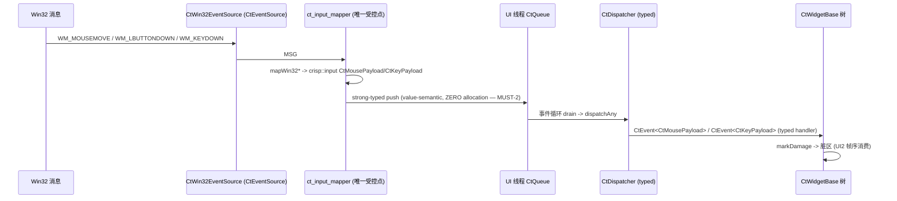

# CRISP UI3 平台窗口双模式架构文档

> 状态：**权威规范（完整）**——§1–§17 全部定稿；§3 类型与 §4 接口为 UI3 唯一权威接口规范，编码 agent 无需猜测即可实现；**本文不包含任何 src/ 实现代码**。
> 对应里程碑：UI3（平台窗口双模式），对齐 `docs/ui/03-rewrite-proposal.md` §4.3 与 §5 UI3 行。
> 前置：UI1（对象树/脏区/轨迹，04）与 UI2（绘制基元/后端，05）均 `DEPLOYED_OK`；事件系统 M1–M4（typed 事件/队列/事件源/桥）与多线程 MT 已就绪。
> 结构模板：`docs/ui/04-ui1-architecture.md` §1–§17；接口锚点：03 §4.3.1–§4.3.5 类声明（本文为权威精化，偏差见 §11）。

---

## 1. 范围与目标（Scope & Goals）

### 1.1 做（UI3 交付）

UI3 交付平台窗口双模式，打通"平台输入 → crisp::input → 控件树"全链路（对齐 03 §4.3 与 §5 UI3 行）：

1. **CtPlatformWindow 双模式抽象**：Win32 原生模式（owns HWND，消息泵 = `CtEventSource`）+ Qt 宿主模式（新封装 `CtQtHostEventSource<CtUiEventSet>`，内部复用 M4 翻译器 + mapBridge*）——双模式**一个接口**（03 §4.3.1；W-1/P7：不能直接复用 M3/M4 `CtQtEventSource`，桥集不同）。
2. **CtWin32EventSource**：Win32 消息泵实现为 `CtEventSource`（M2 §7.12 轮询模型，`CtEventLoop::exec` 每迭代 poll 一次；不引入第二套消息泵）。
3. **ct_input_mapper（唯一受控点）**：Win32 MSG → `crisp::input` 载荷；Qt 桥载荷 → `crisp::input` 载荷——**双模式共用同一张映射边界**，控件层看到的载荷完全一致（P1 类型安全，handler 零平台依赖）。
4. **输入全链路**：`OS → CtWin32EventSource → mapper → UI 线程 CtQueue → CtDispatcher → CtWidgetBase 树`（typed handler 消费 `crisp::input` 载荷）。
5. **timestamp 落地**（03 开放问题 #2）：`CtMousePayload` 增加 `std::chrono::steady_clock::time_point timestamp`；Win32 填 `GetMessageTime()`，Qt 模式填 `QMouseEvent::timestamp()`。
6. **WM_TIMER 定案**：在 poll 内映射为 `CtTimerPayload`（03 §4.3.2 二选一之选 A，见 §10 决策 D5）。
7. **GDI 后端接入**（UI2 平台层，**可选交付**——WARN-5 定案）：`CtPaintBackendGdi` 对接窗口 DC（FillRect/DrawTextW/BitBlt），`CtBackingStore` 消费（03 §4.2.2 平台层清单）。GDI 后端本身为**可选交付**；映射器/事件源/窗口抽象为**按平台必选**（见下）。
   **必选/可选语义（WARN-5 统一）**：功能上**必选** = 映射器（核心共享表 + 平台 Win32/Qt 桥映射）+ `CtPlatformWindow` 抽象 + `CtWin32EventSource`（消息泵）；**构建目标按平台**——Win32 目标（`platform/ct_win32_event_source.cpp`、`ct_input_mapper_win32.cpp`、`ct_platform_window_win32.cpp`、`ct_paint_backend_gdi.cpp`）在有 Win32 环境时（`if(WIN32)`）**必须启用**并纳入冒烟测试；无 Win32 环境（纯 Qt 宿主）豁免并注明。§9.1/§9.3/§17.2 与此一致。

### 1.2 不做（明确归后续里程碑或不做）

| 能力 | 归属 | 依据 |
|------|------|------|
| 全局坐标 `mapToGlobal/mapFromGlobal` | **推迟 UI4**（窗口位置已知后） | 03 开放问题 #1：UI3 先提供根 hit-test 统一换算 |
| 控件交互状态机（双击/hover 判定落控件） | **UI4** | 03 §4.4：UI3 只做平台输入→载荷映射，双击由 Qt 合成/mapper 提供 |
| 焦点链（CtFocusChain/Tab 步进） | **UI4** | 03 §4.4.4 |
| 基础控件（CtLabel/CtPushButton/CtLineEdit） | **UI4** | 04 §1.2 |
| 多窗口/多 UI 线程 | **不做**（首版单窗口单线程） | 03 开放问题 #5 裁决：UI 线程 = 主线程 |
| 样式委托（CtStyle） | **UI5** | 03 §4.5 |
| 富文本/换行 | **不做** | P10（同 UI2） |
| Qt 宿主模式的实际 Qt 依赖代码 | **平台层**（`src/ui/platform/`，README 例外条款） | 核心层零 Qt/Win32 依赖 |

### 1.3 与前置里程碑的衔接

- **UI1**：`CtWidgetBase::markDamage/dirtyRegion`（脏区来源）、`CtWidgetTrace`（轨迹环）、`CtThreadAffinity`/`assertSameThread`（线程守门）、`dispatchInput(CtEvent<CtMousePayload>&)`/`dispatchInput(CtEvent<CtKeyPayload>&)`（typed 输入入口，04 §3.6）。
- **UI2**：`CtPaintBackend`（size/submitCommands/flush/present/fontMetrics）、`CtBackingStore(size, backend&)`（每窗口单缓冲 + 脏区合批 + kPainted/clearDamage）、`CtPaintBackendGdi`（UI3 落地平台层）、帧序（05 §4.3）。
- **事件系统 M2**：`CtEventSource`/`CtQueue`/`CtEventLoop`（消息泵 + 队列 + 分发）、`postTo`/路由表（M2 §7.12/§10）。
- **M3/M4 Qt 桥**：`CtQtEventSource`/翻译器/`CtQtEventPayload`（Qt 宿主模式复用，`src/bridge/`）。

---

## 2. 非目标（Non-Goals）

- **不做第二套消息泵**：Win32 模式只实现 `CtEventSource::poll()`（`PeekMessageW` 每帧一次），由 `CtEventLoop::exec` 驱动；不引入独立 Win32 消息循环线程。
- **不做跨线程输入**：所有平台输入只在 UI 线程 poll/翻译/分发（UI 线程 = 主线程，03 开放问题 #5 裁决）。
- **不做全局坐标**：UI3 载荷坐标保持 widget-local（`CtMousePayload.x/y` 为控件局部）；窗口坐标/全局换算推迟 UI4。
- **不做输入合成/注入**：UI3 只翻译真实平台消息；程序化事件注入（测试用）走既有 `CtDispatcher` 通道，不经映射器。
- **不做 Qt 宿主模式的控件树级完整双跑**：UI3 交付 **mapper 级字段交叉断言**（Win32 vs Qt 桥映射产出字段一致，显式排除 `text`/`timestamp`——MUST-3/D12/WARN-2）；**控件树级完整双跑**（同一控件树双模式收到相同载荷序列）留 UI4 控件完备后（03 §5 UI3 验收的完整形态）。ctest 7/7 的 dual_run/dual_compare 为事件系统既有套件，UI3 不新增条目（WARN-1）。
- **不做触控/笔/高 DPI 感知**：首版鼠标+键盘；DPI 缩放推迟（README 记录）。

---

## 3. 新类型与开放问题定案

> 本文件 §3 的开放问题定案与新增类型为 **UI3 权威规范**。

### 3.1 timestamp 字段（03 开放问题 #2 定案）

```cpp
// ct_mouse_payload.h (crisp::input) — UI3 adds the timestamp field.
// Value semantics, zero heap allocation (steady_clock::time_point is a
// POD-ish value).
struct CtMousePayload {
    CtMouseAction action = CtMouseAction::kMove;
    int x = 0;               ///< widget-local x
    int y = 0;               ///< widget-local y
    std::optional<CtMouseButton> button;
    CtMouseButtons buttons;
    CtModifiers modifiers;
    // UI3 (open question #2 ruling): steady-clock timestamp for
    // double-click/hover windows. Win32 mapper fills GetMessageTime();
    // Qt-host mode fills QMouseEvent::timestamp(). Zero heap allocation.
    std::chrono::steady_clock::time_point timestamp{};
};
```

**契约**：`timestamp` 值语义零堆分配；Win32 模式 `GetMessageTime()`（ms，boot 相对）→ `steady_clock`：`steady_clock::now() - (GetTickCount64() - msg_time_ms)`（D6）；Qt 宿主模式**经 M4 桥载荷补 timestamp 字段**（MUST-8：`mapBridgeMouse` 入参 `crisp::event::CtMousePayload` 增加 timestamp，M4 桥 `06-m4-typed-translation.md` §2.2 字段表同步更新）→ `steady_clock`：**Qt 侧换算 `steady_clock::now() - (boot_ms - qt_ts_ms)`**（**假设限定（W-4）：`QMouseEvent::timestamp()` 语义随平台不同，该公式限定当前目标平台（Windows/Qt）；跨平台时按 Qt 文档重新校准，`input_mapper_timestamp_filled` 用例断言"与 steady_clock::now() 偏差有界"而非精确换算**）。UI3 只**落地字段与填充**，控件消费（双击窗口）随 UI4。双跑对比显式排除 timestamp（纪元/粒度不同，WARN-2/D6）。

### 3.2 开放问题定案汇总

| # | 开放问题 | UI3 定案 |
|---|---------|---------|
| #2 | timestamp 支撑 | **UI3 落地**：`CtMousePayload::timestamp`（§3.1）；Win32 `GetMessageTime()` / Qt 桥经 M4 载荷补 timestamp（MUST-8，§10 D6） |
| #6 | Win32 → CtKeyButton 映射归属 | **平台层**（`platform/ct_input_mapper_win32.cpp`，§4.3 唯一受控点；核心 `ct_input_mapper.cpp` 只含**可移植共享映射表**，mapBridge*/mapWin32* 均在平台层 TU——MUST-7）；核心层 `ct_input.h` 只定义枚举，无 VK 码表 |
| #7 | 未知名 VK 码 | 映射为 `CtKeyButton::kUnknown`（**不静默丢事件，可观测**）；kUnknown 记录在 `CtWin32EventSource::poll` 源侧（MUST-5），mapper 保持纯函数 |
| — | WM_TIMER 二选一 | **选 A**：poll 内映射为 `CtTimerPayload`（§10 D5）；不引入独立 `CtTimerEventSource` 实例 |
| — | 双击检测双实现 | Win32 映射器 `mapWin32Mouse` **显式状态参数** `CtDblClickState&`（MUST-4，纯逻辑可测）；Qt 模式由 Qt 合成；双跑对比保证控件层载荷一致 |
| — | 消息泵唤醒 | **扩展 M2 核心**：`CtQueueBase::waitForEvent` 加超时重载（16ms）+ `CtEventLoop::exec` 带超时等待（D10/MUST-1）——`notifyAll` 定时器方案不成立（带谓词等待） |
| — | EventSet 类型 | **`using CtUiEventSet = CtEventSet<CtMousePayload, CtKeyPayload, CtTimerPayload>`**；`CtWin32EventSource<CtUiEventSet>` 模板化（MUST-2，§3.4） |

### 3.3 CtUiEventSet（UI 输入事件集，MUST-2）

```cpp
// ct_input_mapper.h — UI3 UI input EventSet (crisp::ui).
// The strong-typed event set carried by CtWin32EventSource<CtUiEventSet>
// (precedent: ct_timer_event_source.h / qt_event_source.h are EventSet
// templates; MUST-2 ruling — non-template sources have no injection
// channel into CtEventLoop, Rev 10 P2-A / 04 §7.12 contract #6).
namespace crisp::ui {

using CtUiEventSet = crisp::event::CtEventSet<
    crisp::input::CtMousePayload,   ///< mouse input (typed)
    crisp::input::CtKeyPayload,     ///< keyboard input (typed)
    crisp::event::CtTimerPayload>;  ///< WM_TIMER (D5)

} // namespace crisp::ui
```

**契约**：`CtUiEventSet` 是 UI3 输入链路的强类型事件集（kQueued→kDelivered 轨迹落点）；`CtWin32EventSource<CtUiEventSet>` 在 poll 内 `eventSetId()` 断言后强类型 `push`（M2 §7.12 契约 #6）。**命名空间（P8）**：`CtUiEventSet` 定义于 `crisp::ui`（§3.3），与 `ct_input_mapper.h` 其余内容的 `crisp::ui::platform` 命名空间**同头共存**（同一文件两个命名空间块合法）；编码 agent 照抄 §4.3 头时须保留 §3.3 的 `crisp::ui` 块，勿漏定义。

### 3.4 映射结果类型（MUST-9 定案：std::variant）

```cpp
// ct_input_mapper.h — UI3 platform-input mapper boundary (the SINGLE
// sanctioned mapping point).
// The ONLY sanctioned mapping from platform input into crisp::input
// payloads (docs/ui/README "Joint design points", ct_input.h contract).
namespace crisp::ui::platform {

/// Result of mapping one platform message: an input event (mouse or key)
/// or "not input" (WM_PAINT etc.). Compile-time discriminated union
/// (MUST-9 ruling, principle #1): callers visit() the variant — no int
/// kind magic numbers, no invalid states. std::monostate = "not input".
using CtInputMapperResult =
    std::variant<std::monostate,   ///< message carries no UI input
                 crisp::input::CtMousePayload,
                 crisp::input::CtKeyPayload>;

/// True if the result mapped to an input event (not monostate).
inline bool isInput(const CtInputMapperResult& r) noexcept {
    return !std::holds_alternative<std::monostate>(r);
}

} // namespace crisp::ui::platform
```

**契约**（MUST-9 定案）：
- `std::monostate` = 非输入消息（WM_PAINT/WM_NCHITTEST/WM_SIZE）；调用方 `std::visit` 穷尽判别，**无 int 魔数**（原则 #1）。
- 零堆分配：variant 值语义（`CtMousePayload` 无 string；`CtKeyPayload` 的 `u16string` 仅在 key 分支构造——见 §4.3 MUST-3 契约）。
- 双模式共用此结果类型。

---

## 4. 完整接口（Complete Interfaces）

> 本节为 UI3 权威接口规范：与 `src/ui/ct_platform_window.h`、`src/ui/platform/ct_win32_event_source.h`、`src/ui/ct_input_mapper.h` 对应。类声明基于 03 §4.3.1–§4.3.4 锚点精化（偏差见 §11）。

### 4.1 CtPlatformWindow 抽象（双模式）

```cpp
#pragma once

// ct_platform_window.h — UI3 platform window abstraction (crisp::ui).
// TWO modes, ONE interface (03 §4.3.1):
//  - Win32 native: owns an HWND; the message pump IS a CtEventSource;
//  - Qt host: owns a QWindow/QWidget; uses the UI3 host wrapper
//    CtQtHostEventSource<CtUiEventSet> (W-1/P7: NOT the M4 source
//    directly — bridge EventSet differs from the UI EventSet).
// Authoritative spec: docs/ui/06-ui3-architecture.md §4.1.

#include <memory>

#include "ct_paint_types.h"        // CtSize (defined here, not ct_geometry.h)
#include "event/ct_event_source.h"  // crisp::event::CtEventSource

namespace crisp::ui {

/// Platform window abstraction (QPA QWindow analog, 01 §1).
class CtPlatformWindow {
public:
    virtual ~CtPlatformWindow() = default;

    /// The window's surface size in device pixels (for the backing store).
    virtual CtSize surfaceSize() const noexcept = 0;

    /// Show/hide the native window.
    virtual void show() = 0;
    virtual void hide() noexcept = 0;

    /// The event source this window contributes to the UI loop
    /// (attached via CtEventLoop::attachSource).
    virtual std::shared_ptr<crisp::event::CtEventSource> eventSource() = 0;
};

} // namespace crisp::ui
```

**契约**：
- **双模式一个接口**：Win32 与 Qt 宿主都实现此接口；控件层/事件循环只依赖它。
- `surfaceSize()`：设备像素尺寸，供 `CtBackingStore`（UI2）创建/重设缓冲。
- `eventSource()`：窗口贡献给 UI 循环的事件源（`CtEventLoop::attachSource`）；Win32 模式返回 `CtWin32EventSource<CtUiEventSet>`，Qt 模式返回 **新封装 `CtQtHostEventSource<CtUiEventSet>`**（内部复用 M4 翻译器 → mapBridge* → 强类型 push；**不能直接复用 M3/M4 `CtQtEventSource`**——桥集与 UI EventSet 不同，W-1/P7）。
- **析构契约指针（SUGGEST-6）**：窗口实现析构时必须先 `eventSource()->deactivate()` + 从 loop `detachSource()`，再释放原生资源（HWND/QWindow）——**销毁序硬契约见 §5.2/D11（MUST-6）**；编码 agent 实现 CtPlatformWindow 派生类时必须遵守。

### 4.2 CtWin32EventSource（Win32 消息泵 = CtEventSource）

```cpp
#pragma once

// ct_win32_event_source.h — UI3 Win32 message pump AS a CtEventSource
// (platform layer; README exception clause allows Win32).
// EventSet TEMPLATE (MUST-2 ruling): non-template sources have no
// injection channel into CtEventLoop (Rev 10 P2-A / 04 §7.12 contract
// #6) — precedent: ct_timer_event_source.h / qt_event_source.h.
// Authoritative spec: docs/ui/06-ui3-architecture.md §4.2.

#include "event/ct_event_source.h"      // crisp::event::CtEventSource (base)
#include "event/ct_event_set.h"         // crisp::event::CtEventSet
#include "event/ct_queue.h"             // crisp::event::CtQueueBase
#include "ct_input_mapper.h"            // crisp::ui::platform::mapper

namespace crisp::ui {

/// Win32 message pump implemented AS a CtEventSource (M2 §7.12): poll()
/// drains the window's message queue (PeekMessageW) and pushes translated
/// events via STRONG-TYPED push (eventSetId() assertion + CtQueue::push,
/// zero allocation). Allocates nothing per message in the translation.
template <typename EventSet>
class CtWin32EventSource final : public crisp::event::CtEventSource {
public:
    /// `hwnd`: the BORROWED top-level window handle (W-5: valid while the
    /// window lives; the source never frees it — the window dtor
    /// deactivates + detaches first, MUST-6/D11).
    /// Platform layer: takes the native HWND type directly (S-4 — the
    /// header stays Win32-only, no portability constraint here).
    explicit CtWin32EventSource(HWND hwnd);

    /// poll: PeekMessageW once per frame; translate each input message
    /// via the mapper; strong-typed push to the loop queue (assert
    /// eventSetId). WM_TIMER -> CtTimerPayload (D5). Non-input messages
    /// are skipped (ValidateRect for WM_PAINT, WARN-4).
    void poll(CtQueueBase& queue) override;

    bool activate() override;       ///< mark the source enabled (S-1: no
                                    ///< hook registration needed — wakeup
                                    ///< comes from exec's timed wait, D10)
    void deactivate() noexcept override;
    std::string_view sourceName() const noexcept override;

private:
    HWND m_hwnd = nullptr; ///< BORROWED top-level HWND (not owned, MUST-6:
                           ///< valid while the window lives; the event
                           ///< source never frees it — the window dtor
                           ///< deactivates + detaches first, D11)
    // D7 dbl-click state (owned here, passed to the mapper by ref)
    // platform::CtDblClickState m_dblClick; (platform TU)
    // CtTrace sink for kUnknown records (MUST-5)
};

} // namespace crisp::ui
```

**关键契约**：
- **EventSet 模板化（MUST-2）**：`CtWin32EventSource<CtUiEventSet>`；poll 内 `eventSetId()` 断言后**强类型 push**（`CtQueue::push` 值语义入 deque，**零分配**——无 async-path holder；erased `pushAny` 路径才分配）。
- **消息泵唤醒（MUST-1/D10，修订）**：`CtEventLoop::exec` 的 `waitForEvent()` 是**带谓词等待**（`ct_queue.inl:280-284`：`m_cv.wait(lock, [this]{ return !m_events.empty() || m_closed; })`）——`notifyAll()` 唤醒后队列空仍立即重阻塞，**"周期定时器 notifyAll"方案不成立**。**定案（方案 A，P1 四审补齐判定机制）**：
  1. **M2 核心**：`CtQueueBase::waitForEvent` 增加**超时重载** `virtual bool waitForEvent(std::chrono::milliseconds timeout) = 0`（false=超时，true=有事件/已关闭）；`CtQueue` 以 `m_cv.wait_for(lock, timeout, pred)` 实现（07 承接文档）。
  2. **`CtEventSource` 加虚接口** `virtual bool needsPollingWakeup() const noexcept { return false; }`（P1：exec 是 .cpp 非模板，无法识别"需轮询唤醒源"——该虚接口是判定机制）；`CtWin32EventSource` 返回 true。
  3. **`CtEventLoop::exec`**：attach 的源中**任一 `needsPollingWakeup()` 为 true** → 用超时等待（16ms）；否则保持原无超时等待。**判定每迭代评估**（S4：与 attach/detach 动态一致，实现最简——不缓存）。超时后回到 poll 执行 `PeekMessageW`。
  **同步修订 `docs/event-system/07-m2-waitfor-timeout.md`**（07 文档补 exec 判定规则）与 `docs/event-system/04` §14 #8（04 中文乱码，修订登记以 07 承接）。
- **翻译在 poll 内**：`PeekMessageW` 取消息 → mapper 翻译 → 强类型 push；**翻译零分配**（MUST-2）。**`widgetLocalSize` 来源 = `GetClientRect(hwnd)`**（WARN-4：poll 内取客户区尺寸供 mapper 坐标换算）。
- **WM_TIMER 定案（D5）**：poll 内映射为 `CtTimerPayload`。
- **非输入消息**：mapper 返回 `std::monostate`，poll 跳过；**WM_PAINT 后 `ValidateRect`**（WARN-4：否则 update region 不验证，Windows 持续重发）。
- **kUnknown 记录（MUST-5）**：mapper 保持纯函数；`poll` 检查 result 后对 `kUnknown` 写源侧 `CtTrace`（可观测，不污染 mapper 纯函数性）。
- **key text（MUST-3）**：Win32 模式 `CtKeyPayload::text` **留空**（单条 WM_KEYDOWN 无法填 Unicode 文本；文本路径归 UI4 经 WM_CHAR 状态机或直接忽略）；双跑对比显式排除 text。

### 4.3 ct_input_mapper（唯一受控点）

```cpp
#pragma once

// ct_input_mapper.h — UI3 THE only sanctioned mapping from platform
// input (Win32 messages / Qt bridged events) into crisp::input payloads
// (docs/ui/README "Joint design points", ct_input.h header contract).
// Authoritative spec: docs/ui/06-ui3-architecture.md §4.3.
// DECISION D3 (§10): the mapper is the SINGLE mapping boundary shared by
// BOTH modes — Win32 maps raw MSG (platform TU); Qt-host maps bridged
// M4 payloads (core TU) — so the widget layer sees IDENTICAL payloads.
// MUST-7: the CORE TU implements only the PORTABLE SHARED MAPPING TABLE
// (mapKeyToCt + isDoubleClick); mapWin32* (platform/ct_input_mapper_win32.cpp)
// and mapBridge* (platform/ct_input_mapper_bridge.cpp) live in platform TUs.

#include <variant>

#include "event/ct_input.h"          // crisp::input enums
#include "event/ct_event_set.h"      // crisp::event::CtEventSet (CtUiEventSet)
#include "event/ct_timer_event_source.h" // crisp::event::CtTimerPayload (M-3)
#include "event/ct_mouse_payload.h"  // crisp::input::CtMousePayload
#include "event/ct_key_payload.h"    // crisp::input::CtKeyPayload
#include "ct_paint_types.h"          // CtSize (defined here, M-3)

// NOTE (MUST-7 revision): the CORE mapper header carries NO Qt/Win32
// dependency — the mapBridge* signatures live in the PLATFORM layer
// (platform/ct_input_mapper_bridge.h, Qt-host mode) because they
// reference the bridge payloads (which include QString/Qt::Key). The
// core TU implements only the portable shared mapping table (uint32_t
// keys, see platform/ct_input_mapper_win32.cpp / _bridge.cpp).

namespace crisp::ui::platform {

/// Platform key source kind for the shared mapping table (P3): the
/// non-printing key value spaces differ (VK 8-bit vs Qt::Key enum), so
/// each platform TU normalizes its values to the shared semantic table.
enum class CtKeySourceKind : std::uint8_t {
    kWin32Vk = 0, ///< Windows virtual-key code (8-bit)
    kQtKey = 1,   ///< Qt::Key enum value
};

/// PORTABLE shared mapping table entry point (P3/M-1): maps a platform
/// key value (normalized by kind) to a CRISP CtKeyButton via the shared
/// SEMANTIC table (kF1/kArrowUp/kEnter... share one row across
/// platforms; each platform TU supplies its own value for a semantic
/// key). Returns kUnknown for values outside the table (never silently
/// drops, D8). CORE TU (ct_input_mapper.cpp), zero allocation.
CtKeyButton mapKeyToCt(CtKeySourceKind kind,
                       std::uint32_t platformKey) noexcept;

/// Portable raw Win32 message (WARN-3): the mapper stays type-safe and
/// portable — the platform TU converts MSG -> CtRawMsg.
struct CtRawMsg {
    std::uintptr_t hwnd = 0;   ///< window handle
    std::uint32_t msg = 0;     ///< WM_* id
    std::uintptr_t wParam = 0; ///< message wParam
    std::uintptr_t lParam = 0; ///< message lParam
    std::uint32_t time = 0;    ///< GetMessageTime() ms
    std::uint32_t bootTimeMs = 0; ///< GetTickCount64() ms at message time
                                  ///< (P5: required by D6 timestamp conversion)
    int32_t ptX = 0;           ///< client x (LOWORD(lParam) for mouse)
    int32_t ptY = 0;           ///< client y (HIWORD(lParam) for mouse)
};

/// Double-click detection state (MUST-4): passed to mapWin32Mouse BY
/// REFERENCE so the mapper stays a pure function with explicit,
/// testable state (GetDoubleClickTime + distance window). Owned by
/// CtWin32EventSource (platform TU); zero allocation.
struct CtDblClickState {
    std::chrono::steady_clock::time_point lastPress{};
    int lastX = 0;
    int lastY = 0;
    bool hasLast = false;
    /// Reset when the window is destroyed / a non-press event arrives.
    void reset() noexcept { hasLast = false; }
};

/// Map a Win32 message (portable CtRawMsg) to a crisp::input payload.
/// Returns monostate for messages that carry no UI input.
/// PLATFORM TU (platform/ct_input_mapper_win32.cpp).
CtInputMapperResult
    mapWin32Mouse(const CtRawMsg& msg, const CtSize& widgetLocalSize,
                  CtDblClickState& dblClick) noexcept;
CtInputMapperResult
    mapWin32Key(const CtRawMsg& msg) noexcept;

/// PORTABLE double-click predicate (W-7): the time+distance window logic
/// lives in the CORE TU (ct_input_mapper.cpp) so it is testable without
/// any platform dependency; mapWin32Mouse (platform TU) calls it with
/// the GetDoubleClickTime()/distance-window values it resolves.
/// Returns true when a press at (x,y) at `now` completes a double-click
/// against `state` (updating the state to the new press either way).
bool isDoubleClick(CtDblClickState& state,
                   std::chrono::steady_clock::time_point now,
                   int x, int y,
                   std::chrono::milliseconds maxGap,
                   int maxDistance) noexcept;

} // namespace crisp::ui::platform
```

> **Qt 宿主映射（P4 完整签名，平台层 `platform/ct_input_mapper_bridge.h/.cpp`，Qt 依赖允许——MUST-7）**：
>
> ```cpp
> // platform/ct_input_mapper_bridge.h (Qt-host mode, PLATFORM TU).
> #include "event/ct_mouse_payload.h"   // crisp::input payloads
> #include "event/ct_key_payload.h"
> #include "bridge/qt_mouse_payload.h"  // crisp::event::CtMousePayload (Qt fields, has timestamp per MUST-8)
> #include "bridge/qt_key_payload.h"    // crisp::event::CtKeyPayload
> #include "ct_paint_types.h"           // CtSize
> #include "ct_input_mapper.h"          // CtInputMapperResult / crisp::ui::platform
>
> namespace crisp::ui::platform {
>
> /// Map a bridged M4 payload (crisp::event, Qt fields) into the core
> /// crisp::input payload (Qt-host mode). Bridge payloads include
> /// QString/Qt::Key — PLATFORM TU (MUST-7: core library stays Qt-free).
> CtInputMapperResult mapBridgeMouse(
>     const crisp::event::CtMousePayload& qtFields, ///< M4 bridge mouse (has timestamp, MUST-8)
>     const CtSize& widgetLocalSize) noexcept;
>
> CtInputMapperResult mapBridgeKey(
>     const crisp::event::CtKeyPayload& qtFields) noexcept; ///< keeps text (D12)
>
> } // namespace crisp::ui::platform
> ```

**关键契约**：
- **§3.3 + §3.4 + §4.3 三块合并为同一 `ct_input_mapper.h`**（S1）：`CtUiEventSet`（crisp::ui 块）+ `CtInputMapperResult`/`CtRawMsg`/`CtDblClickState`/`mapKeyToCt`/`isDoubleClick`/`mapWin32*`（crisp::ui::platform 块）+ include 清单——编码 agent 照抄时三块合为一文件，勿拆。
- **映射表只存在于 `ct_input_mapper`（唯一受控点）**：handler 零平台依赖；`CtKeyButton` 不镜像任何平台 scancode 集（`ct_input.h` 契约）。
- **TU 拆分（MUST-7）**：核心 `ct_input_mapper.cpp` 只含**可移植共享映射表**（见下"共享映射表"条目）；`mapWin32*` 在 `platform/ct_input_mapper_win32.cpp`（Win32 依赖）、`mapBridge*` 在 `platform/ct_input_mapper_bridge.cpp`（Qt 依赖）——核心库零 Qt/Win32 编译依赖。
- **可移植共享映射表（M-1 具体化 + S3）**：核心 TU 提供**双平台归一化的非打印键映射**——`mapKeyToCt(CtKeySourceKind kind, std::uint32_t platformKey) -> CtKeyButton`（`CtKeySourceKind`：`kWin32Vk` / `kQtKey`），平台 TU 把 VK 码 / Qt::Key 值归一化后调用；打印键（ASCII 区间）由平台 TU 直接映射。**归属示例（S3 钉死）**：`VK_A(0x41) → kA` 走平台 TU 直接映射（ASCII 直接对应）；`VK_F1 → mapKeyToCt(kWin32Vk, 0x70)` 走语义表（kF1 行双平台共享）；`VK_RETURN(0x0D) → kEnter` 走语义表（kEnter 行共享，虽 ASCII 含 CR——归属以语义键名为准，S3）。键语义：非打印键双平台取值空间不同（VK 8-bit、Qt::Key 枚举值），核心表**按语义键名共享**（如 `kF1/kArrowUp/kEnter` 各平台映射到同一 `CtKeyButton`），平台 TU 负责各自取值 → 语义键的归一化。双击判定 `isDoubleClick(state, now, x, y)` 也是核心 TU 可移植函数（W-7）。
- **`CtRawMsg`（WARN-3）**：可移植消息载体（类型安全，替代 `void*`）；平台 TU 负责 `MSG → CtRawMsg` 转换。
- **双击状态参数（MUST-4）**：`mapWin32Mouse(msg, size, dblClick&)`——显式状态、纯函数可测（核心层用模拟 CtRawMsg 驱动）；`CtDblClickState` 由 `CtWin32EventSource` 持有（平台 TU）。
- **key text（MUST-3）**：Win32 模式 `CtKeyPayload::text` **留空**（单条 WM_KEYDOWN 无 Unicode 文本）；`mapBridgeKey` 保留桥载荷的 text（Qt 侧有）；**双跑对比显式排除 text 字段**（§8.3/§17.2）。
- **未知名 VK → `kUnknown`**（D8）：mapper 返回载荷；kUnknown 记录在 poll 源侧（MUST-5）。
- **双击检测**：Win32 模式经 `CtDblClickState`（GetDoubleClickTime + 距离窗）；Qt 模式由 Qt 合成；控件层统一消费 `CtMouseAction::kDblClick`。

### 4.4 输入全链路（权威流程）



**Qt 宿主模式链路（W-1 修订）**：`QEvent → CtQtHostEventSource<CtUiEventSet>（新平台层封装：内部复用 M3/M4 翻译器产出桥载荷 → mapBridge* 转核心 crisp::input 载荷 → 强类型 push）→ 同一 CtQueue 分发`——**控件层之后完全一致**（双模式可双跑对比，§17 验收）。M4 源 `CtQtEventSource<CtQtEventSet>` 桥集与 UI 循环 `CtUiEventSet` 不同（`eventSetId()` 断言必失败），**不能直接复用**——UI3 的 Qt 宿主源是新封装 `CtQtHostEventSource<CtUiEventSet>`（内部翻译器复用），此偏差登记于 §11。

**UI 循环 EventSet 硬契约（MUST-2 缺口 2）**：UI 线程的事件循环（`CtEventLoop` + `CtQueue` + `CtDispatcher`）**必须以 `CtUiEventSet` 实例化**——`CtWin32EventSource<CtUiEventSet>` 的强类型 push 依赖 loop 队列 EventSet 与源一致（`eventSetId()` 断言）。实例化点：UI 线程启动处（`CtEventLoop::setDispatcher<CtUiEventSet>` / `CtQueue<CtUiEventSet>`），§12 依赖节登记。

---

## 5. 线程与所有权（Threading & Ownership）

### 5.1 单线程模型（03 开放问题 #5 裁决）

- **UI 线程 = 主线程**：所有平台输入 poll/翻译/分发、绘制、控件操作都在主线程事件循环内（`CtEventLoop::exec` 驱动）。
- **跨线程一律 postTo**（MT2 桥）：worker 线程绝不触碰窗口/控件/后端；完成回调经 `postTo` 回投 UI 线程。

### 5.2 窗口与事件源所有权

- **CtPlatformWindow**：窗口实现拥有原生资源（HWND / QWindow）——RAII，析构释放；核心层接口不暴露平台句柄类型。
- **CtWin32EventSource**：持有 `m_hwnd`（非拥有，窗口存活期内有效）；`activate()/deactivate()` 标记启用/停用（P9：**无消息钩子注册**——唤醒来自 exec 的超时等待 D10，`PeekMessageW` 轮询即可）。
- **eventSource()**：返回 `shared_ptr<CtEventSource>`——被 `CtEventLoop::attachSource` 持有（loop 生命周期长于窗口）。
- **销毁序硬契约（MUST-6 定案，D11）**：**窗口析构先于事件源**——窗口 dtor 先 `eventSource()->deactivate()` + 从 loop `detachSource()`，再释放 HWND；**loop 引用经 `CtEventLoop::current()` 取得**（TLS，S-6）；`CtWin32EventSource::poll` 守卫 `m_hwnd` 有效性（空则空转）。§13/§14 与此一致。

### 5.3 映射器无状态

- **ct_input_mapper 是纯函数**：`mapWin32*`/`mapBridge*` 无内部状态、无分配（热路径）；双击判定经**显式状态参数 `CtDblClickState&`**（核心可移植 `isDoubleClick`，W-7）；状态由 `CtWin32EventSource` 持有（§10 D7，S-7 统一为显式参数表述）。
- 线程规则：映射器只在 UI 线程被调用（poll 内）；无锁。

### 5.4 GDI 后端线程亲和

- `CtPaintBackendGdi`（UI3 落地平台层）与 PixelBuffer 同规则：持 `CtThreadAffinity`，`flush/present/fontMetrics` 入口断言（05 §5.2）。

---

## 6. 零分配保证（Zero-Allocation Guarantees）

### 6.1 零分配路径清单

| 路径 | 是否零堆分配 | 依据 |
|------|-------------|------|
| `mapWin32*`（翻译） | ✅ **零堆分配** | 纯函数；载荷值语义（timestamp 是 steady_clock 值）；无内部状态 |
| `mapBridgeMouse` / `mapBridgeKey(text 空)` | ✅ **零堆分配** | 同上；桥载荷字段直译 |
| `mapBridgeKey(text 非空)` | ⬜ **允许一次分配** | MUST-3/D12：`QString → std::u16string` 转换（非热路径——原则 #5 热路径以鼠标移动/定时器为准；M-4 豁免理由） |
| `CtWin32EventSource::poll` 强类型 push | ✅ **零堆分配** | EventSet 模板强类型 `CtQueue::push`（值语义入 deque，MUST-2）；**无 holder 分配**（erased `pushAny` 路径才分配，UI3 不用） |
| `CtPlatformWindow::surfaceSize` | ✅ 零堆分配 | 访问器 |
| 输入全链路（mapper → push → dispatch → handler） | ✅ 零堆分配 | 强类型 push 值语义（MUST-2/SUGGEST-4）；kQueued→kDelivered 复用既有轨迹 |
| `CtMousePayload::timestamp` 填充 | ✅ 零堆分配 | steady_clock::time_point 值 |
| 双击检测状态（D7） | ✅ 零堆分配 | `CtDblClickState` 固定成员（CtWin32EventSource 持有） |

**限定**：零分配声明限于**翻译 + 强类型 push 热路径**（MUST-2 后无 async-path holder 分配；M2 §10 的 erased `pushAny` 边界与 UI3 强类型路径无关）。

### 6.2 验收方法

- 仿 UI1/UI2 §6：测试二进制全局计数 `operator new`，预热后武装，断言零分配。
- **零分配断言范围（M-4 定案）**：`mapWin32*` 系列 + `mapBridgeMouse` + `mapBridgeKey(text 空)`；**非空 text 的 `mapBridgeKey` 显式排除**（QString → u16string 允许一次分配，非热路径豁免）。
- 用例 `input_mapper_translation_allocates_zero`（§8.2）：表驱动映射 + 计数断言（限上述范围）。

---

## 7. 可观测性与 Trace（Observability & Tracing）

### 7.1 输入全链路轨迹

- 复用事件系统轨迹：输入事件经 `CtQueue`（kQueued）→ `CtDispatcher`（kDelivered）已有相位（M2 §10）。
- UI3 新增映射层可观测点：**`CtWin32EventSource::poll` 在映射结果为 `kUnknown` VK 码时写源侧轨迹**（MUST-5：mapper 保持纯函数；**sink 钉死为 `queue.trace()`**——`CtQueueBase::trace()` 实际存在，S-5；UI 线程独占写，零分配；开放问题 #7：不静默丢事件，可观测）。

### 7.2 WM_TIMER 可观测

- `CtTimerPayload` 走事件系统定时语义（D5）；poll 内映射的 timer 事件在 `CtQueue` 轨迹可见（kQueued→kDelivered）。

### 7.3 双击检测可观测（D7）

- 双击判定（Win32 `GetDoubleClickTime()` + 距离窗）产出的 `kDblClick` 载荷与 Qt 合成的一致；**双跑对比**（§17 验收）以轨迹/载荷序列断言一致性。

---

## 8. 测试计划（Test Plan）

### 8.1 测试文件布局

```
tests/ui/
├── CMakeLists.txt                # ui_tests 目标扩展（§9）
├── main.cpp                      # 注册全部用例
├── test_ct_geometry.cpp          # UI1 既有
├── test_ct_widget_trace.cpp      # UI1 既有
├── test_ct_widget_base.cpp       # UI1 既有
├── test_ct_paint_types.cpp       # UI2 既有
├── test_ct_painter.cpp           # UI2 既有
├── test_ct_paint_backend_pixel.cpp # UI2 既有
├── test_ct_backing_store.cpp     # UI2 既有
├── test_ct_input_mapper.cpp      # UI3：映射器表驱动单测（Win32 + 桥）
└── platform/                     # UI3 平台层（按平台必选：if(WIN32) 启用，W-3）
    └── test_win32_smoke.cpp      # UI3：CtWin32EventSource 冒烟
```

- 映射器测试**核心层可测**（`mapWin32*` 经 `CtRawMsg` 可移植载体——WARN-3；平台 TU 负责 `MSG → CtRawMsg` 转换）；Qt 桥映射（`mapBridge*`，平台层 `platform/ct_input_mapper_bridge.cpp`，**Qt 使能测试目标**——C1：`ui3_qt_mapper_tests` 或扩展 `qt_bridge_tests`）复用 M3/M4 桥载荷测试数据。
- 平台层（`CtWin32EventSource`）冒烟放 `tests/ui/platform/`——**按平台必选**（`if(WIN32)` 启用；无 Win32 环境豁免并注明，W-3/WARN-5）。

### 8.2 测试用例清单（对齐 03 §5 UI3 行）

| 用例 | 覆盖契约 | 状态 |
|------|---------|------|
| `input_mapper_win32_mouse_press_release` | `mapWin32Mouse(CtRawMsg)`：WM_LBUTTONDOWN/UP → CtMousePayload 字段断言（action/button/buttons/modifiers/x/y） | 待实现 |
| `input_mapper_win32_mouse_move` | WM_MOUSEMOVE → kMove、button nullopt、buttons 聚合 | 待实现 |
| `input_mapper_win32_key_press_release` | `mapWin32Key(CtRawMsg)`：WM_KEYDOWN/UP → CtKeyPayload（key/action/modifiers/isAutoRepeat；**text 留空**——MUST-3/D12） | 待实现 |
| `input_mapper_win32_modifiers_combined` | **修饰键组合**：Ctrl+Shift 等组合位掩码断言 | 待实现 |
| `input_mapper_win32_rejects_non_input` | **拒绝非输入消息**（WM_PAINT/WM_NCHITTEST/WM_SIZE）→ `std::monostate` | 待实现 |
| `input_mapper_win32_unknown_vk_maps_kUnknown` | 未知名 VK → `CtKeyButton::kUnknown`（不静默丢，poll 源侧记录） | 待实现 |
| `input_mapper_bridge_mouse_key` | `mapBridge*`（**平台层 `platform/ct_input_mapper_bridge.cpp`，Qt 使能测试目标**——W-6）：M3/M4 桥载荷 → crisp::input 字段断言（含 text 保留；timestamp 经 M4 载荷补字段——MUST-8） | 待实现 |
| `input_mapper_timestamp_filled` | timestamp 落地（§3.1/D6）：Win32 GetMessageTime 语义、桥载荷 timestamp 语义 | 待实现 |
| `input_mapper_translation_allocates_zero` | **§6.2 零分配验收**（operator new 计数：mapWin32* + mapBridgeMouse + mapBridgeKey(text 空)——非空 text 豁免，M-4；mapBridge 部分在 Qt 使能测试目标，W-6） | 待实现 |
| `input_mapper_dblclick_detection` | 双击检测（D7/MUST-4/W-7）：**核心可移植 `isDoubleClick(state, now, x, y, maxGap, maxDistance)`** 表驱动断言（时间窗 + 距离窗 → 双击/单击判定；`mapWin32Mouse` 平台 TU 调用它） | 待实现 |
| `platform_window_surface_size_and_event_source` | CtPlatformWindow 抽象：surfaceSize/eventSource 契约 | 待实现 |
| `win32_event_source_poll_pushes_input` | CtWin32EventSource poll 冒烟：PeekMessageW → mapper → 强类型 push（平台层） | 待实现 |

### 8.3 映射正确性表驱动

- `mapWin32Mouse/Key` 用**表驱动**：`{CtRawMsg（msg/wParam/lParam/time/ptX/ptY）, 期望载荷字段}` 表逐行断言（对齐 03 §5 UI3 "表驱动"验收；**CtRawMsg 使核心层可测**，MUST-7/WARN-3）。
- 双跑对比（Win32 vs Qt 桥映射产出**字段一致，显式排除 `text`（MUST-3/D12）与 `timestamp`（WARN-2/D6，纪元/粒度不同）**）在 `input_mapper_bridge_mouse_key` 与 Win32 用例间交叉断言（§17 验收；**mapper 级**交叉断言，控件树级完整双跑留 UI4——WARN-1）。

---

## 9. CMake 与模块结构（Build & Module Layout）

### 9.1 src/ui/CMakeLists.txt（UI3 扩展）

```cmake
add_library(crisp_ui STATIC
    ct_geometry.cpp
    ct_widget_trace.cpp
    ct_widget_base.cpp
    ct_paint_types.cpp
    ct_painter.cpp
    ct_paint_backend_pixel.cpp
    ct_backing_store.cpp
    ct_input_mapper.cpp          # UI3: CORE mapper (portable shared
                                 #      mapping table ONLY; NO Qt/Win32
                                 #      dependency, MUST-7)
)

# platform layer (WARN-5: REQUIRED on Win32, README exception clause):
if(WIN32)
    target_sources(crisp_ui PRIVATE
        platform/ct_input_mapper_win32.cpp   # Win32 MSG -> CtRawMsg -> mapWin32*
        platform/ct_win32_event_source.cpp
        platform/ct_platform_window_win32.cpp
        platform/ct_paint_backend_gdi.cpp)
endif()

# Qt-host mode (C1: Qt-enabled branch; bridge payloads are Qt-dependent,
# MUST-7 keeps them out of the core library):
if(QT_FOUND)
    target_sources(crisp_ui PRIVATE
        platform/ct_input_mapper_bridge.cpp)  # mapBridge* (Qt-host, W-1)
endif()

target_include_directories(crisp_ui PUBLIC
    $<BUILD_INTERFACE:${CMAKE_CURRENT_SOURCE_DIR}/..>
    $<INSTALL_INTERFACE:include>)

target_compile_features(crisp_ui PUBLIC cxx_std_17)
target_link_libraries(crisp_ui PUBLIC crisp::event)
add_library(crisp::ui ALIAS crisp_ui)
```

- **核心层（MUST-7）**：`ct_input_mapper.cpp` 只含**可移植共享映射表**（`uint32_t` 键）——**零 Qt/Win32 编译依赖**。
- **平台层（WARN-5）**：`if(WIN32)` 下**必须启用** `platform/` 四个目标（`ct_input_mapper_win32.cpp`：Win32 MSG → `CtRawMsg` → `mapWin32*`；`ct_win32_event_source.cpp`；`ct_platform_window_win32.cpp`；`ct_paint_backend_gdi.cpp`）并纳入冒烟测试；Qt 宿主映射在 `platform/ct_input_mapper_bridge.cpp`（Qt 依赖，Qt 环境时启用）。**`CtWin32EventSource<CtUiEventSet>` 在 `ct_win32_event_source.cpp` 显式实例化**（S-3，模板类否则链接错误）。无对应平台环境时豁免并注明。

### 9.2 顶层 CMakeLists.txt

- 无需新增子目录；UI3 仅扩展源文件列表与测试目标。

### 9.3 tests/ui/CMakeLists.txt（UI3 扩展）

```cmake
add_executable(ui_tests
    main.cpp
    test_ct_geometry.cpp
    test_ct_widget_trace.cpp
    test_ct_widget_base.cpp
    test_ct_paint_types.cpp
    test_ct_painter.cpp
    test_ct_paint_backend_pixel.cpp
    test_ct_backing_store.cpp
    test_ct_input_mapper.cpp)     # UI3: mapper table-driven tests

target_include_directories(ui_tests PRIVATE
    ${CMAKE_CURRENT_SOURCE_DIR}/../event)

target_link_libraries(ui_tests PRIVATE crisp::ui crisp::event)
add_test(NAME ui_tests COMMAND ui_tests)

# UI3 platform smoke (platform-required, enabled under if(WIN32), P9/W-3):
# if(WIN32)
#     add_executable(ui3_platform_tests platform/test_win32_smoke.cpp ...)
#     add_test(NAME ui3_platform_tests COMMAND ui3_platform_tests)
# endif()

# UI3 Qt-host mapper tests (C1: mapBridge* is Qt-dependent — run under a
# Qt-enabled test target; either extend qt_bridge_tests or add a
# tests/ui/platform Qt target):
# if(QT_FOUND)
#     add_executable(ui3_qt_mapper_tests
#         test_ct_input_mapper_qt.cpp ...)   # input_mapper_bridge_* cases
#     add_test(NAME ui3_qt_mapper_tests COMMAND ui3_qt_mapper_tests)
# endif()
# add_executable(ui3_platform_tests platform/test_win32_smoke.cpp ...)
```

---

## 10. 决策日志（Decision Log D1–Dn）

| 编号 | 裁决 | 结论（权威） | 依据/落点 |
|------|------|-------------|----------|
| **D1** | 双模式接口 | **一个 `CtPlatformWindow` 接口，Win32/Qt 两种实现** | §4.1；03 §4.3.1；控件层零平台依赖 |
| **D2** | 消息泵模型 | **Win32 消息泵 = `CtEventSource::poll()`**（M2 §7.12 轮询，`CtEventLoop::exec` 每迭代 poll） | §4.2；不引入第二套消息泵、不建独立线程 |
| **D3** | 映射唯一受控点 | **`ct_input_mapper` 是唯一映射边界**（Win32 MSG + Qt 桥载荷共用） | §4.3；handler 零平台依赖（P1）；双模式载荷一致 |
| **D4** | 输入全链路 | **`OS → CtWin32EventSource → mapper → CtQueue → CtDispatcher → CtWidgetBase 树`** | §4.4；typed handler 消费 crisp::input |
| **D5** | WM_TIMER | **poll 内映射为 `CtTimerPayload`**（选 A；不建独立 CtTimerEventSource 实例） | §4.2；复用事件系统定时语义 |
| **D6** | timestamp 换算 | Win32 `GetMessageTime()`（ms，boot 相对）→ `steady_clock`：`steady_clock::now() - (GetTickCount64() - msg_time_ms)`（**now_ms 来源 = `GetTickCount64()`**，WARN-2）；Qt 桥经 **M4 桥载荷补 timestamp 字段**（MUST-8）→ `steady_clock`。**双跑对比显式排除 timestamp**（纪元不同、粒度不同——字段级"字节一致"不可能含 timestamp，WARN-2） | §3.1；开放问题 #2 落地 |
| **D7** | 双击检测 | **`mapWin32Mouse` 显式状态参数 `CtDblClickState&`**（GetDoubleClickTime + 距离窗，MUST-4 纯逻辑可测）；Qt 由 Qt 合成；控件层统一 `kDblClick` | §4.3/§7.3；双实现双跑对比保证一致 |
| **D8** | 未知名 VK | **映射为 `CtKeyButton::kUnknown`**（不静默丢，可观测）；kUnknown 记录在 poll 源侧（MUST-5） | §3.2/§4.3；开放问题 #7 定案 |
| **D9** | 核心/平台分层 | 映射器**TU 拆分**（MUST-7）：核心 `ct_input_mapper.cpp` 只含**可移植共享映射表**（`mapKeyToCt` 语义键 + `isDoubleClick`）；`mapWin32*`/`mapBridge*` 在平台层 TU（Win32/Qt 依赖）；`CtRawMsg` 可移植载体（WARN-3） | §4.3/§9；核心层零 Qt/Win32 |
| **D10** | 消息泵唤醒 | **扩展 M2 核心**：`CtQueueBase::waitForEvent` 加超时重载（16ms）+ `CtEventSource::needsPollingWakeup()` 虚接口 + `CtEventLoop::exec` 判定（任一源返回 true 则超时等待，P1）；`notifyAll` 定时器方案不成立（带谓词等待）；**同步 `docs/event-system/07-m2-waitfor-timeout.md`** | §4.2/§13/§16 |
| **D11** | 销毁序 | **窗口析构先于事件源**：dtor 先 `deactivate()` + `detachSource()` 再释放 HWND；`poll` 守卫 `m_hwnd`（MUST-6） | §5.2/§13/§14 |
| **D12** | key text | **Win32 模式 `CtKeyPayload::text` 留空**（单条 WM_KEYDOWN 无 Unicode 文本）；`mapBridgeKey` 保留桥 text；双跑对比**显式排除 text**（MUST-3） | §4.2/§4.3/§8.3/§17.2 |

> 决策已在 §3/§4/§7/§9 正文标注 `DECISION Dn` 标记。

---

## 11. 与 03 §4.3 的偏差（Deviations from 03 §4.3）

| 03 §4.3 草案 | UI3 定稿偏差 | 原因 |
|--------------|-------------|------|
| `mapWin32Mouse/Key` 返回 `std::optional<CtMousePayload>` | **返回 `std::variant<std::monostate, Mouse, Key>`**（`CtInputMapperResult`） | MUST-9：variant 编译期穷尽判别（原则 #1），替代手搓 int kind 魔数 |
| 映射器入参为 `MSG`（Win32 类型） | **`CtRawMsg` 可移植结构体**（平台 TU 负责 MSG → CtRawMsg） | WARN-3/MUST-7：类型安全与可移植兼得，核心层头零 Win32 依赖 |
| 03 的 `ct_input_mapper_win32.h/.cpp` | **更名 `ct_input_mapper.h` + TU 拆分**（核心 = 可移植共享映射表；平台 = `mapWin32*`/`mapBridge*`） | MUST-7：核心层零 Qt/Win32 编译依赖（SUGGEST-1） |
| 未定 timestamp 字段 | **`CtMousePayload::timestamp` 落地**（§3.1，D6）；**M4 桥鼠标载荷补 timestamp 字段**（MUST-8） | 03 开放问题 #2 定案；桥载荷无 timestamp 数据源 |
| 未定 WM_TIMER 二选一 | **选 A：poll 内映射 `CtTimerPayload`**（D5） | 03 §4.3.2 "二选一由实现决定，文档须注明"——本文定案 |
| 未定双击检测实现 | **`mapWin32Mouse` 显式状态参数 `CtDblClickState&`**（D7/MUST-4） | 纯函数 + 核心层可测；03 倾向方案定案 |
| 未定 key `text` | **Win32 模式 text 留空**；双跑对比显式排除 text（D12/MUST-3） | 单条 WM_KEYDOWN 无 Unicode 文本 |
| 未定消息泵唤醒 | **扩展 M2 核心：`waitForEvent` 超时重载（16ms）+ `exec` 带超时等待**（D10/MUST-1） | `CtEventLoop::exec` 带谓词等待（`notifyAll` 定时方案不成立），Win32 消息需超时轮询 |
| 未定销毁序 | **窗口 dtor 先 deactivate + detachSource 再释放 HWND；poll 守卫 m_hwnd**（D11/MUST-6） | loop 持 shared_ptr 事件源，生命周期长于窗口 |
| `CtEventSource::poll` 签名 | **`poll(CtQueueBase&)`**（M2 实际签名；与 03 §4.3.2 一致） | 与 M2 对齐 |
| Qt 宿主 `CtQtEventSource` 复用 | **抽象为 `CtPlatformWindow::eventSource()` 返回 `shared_ptr<CtEventSource>`**（M3/M4 封装）；**Qt 宿主源 = 新封装 `CtQtHostEventSource<CtUiEventSet>`**（内部复用 M4 翻译器 → mapBridge* → 强类型 push；不能直接复用 M4 源——桥集与 UI EventSet 不同，W-1） | 双模式统一接口（D1）；EventSet 硬契约（MUST-2） |
| 未定 EventSet | **`CtUiEventSet`（Mouse/Key/Timer）+ `CtWin32EventSource<CtUiEventSet>` 模板化**（MUST-2） | 非模板源无强类型注入通道（04 §7.12 契约 #6） |
| 未定 M2 超时签名 | **`virtual bool waitForEvent(std::chrono::milliseconds timeout) = 0`**（false=超时）+ **`CtEventSource::needsPollingWakeup()` 虚接口**（exec 判定：任一源 true → 超时等待 16ms）（W-2/P1） | MUST-1/D10 钉死 |

> 其余（双模式一个接口、消息泵 = CtEventSource、唯一映射点、控件层之后载荷一致）与 03 §4.3 一致。

---

## 12. 依赖与前置（Dependencies & Prerequisites）

- **复用（UI1）**：`CtWidgetBase`（输入入口 dispatchInput/hitTest、markDamage、CtWidgetTrace、CtThreadAffinity/assertSameThread——04 §3.6/§3.7/§4.2）。
- **复用（UI2）**：`CtPaintBackend`/`CtBackingStore`（绘制/合批）、`CtPaintBackendGdi`（UI3 平台层落地）、帧序（05 §4.3）。
- **复用（事件系统 M2）**：`CtEventSource`/`CtQueue`/`CtEventLoop`/`CtQueueBase`、`postTo`/路由表（M2 §7.12/§10）。
- **复用（M3/M4 桥）**：`CtQtEventSource`/翻译器/`crisp::event` 桥载荷（Qt 宿主模式）。
- **复用（crisp::input）**：`CtMousePayload`/`CtKeyPayload`/`CtMouseButton`/`CtKeyButton`/`CtModifiers`（ct_input.h，值稳定契约）。
- **不依赖**：Qt（核心层）、Win32（核心层；平台层允许）；`crisp::thread`（UI3 无并行；MT2 桥供 UI4 重活）。
- **构建**：`crisp_ui` 链接 `crisp::event`；平台层目标**按平台必选**（`if(WIN32)` 启用，README 例外条款；无对应平台环境豁免，W-3）。

---

## 13. 生命周期与状态机（Lifecycle & State Machines）

- **CtPlatformWindow**：构造（创建原生资源）→ show/hide → 事件源 attach 到 UI 循环 → **析构（MUST-6/D11）：先 `deactivate()` + `detachSource()`，再释放 HWND/QWindow**——事件源（被 loop 持有）在窗口之后析构但 `m_hwnd` 已守卫（poll 空转）。
- **CtWin32EventSource**：activate（标记启用）→ 每帧 poll（PeekMessageW → mapper → 强类型 push）→ deactivate（标记停用）→ 析构。activate/deactivate 幂等（P9：无钩子注册）。
- **输入事件生命周期**：平台消息 → 翻译（mapper 纯函数）→ 强类型 push（async-path holder）→ CtQueue（kQueued）→ CtDispatcher（kDelivered）→ CtWidgetBase 树（typed handler）→ markDamage（脏区）。
- **双击状态（D7）**：映射器调用方（CtWin32EventSource 成员）持有上次按下时间/位置；窗口销毁时重置。

---

## 14. 边界与错误处理（Edge Cases & Error Handling）

| 边界情况 | 契约 |
|----------|------|
| 非输入消息（WM_PAINT/WM_NCHITTEST/WM_SIZE） | `isInput==false`，poll 跳过（不投递、不写轨迹） |
| 未知名 VK 码 | `CtKeyButton::kUnknown`（不静默丢，可观测，D8） |
| 修饰键组合 | `CtModifiers` 位掩码（Ctrl/Shift/Alt/Meta 独立位） |
| 双击窗口（时间/距离超限） | 判定为两次单击（kPress×2），不产生 kDblClick（D7） |
| `widgetLocalSize` 零尺寸 | mapper 返回 `isInput==false`（无可命中表面） |
| 跨线程调用窗口/映射器 | UI 线程守门（assertSameThread：debug abort / release no-op） |
| WM_TIMER 周期 | poll 内映射 CtTimerPayload；定时语义复用事件系统（D5） |
| 事件源 activate 失败 | deactivate 幂等安全；poll 空转（不投递） |
| 窗口销毁时事件源仍激活 | 窗口析构先于事件源；deactivate 在窗口析构前调用（§5.2 生命周期纪律） |

---

## 15. 开放问题（Open Questions）

| # | 问题 | 状态 |
|---|------|------|
| O1 | 全局坐标 mapToGlobal/mapFromGlobal | **留 UI4**（窗口位置已知后）；UI3 只做根 hit-test 换算 |
| O2 | 高 DPI 感知 / DPI 缩放 | **UI3 不做**；README 记录 |
| O3 | 触控/笔输入 | **不做**；首版鼠标+键盘 |
| O4 | Qt 宿主模式双跑完整测试 | **UI4 控件完备后**；UI3 交付表驱动 + Win32 冒烟 |
| O5 | 多窗口支持 | **首版单窗口**（UI 线程 = 主线程模型）；多窗口推迟 |

---

## 16. 风险与缓解（Risks & Mitigations）

| 风险 | 约束/对策 |
|------|----------|
| Win32 消息循环与事件循环双泵冲突 | 消息泵 = CtEventSource（D2），不引入第二套泵；`CtEventLoop::exec` 驱动 |
| **M2 核心修订（MUST-1/D10）**：`waitForEvent` 加超时重载 + `exec` 带超时等待 + `needsPollingWakeup()` | **改事件系统核心**（M2 已部署模块，走文档修订门禁）；**`docs/event-system/07-m2-waitfor-timeout.md` 为登记载体**（04 中文乱码无法直接修订，S2：04 修复后回填） |
| 双模式行为漂移（Win32 vs Qt 宿主） | 唯一映射点（D3）+ mapper 级交叉断言（§17 验收，排除 text/timestamp）；控件树级双跑留 UI4 |
| 映射器误映射（坐标/修饰键/按钮） | 表驱动单测（§8.3）+ 逐字段断言；`kUnknown` 可观测（D8） |
| timestamp 换算漂移（GetMessageTime vs QMouseEvent） | D6 + Qt 侧公式（MUST-8）定案 + `input_mapper_timestamp_filled` 用例；双跑排除 timestamp |
| 平台层代码侵蚀核心层 | **TU 拆分**（MUST-7）+ `CtRawMsg` 可移植载体（WARN-3）；核心层零 Qt/Win32 编译依赖 |
| `CtKeyButton` 覆盖不全 | `kUnknown` 兜底 + 枚举值稳定扩展（ct_input.h 契约） |
| 双击双实现不一致 | 显式 `CtDblClickState&`（MUST-4）+ 双跑断言载荷一致（D7） |
| 04 文档乱码（历史遗留） | 不影响 UI3 编码（接口规范在本文档）；04 修订登记待文档修复 |

---

## 17. 实施顺序与验收清单（Implementation Order & Acceptance Checklist）

### 17.1 实施顺序

1. **§3.1 开放问题落地**：`ct_mouse_payload.h` 加 `timestamp` 字段；**M4 桥鼠标载荷补 timestamp**（`src/bridge/qt_mouse_payload.h` 加 timestamp + **同步更新 `docs/event-system/06-m4-typed-translation.md` §2.2 字段表**——C2：06 文档修订与桥载荷变更绑定为同一提交）。
2. **§3.3/§3.4 类型**：`ct_input_mapper.h`（`CtInputMapperResult` variant + `CtRawMsg` + `CtDblClickState` + `CtUiEventSet`）。
3. **§4.3 核心映射器**：`ct_input_mapper.cpp`（**可移植共享映射表**：`mapKeyToCt` 语义键 + `isDoubleClick`，零 Qt/Win32，MUST-7）。
4. **§4.3 平台映射器**：`platform/ct_input_mapper_win32.cpp`（`MSG → CtRawMsg → mapWin32Mouse/Key`，含双击状态 D7、kUnknown D8）。
5. **§4.1 抽象**：`ct_platform_window.h`（CtPlatformWindow 双模式接口）。
6. **§4.2 消息泵**（平台层）：`platform/ct_win32_event_source.cpp`（`CtWin32EventSource<CtUiEventSet>`：poll = PeekMessageW → mapper → 强类型 push；WM_TIMER → CtTimerPayload；activate 标记启用 + `needsPollingWakeup()==true`（唤醒来自 exec 超时等待，D10/P9）；kUnknown 记录 MUST-5）。
7. **平台层窗口/GDI**（按平台必选）：`platform/ct_platform_window_win32.cpp`、`platform/ct_paint_backend_gdi.cpp`（`if(WIN32)` 启用；无 Win32 环境豁免，W-3）。
8. **测试**：`tests/ui/test_ct_input_mapper.cpp`（§8.2 表驱动用例，CtRawMsg 驱动核心可测）+ 平台层冒烟（按平台必选，W-3）。
9. **CMake**：扩展 `src/ui/CMakeLists.txt` + `tests/ui/CMakeLists.txt`（§9，TU 拆分）。
10. **门禁**：代码审计子agent → 修复 → 代码审查 → ctest 全绿。
11. **验收**：§17.2 清单逐项确认 → `DEPLOYED_OK`。

### 17.2 验收清单（UI3 完成定义）

- [ ] `CtMousePayload::timestamp` 字段落地 + **M4 桥鼠标载荷补 timestamp + `06-m4-typed-translation.md` §2.2 字段表同步更新**（§3.1/MUST-8/C2，同一提交）
- [ ] §3.3/§3.4 类型（variant/CtRawMsg/CtDblClickState/CtUiEventSet）+ §4.3 映射器与 `src/ui/` 实现一致
- [ ] **TU 拆分**：核心 `ct_input_mapper.cpp` 零 Win32 编译依赖（MUST-7，构建验证）
- [ ] 全部 §8.2 用例通过（`tests/ui/` 全绿；含表驱动 + 零分配 + 拒绝非输入 + kUnknown + timestamp + 双击状态）
- [ ] `input_mapper_translation_allocates_zero` 通过（§6.2 零堆分配验收：mapWin32* + mapBridgeMouse + mapBridgeKey(text 空)——非空 text 豁免，M-4）
- [ ] 双跑对比（Win32 vs Qt 桥映射产出**字段一致，显式排除 `text`/`timestamp`**——MUST-3/D12/WARN-2；**mapper 级**交叉断言，控件树级留 UI4）通过
- [ ] **平台层冒烟**（WARN-5：Win32 环境 `if(WIN32)` **必须启用**）：`win32_event_source_poll_pushes_input`（PeekMessageW → mapper → 强类型 push）通过
- [ ] **Qt 使能测试目标构建验证**（C1）：`mapBridge*` 用例在 Qt 目标（`ui3_qt_mapper_tests` 或扩展 `qt_bridge_tests`）下构建+通过
- [ ] ctest 全量 7/7 通过（event / thread / ui / qt_bridge / dual_run / dual_compare）
- [ ] 代码审计子agent 无 [MUST] 残留
- [ ] 代码审查通过（与本文档设计一致性核对）
- [ ] 本文档 §1–§17 定稿为权威规范（无空节）

---

## 结论（Conclusion）

**UI3 交付平台窗口双模式：`CtPlatformWindow` 统一接口（Win32 原生 + Qt 宿主）+ `CtWin32EventSource`（消息泵 = CtEventSource）+ `ct_input_mapper` 唯一映射点（Win32/Qt 桥共用，载荷字段级一致）+ timestamp 落地——打通"平台输入 → crisp::input → 控件树"全链路，核心层零 Qt/Win32 依赖，待审计/审查门禁后 `DEPLOYED_OK`。**

---

READY_FOR_REVIEW